# HTML Learning Modules

[](https://html.spec.whatwg.org/) [](#learning-roadmap) [](#learning-modules--subtopics) [](#learning-modules--subtopics) [](#tech-stack--tools) [](./LICENSE)


## Project Description

**HTML Learning Modules** is an exhaustive, production-grade educational curriculum designed to guide learners from fundamental document markup through advanced modern HTML5 paradigms, web accessibility (WCAG/WAI-ARIA), semantic layout architectures, vector graphics, multimedia streaming, and complete multi-page web applications.

Structured across **18 pedagogical modules** encompassing **300 fully standalone, interactive HTML documents**, this repository bridges theory and browser-native execution. Every lesson is crafted with modern semantic markup, clean inline component styling, live interactive demonstrations, and a verified browser execution capture recorded directly from modern rendering engines. Built entirely with zero third-party framework dependencies, this repository serves as an authoritative, hands-on, code-first reference for mastering the web's fundamental foundation.

## Learning Objectives

Learners engaging with this curriculum will develop concrete, industry-standard frontend engineering skills across every core domain of modern web development:

- **Document Anatomy & Syntax**: Master valid HTML5 document structures, the `<!DOCTYPE html>` declaration, root containment, `<head>` vs. `<body>` scoping, and global attributes (`id`, `class`, `title`, `lang`).
- **Typography & Text Semantics**: Implement hierarchical headings (`h1`–`h6`), structural paragraphs, inline emphasis (`strong`, `em`, `mark`), preformatted code displays (`pre`, `code`), and citation elements.
- **Hyperlinks & Site Navigation**: Architect internal fragment jumps, cross-document links, absolute and relative path resolution, protocol links (`mailto:`, `tel:`), and accessible breadcrumb navigation.
- **Content Grouping & Lists**: Organize structured information using ordered (`ol`), unordered (`ul`), and description lists (`dl`/`dt`/`dd`), list manipulation attributes, and multi-tier nested navigation bars.
- **Visual Media & Responsive Graphics**: Embed high-performance images using ``, accessible alternative text (`alt`), `<figure>` captions, adaptive `<picture>` elements, and responsive `srcset` and `sizes` attributes.
- **Tabular Data Architecture**: Construct accessible, responsive tables using `<table>`, `<thead>`, `<tbody>`, `<tfoot>`, column groups (`<colgroup>`), and multi-dimensional cell spans (`colspan`/`rowspan`).
- **Comprehensive Form Engineering**: Design user data capture interfaces utilizing 20+ specialized `<input>` types, custom `<button>` triggers, multi-option `<select>` elements, and `<textarea>` controls.
- **Native Constraint Validation**: Implement robust client-side validation using HTML5 constraints (`required`, `pattern`, `min`, `max`, `step`, `minlength`, `maxlength`), custom `<datalist>` widgets, and progress indicators.
- **Living Standard Semantic Layouts**: Structure web applications using HTML5 landmarks (`header`, `nav`, `main`, `section`, `article`, `aside`, `footer`), collapsible `<details>`/`<summary>` widgets, and native `<dialog>` modals.
- **SEO & Social Graph Metadata**: Optimize search visibility and link unfurling using mobile `<meta name="viewport">`, canonical links, robots directives, and Open Graph / Twitter Card metadata.
- **Multimedia Streaming & Subtitles**: Deliver accessible audio and video playback using native `<audio>` and `<video>` tags, custom posters, multiple source fallbacks, and timed WebVTT caption tracks (`<track>`).
- **Sandboxed Embedding & Third-Party Integrations**: Securely embed third-party web content, maps, and PDF documents using isolated `<iframe>` sandboxes, permissions policies, and responsive aspect-ratio wrappers.
- **Web Accessibility (a11y) & WAI-ARIA**: Build inclusive web interfaces complying with WCAG 2.1 standards, accessible name computation, logical heading trees, keyboard focusability (`tabindex`), and ARIA attributes.
- **Vector Graphics & Canvas 2D**: Author inline Scalable Vector Graphics (`<svg>`), coordinate viewports (`viewBox`), complex geometric paths, and dynamic bitmap drawing via the HTML5 Canvas 2D Context.
- **Internationalization & Microdata**: Localize content for global audiences using language tags (`lang`), bidirectional text directionality (`dir="rtl"`, `<bdi>`, `<bdo>`), East Asian ruby annotations, and Schema.org Microdata.
- **Modern Living Standard Innovations**: Leverage cutting-edge browser capabilities including the HTML Popover API, Web Component `<template>` and `<slot>` architectures, and the `inert` DOM attribute.
- **Validation & Performance Discipline**: Audit web documents for W3C syntax compliance, nesting validity, duplicate IDs, asset loading strategies (`preload`, `prefetch`, `defer`, `async`), and resource security.
- **Full-Scale Capstone Web Development**: Synthesize architectural knowledge by building 10 complete standalone projects ranging from portfolio galleries and resume documents to corporate landing pages and interconnected multi-page websites.

## Learning Roadmap

The curriculum follows a structured pedagogical trajectory progressing from foundational markup to advanced web engineering architectures:

| Module | Title | Level | Topics | Primary Focus |
| :--- | :--- | :--- | :---: | :--- |
| [01. Introduction to HTML and Document Structure](#module-01-introduction-to-html-and-document-structure) | Introduction to HTML and Document Structure | `Fundamental` | 15 (1–15) | Covers foundational HTML syntax, document anatomy, `<!DOCTYPE html>` prolog, element nesting, attributes, whitespace rules, void elements, and DOM hierarchy. |
| [02. Headings, Text Formatting, and Typography](#module-02-headings-text-formatting-and-typography) | Headings, Text Formatting, and Typography | `Fundamental` | 20 (16–35) | Explores document heading hierarchies (`h1`–`h6`), paragraph structures, line breaks, horizontal dividers, semantic text formatting (`strong`, `em`, `mark`), quotes, and preformatted code blocks. |
| [03. Hyperlinks and Navigation](#module-03-hyperlinks-and-navigation) | Hyperlinks and Navigation | `Fundamental` | 15 (36–50) | Examines anchor elements (`a`), relative and absolute URL resolution, internal fragment navigation, protocol schemes (`mailto:`, `tel:`), navigation landmarks (`nav`), and accessible links. |
| [04. Lists and Content Grouping](#module-04-lists-and-content-grouping) | Lists and Content Grouping | `Fundamental` | 12 (51–62) | Covers unordered (`ul`), ordered (`ol`), and description lists (`dl`), item value configuration, list numbering reversal, nested hierarchy structures, and navigation lists. |
| [05. Images and Visual Media](#module-05-images-and-visual-media) | Images and Visual Media | `Fundamental to Intermediate` | 18 (63–80) | Covers image embedding (`img`), accessible `alt` text, dimensions, figure captions (`figure`/`figcaption`), responsive images (`picture`, `srcset`, `sizes`), lazy loading, and image maps. |
| [06. HTML Tables and Data Representation](#module-06-html-tables-and-data-representation) | HTML Tables and Data Representation | `Intermediate` | 15 (81–95) | Covers structured tabular data, rows, headers, data cells, captions, semantic sections (`thead`, `tbody`, `tfoot`), column spans, row spans, column groups, and accessible header scopes. |
| [07. Forms and Basic Input Controls](#module-07-forms-and-basic-input-controls) | Forms and Basic Input Controls | `Intermediate` | 30 (96–125) | Covers HTML form mechanisms, GET and POST transmission methods, 20+ specialized input types (text, password, email, date, color, file, range, checkboxes, radio), buttons, select menus, and textareas. |
| [08. Advanced Forms and Native Validation](#module-08-advanced-forms-and-native-validation) | Advanced Forms and Native Validation | `Intermediate` | 20 (126–145) | Examines form field grouping (`fieldset`/`legend`), datalist auto-completion, gauge meters, progress indicators, and browser-native constraint validation attributes (`required`, `pattern`, `min`/`max`). |
| [09. Semantic HTML and Modern Layouts](#module-09-semantic-html-and-modern-layouts) | Semantic HTML and Modern Layouts | `Intermediate` | 20 (146–165) | Explores HTML5 semantic landmarks (`header`, `nav`, `main`, `section`, `article`, `aside`, `footer`), native disclosure widgets (`details`/`summary`), modal dialogs, and real-world semantic layout patterns. |
| [10. Document Head, Metadata, and SEO](#module-10-document-head-metadata-and-seo) | Document Head, Metadata, and SEO | `Intermediate` | 15 (166–180) | Examines document head configuration, character encoding, mobile viewports, meta descriptions, search engine indexing controls, favicons, script execution control (`defer`/`async`), and Open Graph metadata. |
| [11. Audio, Video, and Multimedia](#module-11-audio-video-and-multimedia) | Audio, Video, and Multimedia | `Intermediate to Advanced` | 15 (181–195) | Covers native HTML5 audio and video playback, multi-format media sources, player controls, custom video posters, WebVTT subtitle and caption tracks, preload policies, and accessible media delivery. |
| [12. Iframes, Embedded Content, and Integrations](#module-12-iframes-embedded-content-and-integrations) | Iframes, Embedded Content, and Integrations | `Intermediate to Advanced` | 15 (196–210) | Explores embedded browsing contexts (`iframe`), sandbox isolation security, lazy loading, external media integration (`embed`, `object`), PDF embedding, and responsive iframe containment. |
| [13. Web Accessibility (a11y) and WAI-ARIA](#module-13-web-accessibility-a11y-and-wai-aria) | Web Accessibility (a11y) and WAI-ARIA | `Intermediate to Advanced` | 20 (211–230) | Focuses on WCAG 2.1 POUR principles, accessible heading trees, descriptive alt text, keyboard navigation, `tabindex` management, WAI-ARIA landmark roles, accessible labels, and live regions. |
| [14. SVG Graphics, Canvas, and Graphic Elements](#module-14-svg-graphics-canvas-and-graphic-elements) | SVG Graphics, Canvas, and Graphic Elements | `Intermediate to Advanced` | 15 (231–245) | Covers Scalable Vector Graphics (`svg`), primitive vector shapes, coordinate viewports (`viewBox`), complex bezier paths, accessible SVG markup, and HTML5 Canvas 2D raster drawing. |
| [15. Internationalization (i18n) and Semantic Metadata](#module-15-internationalization-i18n-and-semantic-metadata) | Internationalization (i18n) and Semantic Metadata | `Advanced` | 15 (246–260) | Covers document localization (`lang`), bidirectional text directionality (`dir="rtl"`, `bdi`, `bdo`), East Asian phonetic ruby annotations (`ruby`/`rt`/`rp`), and Schema.org Microdata structured vocabulary. |
| [16. Modern HTML Elements and Living Standard Attributes](#module-16-modern-html-elements-and-living-standard-attributes) | Modern HTML Elements and Living Standard Attributes | `Advanced` | 15 (261–275) | Covers modern Living Standard capabilities: custom `data-*` attributes, inline editing, drag-and-drop, inert subtrees, HTML Popover API, Web Component `<template>` and `<slot>` elements, and native dialog forms. |
| [17. HTML Validation, Performance, and Quality Auditing](#module-17-html-validation-performance-and-quality-auditing) | HTML Validation, Performance, and Quality Auditing | `Advanced` | 15 (276–290) | Covers official W3C HTML validation, element nesting rules, duplicate ID auditing, semantic verification, performance resource hinting (`preload`, `prefetch`), security attributes, and accessibility testing. |
| [18. Practical Capstone Web Projects](#module-18-practical-capstone-web-projects) | Practical Capstone Web Projects | `Capstone / Practical` | 10 (291–300) | Synthesizes curriculum concepts into 10 complete real-world web projects: developer profile, portfolio gallery, resume, blog article, news portal, e-commerce catalog, registration form, survey, landing page, and multipage website. |

## Prerequisites

Before starting with the curriculum, ensure your local development environment meets the following baseline requirements:

- **Prior Knowledge**: No prior programming or web development experience is required. The curriculum begins with fundamental concepts and progressively advances to professional architectures.
- **Modern Web Browser**: Any modern web browser with full support for HTML5 and Web Standards:
  - **Google Chrome** (v90 or higher)
  - **Mozilla Firefox** (v88 or higher)
  - **Microsoft Edge** (v90 or higher)
  - **Apple Safari** (v15 or higher)
- **Text Editor or IDE**: Any code editor supporting HTML syntax highlighting (e.g., [Visual Studio Code](https://code.visualstudio.com/), [Sublime Text](https://www.sublimetext.com/), or [WebStorm](https://www.jetbrains.com/webstorm/)).
- **Local HTTP Server (Recommended)**: While HTML files can be opened directly via the filesystem, serving them over HTTP is recommended for testing iframes, video subtitle tracks, and fetch integrations. Tools include VS Code Live Server extension, Node.js (`npx serve`), or Python (`python -m http.server`).

## Tech Stack & Tools

- **Core Markup Language**: HTML5 (W3C Recommendation & WHATWG HTML Living Standard)
- **Vector & Raster Graphics**: SVG 2.0 (Scalable Vector Graphics), HTML5 Canvas 2D API
- **Multimedia & Captions**: HTML5 Audio & Video APIs, WebVTT (`.vtt` Timed Text Tracks)
- **Accessibility & Metadata**: W3C WAI-ARIA 1.2, WCAG 2.1 AA Guidelines, Schema.org Microdata
- **Development & Inspection**: Browser Developer Tools (Elements Tree, Accessibility Tree, Console, Network, Lighthouse)
- **Validation Engines**: W3C Nu HTML Checker (`v.Nu`)

## Getting Started

Follow these steps to clone the repository and explore the learning modules locally:

### 1. Clone the Repository

```bash
git clone https://github.com/weztcy/HTML-Learning-Modules.git
cd HTML-Learning-Modules
```

### 2. Previewing Lessons in Your Browser

You can inspect and execute any lesson using one of the following methods:

#### Method A: Direct File Execution

Open any lesson directly from your terminal or file manager:
```bash
# Windows PowerShell
Start-Process module-01-pengenalan-html-dan-struktur-dokumen/01_hello_html.html

# macOS
open module-01-pengenalan-html-dan-struktur-dokumen/01_hello_html.html

# Linux
xdg-open module-01-pengenalan-html-dan-struktur-dokumen/01_hello_html.html
```

#### Method B: VS Code Live Server Extension (Recommended)

1. Open the cloned repository folder in Visual Studio Code.
2. Install the **Live Server** extension (`ritwickdey.liveserver`).
3. Right-click on any `.html` file and select **Open with Live Server** to view the live preview with instant reload.

#### Method C: Python Built-In HTTP Server

If you have Python installed, launch a local web server from the repository root:
```bash
python -m http.server 8080
```
Then navigate to `http://localhost:8080` in your web browser.

#### Method D: Node.js Serve

If Node.js is installed, spin up a lightweight local server via npx:
```bash
npx serve .
```

## How to Use This Repository

To maximize your learning effectiveness, follow this structured study workflow:

1. **Select a Module**: Review the [Learning Roadmap](#learning-roadmap) and choose a topic aligned with your current learning objectives.
2. **Study the Architecture**: Read the module overview and subtopic descriptions to grasp the underlying DOM mechanics, accessibility considerations, and browser parsing behaviors.
3. **Inspect the Markup Source**: Open the linked `.html` file in your code editor to examine element nesting, semantic tag choices, and attribute configurations.
4. **Render in Browser**: Launch the file in your browser to interact with the rendered components, test form inputs, and inspect responsive layouts.
5. **Compare with Output Captures**: Compare your browser's rendered display against the verified output screenshot located in that subtopic's `output/` directory.
6. **Experiment and Modify**: Experiment by altering markup, testing validation attributes, modifying SVG coordinates, and building the capstone projects in Module 18.

## Learning Modules & Subtopics

This section contains the comprehensive curriculum breakdown across all 18 modules and 300 subtopics. Each subtopic includes a verified link to its source code, key concepts, technical implementation details, and rendered browser execution capture.

### Module 01: Introduction to HTML and Document Structure

**Curriculum Path**: [`module-01-pengenalan-html-dan-struktur-dokumen`](./module-01-pengenalan-html-dan-struktur-dokumen) | **Level**: `Fundamental` | **Scope**: 15 Documents

#### Overview & Concepts Covered

Covers foundational HTML syntax, document anatomy, `<!DOCTYPE html>` prolog, element nesting, attributes, whitespace rules, void elements, and DOM hierarchy.

#### Subtopics & Visual Captures

##### 1. First HTML Page

- **Source Code**: [`01_hello_html.html`](./module-01-pengenalan-html-dan-struktur-dokumen/01_hello_html.html)
- **Key Concept**: HTML is a standard markup language for creating web pages. HTML documents consist of a series of tags that tell the browser how to display content.
- **Implementation**: This file demonstrates a valid HTML document containing <h1> heading and <p> paragraph elements. Each element wraps the content text and is rendered blockwise by the browser.
- **Execution Output**:

  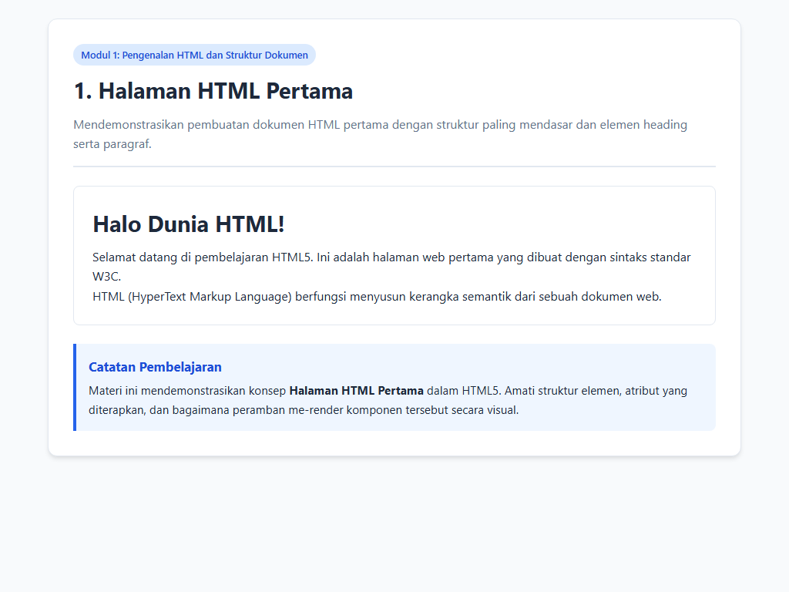

##### 2. HTML Document Structure

- **Source Code**: [`02_html_document_structure.html`](./module-01-pengenalan-html-dan-struktur-dokumen/02_html_document_structure.html)
- **Key Concept**: An HTML5 document structure consists of <!DOCTYPE html>, a root element <html>, a head element <head> for metadata, and a body element <body> for visual content.
- **Implementation**: The program demonstrates a multi-level visualization of how foundation elements nest together and function to build a complete web document.
- **Execution Output**:

  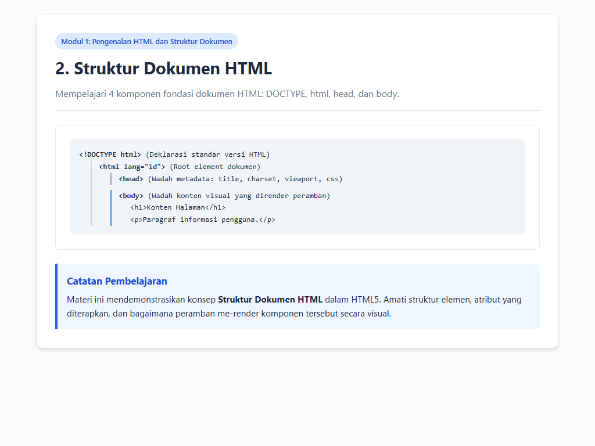

##### 3. DOCTYPE Declaration

- **Source Code**: [`03_doctype_declaration.html`](./module-01-pengenalan-html-dan-struktur-dokumen/03_doctype_declaration.html)
- **Key Concept**: DOCTYPE is not an HTML tag but rather a prologue of instructions for the browser engine to implement the standard HTML5 specification.
- **Implementation**: The source code explains the differences between modern HTML5 DOCTYPE syntax and previous versions of HTML and its implications for layout rendering.
- **Execution Output**:

  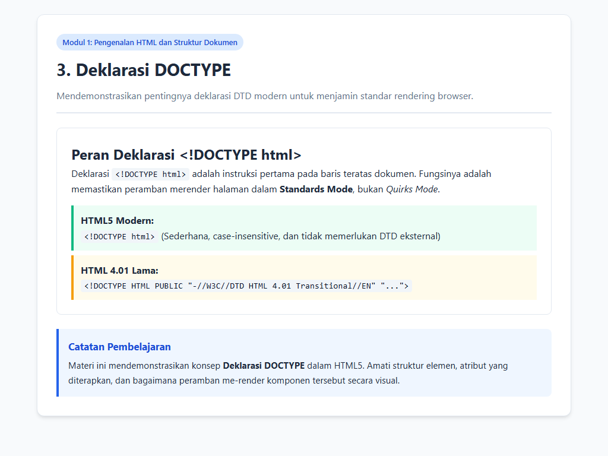

##### 4. HTML Elements

- **Source Code**: [`04_html_element.html`](./module-01-pengenalan-html-dan-struktur-dokumen/04_html_element.html)
- **Key Concept**: An element is a complete unit consisting of a start tag, body content and end tag.
- **Implementation**: The program demonstrates a color visualization of the anatomy of an HTML element so that beginners can see the start and end boundaries of an element.
- **Execution Output**:

  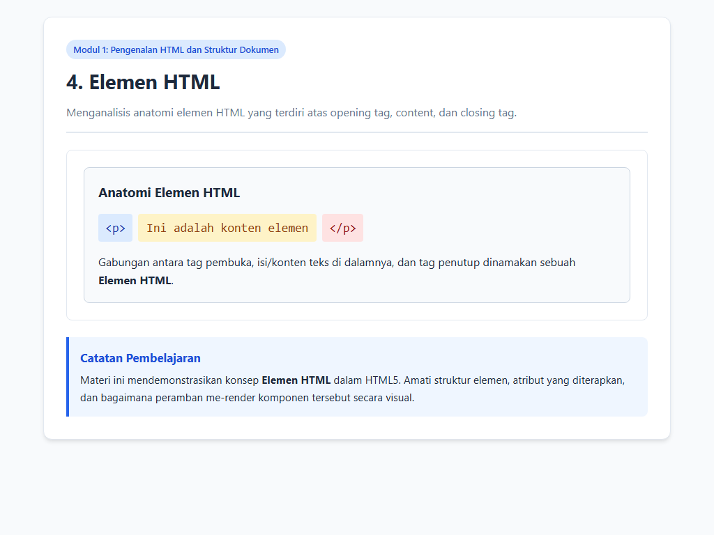

##### 5. HTML tags

- **Source Code**: [`05_html_tags.html`](./module-01-pengenalan-html-dan-struktur-dokumen/05_html_tags.html)
- **Key Concept**: Tags are markup tokens with angle brackets that provide instructions to the web browser's parser.
- **Implementation**: The file demonstrates the use of paired tags such as <h3>, <p>, and <strong> along with the closing rule with a slash.
- **Execution Output**:

  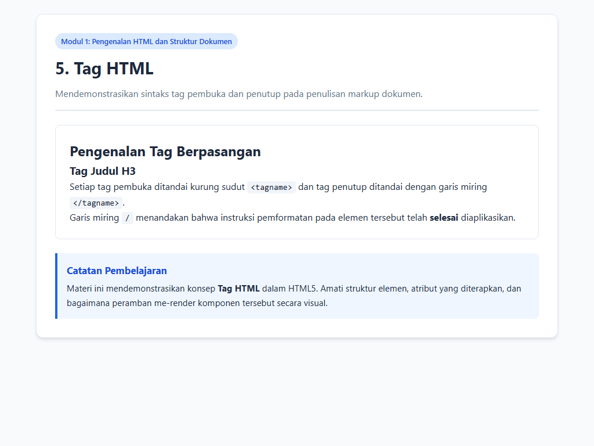

##### 6. HTML Attributes

- **Source Code**: [`06_html_attributes.html`](./module-01-pengenalan-html-dan-struktur-dokumen/06_html_attributes.html)
- **Key Concept**: Attributes are written in the start tag to add metadata, unique identifier (id), CSS class (class), or special configuration (href, title).
- **Implementation**: Displays a paragraph equipped with id, class, and title attributes (browser tooltip), as well as a link tag with the href attribute.
- **Execution Output**:

  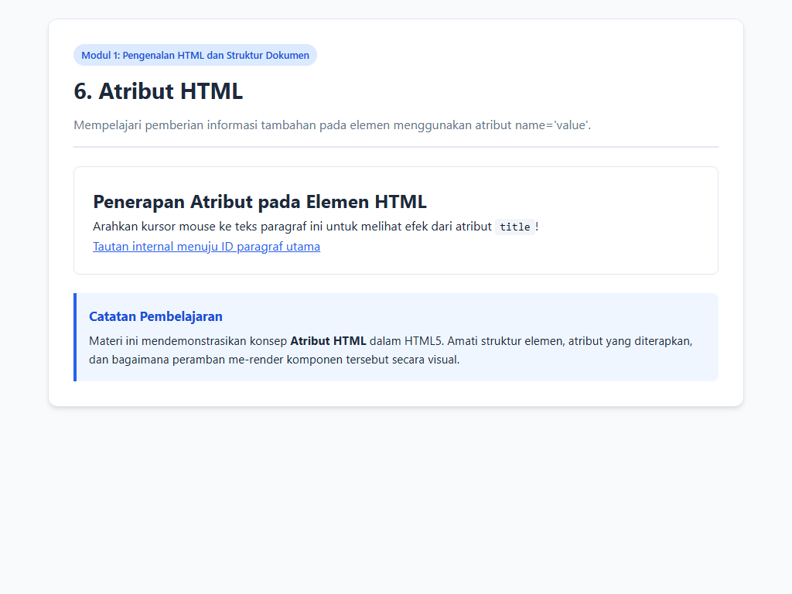

##### 7. Nested Elements

- **Source Code**: [`07_html_nesting.html`](./module-01-pengenalan-html-dan-struktur-dokumen/07_html_nesting.html)
- **Key Concept**: Elements that are opened last must be closed first (Last-In First-Out principle) to maintain the integrity of the DOM tree.
- **Implementation**: Demonstrate a contrast comparison between valid nesting patterns (green boxes) and prohibited invalid patterns (red boxes).
- **Execution Output**:

  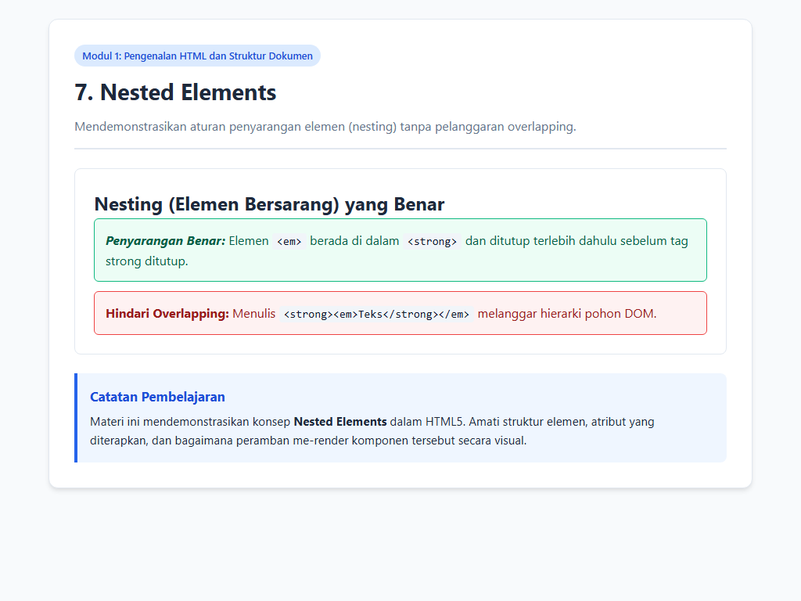

##### 8. HTML indentation

- **Source Code**: [`08_html_indentation.html`](./module-01-pengenalan-html-dan-struktur-dokumen/08_html_indentation.html)
- **Key Concept**: Although browsers ignore whitespace, indentation is essential for code maintenance by software engineers.
- **Implementation**: Shows an example of writing nested markup with standard nested indentation in a code block.
- **Execution Output**:

  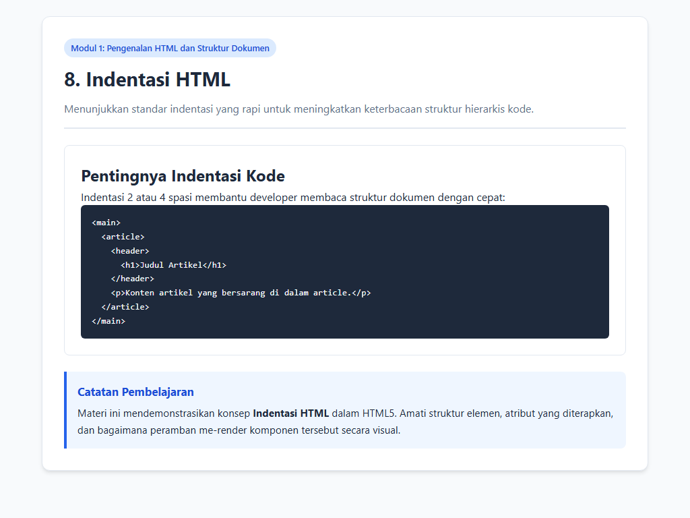

##### 9. HTML comments

- **Source Code**: [`09_html_comments.html`](./module-01-pengenalan-html-dan-struktur-dokumen/09_html_comments.html)
- **Key Concept**: Comments are ignored by the browser rendering parser but can be read in the source code for documentation.
- **Implementation**: The file demonstrates single-line and multi-line comments alongside active paragraph elements.
- **Execution Output**:

  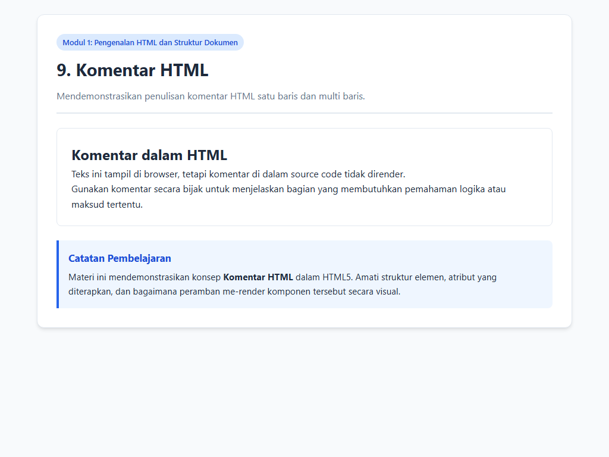

##### 10. HTML Entities

- **Source Code**: [`10_html_entities.html`](./module-01-pengenalan-html-dan-struktur-dokumen/10_html_entities.html)
- **Key Concept**: HTML entities are written in the format &name; or &#number; to represent prohibited characters or special symbols.
- **Implementation**: Displays a list of essential entities (<, >, &, ", ©,  ) and their visualization results.
- **Execution Output**:

  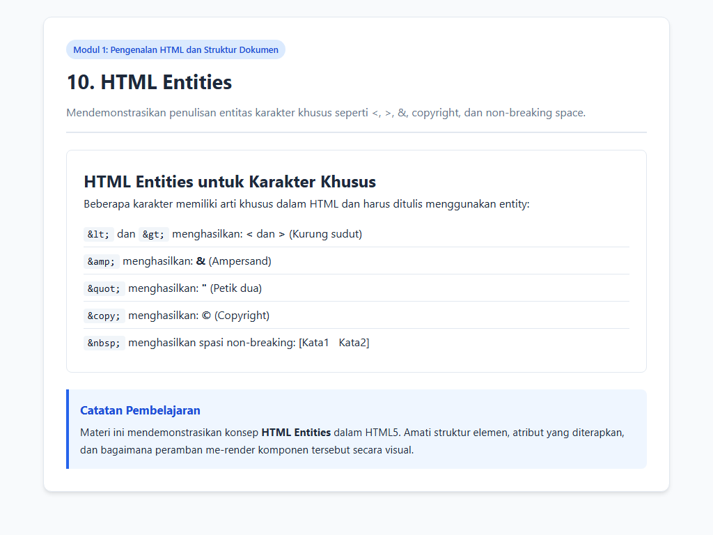

##### 11. Whitespace in HTML

- **Source Code**: [`11_html_whitespace.html`](./module-01-pengenalan-html-dan-struktur-dokumen/11_html_whitespace.html)
- **Key Concept**: Browsers automatically shrink rows of consecutive spaces to a single space, unless they are wrapped by a <pre> element.
- **Implementation**: Demonstrates the rendering difference between plain text with extra spacing and text in a <pre> element.
- **Execution Output**:

  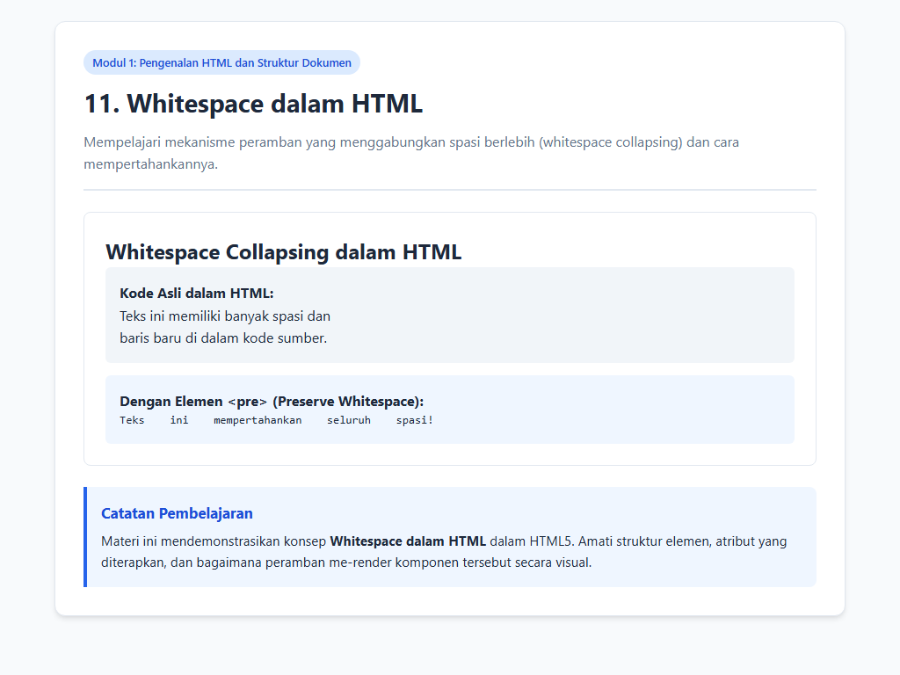

##### 12. Writing Tags and Attributes

- **Source Code**: [`12_html_case_sensitivity.html`](./module-01-pengenalan-html-dan-struktur-dokumen/12_html_case_sensitivity.html)
- **Key Concept**: HTML5 allows case-insensitive writing, but industry standards universally specify lowercase.
- **Implementation**: Explains HTML5 case tolerance rules as well as professional practice standards.
- **Execution Output**:

  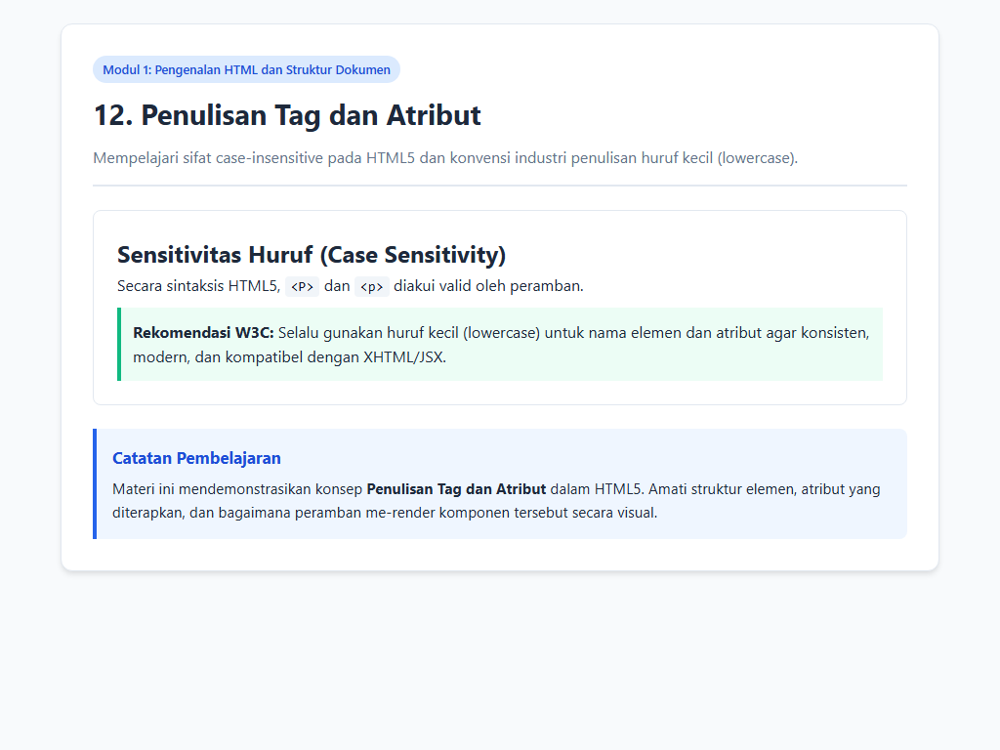

##### 13. Void Elements

- **Source Code**: [`13_html_void_elements.html`](./module-01-pengenalan-html-dan-struktur-dokumen/13_html_void_elements.html)
- **Key Concept**: A void element consists of only one initial tag with no text content or children in it.
- **Implementation**: The file demonstrates the <br> and <hr> elements in breaking up lines of text and visually separating content.
- **Execution Output**:

  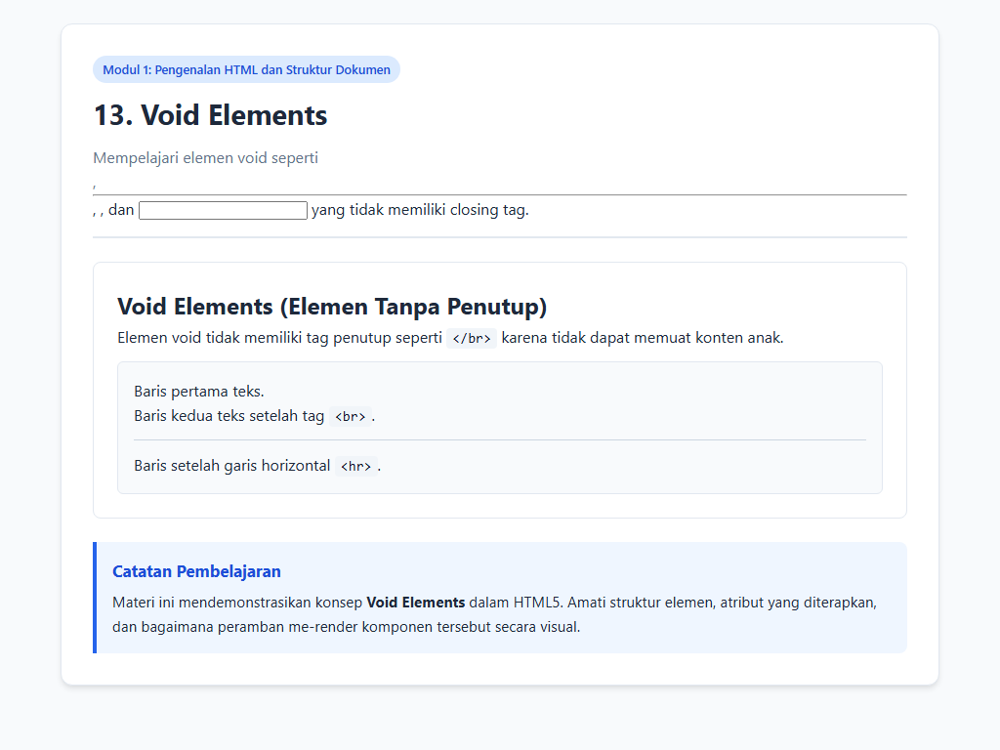

##### 14. Global Attributes

- **Source Code**: [`14_html_global_attributes.html`](./module-01-pengenalan-html-dan-struktur-dokumen/14_html_global_attributes.html)
- **Key Concept**: Global attributes are standard attributes that can be legally attached to any element in HTML5.
- **Implementation**: The program demonstrates the combination of id, class, title, style, and hidden attributes on container elements.
- **Execution Output**:

  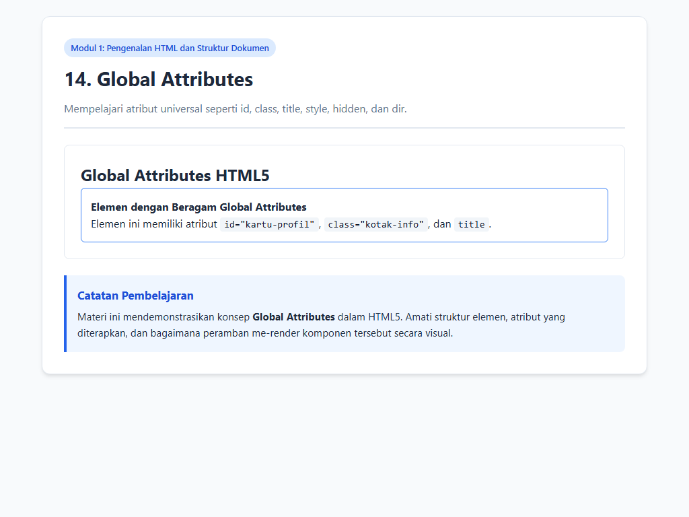

##### 15. Parent and Child Elements

- **Source Code**: [`15_html_parent_child_elements.html`](./module-01-pengenalan-html-dan-struktur-dokumen/15_html_parent_child_elements.html)
- **Key Concept**: Each element that encloses another element is called a parent, the elements within it are called children, and elements at the same level are called siblings.
- **Implementation**: Disjoint container visualization that clearly labels parent, child, and sibling roles.
- **Execution Output**:

  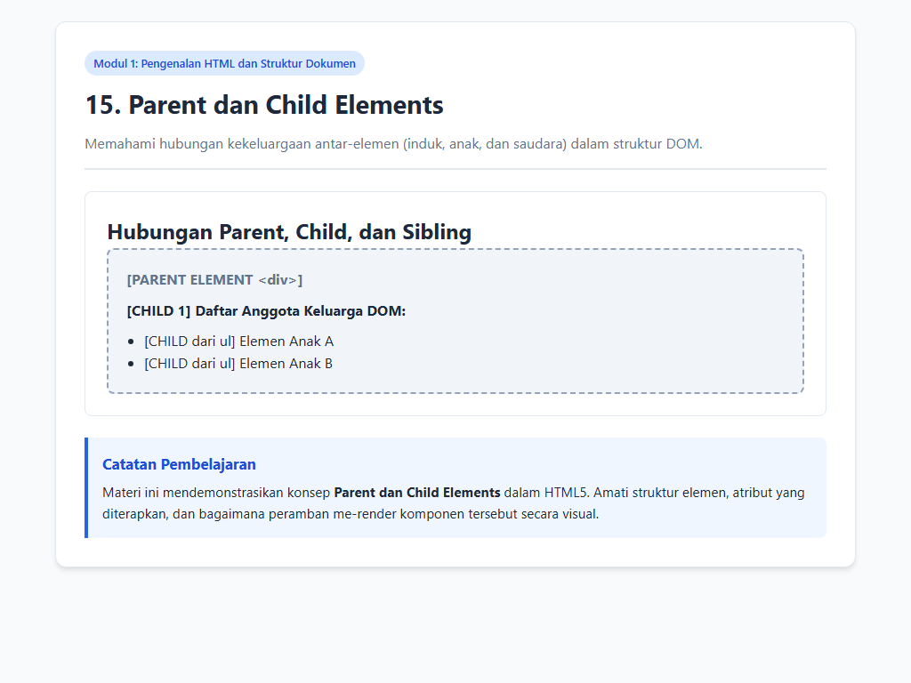

### Module 02: Headings, Text Formatting, and Typography

**Curriculum Path**: [`module-02-heading-teks-dan-pemformatan`](./module-02-heading-teks-dan-pemformatan) | **Level**: `Fundamental` | **Scope**: 20 Documents

#### Overview & Concepts Covered

Explores document heading hierarchies (`h1`–`h6`), paragraph structures, line breaks, horizontal dividers, semantic text formatting (`strong`, `em`, `mark`), quotes, and preformatted code blocks.

#### Subtopics & Visual Captures

##### 1. Heading Elements (h1 - h6)

- **Source Code**: [`16_heading_elements.html`](./module-02-heading-teks-dan-pemformatan/16_heading_elements.html)
- **Key Concept**: Headings form the outline of the page for search engines and screen readers.
- **Implementation**: Displays all heading levels from h1 to h6 in sequence with educational comments.
- **Execution Output**:

  

##### 2. Paragraph Elements

- **Source Code**: [`17_paragraph_element.html`](./module-02-heading-teks-dan-pemformatan/17_paragraph_element.html)
- **Key Concept**: The <p> element is a text-wrapping block-level element with a vertical dividing margin.
- **Implementation**: Presents two paragraphs automatically separated by browser margins.
- **Execution Output**:

  

##### 3. br element (Line Break)

- **Source Code**: [`18_line_break.html`](./module-02-heading-teks-dan-pemformatan/18_line_break.html)
- **Key Concept**: The <br> tag triggers a new line (line break) without adding margins between paragraphs, ideal for writing poetry or physical addresses.
- **Implementation**: Displays a multi-line mailing address format in one <p> element separated by a <br> tag.
- **Execution Output**:

  

##### 4. hr element (Horizontal Rule)

- **Source Code**: [`19_horizontal_rule.html`](./module-02-heading-teks-dan-pemformatan/19_horizontal_rule.html)
- **Key Concept**: The <hr> element represents a paragraph-level thematic break.
- **Implementation**: Demonstrates two pieces of content separated by a dividing horizontal line.
- **Execution Output**:

  

##### 5. Strong element

- **Source Code**: [`20_strong_element.html`](./module-02-heading-teks-dan-pemformatan/20_strong_element.html)
- **Key Concept**: The <strong> tag provides high semantic weight which translates as visual boldness and sound emphasis in screen readers.
- **Implementation**: Displays a security warning message with emphasis on the passphrase.
- **Execution Output**:

  

##### 6. Em element (Emphasis)

- **Source Code**: [`21_emphasis_element.html`](./module-02-heading-teks-dan-pemformatan/21_emphasis_element.html)
- **Key Concept**: The <em> tag changes the meaning of speech by stressing vowels that are rendered italic by default.
- **Implementation**: Displays a clarifying sentence with italic emphasis on the word 'not'.
- **Execution Output**:

  

##### 7. Element b (Bold Text)

- **Source Code**: [`22_bold_text.html`](./module-02-heading-teks-dan-pemformatan/22_bold_text.html)
- **Key Concept**: The <b> tag is used to attract typographic attention without implying higher importance.
- **Implementation**: Displays a sentence listing product colors with color words in pure bold.
- **Execution Output**:

  

##### 8. Element i (Italic Text)

- **Source Code**: [`23_italic_text.html`](./module-02-heading-teks-dan-pemformatan/23_italic_text.html)
- **Key Concept**: The <i> tag presents text in a different voice or mood, like the Latin term taxonomy.
- **Implementation**: Displays scientific Latin names and inner quotes in italics format.
- **Execution Output**:

  

##### 9. u element (Underline Text)

- **Source Code**: [`24_underline_text.html`](./module-02-heading-teks-dan-pemformatan/24_underline_text.html)
- **Key Concept**: The <u> tag provides underlining for writing annotations without link meaning.
- **Implementation**: Shows an example of marking typo words with a wavy underline.
- **Execution Output**:

  

##### 10. Mark element

- **Source Code**: [`25_mark_element.html`](./module-02-heading-teks-dan-pemformatan/25_mark_element.html)
- **Key Concept**: The <mark> tag renders a bright yellow background by default as a marker for relevant words.
- **Implementation**: Displays simulated search results with HTML5 keywords highlighted in yellow.
- **Execution Output**:

  

##### 11. Small elements

- **Source Code**: [`26_small_element.html`](./module-02-heading-teks-dan-pemformatan/26_small_element.html)
- **Key Concept**: The <small> element represents side comments and smaller text.
- **Implementation**: Displays the product price followed by the terms and conditions clause in smaller text size.
- **Execution Output**:

  

##### 12. Del element

- **Source Code**: [`27_deleted_text.html`](./module-02-heading-teks-dan-pemformatan/27_deleted_text.html)
- **Key Concept**: The <del> tag marks a range of text that has been removed from the document and rendered with a centered strikethrough.
- **Implementation**: Displays old price write-offs in promotional discount scenarios.
- **Execution Output**:

  

##### 13. ins element

- **Source Code**: [`28_inserted_text.html`](./module-02-heading-teks-dan-pemformatan/28_inserted_text.html)
- **Key Concept**: The <ins> element represents additions to document content and is rendered underlined by default.
- **Implementation**: Displays a revision of the document in which the old word is crossed out and a replacement word is inserted.
- **Execution Output**:

  

##### 14. Sub element (Subscript)

- **Source Code**: [`29_subscript_text.html`](./module-02-heading-teks-dan-pemformatan/29_subscript_text.html)
- **Key Concept**: The <sub> tag renders the text smaller with a lower baseline position.
- **Implementation**: Demonstrate writing the chemical formulas for H2O and CO2 with descending index numbers.
- **Execution Output**:

  

##### 15. Soup element (Superscript)

- **Source Code**: [`30_superscript_text.html`](./module-02-heading-teks-dan-pemformatan/30_superscript_text.html)
- **Key Concept**: The <sup> tag positions the text above the normal font baseline at reduced size.
- **Implementation**: Displays the Pythagorean quadratic equation and footnote numbers.
- **Execution Output**:

  

##### 16. Abbr element (Abbreviation)

- **Source Code**: [`31_abbreviation.html`](./module-02-heading-teks-dan-pemformatan/31_abbreviation.html)
- **Key Concept**: The <abbr> tag with the title attribute provides an explanation of the acronym expansion to users and machine readers.
- **Implementation**: Features W3C abbreviations, HTML, and CSS that can be hovered over to reveal a tooltip.
- **Execution Output**:

  

##### 17. Cite elements

- **Source Code**: [`32_citation_element.html`](./module-02-heading-teks-dan-pemformatan/32_citation_element.html)
- **Key Concept**: The <cite> element refers to the title of the artwork or publication (not the author's name) and is rendered in italics.
- **Implementation**: Displays references to book titles and film titles in sentences.
- **Execution Output**:

  

##### 18. q element (Inline Quote)

- **Source Code**: [`33_inline_quote.html`](./module-02-heading-teks-dan-pemformatan/33_inline_quote.html)
- **Key Concept**: The <q> element inserts automatic quotation marks around text without the need to manually type quotation symbols.
- **Implementation**: Displays quotes from famous figures where the quotation marks are generated automatically by the browser.
- **Execution Output**:

  

##### 19. Blockquote element

- **Source Code**: [`34_blockquote_element.html`](./module-02-heading-teks-dan-pemformatan/34_blockquote_element.html)
- **Key Concept**: Blockquote isolates long quoted text with indentation and provides a cite attribute for the source URL.
- **Implementation**: Features Tim Berners-Lee's inspirational quote with left vertical border and source description.
- **Execution Output**:

  

##### 20. Pre and code elements

- **Source Code**: [`35_preformatted_text.html`](./module-02-heading-teks-dan-pemformatan/35_preformatted_text.html)
- **Key Concept**: The <pre> element retains whitespace and newlines exactly as it was, while <code> marks the semantics of the computer code.
- **Implementation**: Displays neatly formatted JavaScript functions with monospaced fonts in a dark box.
- **Execution Output**:

  

### Module 03: Hyperlinks and Navigation

**Curriculum Path**: [`module-03-hyperlink-dan-navigasi`](./module-03-hyperlink-dan-navigasi) | **Level**: `Fundamental` | **Scope**: 15 Documents

#### Overview & Concepts Covered

Examines anchor elements (`a`), relative and absolute URL resolution, internal fragment navigation, protocol schemes (`mailto:`, `tel:`), navigation landmarks (`nav`), and accessible links.

#### Subtopics & Visual Captures

##### 1. Hyperlinks Using a

- **Source Code**: [`36_basic_hyperlink.html`](./module-03-hyperlink-dan-navigasi/36_basic_hyperlink.html)
- **Key Concept**: The <a> element with the href (hypertext reference) attribute defines the navigation target when the text is clicked.
- **Implementation**: Displays hyperlinks to the MDN documentation portal with the link's distinctive blue color styling.
- **Execution Output**:

  

##### 2. Absolute URL

- **Source Code**: [`37_absolute_url.html`](./module-03-hyperlink-dan-navigasi/37_absolute_url.html)
- **Key Concept**: Absolute URL represents the absolute location of a file throughout the global network of the World Wide Web.
- **Implementation**: Displays a list of external links with the https:// protocol scheme and domain hostname.
- **Execution Output**:

  

##### 3. Relative URLs

- **Source Code**: [`38_relative_url.html`](./module-03-hyperlink-dan-navigasi/38_relative_url.html)
- **Key Concept**: Relative URL refers to the location of the file relative to the location of the HTML document that is being opened at that time.
- **Implementation**: Explains the pattern of writing paths at level, subfolders, and parent folders (..) along with local test links.
- **Execution Output**:

  

##### 4. Internal Page Links

- **Source Code**: [`39_internal_link.html`](./module-03-hyperlink-dan-navigasi/39_internal_link.html)
- **Key Concept**: Internal links facilitate integrated browsing between documents belonging to the same website.
- **Implementation**: Features a simple navigation bar with internal links to related modules.
- **Execution Output**:

  

##### 5. External Links

- **Source Code**: [`40_external_link.html`](./module-03-hyperlink-dan-navigasi/40_external_link.html)
- **Key Concept**: External links direct the browser away from the site's current origin to a new origin.
- **Implementation**: Displays external reference cards towards WHATWG consortium standards.
- **Execution Output**:

  

##### 6. Target attribute

- **Source Code**: [`41_link_target.html`](./module-03-hyperlink-dan-navigasi/41_link_target.html)
- **Key Concept**: The target attribute determines the browsing context in which the linked document will be displayed.
- **Implementation**: Returns a comprehensive list of target attribute values ​​along with an explanation of their respective behavior.
- **Execution Output**:

  

##### 7. Rails attribute

- **Source Code**: [`42_link_rel.html`](./module-03-hyperlink-dan-navigasi/42_link_rel.html)
- **Key Concept**: The rel attribute guarantees the security and performance of the application when opening links in new tabs.
- **Implementation**: Shows a demonstration of a secure link with the rel='noopener noreferrer' attribute.
- **Execution Output**:

  

##### 8. Link Using mailto:

- **Source Code**: [`43_email_link.html`](./module-03-hyperlink-dan-navigasi/43_email_link.html)
- **Key Concept**: mailto URL protocol: automatically opens the default email application with the recipient address and subject filled in.
- **Implementation**: Displays a contact button that triggers an email client with encoded subject and body parameters.
- **Execution Output**:

  

##### 9. Link Using tel:

- **Source Code**: [`44_telephone_link.html`](./module-03-hyperlink-dan-navigasi/44_telephone_link.html)
- **Key Concept**: The tel: URL scheme allows smartphone users to initiate direct voice calls with just one click.
- **Implementation**: Displays a green button labeled with a telephone number with the internationally standardized tel: protocol.
- **Execution Output**:

  

##### 10. Download attribute

- **Source Code**: [`45_download_link.html`](./module-03-hyperlink-dan-navigasi/45_download_link.html)
- **Key Concept**: The download attribute instructs the browser to save the resource to local disk.
- **Implementation**: Displays a curriculum document download button with a specific downloaded file name.
- **Execution Output**:

  

##### 11. Anchor Navigation

- **Source Code**: [`46_anchor_navigation.html`](./module-03-hyperlink-dan-navigasi/46_anchor_navigation.html)
- **Key Concept**: The link href='#id' matches the id of the destination element and scrolls the viewport directly to that element.
- **Implementation**: Presents a quick navigation menu to 3 different chapters on the same page.
- **Execution Output**:

  

##### 12. Navigation Between HTML Documents

- **Source Code**: [`47_page_navigation.html`](./module-03-hyperlink-dan-navigasi/47_page_navigation.html)
- **Key Concept**: A collection of individual web pages is united by the consistency of a global navigation bar.
- **Implementation**: Features a professional dark navbar with the site's main page items.
- **Execution Output**:

  

##### 13. Nav element

- **Source Code**: [`48_navigation_element.html`](./module-03-hyperlink-dan-navigasi/48_navigation_element.html)
- **Key Concept**: The <nav> element is specifically intended for blocks containing a collection of the document's main navigation links.
- **Implementation**: Displays a semantic nav structure that wraps an ul/li list containing important site links.
- **Execution Output**:

  

##### 14. Breadcrumb Navigation Structure

- **Source Code**: [`49_breadcrumb_navigation.html`](./module-03-hyperlink-dan-navigasi/49_breadcrumb_navigation.html)
- **Key Concept**: Breadcrumbs help users understand the current depth position of a page in the site structure.
- **Implementation**: Displays a three-level breadcrumb from Home to the active page with a slash separator.
- **Execution Output**:

  

##### 15. Hyperlink Accessibility

- **Source Code**: [`50_link_accessibility.html`](./module-03-hyperlink-dan-navigasi/50_link_accessibility.html)
- **Key Concept**: Screen readers read links in isolation; The link text should stand alone explaining the purpose without the phrase 'click here'.
- **Implementation**: Presents a direct comparison between ambiguous anchor text and professional descriptive anchor text.
- **Execution Output**:

  

### Module 04: Lists and Content Grouping

**Curriculum Path**: [`module-04-list-dan-pengelompokan-konten`](./module-04-list-dan-pengelompokan-konten) | **Level**: `Fundamental` | **Scope**: 12 Documents

#### Overview & Concepts Covered

Covers unordered (`ul`), ordered (`ol`), and description lists (`dl`), item value configuration, list numbering reversal, nested hierarchy structures, and navigation lists.

#### Subtopics & Visual Captures

##### 1. Unordered List

- **Source Code**: [`51_unordered_list.html`](./module-04-list-dan-pengelompokan-konten/51_unordered_list.html)
- **Key Concept**: The <ul> element groups items whose order does not affect the meaning of the material.
- **Implementation**: Displays a list of frontend skills with the browser's built-in round bullet symbol.
- **Execution Output**:

  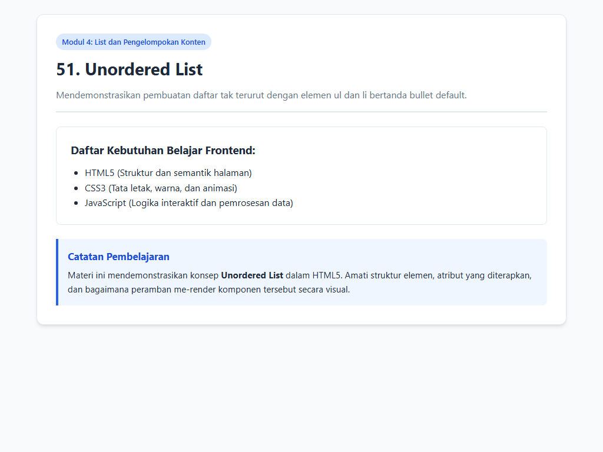

##### 2. Ordered List

- **Source Code**: [`52_ordered_list.html`](./module-04-list-dan-pengelompokan-konten/52_ordered_list.html)
- **Key Concept**: The <ol> element renders ascending order numbers automatically on each <li> child element.
- **Implementation**: Displays three stages of project installation with automatic sequence numbers.
- **Execution Output**:

  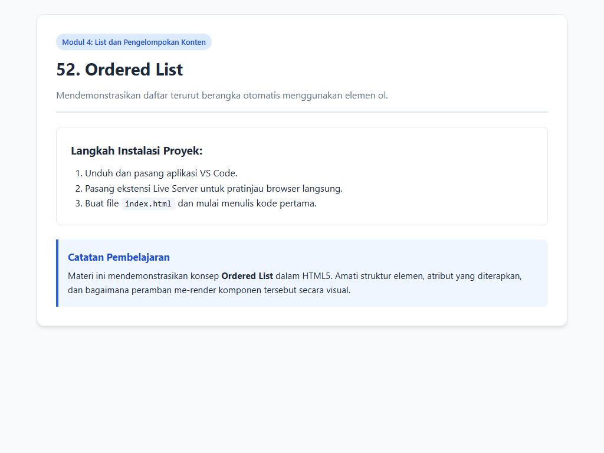

##### 3. Li element

- **Source Code**: [`53_list_item.html`](./module-04-list-dan-pengelompokan-konten/53_list_item.html)
- **Key Concept**: The <li> element functions as a multipurpose container that can accommodate text, links, images, and even other lists.
- **Implementation**: Displays various types of content in list items: text, inline formatting, and div containers.
- **Execution Output**:

  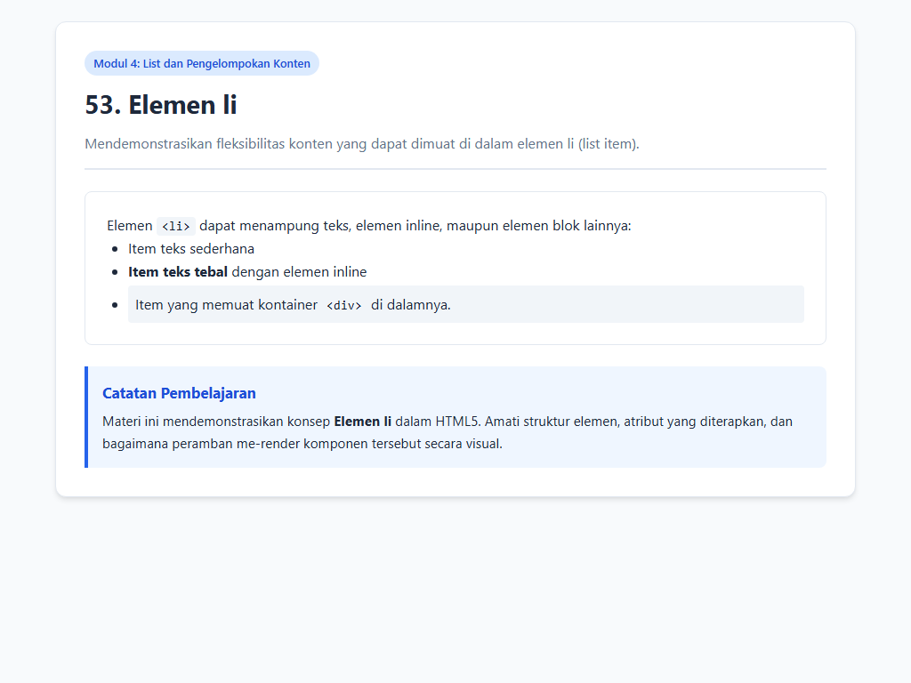

##### 4. Nested Lists

- **Source Code**: [`54_nested_list.html`](./module-04-list-dan-pengelompokan-konten/54_nested_list.html)
- **Key Concept**: Nested lists should be placed within the parent <li> tag, not directly between two <li>s.
- **Implementation**: Features a multilevel curriculum with bulleted sub-lists and numbered sub-lists under the main.
- **Execution Output**:

  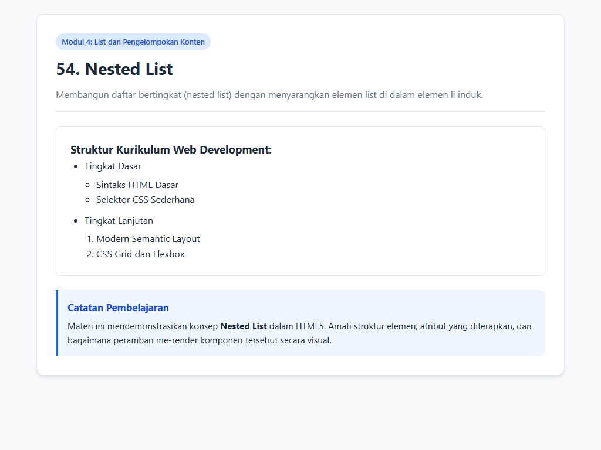

##### 5. start attribute

- **Source Code**: [`55_start_attribute.html`](./module-04-list-dan-pengelompokan-konten/55_start_attribute.html)
- **Key Concept**: The start attribute accepts an integer value to change the starting point of the automatic numbering enumeration.
- **Implementation**: Displays a ranking list of participants starting directly from number 6.
- **Execution Output**:

  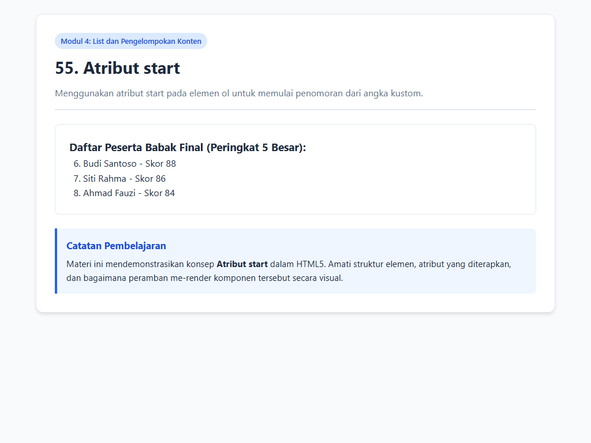

##### 6. Reversed attribute

- **Source Code**: [`56_reversed_list.html`](./module-04-list-dan-pengelompokan-konten/56_reversed_list.html)
- **Key Concept**: The boolean reversed attribute reverses the ordinal numbers from the total number of items up to 1.
- **Implementation**: Shows a three-phase countdown simulation of a spacecraft launch.
- **Execution Output**:

  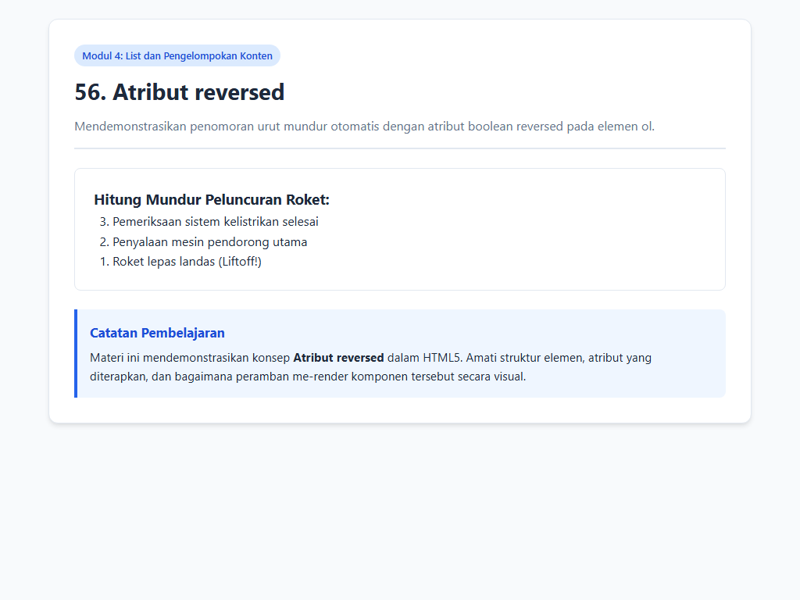

##### 7. Value attribute on List Item

- **Source Code**: [`57_list_value.html`](./module-04-list-dan-pengelompokan-konten/57_list_value.html)
- **Key Concept**: The value attribute in <li> forces the item's sequence number to jump to the specified number.
- **Implementation**: Displays a list of articles that jump from number 2 directly to number 10 and continues to 11.
- **Execution Output**:

  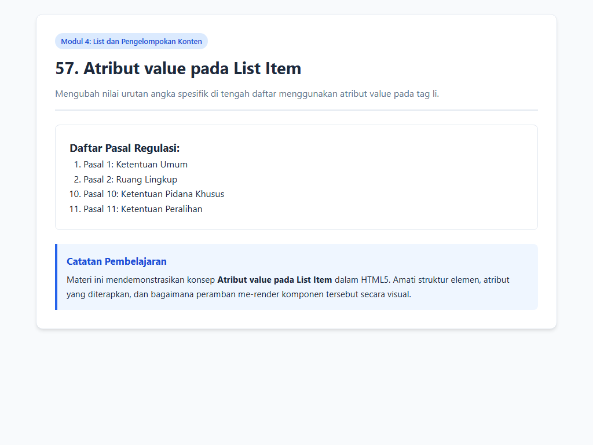

##### 8. Description List (dl)

- **Source Code**: [`58_description_list.html`](./module-04-list-dan-pengelompokan-konten/58_description_list.html)
- **Key Concept**: The <dl> element encloses a name-value pair or term and its definition.
- **Implementation**: Displays a glossary of API and DOM technical terms with a typical description list layout.
- **Execution Output**:

  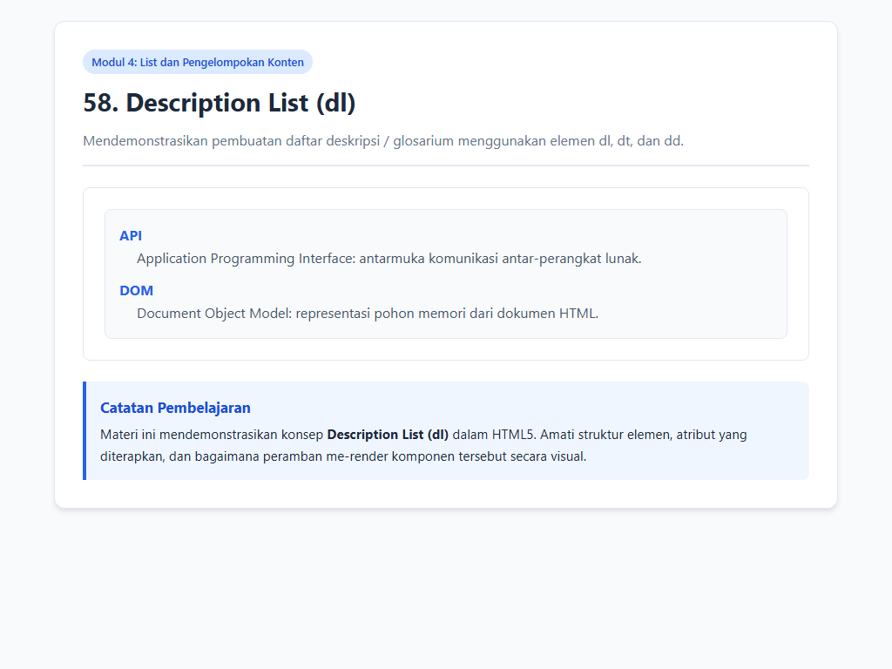

##### 9. Element dt

- **Source Code**: [`59_description_term.html`](./module-04-list-dan-pengelompokan-konten/59_description_term.html)
- **Key Concept**: The <dt> tag acts as the subject or key in a list of key-value relationships.
- **Implementation**: Presents two technical terms 'Programming Language' and 'Markup Language' using dt element.
- **Execution Output**:

  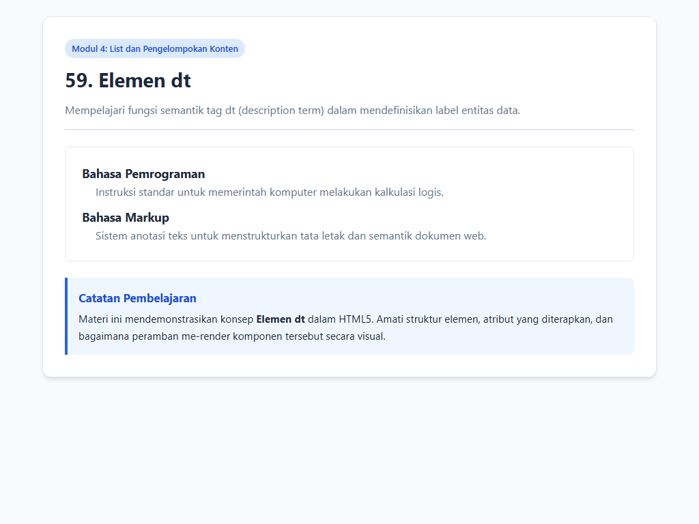

##### 10. Element dd

- **Source Code**: [`60_description_details.html`](./module-04-list-dan-pengelompokan-konten/60_description_details.html)
- **Key Concept**: One <dt> is allowed to have more than one <dd> to specify different aspects of the term.
- **Implementation**: Displays the term 'Arabica Coffee' accompanied by two separate descriptive details.
- **Execution Output**:

  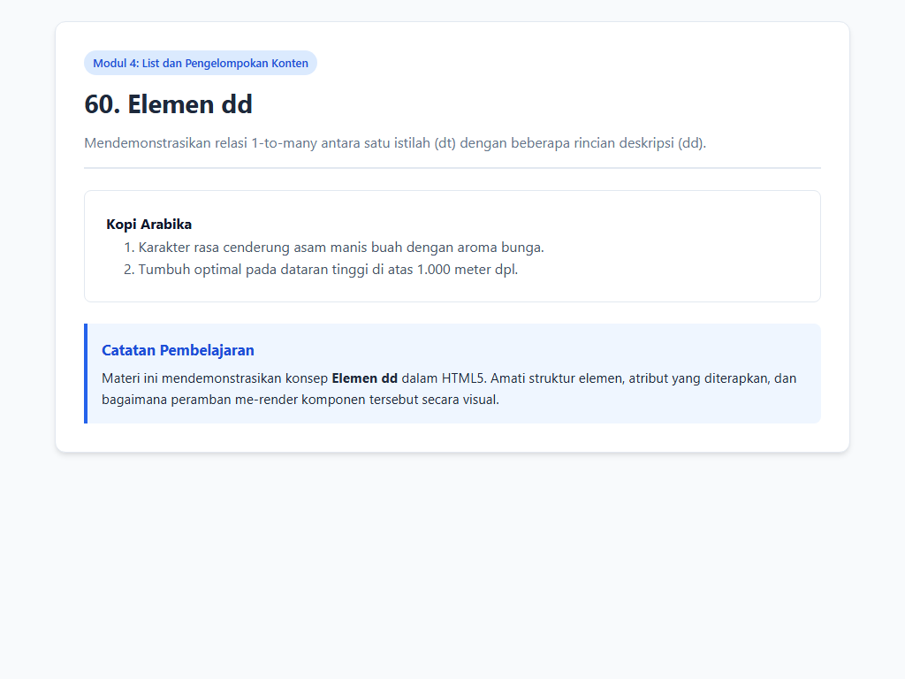

##### 11. Combination of Various List Types

- **Source Code**: [`61_mixed_list.html`](./module-04-list-dan-pengelompokan-konten/61_mixed_list.html)
- **Key Concept**: The right combination of list types produces a very organized visualization of the information hierarchy.
- **Implementation**: Presents an integrated curriculum plan that combines bullet lists, numbered lists, and definition lists.
- **Execution Output**:

  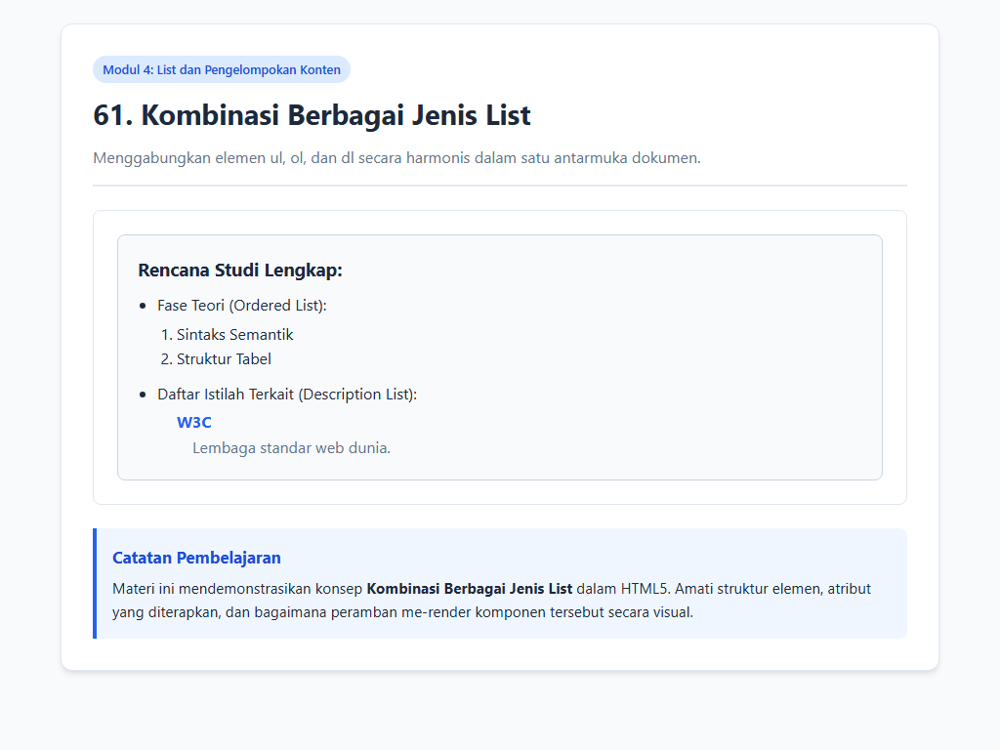

##### 12. List for Navigation

- **Source Code**: [`62_navigation_list.html`](./module-04-list-dan-pengelompokan-konten/62_navigation_list.html)
- **Key Concept**: Screen readers can announce the number of menu links to visually impaired users if the navbar is created from a list.
- **Implementation**: Displays a modern horizontal menu bar based on the ul/li list with a blue active button.
- **Execution Output**:

  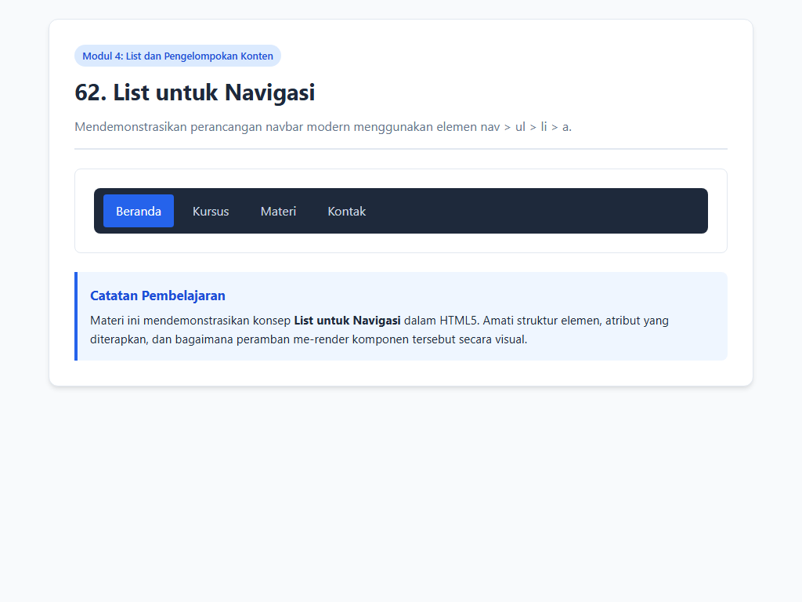

### Module 05: Images and Visual Media

**Curriculum Path**: [`module-05-gambar-dan-visual`](./module-05-gambar-dan-visual) | **Level**: `Fundamental to Intermediate` | **Scope**: 18 Documents

#### Overview & Concepts Covered

Covers image embedding (`img`), accessible `alt` text, dimensions, figure captions (`figure`/`figcaption`), responsive images (`picture`, `srcset`, `sizes`), lazy loading, and image maps.

#### Subtopics & Visual Captures

##### 1. Displaying Images with img

- **Source Code**: [`63_basic_image.html`](./module-05-gambar-dan-visual/63_basic_image.html)
- **Key Concept**: The  element is a replaced element that downloads and renders external image files.
- **Implementation**: Displays local vector image files with src and alt attributes.
- **Execution Output**:

  

##### 2. src attribute

- **Source Code**: [`64_image_src.html`](./module-05-gambar-dan-visual/64_image_src.html)
- **Key Concept**: The src attribute is required on the img element to tell the browser the location of the image file.
- **Implementation**: Demonstrates loading images from local paths and direct URI data.
- **Execution Output**:

  

##### 3. Alt attribute

- **Source Code**: [`65_image_alt.html`](./module-05-gambar-dan-visual/65_image_alt.html)
- **Key Concept**: The alt attribute provides a text description for visually impaired users and displays if the image fails to download.
- **Implementation**: Shows a comparison of the active image and simulates alt text replacement when the image is corrupted.
- **Execution Output**:

  

##### 4. Width and height attributes

- **Source Code**: [`66_image_dimensions.html`](./module-05-gambar-dan-visual/66_image_dimensions.html)
- **Key Concept**: Providing intrinsic dimensions allows the browser to calculate the aspect ratio before the image file has finished downloading.
- **Implementation**: Displays images with dimension specifications width=360 and height=180.
- **Execution Output**:

  

##### 5. The title attribute in Figure

- **Source Code**: [`67_image_title.html`](./module-05-gambar-dan-visual/67_image_title.html)
- **Key Concept**: The title attribute displays a browser tooltip bubble when the cursor is hovered over the element.
- **Implementation**: Displays images that have an interactive title attribute for desktop readers.
- **Execution Output**:

  

##### 6. Image Path

- **Source Code**: [`68_image_paths.html`](./module-05-gambar-dan-visual/68_image_paths.html)
- **Key Concept**: Understanding the file path is crucial so that the image does not experience a 404 Not Found error.
- **Implementation**: Explains the pattern of writing path levels, subfolders, parent folders, and absolute URLs with examples of active images.
- **Execution Output**:

  

##### 7. Use of Image Formats

- **Source Code**: [`69_image_formats.html`](./module-05-gambar-dan-visual/69_image_formats.html)
- **Key Concept**: Each format has different compression and algorithms (raster vs vector, lossy vs lossless).
- **Implementation**: Presents a technical comparison table between modern web image formats.
- **Execution Output**:

  

##### 8. Figure elements

- **Source Code**: [`70_figure_element.html`](./module-05-gambar-dan-visual/70_figure_element.html)
- **Key Concept**: The <figure> element encloses a stand-alone visual unit and is usually referenced in the main text.
- **Implementation**: Displays an illustration image neatly isolated inside the figure element box.
- **Execution Output**:

  

##### 9. Figcaption elements

- **Source Code**: [`71_figcaption_element.html`](./module-05-gambar-dan-visual/71_figcaption_element.html)
- **Key Concept**: The <figcaption> tag associates caption text with its visual content for screen reader technology.
- **Implementation**: Displays an image in a figure with captions centered at the bottom.
- **Execution Output**:

  

##### 10. Responsive Images

- **Source Code**: [`72_responsive_images.html`](./module-05-gambar-dan-visual/72_responsive_images.html)
- **Key Concept**: Implementing max-width: 100% and height: auto prevents images from overflowing beyond the borders of the phone screen.
- **Implementation**: Displays the image inside a dotted container that adjusts the width automatically.
- **Execution Output**:

  

##### 11. Picture elements

- **Source Code**: [`73_picture_element.html`](./module-05-gambar-dan-visual/73_picture_element.html)
- **Key Concept**: The <picture> element evaluates media queries in the <source> tag before deciding which image file to download.
- **Implementation**: Demonstrates multi-source picture tags for desktop, tablet, and mobile breakpoints.
- **Execution Output**:

  

##### 12. Source element for Image

- **Source Code**: [`74_source_element.html`](./module-05-gambar-dan-visual/74_source_element.html)
- **Key Concept**: The browser will skip formats it doesn't recognize and choose the first supported format.
- **Implementation**: Displays a picture structure with several sources of different MIME types to the fallback img.
- **Execution Output**:

  

##### 13. srcset attribute

- **Source Code**: [`75_srcset_attribute.html`](./module-05-gambar-dan-visual/75_srcset_attribute.html)
- **Key Concept**: The srcset attribute tells the browser the available physical screen resolution options.
- **Implementation**: Returns an image with the srcset attribute descriptor 1x and 2x pixel density.
- **Execution Output**:

  

##### 14. The sizes attribute

- **Source Code**: [`76_sizes_attribute.html`](./module-05-gambar-dan-visual/76_sizes_attribute.html)
- **Key Concept**: The sizes attribute maps the viewport condition to the estimated percentage width of the image slot.
- **Implementation**: Displays responsive images with wide descriptor configurations of 300w, 500w, 800w and sizes 100vw/50vw.
- **Execution Output**:

  

##### 15. Loading attribute

- **Source Code**: [`77_image_loading.html`](./module-05-gambar-dan-visual/77_image_loading.html)
- **Key Concept**: The value loading='lazy' suspends network requests for images that have not yet entered the viewport.
- **Implementation**: Shows the application of the loading='lazy' attribute to full-dimensional img elements.
- **Execution Output**:

  

##### 16. Decoding attribute

- **Source Code**: [`78_image_decoding.html`](./module-05-gambar-dan-visual/78_image_decoding.html)
- **Key Concept**: The decoding='async' attribute moves the image rasterization process off the main CPU thread.
- **Implementation**: Displays images with asynchronous decoding configuration for optimal frame rate performance.
- **Execution Output**:

  

##### 17. Image Maps

- **Source Code**: [`79_image_maps.html`](./module-05-gambar-dan-visual/79_image_maps.html)
- **Key Concept**: The usemap attribute links the image to the definition of interactive coordinates on the map element.
- **Implementation**: Displays images that have square and circle click areas with separate navigation targets.
- **Execution Output**:

  

##### 18. Image Map Area and Coordinates

- **Source Code**: [`80_image_map_coordinates.html`](./module-05-gambar-dan-visual/80_image_map_coordinates.html)
- **Key Concept**: The coordinate system originates from the pixel (0,0) in the upper left corner of the source image.
- **Implementation**: Presents a comprehensive guide to mathematical formulas for determining rect, circle and poly coordinates.
- **Execution Output**:

  

### Module 06: HTML Tables and Data Representation

**Curriculum Path**: [`module-06-tabel-html`](./module-06-tabel-html) | **Level**: `Intermediate` | **Scope**: 15 Documents

#### Overview & Concepts Covered

Covers structured tabular data, rows, headers, data cells, captions, semantic sections (`thead`, `tbody`, `tfoot`), column spans, row spans, column groups, and accessible header scopes.

#### Subtopics & Visual Captures

##### 1. Basic Table

- **Source Code**: [`81_basic_table.html`](./module-06-tabel-html/81_basic_table.html)
- **Key Concept**: HTML tables are arranged row by row using <tr> elements that hold <td> cells.
- **Implementation**: Displays a data table of at least 2 rows x 2 columns with a connected border.
- **Execution Output**:

  

##### 2. tr element (Table Row)

- **Source Code**: [`82_table_row.html`](./module-06-tabel-html/82_table_row.html)
- **Key Concept**: Each row of table data must be wrapped in a <tr> element before being filled in by <th> or <td>.
- **Implementation**: Displays two tr rows with a different background color of the first row.
- **Execution Output**:

  

##### 3. th element (Table Header)

- **Source Code**: [`83_table_header.html`](./module-06-tabel-html/83_table_header.html)
- **Key Concept**: The <th> element provides label semantics that bind the underlying columns or rows of data.
- **Implementation**: Displays a table of team members with the three th cells in the top row.
- **Execution Output**:

  

##### 4. td element (Table Data)

- **Source Code**: [`84_table_data.html`](./module-06-tabel-html/84_table_data.html)
- **Key Concept**: The <td> element holds the actual data from the table record and is rendered left-aligned by default.
- **Implementation**: Displays store inventory product data rows using cell td.
- **Execution Output**:

  

##### 5. Caption elements

- **Source Code**: [`85_table_caption.html`](./module-06-tabel-html/85_table_caption.html)
- **Key Concept**: The <caption> tag is placed right after the opening <table> tag to announce the purpose of the table to the user.
- **Implementation**: Displays a summary table of exam scores complete with caption text at the top.
- **Execution Output**:

  

##### 6. Thead element

- **Source Code**: [`86_table_head.html`](./module-06-tabel-html/86_table_head.html)
- **Key Concept**: The <thead> element differentiates header rows from data rows when a document is printed multiple times on separate pages.
- **Implementation**: Displays a transaction table with a visually appealing blue head block.
- **Execution Output**:

  

##### 7. tbody element

- **Source Code**: [`87_table_body.html`](./module-06-tabel-html/87_table_body.html)
- **Key Concept**: The browser automatically inserts <tbody> if the coder did not write it explicitly.
- **Implementation**: Displays a table of city and province names neatly arranged in the tbody element.
- **Execution Output**:

  

##### 8. tfoot element

- **Source Code**: [`88_table_footer.html`](./module-06-tabel-html/88_table_footer.html)
- **Key Concept**: The <tfoot> element encapsulates the table data and remains displayed at the bottom of the table.
- **Implementation**: Displays shopping order details with a total summary row in the tfoot section.
- **Execution Output**:

  

##### 9. colspan attribute

- **Source Code**: [`89_table_colspan.html`](./module-06-tabel-html/89_table_colspan.html)
- **Key Concept**: The colspan attribute accepts an integer that states how wide the combined columns are.
- **Implementation**: Displays a yellow contact cell that stretches across two columns horizontally.
- **Execution Output**:

  

##### 10. rowspan attribute

- **Source Code**: [`90_table_rowspan.html`](./module-06-tabel-html/90_table_rowspan.html)
- **Key Concept**: The rowspan attribute makes cells extend downward across a number of rows of data.
- **Implementation**: Displays a light blue IT Department cell that combines two rows of team members together.
- **Execution Output**:

  

##### 11. Colgroup elements

- **Source Code**: [`91_table_colgroup.html`](./module-06-tabel-html/91_table_colgroup.html)
- **Key Concept**: The <colgroup> element groups one or more columns together to make width and styling easier.
- **Implementation**: Displays a table whose width is set proportionally (15%, 50%, 35%) via colgroup.
- **Execution Output**:

  

##### 12. Element col

- **Source Code**: [`92_table_column.html`](./module-06-tabel-html/92_table_column.html)
- **Key Concept**: The <col> tag represents one or more columns in a colgroup.
- **Implementation**: Displays a table with the first column gray and the next two columns white via span='2'.
- **Execution Output**:

  

##### 13. Scope attribute

- **Source Code**: [`93_table_scope.html`](./module-06-tabel-html/93_table_scope.html)
- **Key Concept**: The scope attribute associates th cells with data cells in a direction (vertical column or horizontal row).
- **Implementation**: Displays a table with th scope='col' in the header and th scope='row' in the staff name cell.
- **Execution Output**:

  

##### 14. Headers attribute

- **Source Code**: [`94_table_headers.html`](./module-06-tabel-html/94_table_headers.html)
- **Key Concept**: When a table has multiple nested headers, the screen reader uses the headers attribute to assemble the context.
- **Implementation**: Displays a multilevel quarterly financial report table with ID and headers attribute mapping.
- **Execution Output**:

  

##### 15. Accessible Data Table

- **Source Code**: [`95_accessible_data_table.html`](./module-06-tabel-html/95_accessible_data_table.html)
- **Key Concept**: Professional tables combine full semantics with an overflow-x:auto wrapper to prevent broken layouts.
- **Implementation**: Displays a standard wage table with an elegant design with a dark header and green status.
- **Execution Output**:

  

### Module 07: Forms and Basic Input Controls

**Curriculum Path**: [`module-07-formulir-dan-input-dasar`](./module-07-formulir-dan-input-dasar) | **Level**: `Intermediate` | **Scope**: 30 Documents

#### Overview & Concepts Covered

Covers HTML form mechanisms, GET and POST transmission methods, 20+ specialized input types (text, password, email, date, color, file, range, checkboxes, radio), buttons, select menus, and textareas.

#### Subtopics & Visual Captures

##### 1. Basic Form

- **Source Code**: [`96_basic_form.html`](./module-07-formulir-dan-input-dasar/96_basic_form.html)
- **Key Concept**: The <form> element coordinates the delivery of user data to the server.
- **Implementation**: Displays a text input form with a blue submit button.
- **Execution Output**:

  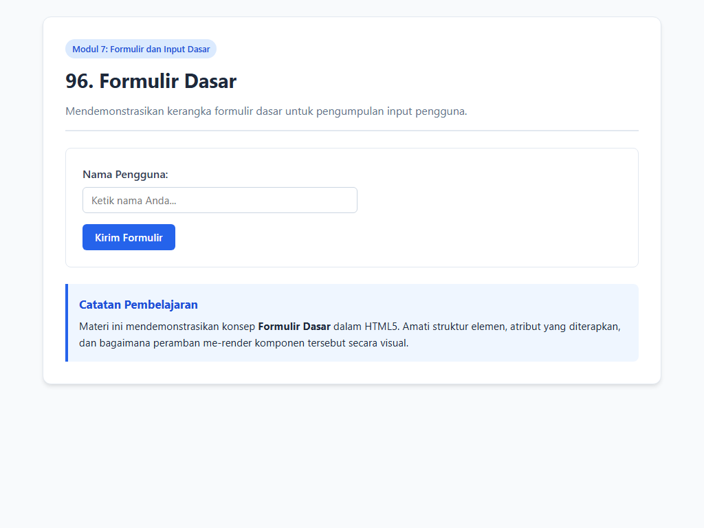

##### 2. Action attribute

- **Source Code**: [`97_form_action.html`](./module-07-formulir-dan-input-dasar/97_form_action.html)
- **Key Concept**: The action attribute contains the URI to which the browser sends the form payload.
- **Implementation**: Returns a registration form targeting the /api/v1/registration endpoint.
- **Execution Output**:

  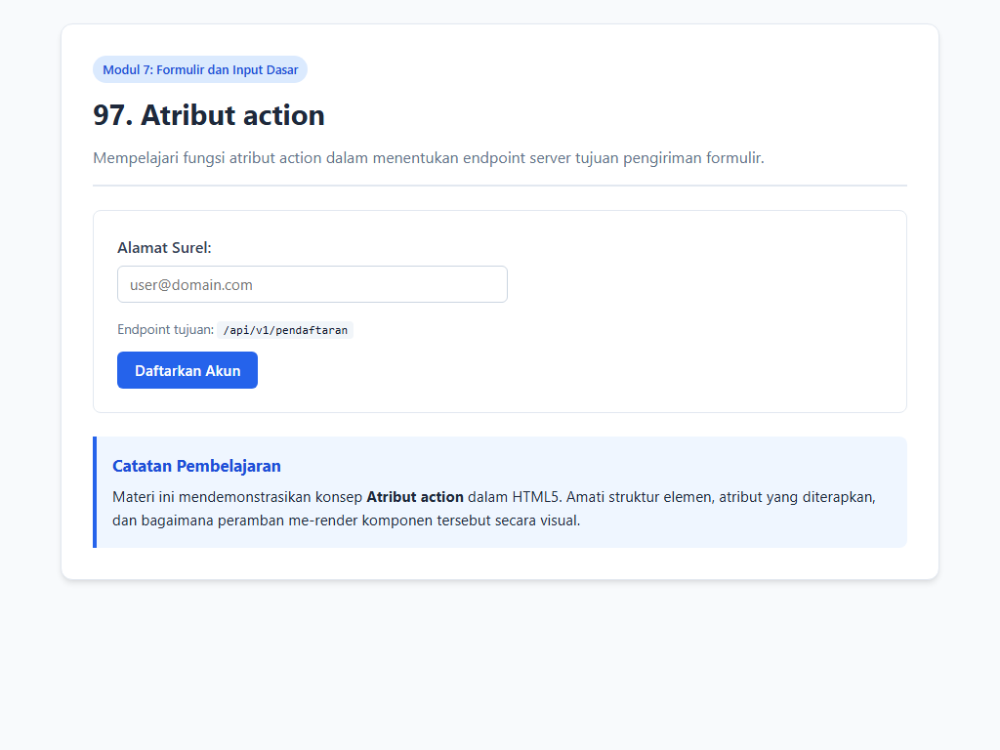

##### 3. Method attribute

- **Source Code**: [`98_form_method.html`](./module-07-formulir-dan-input-dasar/98_form_method.html)
- **Key Concept**: GET includes parameters in the URL, while POST hides them in the request body.
- **Implementation**: Presents two comparison cards of the characteristics of the GET and POST methods.
- **Execution Output**:

  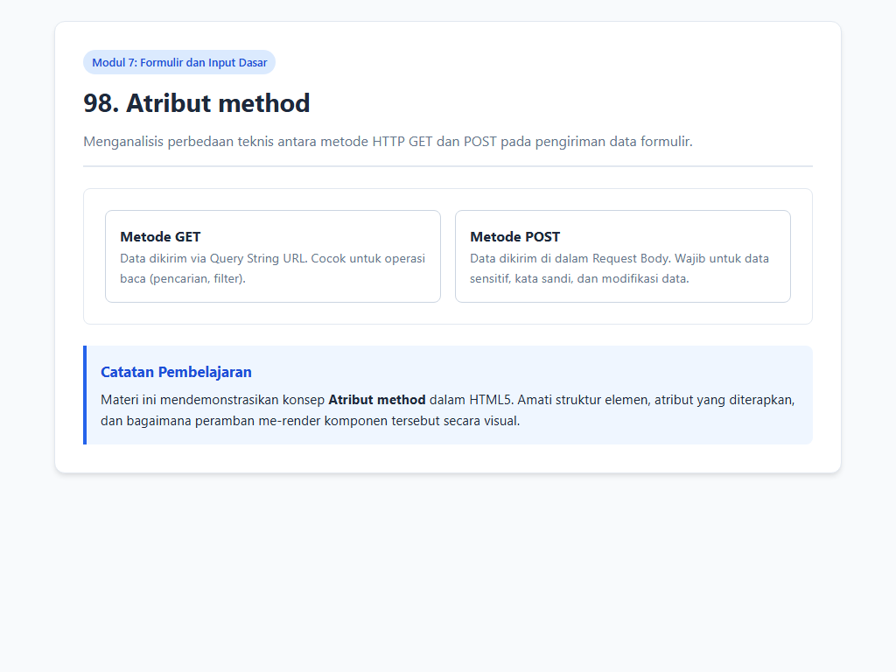

##### 4. Form with GET Method

- **Source Code**: [`99_form_get_method.html`](./module-07-formulir-dan-input-dasar/99_form_get_method.html)
- **Key Concept**: The GET method is ideal for searches because the URL of the results can be bookmarked or shared.
- **Implementation**: Displays a search form that maps input to the URL query parameter 'q'.
- **Execution Output**:

  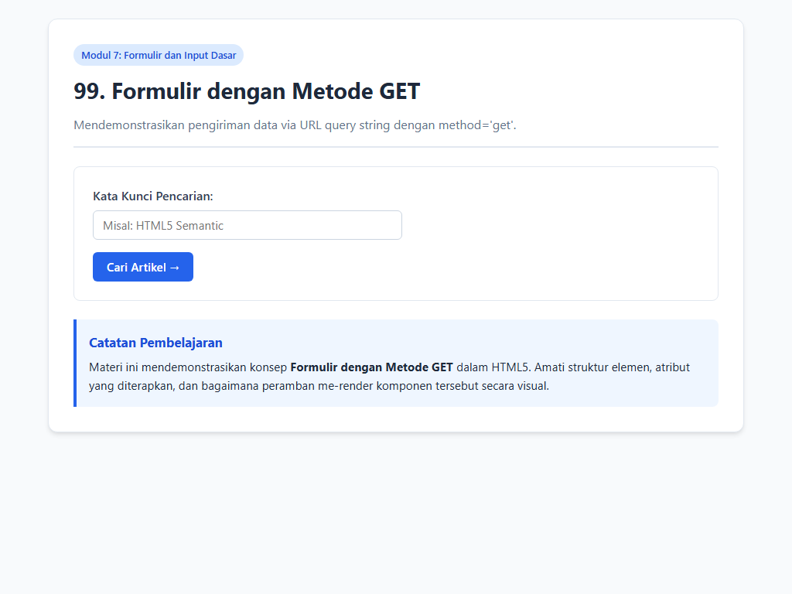

##### 5. Form with POST Method

- **Source Code**: [`100_form_post_method.html`](./module-07-formulir-dan-input-dasar/100_form_post_method.html)
- **Key Concept**: POST prevents password data from being recorded in browser history or proxy server logs.
- **Implementation**: Displays a login authentication form with post type name and password input.
- **Execution Output**:

  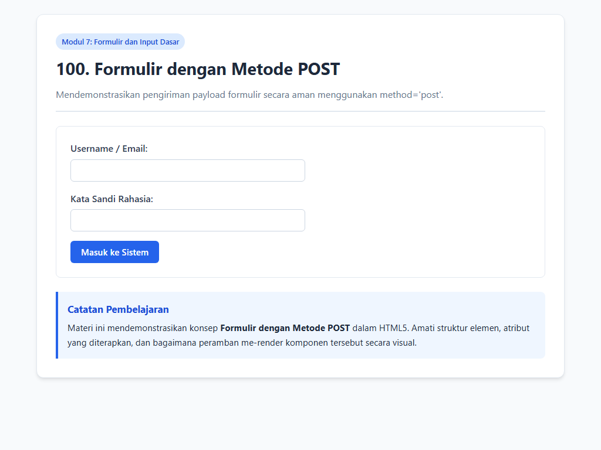

##### 6. Text Input

- **Source Code**: [`101_input_text.html`](./module-07-formulir-dan-input-dasar/101_input_text.html)
- **Key Concept**: The text input type is a versatile input control for alphanumeric characters.
- **Implementation**: Displays the full name text field with informative placeholders.
- **Execution Output**:

  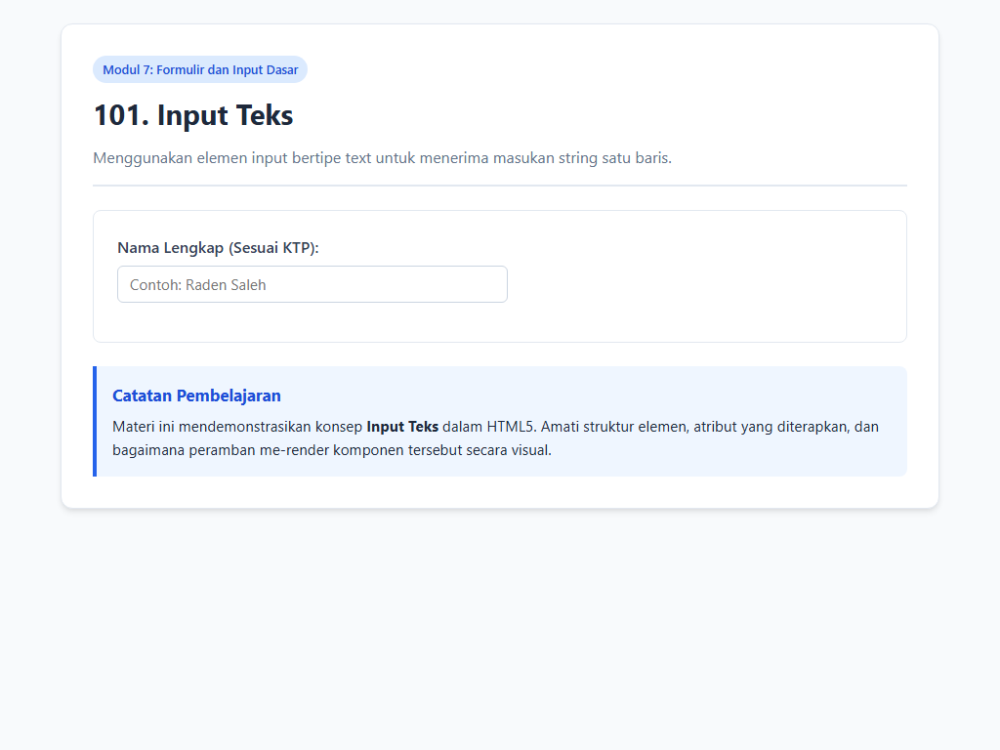

##### 7. Password Input

- **Source Code**: [`102_input_password.html`](./module-07-formulir-dan-input-dasar/102_input_password.html)
- **Key Concept**: The type='password' attribute prevents others nearby from seeing the typed characters.
- **Implementation**: Displays a password input field that automatically blurs the text into a black circle.
- **Execution Output**:

  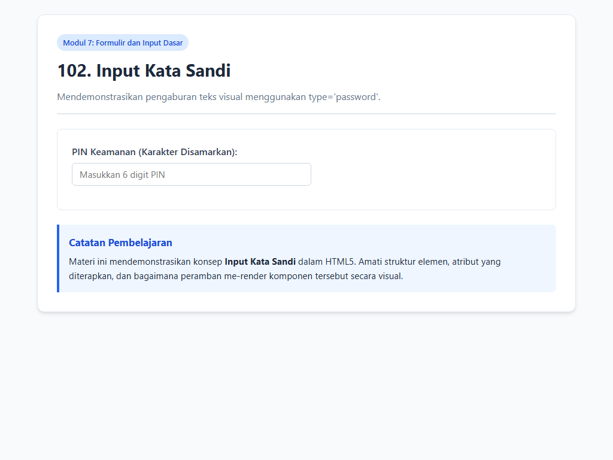

##### 8. Enter Email

- **Source Code**: [`103_input_email.html`](./module-07-formulir-dan-input-dasar/103_input_email.html)
- **Key Concept**: The type='email' attribute enables validation of the email address syntax before the form is submitted.
- **Implementation**: Displays an email field that refuses delivery if the @domain format is incomplete.
- **Execution Output**:

  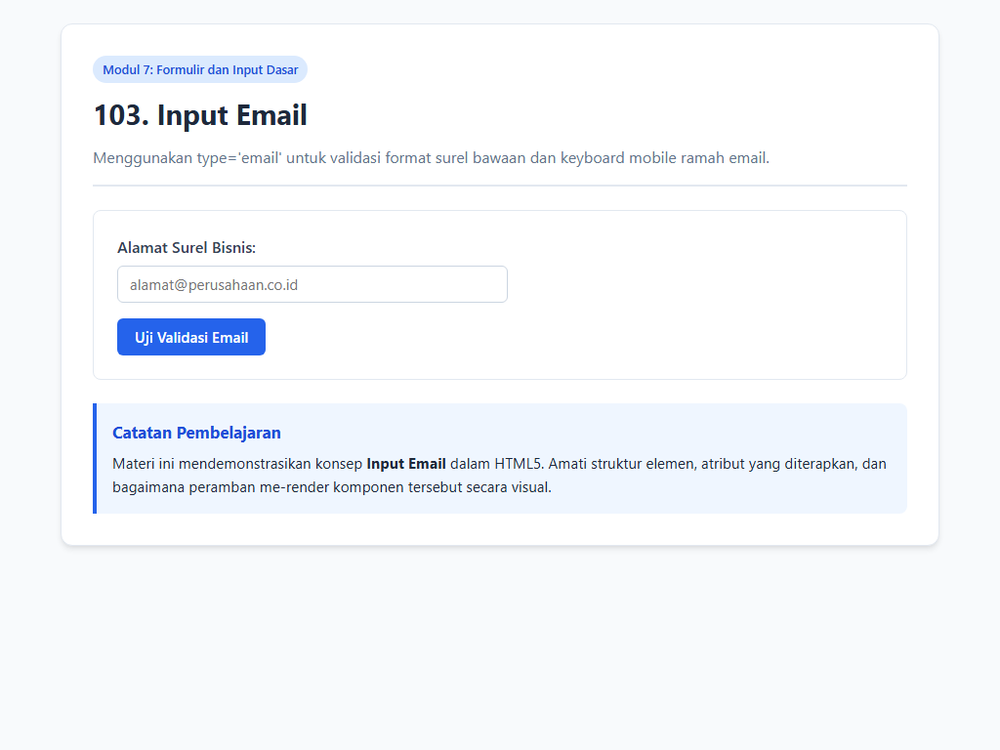

##### 9. Number Input

- **Source Code**: [`104_input_number.html`](./module-07-formulir-dan-input-dasar/104_input_number.html)
- **Key Concept**: The number input provides arrow stepper control and filters non-number characters.
- **Implementation**: Displays input ticket numbers with an initial value of 1 and a range of 1-10.
- **Execution Output**:

  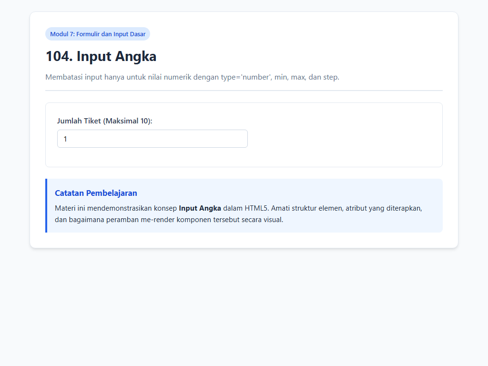

##### 10. Input Telephone Number

- **Source Code**: [`105_input_tel.html`](./module-07-formulir-dan-input-dasar/105_input_tel.html)
- **Key Concept**: Tel type calls a number dialpad on a smart phone touch screen device.
- **Implementation**: Displays the international format telephone number input field.
- **Execution Output**:

  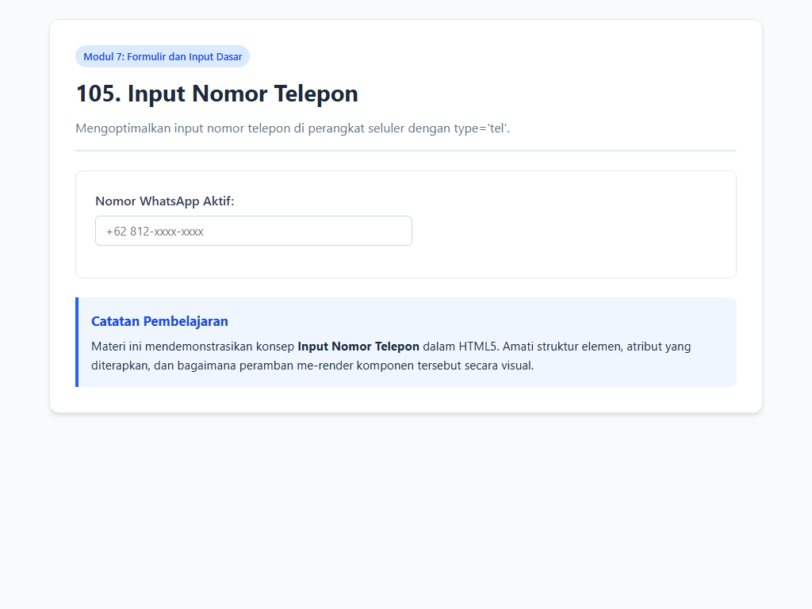

##### 11. Enter URL

- **Source Code**: [`106_input_url.html`](./module-07-formulir-dan-input-dasar/106_input_url.html)
- **Key Concept**: The input url validates whether the value entered is prefixed by a scheme such as http:// or https://.
- **Implementation**: Returns a URL input that demands a valid link web format.
- **Execution Output**:

  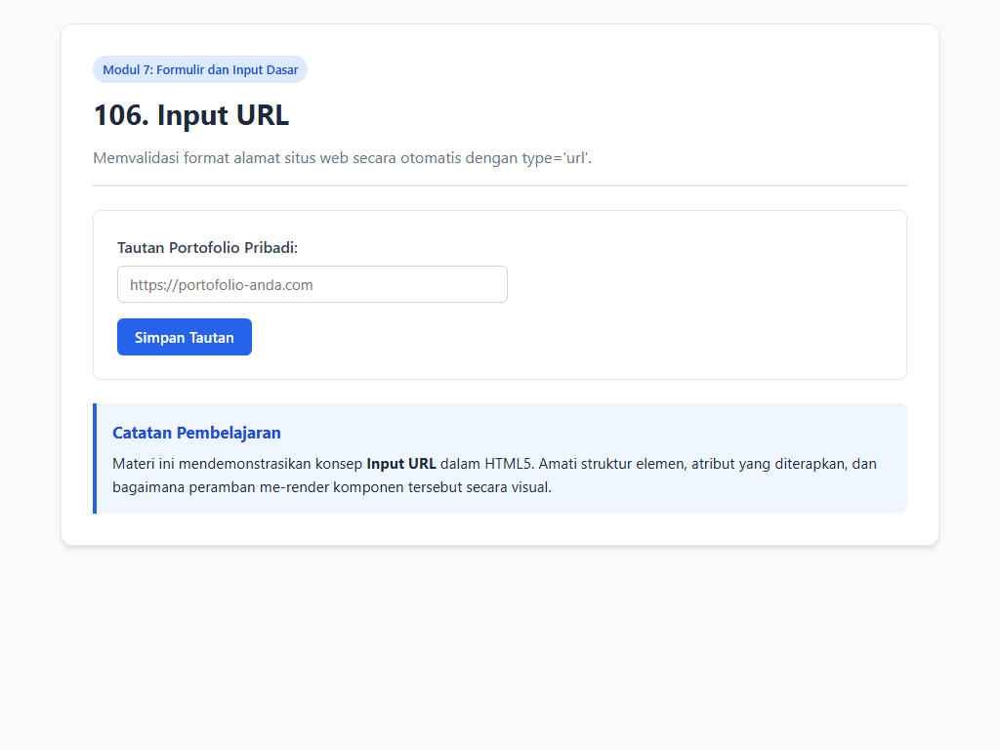

##### 12. Search Input

- **Source Code**: [`107_input_search.html`](./module-07-formulir-dan-input-dasar/107_input_search.html)
- **Key Concept**: Input search provides semantic search and automatic text cleanup controls.
- **Implementation**: Displays the search field with elegant rounded corners.
- **Execution Output**:

  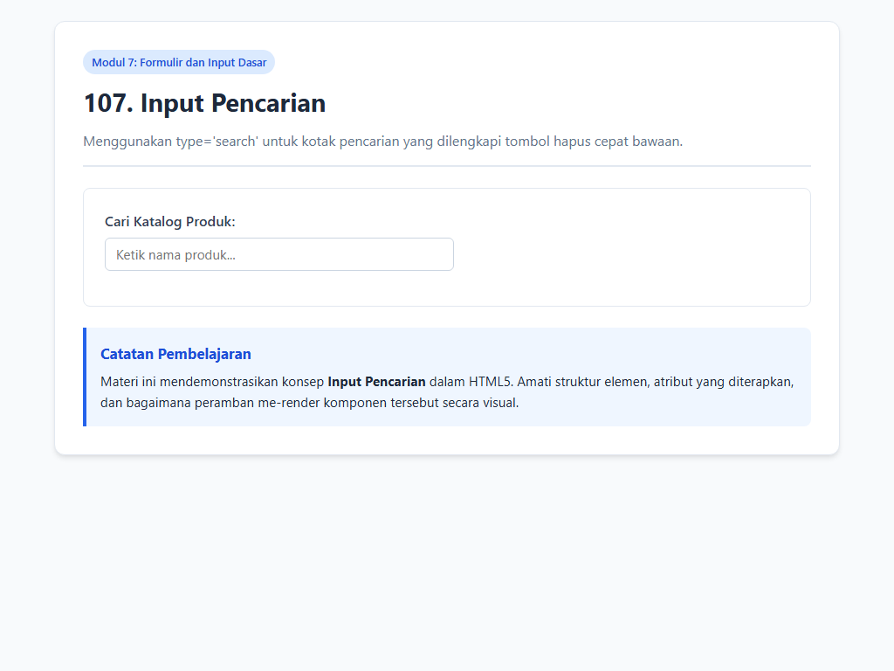

##### 13. Date Input

- **Source Code**: [`108_input_date.html`](./module-07-formulir-dan-input-dasar/108_input_date.html)
- **Key Concept**: Input date guarantees uniform ISO 8601 YYYY-MM-DD data format to the server.
- **Implementation**: Displays date input with a built-in visual calendar.
- **Execution Output**:

  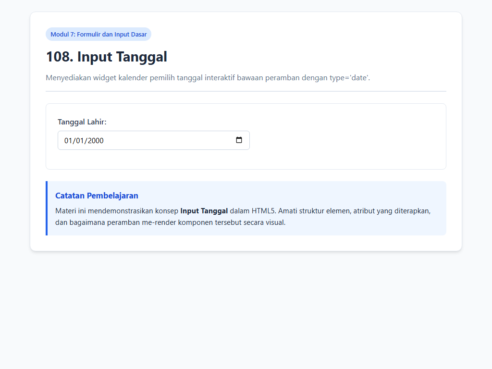

##### 14. Time Input

- **Source Code**: [`109_input_time.html`](./module-07-formulir-dan-input-dasar/109_input_time.html)
- **Key Concept**: Input time locks the hour:minute time format according to the operating system's local standards.
- **Implementation**: Displays a meeting time picker with a default value of 09:00.
- **Execution Output**:

  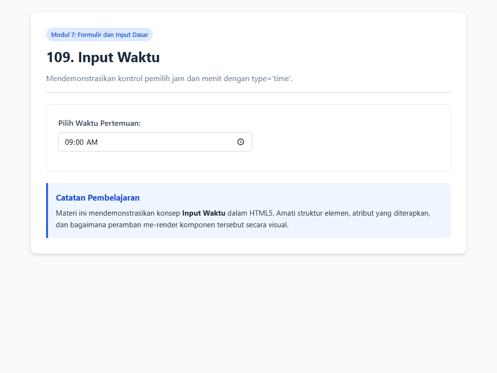

##### 15. Date and Time Input

- **Source Code**: [`110_input_datetime_local.html`](./module-07-formulir-dan-input-dasar/110_input_datetime_local.html)
- **Key Concept**: The datetime-local format produces an ISO string of date and time combinations (YYYY-MM-DDTHH:MM).
- **Implementation**: Features an integrated date-time selector for event scheduling.
- **Execution Output**:

  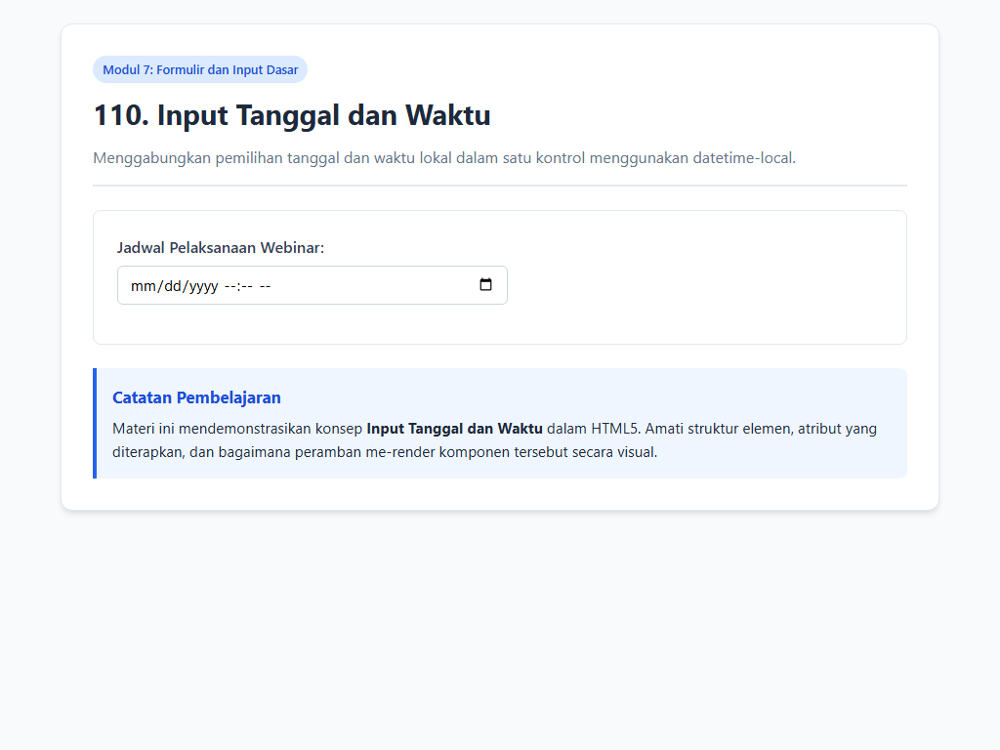

##### 16. Month Input

- **Source Code**: [`111_input_month.html`](./module-07-formulir-dan-input-dasar/111_input_month.html)
- **Key Concept**: It is ideal for payment card expiry or monthly statement periods.
- **Implementation**: Displays a month selector control with the year 2026 format.
- **Execution Output**:

  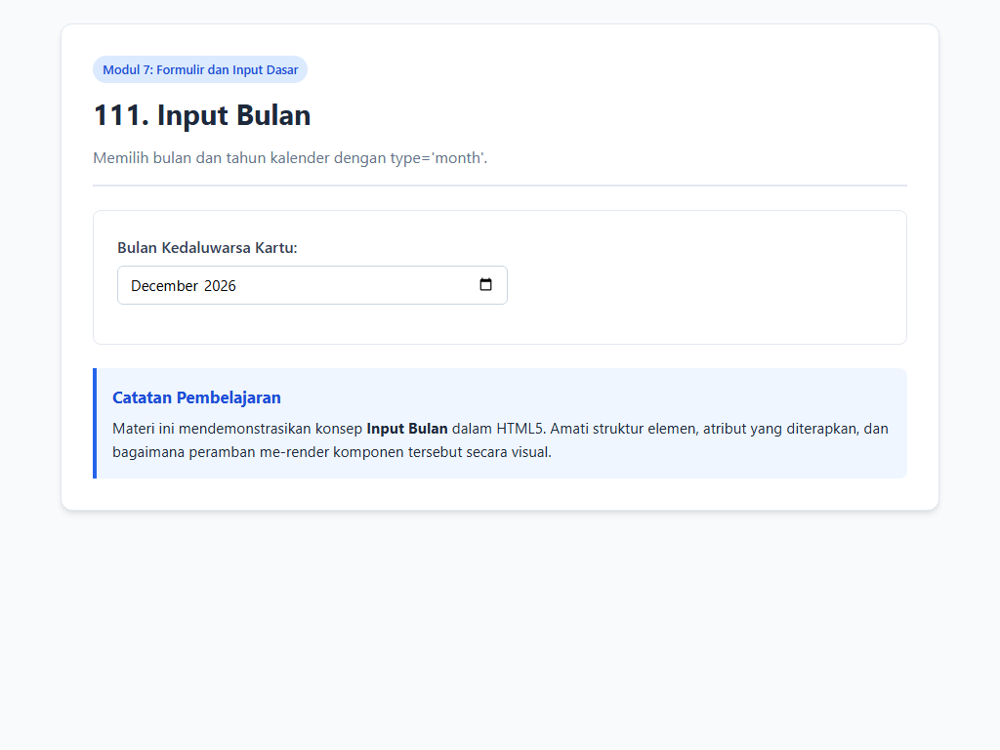

##### 17. Week Input

- **Source Code**: [`112_input_week.html`](./module-07-formulir-dan-input-dasar/112_input_week.html)
- **Key Concept**: The data type='week' format is useful for Agile sprint and project management systems.
- **Implementation**: Displays the project work week selector.
- **Execution Output**:

  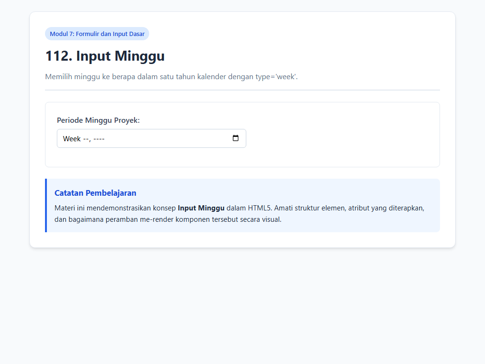

##### 18. Color Input

- **Source Code**: [`113_input_color.html`](./module-07-formulir-dan-input-dasar/113_input_color.html)
- **Key Concept**: Input color returns a 7 character hexadecimal value (ex: #2563eb).
- **Implementation**: Displays interactive, clickable color box swatches.
- **Execution Output**:

  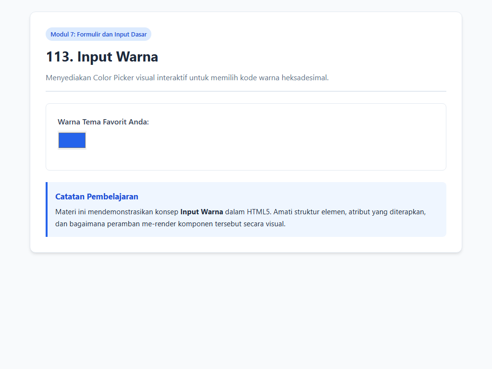

##### 19. Range Input (Slider)

- **Source Code**: [`114_input_range.html`](./module-07-formulir-dan-input-dasar/114_input_range.html)
- **Key Concept**: The input range is very intuitive for setting percentages, volume, or brightness.
- **Implementation**: Displays a horizontal slider lever with a position value of 70%.
- **Execution Output**:

  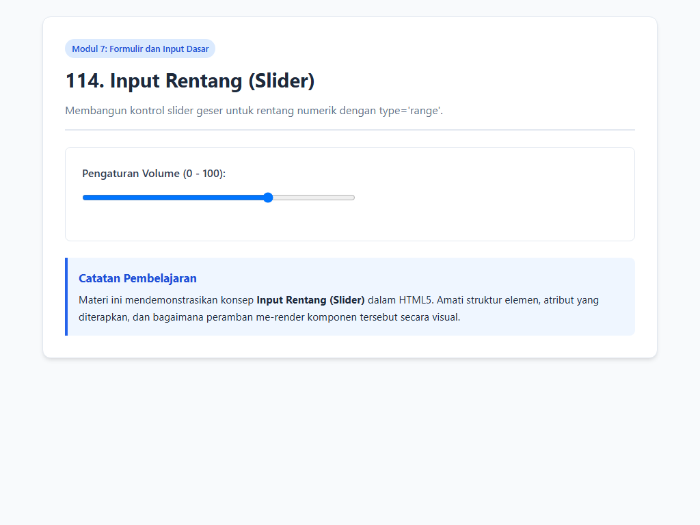

##### 20. Input Checkbox

- **Source Code**: [`115_input_checkbox.html`](./module-07-formulir-dan-input-dasar/115_input_checkbox.html)
- **Key Concept**: Each checkbox is independent and can be checked simultaneously.
- **Implementation**: Displays three skill options with the HTML5 option pre-checked.
- **Execution Output**:

  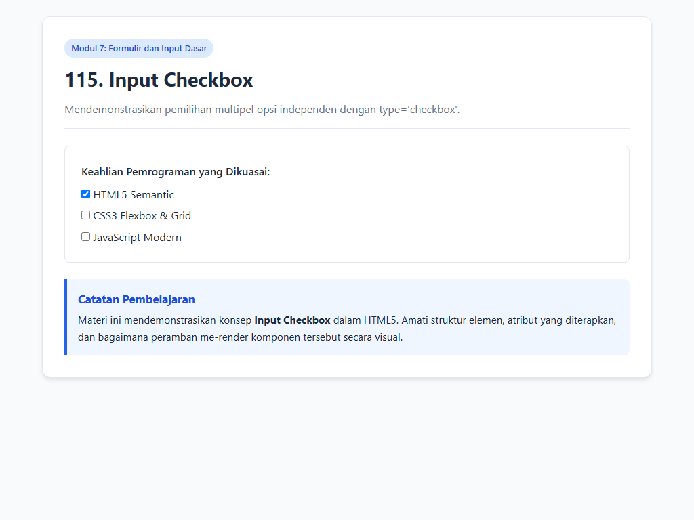

##### 21. Radio Input

- **Source Code**: [`116_input_radio.html`](./module-07-formulir-dan-input-dasar/116_input_radio.html)
- **Key Concept**: The key to radio buttons is in the same name attribute that groups them.
- **Implementation**: Featuring two subscription plan options with a single exclusive choice.
- **Execution Output**:

  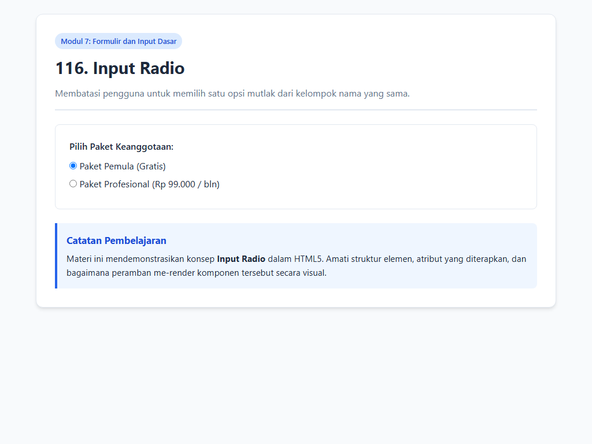

##### 22. Input Files

- **Source Code**: [`117_input_file.html`](./module-07-formulir-dan-input-dasar/117_input_file.html)
- **Key Concept**: The file upload form must use the POST method and enctype multipart/form-data.
- **Implementation**: Displays the browser's 'Choose File' button to select a local document.
- **Execution Output**:

  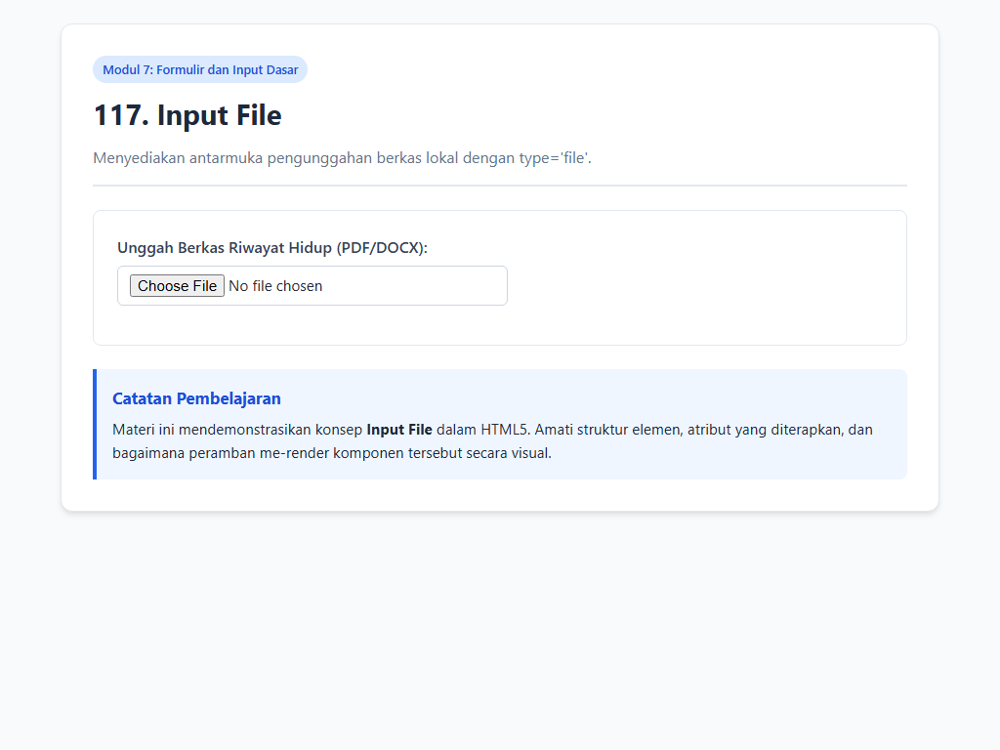

##### 23. Input Hidden

- **Source Code**: [`118_input_hidden.html`](./module-07-formulir-dan-input-dasar/118_input_hidden.html)
- **Key Concept**: Fixed-value hidden input sent with the form payload without physical appearance.
- **Implementation**: Displays a form that securely conveys confidential token data.
- **Execution Output**:

  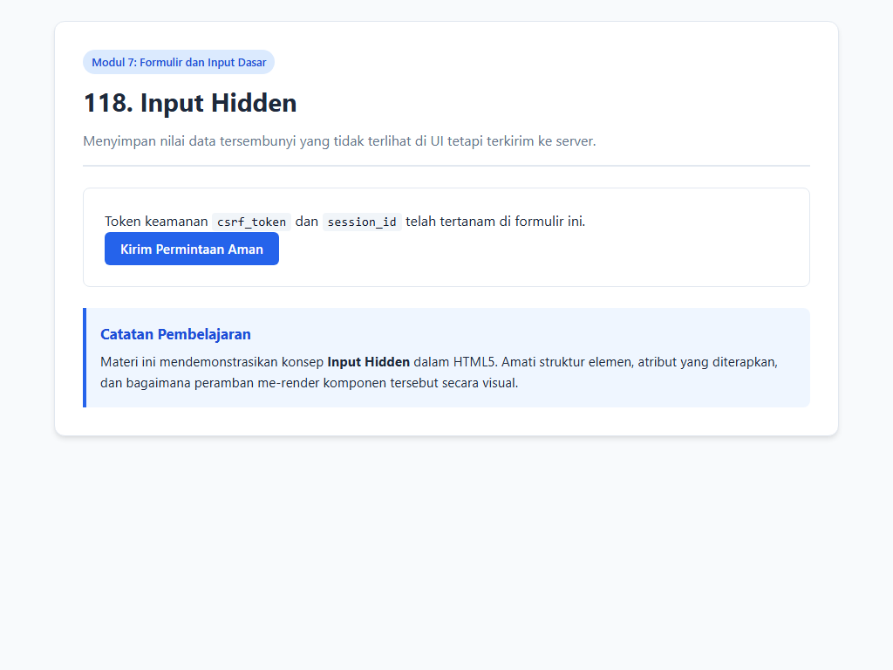

##### 24. Submit button

- **Source Code**: [`119_input_submit.html`](./module-07-formulir-dan-input-dasar/119_input_submit.html)
- **Key Concept**: Input type='submit' triggers the submit event on the form and automatic validation.
- **Implementation**: Displays a blue submit input type submission button.
- **Execution Output**:

  

##### 25. Reset Button

- **Source Code**: [`120_input_reset.html`](./module-07-formulir-dan-input-dasar/120_input_reset.html)
- **Key Concept**: The reset button restores all form control values ​​back to their default values ​​when loaded.
- **Implementation**: Displays a text field with a gray reset button.
- **Execution Output**:

  

##### 26. Button element

- **Source Code**: [`121_button_element.html`](./module-07-formulir-dan-input-dasar/121_button_element.html)
- **Key Concept**: The <button> element has a closing tag so it can contain other HTML markup inside it.
- **Implementation**: Features two modern looking buttons with text icons.
- **Execution Output**:

  

##### 27. Textarea element

- **Source Code**: [`122_textarea_element.html`](./module-07-formulir-dan-input-dasar/122_textarea_element.html)
- **Key Concept**: The <textarea> element wraps the default text between its opening and closing tags.
- **Implementation**: Displays a 4-line message input box that the user can expand.
- **Execution Output**:

  

##### 28. Select element

- **Source Code**: [`123_select_element.html`](./module-07-formulir-dan-input-dasar/123_select_element.html)
- **Key Concept**: The <select> element saves screen space by hiding options until they are opened.
- **Implementation**: Displays a city selector dropdown with guiding default options.
- **Execution Output**:

  

##### 29. Options element

- **Source Code**: [`124_option_element.html`](./module-07-formulir-dan-input-dasar/124_option_element.html)
- **Key Concept**: The selected attribute sets the default option that is active immediately when the page is opened.
- **Implementation**: Displays a language dropdown menu with English automatically selected.
- **Execution Output**:

  

##### 30. Optgroup element

- **Source Code**: [`125_optgroup_element.html`](./module-07-formulir-dan-input-dasar/125_optgroup_element.html)
- **Key Concept**: The <optgroup> element improves dropdown navigation by separating groups of options.
- **Implementation**: Displays a vehicle dropdown with two bold categories: Motorcycles and Personal Cars.
- **Execution Output**:

  

### Module 08: Advanced Forms and Native Validation

**Curriculum Path**: [`module-08-formulir-lanjutan-dan-validasi`](./module-08-formulir-lanjutan-dan-validasi) | **Level**: `Intermediate` | **Scope**: 20 Documents

#### Overview & Concepts Covered

Examines form field grouping (`fieldset`/`legend`), datalist auto-completion, gauge meters, progress indicators, and browser-native constraint validation attributes (`required`, `pattern`, `min`/`max`).

#### Subtopics & Visual Captures

##### 1. Label element

- **Source Code**: [`126_label_element.html`](./module-08-formulir-lanjutan-dan-validasi/126_label_element.html)
- **Key Concept**: The <label> element expands the touch area and is vital for screen reader users.
- **Implementation**: Displays interactive labels that when clicked immediately focus the text input.
- **Execution Output**:

  

##### 2. Fieldset elements

- **Source Code**: [`127_fieldset_element.html`](./module-08-formulir-lanjutan-dan-validasi/127_fieldset_element.html)
- **Key Concept**: Fieldset draws a visual box frame around the relevant data set.
- **Implementation**: Displays a neatly isolated delivery address data box.
- **Execution Output**:

  

##### 3. Legend elements

- **Source Code**: [`128_legend_element.html`](./module-08-formulir-lanjutan-dan-validasi/128_legend_element.html)
- **Key Concept**: The <legend> tag is read by the screen reader when the user moves between input groups.
- **Implementation**: Displays a blue-framed fieldset box with the legend title embedded in the top line.
- **Execution Output**:

  

##### 4. Datalist elements

- **Source Code**: [`129_datalist_element.html`](./module-08-formulir-lanjutan-dan-validasi/129_datalist_element.html)
- **Key Concept**: Datalist combines the freedom of plain text input with the convenience of an options dropdown.
- **Implementation**: Displays input that brings up browser recommendations when typed.
- **Execution Output**:

  

##### 5. Output elements

- **Source Code**: [`130_output_element.html`](./module-08-formulir-lanjutan-dan-validasi/130_output_element.html)
- **Key Concept**: The <output> element announces changes in calculated numbers to assistive technology.
- **Implementation**: Displays instant addition mini-calculator 10 + 25 = 35.
- **Execution Output**:

  

##### 6. Meter element

- **Source Code**: [`131_meter_element.html`](./module-08-formulir-lanjutan-dan-validasi/131_meter_element.html)
- **Key Concept**: The <meter> element is different from a progress bar; meters measure capacity or discount fraction.
- **Implementation**: Displays a disk storage bar meter that is 75% full.
- **Execution Output**:

  

##### 7. Progress element

- **Source Code**: [`132_progress_element.html`](./module-08-formulir-lanjutan-dan-validasi/132_progress_element.html)
- **Key Concept**: The <progress> element represents the status of the task from start to finish (0 to max).
- **Implementation**: Displays the download progress bar which is at 65%.
- **Execution Output**:

  

##### 8. Required attribute

- **Source Code**: [`133_required_attribute.html`](./module-08-formulir-lanjutan-dan-validasi/133_required_attribute.html)
- **Key Concept**: The browser will display a tooltip warning message if the required fields have not been filled in.
- **Implementation**: Displays mandatory inputs labeled with a red asterisk with a test button.
- **Execution Output**:

  

##### 9. Placeholder attribute

- **Source Code**: [`134_placeholder_attribute.html`](./module-08-formulir-lanjutan-dan-validasi/134_placeholder_attribute.html)
- **Key Concept**: Placeholders are not a replacement for labels, but rather short instructions that disappear when typed.
- **Implementation**: Displays an example of telephone number format in the field.
- **Execution Output**:

  

##### 10. Readonly attribute

- **Source Code**: [`135_readonly_attribute.html`](./module-08-formulir-lanjutan-dan-validasi/135_readonly_attribute.html)
- **Key Concept**: Readonly maintains deliverability of values ​​to different backends with disabled.
- **Implementation**: Displays the referral code field with a locked gray background.
- **Execution Output**:

  

##### 11. Disabled attribute

- **Source Code**: [`136_disabled_attribute.html`](./module-08-formulir-lanjutan-dan-validasi/136_disabled_attribute.html)
- **Key Concept**: The disabled control is visually faded and removed from the form submit payload cycle.
- **Implementation**: Displays totally disabled text input and buttons.
- **Execution Output**:

  

##### 12. Min and max attributes

- **Source Code**: [`137_min_max_attributes.html`](./module-08-formulir-lanjutan-dan-validasi/137_min_max_attributes.html)
- **Key Concept**: The browser will refuse to send values ​​that are outside the min and max ranges.
- **Implementation**: Displays age input with a valid range of 18 to 60 years.
- **Execution Output**:

  

##### 13. Minlength and maxlength attributes

- **Source Code**: [`138_minlength_maxlength.html`](./module-08-formulir-lanjutan-dan-validasi/138_minlength_maxlength.html)
- **Key Concept**: The maxlength attribute cuts out excess typing automatically on the interface side.
- **Implementation**: Displays user name input with a length limit of 4-12 characters.
- **Execution Output**:

  

##### 14. Pattern attribute (Regex)

- **Source Code**: [`139_pattern_attribute.html`](./module-08-formulir-lanjutan-dan-validasi/139_pattern_attribute.html)
- **Key Concept**: The pattern attribute matches input values ​​with regex without the need to write a JS script.
- **Implementation**: Displays validation of Indonesian motor vehicle number plates.
- **Execution Output**:

  

##### 15. Step attribute

- **Source Code**: [`140_step_attribute.html`](./module-08-formulir-lanjutan-dan-validasi/140_step_attribute.html)
- **Key Concept**: The step attribute can be an integer (e.g. 50000) or a fractional decimal (e.g. 0.01).
- **Implementation**: Displays donation input with value jumps per 50,000.
- **Execution Output**:

  

##### 16. Multiple attributes

- **Source Code**: [`141_multiple_attribute.html`](./module-08-formulir-lanjutan-dan-validasi/141_multiple_attribute.html)
- **Key Concept**: Users can hold down the Ctrl/Shift key to select multiple files at once.
- **Implementation**: Displays input files that are ready to accommodate more than one file.
- **Execution Output**:

  

##### 17. The accept attribute

- **Source Code**: [`142_accept_attribute.html`](./module-08-formulir-lanjutan-dan-validasi/142_accept_attribute.html)
- **Key Concept**: The accept attribute accepts an extension (.pdf) or MIME type (image/png) to filter the file picker.
- **Implementation**: Displays special file input of PDF documents and PNG images.
- **Execution Output**:

  

##### 18. Autocomplete attribute

- **Source Code**: [`143_autocomplete_attribute.html`](./module-08-formulir-lanjutan-dan-validasi/143_autocomplete_attribute.html)
- **Key Concept**: Values ​​such as name, email, street-address, and tel speed up browser form conversions.
- **Implementation**: Displays an address form with standard autocomplete wizard.
- **Execution Output**:

  

##### 19. Autofocus attribute

- **Source Code**: [`144_autofocus_attribute.html`](./module-08-formulir-lanjutan-dan-validasi/144_autofocus_attribute.html)
- **Key Concept**: Use only one autofocus per page to avoid confusing users.
- **Implementation**: Displays a search field where the cursor lights up immediately when the page loads.
- **Execution Output**:

  

##### 20. Browser Built-in Form Validation

- **Source Code**: [`145_form_validation.html`](./module-08-formulir-lanjutan-dan-validasi/145_form_validation.html)
- **Key Concept**: The combination of required, pattern, type, and pseudo-class results in robust built-in validation.
- **Implementation**: Displays a verified account registration form with email format validation and a 6-digit PIN.
- **Execution Output**:

  

### Module 09: Semantic HTML and Modern Layouts

**Curriculum Path**: [`module-09-semantic-html`](./module-09-semantic-html) | **Level**: `Intermediate` | **Scope**: 20 Documents

#### Overview & Concepts Covered

Explores HTML5 semantic landmarks (`header`, `nav`, `main`, `section`, `article`, `aside`, `footer`), native disclosure widgets (`details`/`summary`), modal dialogs, and real-world semantic layout patterns.

#### Subtopics & Visual Captures

##### 1. Header element

- **Source Code**: [`146_header_element.html`](./module-09-semantic-html/146_header_element.html)
- **Key Concept**: The header encapsulates the opening content or group of navigation aids.
- **Implementation**: Displays document section headers with titles and descriptions.
- **Execution Output**:

  

##### 2. Footer elements

- **Source Code**: [`147_footer_element.html`](./module-09-semantic-html/147_footer_element.html)
- **Key Concept**: The <footer> element contains ownership, licensing, and contact information.
- **Implementation**: Features an elegant dark footer with copyright information.
- **Execution Output**:

  

##### 3. Play elements

- **Source Code**: [`148_main_element.html`](./module-09-semantic-html/148_main_element.html)
- **Key Concept**: The <main> element provides the main landmark for screen readers.
- **Implementation**: Displays the main content box framed in bold blue.
- **Execution Output**:

  

##### 4. Section elements

- **Source Code**: [`149_section_element.html`](./module-09-semantic-html/149_section_element.html)
- **Key Concept**: The <section> element must always have a heading (h2-h6) as the section identity.
- **Implementation**: Featuring a neatly framed background section.
- **Execution Output**:

  

##### 5. Article element

- **Source Code**: [`150_article_element.html`](./module-09-semantic-html/150_article_element.html)
- **Key Concept**: The content in <article> has complete meaning even though it is separated from the original page.
- **Implementation**: Displays blog article cards complete with author metadata.
- **Execution Output**:

  

##### 6. The aside element

- **Source Code**: [`151_aside_element.html`](./module-09-semantic-html/151_aside_element.html)
- **Key Concept**: The <aside> element represents tangential content outside the main flow.
- **Implementation**: Features a two-column layout containing the main content and a light blue sidebar.
- **Execution Output**:

  

##### 7. Semantics of Navigation Elements

- **Source Code**: [`152_nav_semantics.html`](./module-09-semantic-html/152_nav_semantics.html)
- **Key Concept**: The <nav> tag is only for the main large group of links, not for every random link in the footer.
- **Implementation**: Features a neat documentation navigation bar.
- **Execution Output**:

  

##### 8. Address element

- **Source Code**: [`153_address_element.html`](./module-09-semantic-html/153_address_element.html)
- **Key Concept**: Address connects the identity of the person responsible for the content with semantic format.
- **Implementation**: Displays the institution's official contact card complete with email and telephone links.
- **Execution Output**:

  

##### 9. Time element

- **Source Code**: [`154_time_element.html`](./module-09-semantic-html/154_time_element.html)
- **Key Concept**: The datetime attribute contains the ISO 8601 standard standard time string.
- **Implementation**: Displays the activity time text with yellow highlighting.
- **Execution Output**:

  

##### 10. Data elements

- **Source Code**: [`155_data_element.html`](./module-09-semantic-html/155_data_element.html)
- **Key Concept**: The <data> element connects the human representation to the machine's database ID.
- **Implementation**: Displays the product name to which the internal SKU code is tied.
- **Execution Output**:

  

##### 11. Details element

- **Source Code**: [`156_details_element.html`](./module-09-semantic-html/156_details_element.html)
- **Key Concept**: Details hides child content until the user clicks on its opening summary.
- **Implementation**: Features an interactive accordion widget with an opening triangle arrow.
- **Execution Output**:

  

##### 12. Summary element

- **Source Code**: [`157_summary_element.html`](./module-09-semantic-html/157_summary_element.html)
- **Key Concept**: Summary receives keyboard focus and automatically triggers opening of the details element.
- **Implementation**: Displays the accordion FAQ in the open state.
- **Execution Output**:

  

##### 13. Dialogue elements

- **Source Code**: [`158_dialog_element.html`](./module-09-semantic-html/158_dialog_element.html)
- **Key Concept**: The <dialog> element has browser backdrop support and built-in keyboard focus management.
- **Implementation**: Displays a button to open an interactive confirmation modal dialog.
- **Execution Output**:

  

##### 14. Search element

- **Source Code**: [`159_search_element.html`](./module-09-semantic-html/159_search_element.html)
- **Key Concept**: The <search> element officially replaces role='search' in the form wrapper.
- **Implementation**: Displays a standardized search box within the search element.
- **Execution Output**:

  

##### 15. Div element

- **Source Code**: [`160_div_element.html`](./module-09-semantic-html/160_div_element.html)
- **Key Concept**: The <div> element is a block-level container with no special meaning to search engines.
- **Implementation**: Features a styling box framed by a blue dotted line.
- **Execution Output**:

  

##### 16. Span element

- **Source Code**: [`161_span_element.html`](./module-09-semantic-html/161_span_element.html)
- **Key Concept**: The <span> tag acts as a generic inline wrapper for local formatting.
- **Implementation**: Displays a green server status label inline in the paragraph.
- **Execution Output**:

  

##### 17. Comparison of Semantic and Nonsemantic Elements

- **Source Code**: [`162_semantic_vs_nonsemantic.html`](./module-09-semantic-html/162_semantic_vs_nonsemantic.html)
- **Key Concept**: Semantic code is more concise, easy to maintain, SEO friendly, and meets accessibility standards.
- **Implementation**: Displays two green and red comparison boxes regarding the code structure.
- **Execution Output**:

  

##### 18. Semantic Structure of Blogs

- **Source Code**: [`163_blog_semantic_layout.html`](./module-09-semantic-html/163_blog_semantic_layout.html)
- **Key Concept**: Connect headers, articles, asides, and footers in a cohesive layout.
- **Implementation**: Displays a miniature blog page complete with category sidebar.
- **Execution Output**:

  

##### 19. Semantic Structure of News Portals

- **Source Code**: [`164_news_semantic_layout.html`](./module-09-semantic-html/164_news_semantic_layout.html)
- **Key Concept**: Distinguish breaking news headlines from general news feeds using precise semantics.
- **Implementation**: Displays breaking news clips with a striking red badge.
- **Execution Output**:

  

##### 20. Landing Page Semantic Structure

- **Source Code**: [`165_landing_page_semantics.html`](./module-09-semantic-html/165_landing_page_semantics.html)
- **Key Concept**: Unify hero sections, promotional messages, and calls-to-action into clean markup.
- **Implementation**: Displays a product landing page with a registration action button.
- **Execution Output**:

  

### Module 10: Document Head, Metadata, and SEO

**Curriculum Path**: [`module-10-head-metadata-dan-seo`](./module-10-head-metadata-dan-seo) | **Level**: `Intermediate` | **Scope**: 15 Documents

#### Overview & Concepts Covered

Examines document head configuration, character encoding, mobile viewports, meta descriptions, search engine indexing controls, favicons, script execution control (`defer`/`async`), and Open Graph metadata.

#### Subtopics & Visual Captures

##### 1. Head element

- **Source Code**: [`166_head_element.html`](./module-10-head-metadata-dan-seo/166_head_element.html)
- **Key Concept**: The <head> element contains configuration instructions for the browser engine and web crawler.
- **Implementation**: Displays the visual source code of the head element's contents in a dark box.
- **Execution Output**:

  

##### 2. Title element

- **Source Code**: [`167_title_element.html`](./module-10-head-metadata-dan-seo/167_title_element.html)
- **Key Concept**: The title <title> is the most crucial on-page SEO factor for search engines.
- **Implementation**: Displays a visual simulation of a browser tab with an active title.
- **Execution Output**:

  

##### 3. Charset metadata

- **Source Code**: [`168_meta_charset.html`](./module-10-head-metadata-dan-seo/168_meta_charset.html)
- **Key Concept**: UTF-8 is capable of encoding more than one million characters from all the world's script systems.
- **Implementation**: Featuring various foreign characters and perfectly rendered emoji symbols.
- **Execution Output**:

  

##### 4. Viewport metadata

- **Source Code**: [`169_meta_viewport.html`](./module-10-head-metadata-dan-seo/169_meta_viewport.html)
- **Key Concept**: Width=device-width matches the virtual width of the screen to the physical pixels of the device.
- **Implementation**: Displays an explanation of the mobile meta viewport configuration.
- **Execution Output**:

  

##### 5. Meta description

- **Source Code**: [`170_meta_description.html`](./module-10-head-metadata-dan-seo/170_meta_description.html)
- **Key Concept**: Search engines display this descriptive text as a summary snippet below the search title.
- **Implementation**: Displays simulated Google Search search results complete with links and text snippets.
- **Execution Output**:

  

##### 6. Meta robots

- **Source Code**: [`171_meta_robots.html`](./module-10-head-metadata-dan-seo/171_meta_robots.html)
- **Key Concept**: The robots meta tag instructs spider bots like Googlebot how to treat documents.
- **Implementation**: Displays a list of robots directive options (index, follow, noindex, nofollow).
- **Execution Output**:

  

##### 7. Author metadata

- **Source Code**: [`172_meta_author.html`](./module-10-head-metadata-dan-seo/172_meta_author.html)
- **Key Concept**: Author metadata helps content aggregators identify the creator of a work.
- **Implementation**: Shows an example of writing a document author meta tag.
- **Execution Output**:

  

##### 8. Metadata theme color

- **Source Code**: [`173_meta_theme_color.html`](./module-10-head-metadata-dan-seo/173_meta_theme_color.html)
- **Key Concept**: The theme-color attribute aligns the browser's UI colors with the website's color palette.
- **Implementation**: Features a royal blue card which represents the theme color of the browser bar.
- **Execution Output**:

  

##### 9. Favicon

- **Source Code**: [`174_favicon.html`](./module-10-head-metadata-dan-seo/174_favicon.html)
- **Key Concept**: Favicon makes it easier for users to recognize a site among dozens of open tabs.
- **Implementation**: Displays the blue code logo SVG icon along with the connecting link tag syntax.
- **Execution Output**:

  

##### 10. Linking Stylesheets

- **Source Code**: [`175_external_css_link.html`](./module-10-head-metadata-dan-seo/175_external_css_link.html)
- **Key Concept**: The <link rel='stylesheet'> tag downloads CSS files without blocking rendering if set efficiently.
- **Implementation**: Shows an example of the syntax for calling an external CSS file.
- **Execution Output**:

  

##### 11. Connecting External JavaScript

- **Source Code**: [`176_external_script.html`](./module-10-head-metadata-dan-seo/176_external_script.html)
- **Key Concept**: The <script> tag with the src attribute separates the interaction code from the markup framework.
- **Implementation**: Shows examples of writing external script tags.
- **Execution Output**:

  

##### 12. Defer attribute

- **Source Code**: [`177_defer_attribute.html`](./module-10-head-metadata-dan-seo/177_defer_attribute.html)
- **Key Concept**: The defer attribute prevents the JavaScript Render-Blocking phenomenon in browsers.
- **Implementation**: Displays an explanation of how defer works with a green success box.
- **Execution Output**:

  

##### 13. Async attributes

- **Source Code**: [`178_async_attribute.html`](./module-10-head-metadata-dan-seo/178_async_attribute.html)
- **Key Concept**: Async is ideal for analytics tracking scripts that do not manipulate page DOM elements.
- **Implementation**: Shows async attribute explanations for loading third-party tracker files.
- **Execution Output**:

  

##### 14. Canonical link

- **Source Code**: [`179_canonical_link.html`](./module-10-head-metadata-dan-seo/179_canonical_link.html)
- **Key Concept**: Search engines incorporate ranking signals into canonical URLs.
- **Implementation**: Displays a standardized canonical link tag format.
- **Execution Output**:

  

##### 15. Social Media Sharing Metadata (Open Graph)

- **Source Code**: [`180_social_media_metadata.html`](./module-10-head-metadata-dan-seo/180_social_media_metadata.html)
- **Key Concept**: The Open Graph protocol (og:title, og:image, og:description) controls the display of link shares on social networks.
- **Implementation**: Displays a simulated social media card with an image banner and neat description.
- **Execution Output**:

  

### Module 11: Audio, Video, and Multimedia

**Curriculum Path**: [`module-11-audio-video-dan-multimedia`](./module-11-audio-video-dan-multimedia) | **Level**: `Intermediate to Advanced` | **Scope**: 15 Documents

#### Overview & Concepts Covered

Covers native HTML5 audio and video playback, multi-format media sources, player controls, custom video posters, WebVTT subtitle and caption tracks, preload policies, and accessible media delivery.

#### Subtopics & Visual Captures

##### 1. Audio elements

- **Source Code**: [`181_audio_element.html`](./module-11-audio-video-dan-multimedia/181_audio_element.html)
- **Key Concept**: The <audio> element provides a standardized sound player in all modern browsers.
- **Implementation**: Features HTML5 audio player controls with play button and duration bar.
- **Execution Output**:

  

##### 2. Audio control

- **Source Code**: [`182_audio_controls.html`](./module-11-audio-video-dan-multimedia/182_audio_controls.html)
- **Key Concept**: The controls attribute must be included if you want the sound player interface to be visible to the user.
- **Implementation**: Displays the audio player in muted status.
- **Execution Output**:

  

##### 3. Multiple Audio Sources

- **Source Code**: [`183_audio_sources.html`](./module-11-audio-video-dan-multimedia/183_audio_sources.html)
- **Key Concept**: The browser will select the first audio format that is compatible with its system codec.
- **Implementation**: Features an audio player with three different source codec options.
- **Execution Output**:

  

##### 4. Audio fallback

- **Source Code**: [`184_audio_fallback.html`](./module-11-audio-video-dan-multimedia/184_audio_fallback.html)
- **Key Concept**: Content in the audio tag is ignored if the audio player is supported, and displayed if it is not supported.
- **Implementation**: Displays an audio player with alternative download links.
- **Execution Output**:

  

##### 5. Video elements

- **Source Code**: [`185_video_element.html`](./module-11-audio-video-dan-multimedia/185_video_element.html)
- **Key Concept**: The <video> element breaks the dependency on antiquated third-party plugins like Flash.
- **Implementation**: Features a 480x270 resolution black video player with play controls.
- **Execution Output**:

  

##### 6. Video control

- **Source Code**: [`186_video_controls.html`](./module-11-audio-video-dan-multimedia/186_video_controls.html)
- **Key Concept**: The controls attribute enables the play, pause, timeline, and full screen buttons.
- **Implementation**: Features complete video controls with inline playback feature.
- **Execution Output**:

  

##### 7. Video dimensions

- **Source Code**: [`187_video_dimensions.html`](./module-11-audio-video-dan-multimedia/187_video_dimensions.html)
- **Key Concept**: Specifying width and height prevents the browser from re-rendering the page layout.
- **Implementation**: Displays videos with precise 16:9 ratio dimensions.
- **Execution Output**:

  

##### 8. Poster attributes

- **Source Code**: [`188_video_poster.html`](./module-11-audio-video-dan-multimedia/188_video_poster.html)
- **Key Concept**: The poster attribute displays an attractive preview image when the video is not yet playing.
- **Implementation**: Displays a video player with a dark-red thumbnail poster image.
- **Execution Output**:

  

##### 9. Various Video Sources

- **Source Code**: [`189_video_sources.html`](./module-11-audio-video-dan-multimedia/189_video_sources.html)
- **Key Concept**: The WebM format offers slimmer file sizes for Chromium and Firefox browsers.
- **Implementation**: Displays videos with two different source formats.
- **Execution Output**:

  

##### 10. Track elements

- **Source Code**: [`190_video_tracks.html`](./module-11-audio-video-dan-multimedia/190_video_tracks.html)
- **Key Concept**: The <track> tag is a void element that connects the .vtt format file with the video.
- **Implementation**: Displays a video player equipped with a subtitle menu option.
- **Execution Output**:

  

##### 11. Video subtitles

- **Source Code**: [`191_video_subtitles.html`](./module-11-audio-video-dan-multimedia/191_video_subtitles.html)
- **Key Concept**: The kind='subtitles' attribute is specifically for translation of dialogue for viewers who understand the sound but speak different languages.
- **Implementation**: Displays a video player with a choice of Indonesian and English subtitles.
- **Execution Output**:

  

##### 12. WebVTT Captions

- **Source Code**: [`192_webvtt_captions.html`](./module-11-audio-video-dan-multimedia/192_webvtt_captions.html)
- **Key Concept**: Caption captions (kind='captions') include dialogue transcripts as well as non-verbal audio descriptions.
- **Implementation**: Shows an example of the W3C standard WebVTT file writing syntax format.
- **Execution Output**:

  

##### 13. Preload attribute

- **Source Code**: [`193_audio_video_preload.html`](./module-11-audio-video-dan-multimedia/193_audio_video_preload.html)
- **Key Concept**: Preload='none' prevents the browser from needlessly downloading megabytes of video before it is requested.
- **Implementation**: Displays videos configured to save data with preload='none'.
- **Execution Output**:

  

##### 14. Embedding Videos Via Iframe

- **Source Code**: [`194_iframe_video_embed.html`](./module-11-audio-video-dan-multimedia/194_iframe_video_embed.html)
- **Key Concept**: Iframe allows video playback without burdening the hosting's own storage.
- **Implementation**: Displays a video iframe with fullscreen permission.
- **Execution Output**:

  

##### 15. Multimedia Accessibility

- **Source Code**: [`195_multimedia_accessibility.html`](./module-11-audio-video-dan-multimedia/195_multimedia_accessibility.html)
- **Key Concept**: Text transcripts below the media ensure that all content can be enjoyed by all users.
- **Implementation**: Features an audio player accompanied by a full text transcript accordion panel.
- **Execution Output**:

  

### Module 12: Iframes, Embedded Content, and Integrations

**Curriculum Path**: [`module-12-iframe-embedded-content-dan-integrasi`](./module-12-iframe-embedded-content-dan-integrasi) | **Level**: `Intermediate to Advanced` | **Scope**: 15 Documents

#### Overview & Concepts Covered

Explores embedded browsing contexts (`iframe`), sandbox isolation security, lazy loading, external media integration (`embed`, `object`), PDF embedding, and responsive iframe containment.

#### Subtopics & Visual Captures

##### 1. Iframe elements

- **Source Code**: [`196_iframe_basic.html`](./module-12-iframe-embedded-content-dan-integrasi/196_iframe_basic.html)
- **Key Concept**: The <iframe> element creates a new browsing context that is isolated within the parent document.
- **Implementation**: Displays an iframe containing an independent welcome page.
- **Execution Output**:

  

##### 2. Iframe dimensions

- **Source Code**: [`197_iframe_dimensions.html`](./module-12-iframe-embedded-content-dan-integrasi/197_iframe_dimensions.html)
- **Key Concept**: Explicit sizing ensures the browser reserves rendering space precisely.
- **Implementation**: Displays an iframe with a blue frame measuring 450x150 pixels.
- **Execution Output**:

  

##### 3. The title attribute of the iframe

- **Source Code**: [`198_iframe_title.html`](./module-12-iframe-embedded-content-dan-integrasi/198_iframe_title.html)
- **Key Concept**: The screen reader reads the title attribute of the iframe to visually impaired users before they decide to enter it.
- **Implementation**: Displays an iframe labeled with the descriptive title 'New Student Welcome Information Widget'.
- **Execution Output**:

  

##### 4. Sandbox attribute

- **Source Code**: [`199_iframe_sandbox.html`](./module-12-iframe-embedded-content-dan-integrasi/199_iframe_sandbox.html)
- **Key Concept**: The sandbox attribute enables strict security restrictions to protect the host application from XSS.
- **Implementation**: Displays isolated iframe with red dotted line frame safe isolation sign.
- **Execution Output**:

  

##### 5. Lazy loading iframes

- **Source Code**: [`200_iframe_loading.html`](./module-12-iframe-embedded-content-dan-integrasi/200_iframe_loading.html)
- **Key Concept**: The browser saves memory by not loading heavy iframe files that are positioned at the bottom of the screen.
- **Implementation**: Displays an iframe with the loading='lazy' attribute.
- **Execution Output**:

  

##### 6. Referrerpolicy attribute

- **Source Code**: [`201_iframe_referrerpolicy.html`](./module-12-iframe-embedded-content-dan-integrasi/201_iframe_referrerpolicy.html)
- **Key Concept**: The no-referrer or strict-origin-when-cross-origin values ​​prevent leaks of sensitive parameters in the URL.
- **Implementation**: Displays an iframe with a locked referrer privacy policy.
- **Execution Output**:

  

##### 7. Embed elements

- **Source Code**: [`202_embed_element.html`](./module-12-iframe-embedded-content-dan-integrasi/202_embed_element.html)
- **Key Concept**: The <embed> element is a single tag (void element) without a closing tag for fast media integration.
- **Implementation**: Features interactive embed components.
- **Execution Output**:

  

##### 8. Object elements

- **Source Code**: [`203_object_element.html`](./module-12-iframe-embedded-content-dan-integrasi/203_object_element.html)
- **Key Concept**: If the data resource fails to load, the browser automatically renders alternative content in the object tag.
- **Implementation**: Returns an object element containing independent HTML content.
- **Execution Output**:

  

##### 9. Display PDF Documents

- **Source Code**: [`204_pdf_embed.html`](./module-12-iframe-embedded-content-dan-integrasi/204_pdf_embed.html)
- **Key Concept**: The <object> element calls the browser's built-in PDF reader plugin for file page navigation.
- **Implementation**: Displays a digital document preview window complete with a download backup button.
- **Execution Output**:

  

##### 10. Embedding SVG

- **Source Code**: [`205_svg_embed.html`](./module-12-iframe-embedded-content-dan-integrasi/205_svg_embed.html)
- **Key Concept**: Unlike the img tag, SVG embedding via <object> preserves the DOM interactivity within the SVG file.
- **Implementation**: Displays purple SVG vector graphics embedded through object elements.
- **Execution Output**:

  

##### 11. Embedding External Pages

- **Source Code**: [`206_external_page_embed.html`](./module-12-iframe-embedded-content-dan-integrasi/206_external_page_embed.html)
- **Key Concept**: The Same-Origin policy and HTTP security headers limit cross-site embedding permissions.
- **Implementation**: Features an educational card regarding clickjacking protection and an X-Frame-Options header.
- **Execution Output**:

  

##### 12. Embedding a Map (Maps Embed)

- **Source Code**: [`207_google_maps_embed.html`](./module-12-iframe-embedded-content-dan-integrasi/207_google_maps_embed.html)
- **Key Concept**: Map iframes provide zoom, drag, and route navigation features without backend computing costs.
- **Implementation**: Features a map card component with a black header and integrated map frame.
- **Execution Output**:

  

##### 13. Iframe Content Fallback

- **Source Code**: [`208_iframe_fallback.html`](./module-12-iframe-embedded-content-dan-integrasi/208_iframe_fallback.html)
- **Key Concept**: Fallback text within the <iframe> tag ensures information is still conveyed.
- **Implementation**: Shows an example of writing a fallback inside an iframe element.
- **Execution Output**:

  

##### 14. Embedded Content Security

- **Source Code**: [`209_embedded_content_security.html`](./module-12-iframe-embedded-content-dan-integrasi/209_embedded_content_security.html)
- **Key Concept**: Iframe security prevents attackers from using our site as an intermediary for cybercrime.
- **Implementation**: Displays a checklist of steps to prevent iframe security gaps.
- **Execution Output**:

  

##### 15. Responsive Iframe Integration

- **Source Code**: [`210_responsive_iframe.html`](./module-12-iframe-embedded-content-dan-integrasi/210_responsive_iframe.html)
- **Key Concept**: The CSS property aspect-ratio: 16/9 simplifies the old padding-bottom hack technique.
- **Implementation**: Features a blue-framed iframe that dynamically maintains a 16:9 ratio.
- **Execution Output**:

  

### Module 13: Web Accessibility (a11y) and WAI-ARIA

**Curriculum Path**: [`module-13-aksesibilitas-html`](./module-13-aksesibilitas-html) | **Level**: `Intermediate to Advanced` | **Scope**: 20 Documents

#### Overview & Concepts Covered

Focuses on WCAG 2.1 POUR principles, accessible heading trees, descriptive alt text, keyboard navigation, `tabindex` management, WAI-ARIA landmark roles, accessible labels, and live regions.

#### Subtopics & Visual Captures

##### 1. Accessible Document Structure

- **Source Code**: [`211_accessible_document_structure.html`](./module-13-aksesibilitas-html/211_accessible_document_structure.html)
- **Key Concept**: Accessible documents guarantee equal rights for users with visual, motor, or auditory disabilities.
- **Implementation**: Features a summary of the 4 POUR principles in an informative box.
- **Execution Output**:

  

##### 2. Heading Hierarchy

- **Source Code**: [`212_heading_hierarchy.html`](./module-13-aksesibilitas-html/212_heading_hierarchy.html)
- **Key Concept**: Skipping heading levels confuses users navigating via voice outline.
- **Implementation**: Displays a neat multilevel heading structure with a green success background.
- **Execution Output**:

  

##### 3. Image Alternative Text

- **Source Code**: [`213_image_alt_text.html`](./module-13-aksesibilitas-html/213_image_alt_text.html)
- **Key Concept**: Alt text explains the context and purpose of the image, not just the file name.
- **Implementation**: Shows examples of writing alt descriptions that meet WCAG standards.
- **Execution Output**:

  

##### 4. Decorative Image

- **Source Code**: [`214_decorative_images.html`](./module-13-aksesibilitas-html/214_decorative_images.html)
- **Key Concept**: Giving alt='' marks the image as decorative and instructs screen readers to skip it.
- **Implementation**: Features decorative icons that assistive technology ignores.
- **Execution Output**:

  

##### 5. Accessible Form Labels

- **Source Code**: [`215_form_label_accessibility.html`](./module-13-aksesibilitas-html/215_form_label_accessibility.html)
- **Key Concept**: Without a for attribute that matches the id, the screen reader will just read the confusing 'edit text blank'.
- **Implementation**: Displays the NIK field with a strong label relationship.
- **Execution Output**:

  

##### 6. Accessible Input Grouping

- **Source Code**: [`216_fieldset_accessibility.html`](./module-13-aksesibilitas-html/216_fieldset_accessibility.html)
- **Key Concept**: The legend is reread when the user moves between options in the fieldset.
- **Implementation**: Displays a radio questionnaire in an accessible fieldset frame.
- **Execution Output**:

  

##### 7. Navigate Using Keyboard

- **Source Code**: [`217_keyboard_navigation.html`](./module-13-aksesibilitas-html/217_keyboard_navigation.html)
- **Key Concept**: The keyboard focus indicator (:focus-visible) is a mandatory requirement of WCAG 2.1 compliance.
- **Implementation**: Displays buttons and links with a contrasting focus ring.
- **Execution Output**:

  

##### 8. tabindex attribute

- **Source Code**: [`218_tabindex_attribute.html`](./module-13-aksesibilitas-html/218_tabindex_attribute.html)
- **Key Concept**: A tabindex of 0 allows non-interactive elements to receive focus, while -1 is specific to script manipulation.
- **Implementation**: Displays a special box that can be focused with the keyboard via tabindex 0.
- **Execution Output**:

  

##### 9. The aria-label attribute

- **Source Code**: [`219_aria_labels.html`](./module-13-aksesibilitas-html/219_aria_labels.html)
- **Key Concept**: Aria-label replaces visual text as the computational name of an element in the accessibility tree.
- **Implementation**: Displays a magnifying glass icon button with a descriptive aria-label attribute.
- **Execution Output**:

  

##### 10. The aria-labelledby attribute

- **Source Code**: [`220_aria_labelledby.html`](./module-13-aksesibilitas-html/220_aria_labelledby.html)
- **Key Concept**: Aria-labelledby utilizes text that already exists on the page so there is no need for string duplication.
- **Implementation**: Displays information cards named directly from their main heading IDs.
- **Execution Output**:

  

##### 11. Attribute aria-describedby

- **Source Code**: [`221_aria_describedby.html`](./module-13-aksesibilitas-html/221_aria_describedby.html)
- **Key Concept**: Aria-describedby is read after the main label has finished being announced by the screen reader.
- **Implementation**: Displays a binding password field with security hint text below it.
- **Execution Output**:

  

##### 12. aria-hidden attribute

- **Source Code**: [`222_aria_hidden.html`](./module-13-aksesibilitas-html/222_aria_hidden.html)
- **Key Concept**: Aria-hidden='true' removes the element and its children from the accessibility tree.
- **Implementation**: Displays text with an aria-hidden protected trash icon.
- **Execution Output**:

  

##### 13. aria-live attribute

- **Source Code**: [`223_aria_live.html`](./module-13-aksesibilitas-html/223_aria_live.html)
- **Key Concept**: The 'polite' value waits for the screen reader's speech pause, while 'assertive' cuts it off instantly.
- **Implementation**: Displays a green notification box with the live region attribute.
- **Execution Output**:

  

##### 14. aria-expanded attribute

- **Source Code**: [`224_aria_expanded.html`](./module-13-aksesibilitas-html/224_aria_expanded.html)
- **Key Concept**: Aria-expanded tells whether the controlled sub-content is currently open or closed.
- **Implementation**: Displays menu trigger buttons with aria-expanded metadata.
- **Execution Output**:

  

##### 15. The aria-controls attribute

- **Source Code**: [`225_aria_controls.html`](./module-13-aksesibilitas-html/225_aria_controls.html)
- **Key Concept**: Aria-controls makes it easy to navigate screen reader shortcuts to the target panel.
- **Implementation**: Displays the relationship of the trigger button to the target panel with a blue background.
- **Execution Output**:

  

##### 16. Landmark roles

- **Source Code**: [`226_landmark_roles.html`](./module-13-aksesibilitas-html/226_landmark_roles.html)
- **Key Concept**: Use native HTML5 elements when available, and use ARIA roles only as a complement.
- **Implementation**: Displays a table of equivalents between HTML5 tags and ARIA landmark roles.
- **Execution Output**:

  

##### 17. Accessible Tables

- **Source Code**: [`227_accessible_tables.html`](./module-13-aksesibilitas-html/227_accessible_tables.html)
- **Key Concept**: The scope='col' and scope='row' attributes allow the screen reader to announce headers before reading data cells.
- **Implementation**: Displays a two-column study schedule table with accessible layout.
- **Execution Output**:

  

##### 18. Accessible Link

- **Source Code**: [`228_accessible_links.html`](./module-13-aksesibilitas-html/228_accessible_links.html)
- **Key Concept**: Link text should independently explain its purpose and include a warning if it opens a new window.
- **Implementation**: Displays blue links with a high contrast ratio and a new tab marker.
- **Execution Output**:

  

##### 19. Accessible Button

- **Source Code**: [`229_accessible_buttons.html`](./module-13-aksesibilitas-html/229_accessible_buttons.html)
- **Key Concept**: HTML built-in elements have robust free keyboard accessibility features.
- **Implementation**: Features original buttons that automatically meet accessibility standards.
- **Execution Output**:

  

##### 20. HTML Accessibility Check

- **Source Code**: [`230_accessibility_testing.html`](./module-13-aksesibilitas-html/230_accessibility_testing.html)
- **Key Concept**: Self-audits ensure web applications are inclusive and pass government compliance testing standards.
- **Implementation**: Features WCAG's 5-item accessibility testing checklist.
- **Execution Output**:

  

### Module 14: SVG Graphics, Canvas, and Graphic Elements

**Curriculum Path**: [`module-14-svg-canvas-dan-elemen-grafis`](./module-14-svg-canvas-dan-elemen-grafis) | **Level**: `Intermediate to Advanced` | **Scope**: 15 Documents

#### Overview & Concepts Covered

Covers Scalable Vector Graphics (`svg`), primitive vector shapes, coordinate viewports (`viewBox`), complex bezier paths, accessible SVG markup, and HTML5 Canvas 2D raster drawing.

#### Subtopics & Visual Captures

##### 1. Inline SVG

- **Source Code**: [`231_svg_inline.html`](./module-14-svg-canvas-dan-elemen-grafis/231_svg_inline.html)
- **Key Concept**: Inline SVGs can be manipulated with CSS and JavaScript like regular HTML elements.
- **Implementation**: Features a curved vector blue rectangle with text in the center.
- **Execution Output**:

  

##### 2. SVG Basic Shapes

- **Source Code**: [`232_svg_shapes.html`](./module-14-svg-canvas-dan-elemen-grafis/232_svg_shapes.html)
- **Key Concept**: Each shape element has coordinate position attributes and fill color style (fill/stroke).
- **Implementation**: Shows 4 geometric shapes side by side: blue square, red circle, green line, yellow star.
- **Execution Output**:

  

##### 3. Rect element

- **Source Code**: [`233_svg_rectangle.html`](./module-14-svg-canvas-dan-elemen-grafis/233_svg_rectangle.html)
- **Key Concept**: The rx and ry attributes determine the radius of curvature of the corners of the square.
- **Implementation**: Features a purple rectangular card with gently curved corners.
- **Execution Output**:

  

##### 4. Circle element

- **Source Code**: [`234_svg_circle.html`](./module-14-svg-canvas-dan-elemen-grafis/234_svg_circle.html)
- **Key Concept**: The cx and cy coordinates place the center point of the circle on the canvas.
- **Implementation**: Featuring a bright pink circle with a bold frame.
- **Execution Output**:

  

##### 5. Ellipse element

- **Source Code**: [`235_svg_ellipse.html`](./module-14-svg-canvas-dan-elemen-grafis/235_svg_ellipse.html)
- **Key Concept**: The difference in the rx and ry values ​​creates the desired oval shape proportions.
- **Implementation**: Displays a horizontal turquoise ellipse.
- **Execution Output**:

  

##### 6. Line elements

- **Source Code**: [`236_svg_line.html`](./module-14-svg-canvas-dan-elemen-grafis/236_svg_line.html)
- **Key Concept**: The stroke, stroke-width, and stroke-linecap attributes control the thickness and tip of the line.
- **Implementation**: Features a thick diagonal orange line with curved edges.
- **Execution Output**:

  

##### 7. Polygon element

- **Source Code**: [`237_svg_polygon.html`](./module-14-svg-canvas-dan-elemen-grafis/237_svg_polygon.html)
- **Key Concept**: End point coordinate points automatically reconnect to the starting point.
- **Implementation**: Features a regular purple triangular shape with a dark border.
- **Execution Output**:

  

##### 8. Polyline elements

- **Source Code**: [`238_svg_polyline.html`](./module-14-svg-canvas-dan-elemen-grafis/238_svg_polyline.html)
- **Key Concept**: Polyline does not close areas automatically, it is ideal for data fluctuation trend diagrams.
- **Implementation**: Displays a blue wavy line graph depicting up and down data trends.
- **Execution Output**:

  

##### 9. Path element

- **Source Code**: [`239_svg_path.html`](./module-14-svg-canvas-dan-elemen-grafis/239_svg_path.html)
- **Key Concept**: The d attribute accepts the virtual pen movement instruction language (M for move, Q/C for curve).
- **Implementation**: Featuring a smooth arc-shaped pink curve.
- **Execution Output**:

  

##### 10. Text in SVG

- **Source Code**: [`240_svg_text.html`](./module-14-svg-canvas-dan-elemen-grafis/240_svg_text.html)
- **Key Concept**: SVG text scales without breaking along the entire vector canvas.
- **Implementation**: Displays the light blue text 'SVG Vector Typography' inside a dark box.
- **Execution Output**:

  

##### 11. viewBox attribute

- **Source Code**: [`241_svg_viewbox.html`](./module-14-svg-canvas-dan-elemen-grafis/241_svg_viewbox.html)
- **Key Concept**: ViewBox maps the internal canvas to the physical resolution of the outer container.
- **Implementation**: Displays a responsive blue circle that adjusts the size of the parent container.
- **Execution Output**:

  

##### 12. SVG Accessibility

- **Source Code**: [`242_svg_accessibility.html`](./module-14-svg-canvas-dan-elemen-grafis/242_svg_accessibility.html)
- **Key Concept**: The combination of role='img', <title>, and <desc> ensures accessibility compliance.
- **Implementation**: Displays a green success tick icon complete with accessibility metadata.
- **Execution Output**:

  

##### 13. Canvas element

- **Source Code**: [`243_canvas_element.html`](./module-14-svg-canvas-dan-elemen-grafis/243_canvas_element.html)
- **Key Concept**: Canvas draws pixel by pixel, great for gaming and high-performance data visualization.
- **Implementation**: Displays a red box and dynamically drawn text via JS Canvas script.
- **Execution Output**:

  

##### 14. Fallback canvas

- **Source Code**: [`244_canvas_fallback.html`](./module-14-svg-canvas-dan-elemen-grafis/244_canvas_fallback.html)
- **Key Concept**: The text between the opening and closing tags of the canvas serves as an emergency fallback message.
- **Implementation**: Displays a canvas with a backup fallback mechanism.
- **Execution Output**:

  

##### 15. Comparison of SVG and Canvas

- **Source Code**: [`245_svg_vs_canvas.html`](./module-14-svg-canvas-dan-elemen-grafis/245_svg_vs_canvas.html)
- **Key Concept**: SVG excels at independent resolution and accessibility, Canvas excels at manipulation of thousands of fast-moving objects.
- **Implementation**: Displays a comprehensive technical comparison table between SVG and Canvas.
- **Execution Output**:

  

### Module 15: Internationalization (i18n) and Semantic Metadata

**Curriculum Path**: [`module-15-internasionalisasi-dan-metadata-semantik`](./module-15-internasionalisasi-dan-metadata-semantik) | **Level**: `Advanced` | **Scope**: 15 Documents

#### Overview & Concepts Covered

Covers document localization (`lang`), bidirectional text directionality (`dir="rtl"`, `bdi`, `bdo`), East Asian phonetic ruby annotations (`ruby`/`rt`/`rp`), and Schema.org Microdata structured vocabulary.

#### Subtopics & Visual Captures

##### 1. Lang attribute

- **Source Code**: [`246_lang_attribute.html`](./module-15-internasionalisasi-dan-metadata-semantik/246_lang_attribute.html)
- **Key Concept**: Without the correct lang attribute, screen readers will read foreign language text with the wrong accent.
- **Implementation**: Displays Indonesian paragraphs and English quotations on a blue background.
- **Execution Output**:

  

##### 2. dir attribute

- **Source Code**: [`247_direction_attribute.html`](./module-15-internasionalisasi-dan-metadata-semantik/247_direction_attribute.html)
- **Key Concept**: The dir attribute reverses the typing flow, position of punctuation marks, and browser scrollbars.
- **Implementation**: Displays Arabic calligraphy sentences in the writing direction from right to left.
- **Execution Output**:

  

##### 3. Right-to-Left (RTL) Content

- **Source Code**: [`248_rtl_content.html`](./module-15-internasionalisasi-dan-metadata-semantik/248_rtl_content.html)
- **Key Concept**: RTL layout reverses the entire visual orientation of margins, padding, and border markers.
- **Implementation**: Features an RTL style article card with a blue stripe accent on the right side.
- **Execution Output**:

  

##### 4. Unicode in HTML

- **Source Code**: [`249_unicode_html.html`](./module-15-internasionalisasi-dan-metadata-semantik/249_unicode_html.html)
- **Key Concept**: Every character in the world has a unique code point that can be called in HTML.
- **Implementation**: Features a variety of sharply rendered currency, math, and music symbols.
- **Execution Output**:

  

##### 5. Multilingual Content

- **Source Code**: [`250_language_specific_content.html`](./module-15-internasionalisasi-dan-metadata-semantik/250_language_specific_content.html)
- **Key Concept**: Each language container is labeled with a specific lang attribute to be accurately indexed by the translation engine.
- **Implementation**: Displays two cards side by side in Indonesian and English versions.
- **Execution Output**:

  

##### 6. bdi (Bi-directional Isolation) elements

- **Source Code**: [`251_bdi_element.html`](./module-15-internasionalisasi-dan-metadata-semantik/251_bdi_element.html)
- **Key Concept**: The <bdi> element isolates the BiDi algorithm calculations so that outside text is not affected.
- **Implementation**: Displays a two sentence list of user activity with Arabic and Latin names.
- **Execution Output**:

  

##### 7. bdo (Bi-directional Override) element

- **Source Code**: [`252_bdo_element.html`](./module-15-internasionalisasi-dan-metadata-semantik/252_bdo_element.html)
- **Key Concept**: BDO ignores the character's built-in bidirectional algorithm and forces the direction specified by the dir attribute.
- **Implementation**: Displays normal sentences and sentences whose characters are reversed from right to left.
- **Execution Output**:

  

##### 8. Ruby element

- **Source Code**: [`253_ruby_annotation.html`](./module-15-internasionalisasi-dan-metadata-semantik/253_ruby_annotation.html)
- **Key Concept**: Ruby annotations are widely used in Japanese, Mandarin and Korean textbooks.
- **Implementation**: Displays Japanese kanji letters with a small phonetic reading guide at the top.
- **Execution Output**:

  

##### 9. Rp elements

- **Source Code**: [`254_rp_element.html`](./module-15-internasionalisasi-dan-metadata-semantik/254_rp_element.html)
- **Key Concept**: Modern browsers hide the contents of the <rp> tag, whereas older browsers display it as text in brackets.
- **Implementation**: Displays Tokyo kanji with phonetic pronunciation and rp fallback protection.
- **Execution Output**:

  

##### 10. rt element

- **Source Code**: [`255_rt_element.html`](./module-15-internasionalisasi-dan-metadata-semantik/255_rt_element.html)
- **Key Concept**: The text inside <rt> is rendered smaller and floats above the base character.
- **Implementation**: Displays the kanji 'ashita' (tomorrow) with blue phonetic text hovering over it.
- **Execution Output**:

  

##### 11. Basic Microdata

- **Source Code**: [`256_microdata_basic.html`](./module-15-internasionalisasi-dan-metadata-semantik/256_microdata_basic.html)
- **Key Concept**: Microdata helps Google Search display Rich Snippets in search results.
- **Implementation**: Displays a profile card labeled with the itemprop Microdata attribute.
- **Execution Output**:

  

##### 12. Itemscope and itemtype attributes

- **Source Code**: [`257_itemscope_itemtype.html`](./module-15-internasionalisasi-dan-metadata-semantik/257_itemscope_itemtype.html)
- **Key Concept**: The combination of itemscope and itemtype locks the context of the structured data dictionary.
- **Implementation**: Displays the official Schema.org Person entity with a green background.
- **Execution Output**:

  

##### 13. itemprop attribute

- **Source Code**: [`258_itemprop_attribute.html`](./module-15-internasionalisasi-dan-metadata-semantik/258_itemprop_attribute.html)
- **Key Concept**: Search engines read itemprop values ​​to display prices directly in Google Shopping.
- **Implementation**: Displays a product card with mapped name, description, and price properties.
- **Execution Output**:

  

##### 14. Content Structure for Structured Data

- **Source Code**: [`259_structured_data_content.html`](./module-15-internasionalisasi-dan-metadata-semantik/259_structured_data_content.html)
- **Key Concept**: A complete structured data format increases the visibility and credibility of the website.
- **Implementation**: Features a warm coffee flavored recipe card with serving time metadata.
- **Execution Output**:

  

##### 15. Page Semantic Metadata

- **Source Code**: [`260_semantic_metadata.html`](./module-15-internasionalisasi-dan-metadata-semantik/260_semantic_metadata.html)
- **Key Concept**: JSON-LD separates machine data payloads from visual markup for maintenance efficiency.
- **Implementation**: Displays the Course schema's JSON-LD code blocks in a dark code container.
- **Execution Output**:

  

### Module 16: Modern HTML Elements and Living Standard Attributes

**Curriculum Path**: [`module-16-elemen-dan-atribut-html-modern`](./module-16-elemen-dan-atribut-html-modern) | **Level**: `Advanced` | **Scope**: 15 Documents

#### Overview & Concepts Covered

Covers modern Living Standard capabilities: custom `data-*` attributes, inline editing, drag-and-drop, inert subtrees, HTML Popover API, Web Component `<template>` and `<slot>` elements, and native dialog forms.

#### Subtopics & Visual Captures

##### 1. data-* attribute

- **Source Code**: [`261_data_attributes.html`](./module-16-elemen-dan-atribut-html-modern/261_data_attributes.html)
- **Key Concept**: The data-* attribute provides a clean bridge between HTML markup and JavaScript interactive scripts.
- **Implementation**: Displays an article card that carries custom attribute data and a read data button.
- **Execution Output**:

  

##### 2. The contenteditable attribute

- **Source Code**: [`262_contenteditable_attribute.html`](./module-16-elemen-dan-atribut-html-modern/262_contenteditable_attribute.html)
- **Key Concept**: Users can click and change any text within the element instantly.
- **Implementation**: Displays a blue dotted box whose text can be freely edited.
- **Execution Output**:

  

##### 3. Draggable attributes

- **Source Code**: [`263_draggable_attribute.html`](./module-16-elemen-dan-atribut-html-modern/263_draggable_attribute.html)
- **Key Concept**: This attribute triggers a series of dragstart, dragover, and drop events.
- **Implementation**: Displays a blue card that can be dragged with the hand cursor.
- **Execution Output**:

  

##### 4. hidden attribute

- **Source Code**: [`264_hidden_attribute.html`](./module-16-elemen-dan-atribut-html-modern/264_hidden_attribute.html)
- **Key Concept**: Elements with hidden status are not rendered on the screen and are not read by assistive technology.
- **Implementation**: Displays an explanation box regarding HTML's built-in hiding mechanisms.
- **Execution Output**:

  

##### 5. Inert attribute

- **Source Code**: [`265_inert_attribute.html`](./module-16-elemen-dan-atribut-html-modern/265_inert_attribute.html)
- **Key Concept**: Inert automatically blocks pointer-events, keyboard focus, and assistive technology all at once.
- **Implementation**: Displays dimmed (opacity 0.5) sections of the form that are locked from interaction.
- **Execution Output**:

  

##### 6. Translate attribute

- **Source Code**: [`266_translate_attribute.html`](./module-16-elemen-dan-atribut-html-modern/266_translate_attribute.html)
- **Key Concept**: The translate='no' attribute prevents distortion of the meaning of the trade name when the site is translated.
- **Implementation**: Displays sentences with protected brand names translate='no'.
- **Execution Output**:

  

##### 7. Spellcheck attribute

- **Source Code**: [`267_spellcheck_attribute.html`](./module-16-elemen-dan-atribut-html-modern/267_spellcheck_attribute.html)
- **Key Concept**: Disabling spellcheck is ideal for license code fields, URLs, or foreign terms.
- **Implementation**: Displays coded text input that is free from spelling correction red lines.
- **Execution Output**:

  

##### 8. inputmode attribute

- **Source Code**: [`268_inputmode_attribute.html`](./module-16-elemen-dan-atribut-html-modern/268_inputmode_attribute.html)
- **Key Concept**: Inputmode changes the touch screen keyboard type without changing the input data type.
- **Implementation**: Displays the OTP code field with numeric input mode configuration.
- **Execution Output**:

  

##### 9. Enterkeyhint attribute

- **Source Code**: [`269_enterkeyhint_attribute.html`](./module-16-elemen-dan-atribut-html-modern/269_enterkeyhint_attribute.html)
- **Key Concept**: The enter, done, go, next, search, or send values ​​increase the clarity of form actions.
- **Implementation**: Displays search input configured with enterkeyhint='search'.
- **Execution Output**:

  

##### 10. Popover API Via HTML Attributes

- **Source Code**: [`270_popover_attribute.html`](./module-16-elemen-dan-atribut-html-modern/270_popover_attribute.html)
- **Key Concept**: Popover elements are rendered in the browser's Top Layer and support light-dismiss.
- **Implementation**: Features a blue button that triggers a floating popover bubble.
- **Execution Output**:

  

##### 11. Auto and Manual Popover Modes

- **Source Code**: [`271_popover_auto_manual.html`](./module-16-elemen-dan-atribut-html-modern/271_popover_auto_manual.html)
- **Key Concept**: Manual mode is ideal for toast notifications or persistent tooltips that require confirmation.
- **Implementation**: Features a manual popover switch with internal closing button.
- **Execution Output**:

  

##### 12. Template elements

- **Source Code**: [`272_template_element.html`](./module-16-elemen-dan-atribut-html-modern/272_template_element.html)
- **Key Concept**: Content inside <template> does not trigger network requests (images are not downloaded) until cloned.
- **Implementation**: Displays a template duplicator button that duplicates the interactive card.
- **Execution Output**:

  

##### 13. Slot elements

- **Source Code**: [`273_slot_element.html`](./module-16-elemen-dan-atribut-html-modern/273_slot_element.html)
- **Key Concept**: Slots allow developers to inject custom content into encapsulated Shadow DOM images.
- **Implementation**: Displays title and content slot container visualization.
- **Execution Output**:

  

##### 14. Custom Elements Structure

- **Source Code**: [`274_custom_elements_intro.html`](./module-16-elemen-dan-atribut-html-modern/274_custom_elements_intro.html)
- **Key Concept**: Custom tags must contain at least one hyphen (-) to differentiate them from native HTML tags.
- **Implementation**: Returns the active rendered <user-card> custom element.
- **Execution Output**:

  

##### 15. Dialog and Form Integration

- **Source Code**: [`275_dialog_form_integration.html`](./module-16-elemen-dan-atribut-html-modern/275_dialog_form_integration.html)
- **Key Concept**: The submit button on a form with a dialog method automatically closes the modal window and records the button value.
- **Implementation**: Displays a button to open the payment method selection dialog.
- **Execution Output**:

  

### Module 17: HTML Validation, Performance, and Quality Auditing

**Curriculum Path**: [`module-17-validasi-performa-dan-kualitas-html`](./module-17-validasi-performa-dan-kualitas-html) | **Level**: `Advanced` | **Scope**: 15 Documents

#### Overview & Concepts Covered

Covers official W3C HTML validation, element nesting rules, duplicate ID auditing, semantic verification, performance resource hinting (`preload`, `prefetch`), security attributes, and accessibility testing.

#### Subtopics & Visual Captures

##### 1. HTML Document Validation

- **Source Code**: [`276_html_validation.html`](./module-17-validasi-performa-dan-kualitas-html/276_html_validation.html)
- **Key Concept**: Valid documents ensure consistent display across various devices and browser engines.
- **Implementation**: Displays a document validation compliance guidance card outlined in green.
- **Execution Output**:

  

##### 2. Nested Elements Check

- **Source Code**: [`277_html_nesting_validation.html`](./module-17-validasi-performa-dan-kualitas-html/277_html_nesting_validation.html)
- **Key Concept**: Incorrect nesting breaks the DOM tree structure and causes CSS bugs that are hard to track.
- **Implementation**: Displays two element nesting rule comparison boxes.
- **Execution Output**:

  

##### 3. Duplicate ID Check

- **Source Code**: [`278_duplicate_id_validation.html`](./module-17-validasi-performa-dan-kualitas-html/278_duplicate_id_validation.html)
- **Key Concept**: Duplicate IDs trigger JavaScript selector failure and invalidate aria-labelledby accessibility.
- **Implementation**: Displays an explanation of the consequences of duplicate IDs along with solutions.
- **Execution Output**:

  

##### 4. Mandatory Attribute Check

- **Source Code**: [`279_required_attributes.html`](./module-17-validasi-performa-dan-kualitas-html/279_required_attributes.html)
- **Key Concept**: The absence of mandatory attributes can invalidate W3C validity and harm accessibility.
- **Implementation**: Displays a list of important elements along with their mandatory attributes.
- **Execution Output**:

  

##### 5. Semantic Check

- **Source Code**: [`280_semantic_validation.html`](./module-17-validasi-performa-dan-kualitas-html/280_semantic_validation.html)
- **Key Concept**: Proper semantics improve the intelligence of documents in the eyes of browsers and virtual assistants.
- **Implementation**: Features a practical guide to selecting ideal semantic tags.
- **Execution Output**:

  

##### 6. Document Language Check

- **Source Code**: [`281_html_document_language.html`](./module-17-validasi-performa-dan-kualitas-html/281_html_document_language.html)
- **Key Concept**: The lang attribute triggers proper screen reader voice synthesis and punctuation adjustments.
- **Implementation**: Shows examples of writing Indonesian declarations in HTML tags.
- **Execution Output**:

  

##### 7. Metadata Check

- **Source Code**: [`282_html_metadata_validation.html`](./module-17-validasi-performa-dan-kualitas-html/282_html_metadata_validation.html)
- **Key Concept**: Complete metadata guarantees maximum SEO performance and defect-free responsive rendering.
- **Implementation**: Displays a checklist of the 4 main meta tags in the head.
- **Execution Output**:

  

##### 8. Hyperlink Check

- **Source Code**: [`283_html_link_validation.html`](./module-17-validasi-performa-dan-kualitas-html/283_html_link_validation.html)
- **Key Concept**: Regular link checks maintain domain reputation and visitor satisfaction.
- **Implementation**: Displays secure links with rel='noopener noreferrer'.
- **Execution Output**:

  

##### 9. Image Inspection

- **Source Code**: [`284_html_image_validation.html`](./module-17-validasi-performa-dan-kualitas-html/284_html_image_validation.html)
- **Key Concept**: Image optimization accounts for the most significant performance improvements on web pages.
- **Implementation**: Features 4 important web image audit guidelines.
- **Execution Output**:

  

##### 10. Form Structure Check

- **Source Code**: [`285_html_form_validation.html`](./module-17-validasi-performa-dan-kualitas-html/285_html_form_validation.html)
- **Key Concept**: Well-structured forms increase conversion rates and minimize input errors.
- **Implementation**: Displays forms that pass structure and accessibility audits.
- **Execution Output**:

  

##### 11. Accessibility Audit

- **Source Code**: [`286_html_accessibility_audit.html`](./module-17-validasi-performa-dan-kualitas-html/286_html_accessibility_audit.html)
- **Key Concept**: Sites with high accessibility are proven to be easier for all levels of society to navigate.
- **Implementation**: Displays a perfect accessibility score audit guide card.
- **Execution Output**:

  

##### 12. HTML Performance Optimization

- **Source Code**: [`287_html_performance_basics.html`](./module-17-validasi-performa-dan-kualitas-html/287_html_performance_basics.html)
- **Key Concept**: Correct loading order lowers FCP (First Contentful Paint) and LCP metrics.
- **Implementation**: Features a 3-step guide to the fastest file loading sequence.
- **Execution Output**:

  

##### 13. Resource Loading Management

- **Source Code**: [`288_html_resource_loading.html`](./module-17-validasi-performa-dan-kualitas-html/288_html_resource_loading.html)
- **Key Concept**: Preconnect sets up TCP/TLS connections in advance, preload prioritizing crucial fonts.
- **Implementation**: Displays preconnect, preload, and prefetch rail configuration code blocks.
- **Execution Output**:

  

##### 14. HTML Security Attributes

- **Source Code**: [`289_html_security_attributes.html`](./module-17-validasi-performa-dan-kualitas-html/289_html_security_attributes.html)
- **Key Concept**: Security attributes ward off reverse tabnabbing, clickjacking, and script injection attacks.
- **Implementation**: Displays a red warning card containing three markup security protection measures.
- **Execution Output**:

  

##### 15. HTML Writing Best Practices

- **Source Code**: [`290_html_best_practices.html`](./module-17-validasi-performa-dan-kualitas-html/290_html_best_practices.html)
- **Key Concept**: Writing clean markup makes team collaboration easier and ensures code longevity.
- **Implementation**: Features 5 standard clean code HTML guidelines for software engineering.
- **Execution Output**:

  

### Module 18: Practical Capstone Web Projects

**Curriculum Path**: [`module-18-proyek-praktik-html`](./module-18-proyek-praktik-html) | **Level**: `Capstone / Practical` | **Scope**: 10 Documents

#### Overview & Concepts Covered

Synthesizes curriculum concepts into 10 complete real-world web projects: developer profile, portfolio gallery, resume, blog article, news portal, e-commerce catalog, registration form, survey, landing page, and multipage website.

#### Subtopics & Visual Captures

##### 1. Personal Profile Page

- **Source Code**: [`291_personal_profile_project.html`](./module-18-proyek-praktik-html/291_personal_profile_project.html)
- **Key Concept**: A personal profile incorporates a representative header, brief bio, tag badges, and contact links.
- **Implementation**: Features a developer profile card complete with avatar initials, experience summary, and skill badges.
- **Execution Output**:

  

##### 2. Portfolio Page

- **Source Code**: [`292_portfolio_project.html`](./module-18-proyek-praktik-html/292_portfolio_project.html)
- **Key Concept**: The <article> element is used on each portfolio card to represent a standalone project.
- **Implementation**: Features two project cards with a visual banner, technology description, and demonstration link button.
- **Execution Output**:

  

##### 3. Curriculum Vitae page

- **Source Code**: [`293_resume_project.html`](./module-18-proyek-praktik-html/293_resume_project.html)
- **Key Concept**: Preparing a CV uses hierarchical headings, time elements for dates, and lists for achievements.
- **Implementation**: Features an official CV with a formal header layout, work experience timeline, and educational history.
- **Execution Output**:

  

##### 4. Blog Article Page

- **Source Code**: [`294_blog_article_project.html`](./module-18-proyek-praktik-html/294_blog_article_project.html)
- **Key Concept**: Articles combine article metadata headers, time elements, framed quotation blockquotes, and navigation footers.
- **Implementation**: Features comprehensive HTML5 standard themed articles with comfortable reading typography styling.
- **Execution Output**:

  

##### 5. News Portal Structure

- **Source Code**: [`295_news_portal_project.html`](./module-18-proyek-praktik-html/295_news_portal_project.html)
- **Key Concept**: Separation between breaking news banners, dominant headline articles, and sub-news grids.
- **Implementation**: Features a sharp red headlined news portal with one big headline and two side stories.
- **Execution Output**:

  

##### 6. Product Catalog

- **Source Code**: [`296_product_catalog_project.html`](./module-18-proyek-praktik-html/296_product_catalog_project.html)
- **Key Concept**: Each product item is packaged in an <article> element that contains the name, formatted price, and buy button.
- **Implementation**: Displays a product catalog of keyboard and mouse equipment with a shopping action button.
- **Execution Output**:

  

##### 7. Registration form

- **Source Code**: [`297_registration_form_project.html`](./module-18-proyek-praktik-html/297_registration_form_project.html)
- **Key Concept**: The registration form combines fieldset, legend, specific input types, and browser validation.
- **Implementation**: Displays a complete certification registration form with fields for name, email, and agreement to terms.
- **Execution Output**:

  

##### 8. Online Survey Form

- **Source Code**: [`298_online_survey_project.html`](./module-18-proyek-praktik-html/298_online_survey_project.html)
- **Key Concept**: Surveys combine radio button selection, scale range sliders, and multibar feedback input.
- **Implementation**: Features a 3-question questionnaire form that includes satisfaction options, NPS slider, and suggestions.
- **Execution Output**:

  

##### 9. Company Landing Page

- **Source Code**: [`299_company_landing_page_project.html`](./module-18-proyek-praktik-html/299_company_landing_page_project.html)
- **Key Concept**: The landing page brings together top navigation, a persuasive hero section, service pillar cards, and an official footer.
- **Implementation**: Features a modern corporate landing page with a dark navbar, action trigger banner, and 3 service cards.
- **Execution Output**:

  

##### 10. Multi-Page Websites

- **Source Code**: [`300_multipage_website_project.html`](./module-18-proyek-praktik-html/300_multipage_website_project.html)
- **Key Concept**: A multi-page structure binds the home file in the module root with sub-pages in the pages/ subfolder.
- **Implementation**: Features a multi-page site homepage complete with active links to the About, Services, and Contact pages.
- **Execution Output**:

  

## Exercises & Practice

Practical application is central to the curriculum. In addition to isolated conceptual subtopics, the repository culminates in **Module 18: Practical Capstone Web Projects**, providing 10 complete, production-ready web application interfaces built entirely with clean HTML5 semantics:

| Project | Source File | Core Focus & Applied Patterns |
| :--- | :--- | :--- |
| **1. Personal Profile Page** | [`291_personal_profile_project.html`](./module-18-proyek-praktik-html/291_personal_profile_project.html) | Developer identity card, initial avatar graphic, metadata summary, and social badges. |
| **2. Portfolio Project** | [`292_portfolio_project.html`](./module-18-proyek-praktik-html/292_portfolio_project.html) | Multi-card project showcase grid, `<article>` card elements, tag pills, and external action links. |
| **3. Curriculum Vitae Page** | [`293_resume_project.html`](./module-18-proyek-praktik-html/293_resume_project.html) | Formal resume layout, employment timeline with `<time>` elements, skill lists, and contact info. |
| **4. Technical Blog Article** | [`294_blog_article_project.html`](./module-18-proyek-praktik-html/294_blog_article_project.html) | Long-form reading layout, publication metadata, blockquotes, styled code snippets, and author bio. |
| **5. Grid News Portal** | [`295_news_portal_project.html`](./module-18-proyek-praktik-html/295_news_portal_project.html) | Asymmetric multi-column news layout, lead headlines, editorial sidebars (`<aside>`), and footer links. |
| **6. E-Commerce Product Catalog** | [`296_product_catalog_project.html`](./module-18-proyek-praktik-html/296_product_catalog_project.html) | Product merchandising grid, price tags with `<data>`, stock meter badges, and call-to-action buttons. |
| **7. Registration Portal** | [`297_registration_form_project.html`](./module-18-proyek-praktik-html/297_registration_form_project.html) | Multi-section account registration form, grouped fieldsets, password security constraints, and validation. |
| **8. Online Feedback Survey** | [`298_online_survey_project.html`](./module-18-proyek-praktik-html/298_online_survey_project.html) | Customer evaluation form, rating scales using range and radio inputs, and suggestion textareas. |
| **9. Corporate Landing Page** | [`299_company_landing_page_project.html`](./module-18-proyek-praktik-html/299_company_landing_page_project.html) | Full-featured SaaS landing page with hero banner, feature grid, testimonial quotes, and footer. |
| **10. Multi-Page Interconnected Website** | [`300_multipage_website_project.html`](./module-18-proyek-praktik-html/300_multipage_website_project.html) | Complete website architecture linking to external sub-pages (`pages/about.html`, `pages/services.html`, `pages/contact.html`). |

## Code Execution & Expected Output

Because HTML is interpreted directly by web browser layout engines, execution behavior may be analyzed across developer tools and rendering pipelines:

### Browser Rendering Engines

Each `.html` file is designed to render consistently across major modern layout engines:

- **Blink / V8** (Google Chrome, Microsoft Edge, Brave, Opera)

- **Gecko / SpiderMonkey** (Mozilla Firefox)

- **WebKit / JavaScriptCore** (Apple Safari)

### Inspecting DOM and Computed Styles

To inspect how browsers parse elements and construct the Document Object Model:

1. Press `F12` (or `Ctrl+Shift+I` on Windows/Linux, `Cmd+Option+I` on macOS) to open **Browser Developer Tools**.
2. Select the **Elements** panel to view the live DOM tree, attribute bindings, and nested hierarchies.
3. Select the **Accessibility** tab (available in Chrome, Edge, and Firefox) to inspect the computed Accessible Name and ARIA roles for any selected node.
4. Use the **Device Mode** toggle (`Ctrl+Shift+M`) to simulate mobile viewports and verify responsive behavior (`<picture>`, `srcset`, and fluid layouts).

## Learning Resources & References

To deepen your understanding of web standards, accessibility guidelines, and living specifications, consult the following authoritative resources:

- [WHATWG HTML Living Standard](https://html.spec.whatwg.org/) — The official, canonical living specification for HTML.
- [MDN Web Docs: HTML](https://developer.mozilla.org/en-US/docs/Web/HTML) — Exhaustive reference for HTML elements, attributes, and browser compatibility tables.
- [W3C Web Accessibility Initiative (WAI)](https://www.w3.org/WAI/) — Official guidance and technical standards for web accessibility (WCAG 2.1 / WAI-ARIA 1.2).
- [web.dev Learn HTML](https://web.dev/learn/html) — Google's modern, in-depth curriculum covering best practices for performance and semantics.
- [W3C Nu HTML Checker](https://validator.w3.org/nu/) — The official online validator for HTML documents.
- [Schema.org Structured Data](https://schema.org/) — Community documentation for Microdata schemas and semantic vocabulary.

## Troubleshooting

Below are solutions to common rendering anomalies, local filesystem restrictions, and syntax issues encountered during web development:

| Issue | Cause | Solution |
| :--- | :--- | :--- |
| `Cross-Origin Request Blocked (CORS)` on local video subtitles or iframes | Browsers enforce strict origin isolation when opening files directly via `file://` protocol | Serve the repository files using a local HTTP server (`python -m http.server 8080` or VS Code Live Server) instead of opening files directly via `file://`. |
| Raw HTML tags (e.g., `<script>`, `<p>`) displaying as literal text on the page | Unescaped angle brackets (`<` and `>`) written inside plain HTML body text | Replace literal angle brackets with character entities: `&lt;` for `<` and `&gt;` for `>`. Wrap code examples in `<pre><code>` blocks. |
| Form inputs submit without triggering validation prompts | Missing `required` attribute or missing `<form>` wrapper element around inputs | Ensure all input controls are nested inside an active `<form>` element and specify standard validation attributes (`required`, `pattern`, `minlength`). |
| Garbled or corrupted characters (e.g., `` or weird accents) | Browser defaulting to legacy Windows-1252 or ISO-8859-1 encoding | Ensure `<meta charset="UTF-8">` is explicitly declared as the very first child of the `<head>` section in every HTML document. |
| Responsive image fails to switch on window resize | Browser caching high-resolution asset or missing correct `sizes` attribute | Open DevTools, check 'Disable cache', and ensure the `sizes` attribute accurately communicates the element's layout width at each breakpoint. |
| Self-closing tag syntax (e.g., `<div />` or `<span />`) breaks following layout | HTML5 treats `div` and `span` as normal container elements; trailing slash `/` is ignored | Always provide explicit closing tags (`<div></div>`, `<span></span>`) for container elements. Self-closing slashes are only valid on void elements (``, `<br />`, `<hr />`). |

## License

Please see the [LICENSE](./LICENSE) file for the terms and conditions governing the use, modification, and distribution of this project.

## Author & Contact

**Yohanes Dimas Pratama**

- GitHub: [github.com/weztcy](https://github.com/weztcy)
- Portfolio: [dimaspratama.vercel.app](https://dimaspratama.vercel.app)
- LinkedIn: [linkedin.com/in/yohanes-dimas](https://www.linkedin.com/in/yohanes-dimas)