# Modul 2: Heading, Teks, dan Pemformatan

## Ringkasan Ruang Lingkup Materi
Modul ini membahas konsep dasar dan implementasi praktis seputar **Heading, Teks, dan Pemformatan**. Setiap submodul dirancang secara terisolasi agar pembelajar dapat memahami konsep satu per satu secara fokus dan terstruktur.

## Tujuan Pembelajaran Modul
Setelah menyelesaikan modul ini, peserta didik diharapkan mampu memahami, mengimplementasikan, dan menguji komponen-komponen utama dalam lingkup heading, teks, dan pemformatan sesuai standar modern W3C.

## Daftar Materi atau Submodul

- [16_heading_elements.html](16_heading_elements.html) - Heading Elements (h1 - h6)
- [17_paragraph_element.html](17_paragraph_element.html) - Elemen Paragraf
- [18_line_break.html](18_line_break.html) - Elemen br (Line Break)
- [19_horizontal_rule.html](19_horizontal_rule.html) - Elemen hr (Horizontal Rule)
- [20_strong_element.html](20_strong_element.html) - Elemen strong
- [21_emphasis_element.html](21_emphasis_element.html) - Elemen em (Emphasis)
- [22_bold_text.html](22_bold_text.html) - Elemen b (Bold Text)
- [23_italic_text.html](23_italic_text.html) - Elemen i (Italic Text)
- [24_underline_text.html](24_underline_text.html) - Elemen u (Underline Text)
- [25_mark_element.html](25_mark_element.html) - Elemen mark
- [26_small_element.html](26_small_element.html) - Elemen small
- [27_deleted_text.html](27_deleted_text.html) - Elemen del
- [28_inserted_text.html](28_inserted_text.html) - Elemen ins
- [29_subscript_text.html](29_subscript_text.html) - Elemen sub (Subscript)
- [30_superscript_text.html](30_superscript_text.html) - Elemen sup (Superscript)
- [31_abbreviation.html](31_abbreviation.html) - Elemen abbr (Abbreviation)
- [32_citation_element.html](32_citation_element.html) - Elemen cite
- [33_inline_quote.html](33_inline_quote.html) - Elemen q (Inline Quote)
- [34_blockquote_element.html](34_blockquote_element.html) - Elemen blockquote
- [35_preformatted_text.html](35_preformatted_text.html) - Elemen pre dan code

---

## Pembahasan Setiap Submodul

### 1. Heading Elements (h1 - h6)

- **Tujuan Pembelajaran:** Memahami hierarki dan ukuran standar elemen judul h1 hingga h6.
- **Konsep Utama:** Heading membentuk kerangka (outline) halaman untuk mesin pencari dan screen reader.
- **Penjelasan Source Code:** Menampilkan seluruh tingkatan heading dari h1 hingga h6 berurutan dengan komentar edukatif.
- **Cara Menjalankan:** Buka file `16_heading_elements.html` secara langsung di peramban web (Google Chrome, Mozilla Firefox, atau Microsoft Edge), atau jalankan ekstensi Live Server pada VS Code.
- **Hasil yang Diharapkan:** Enam baris judul dengan ukuran teks menurun dari yang paling besar (h1) ke paling kecil (h6).
- **Screenshot Hasil Eksekusi:**

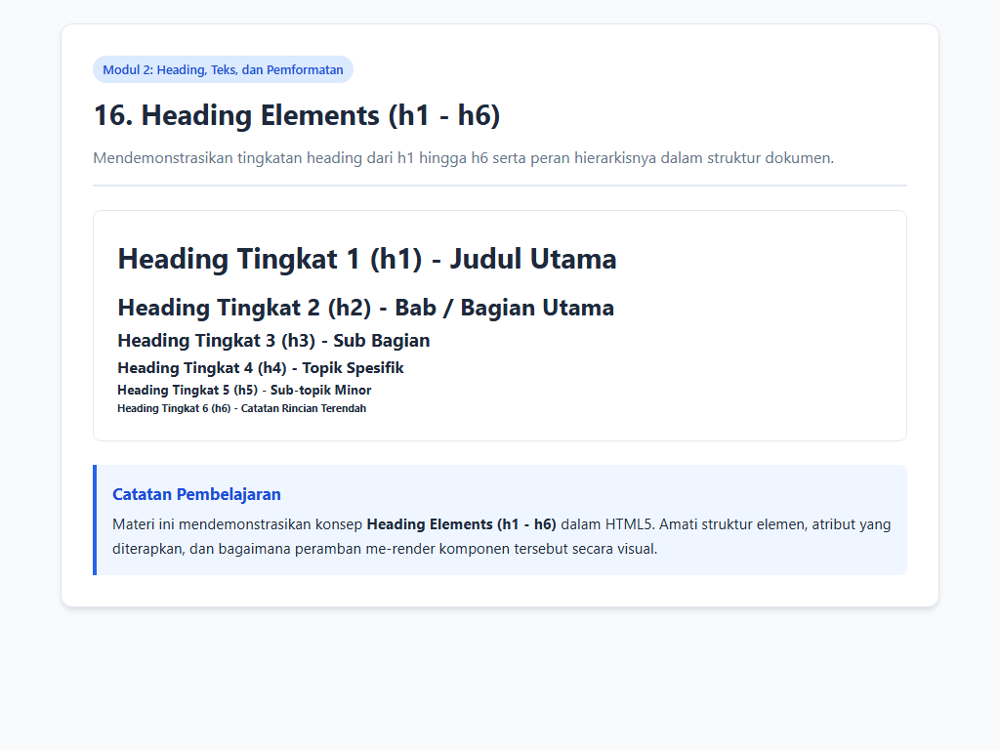

- **Lokasi Source Code:** [16_heading_elements.html](16_heading_elements.html)

---

### 2. Elemen Paragraf

- **Tujuan Pembelajaran:** Menguasai pembentukan paragraf menggunakan tag 
.
- **Konsep Utama:** Elemen 
 adalah elemen block-level pembungkus teks dengan margin pemisah vertikal.
- **Penjelasan Source Code:** Menyajikan dua paragraf yang dipisahkan secara otomatis oleh margin peramban.
- **Cara Menjalankan:** Buka file `17_paragraph_element.html` secara langsung di peramban web (Google Chrome, Mozilla Firefox, atau Microsoft Edge), atau jalankan ekstensi Live Server pada VS Code.
- **Hasil yang Diharapkan:** Dua blok teks yang terpisah rapi dengan jarak margin vertikal yang proporsional.
- **Screenshot Hasil Eksekusi:**

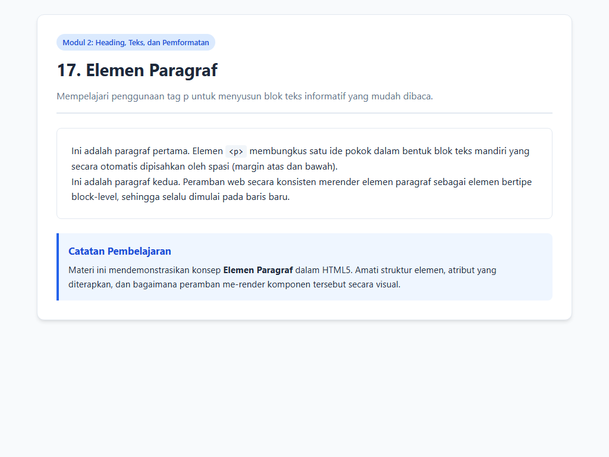

- **Lokasi Source Code:** [17_paragraph_element.html](17_paragraph_element.html)

---

### 3. Elemen br (Line Break)

- **Tujuan Pembelajaran:** Memahami kapan harus menggunakan   dibanding membuat paragraf baru.
- **Konsep Utama:** Tag   memicu baris baru (line break) tanpa menambahkan margin antar-paragraf, sangat ideal untuk penulisan puisi atau alamat fisik.
- **Penjelasan Source Code:** Menampilkan format alamat surat multibarir dalam satu elemen 
 yang dipisah dengan tag  .
- **Cara Menjalankan:** Buka file `18_line_break.html` secara langsung di peramban web (Google Chrome, Mozilla Firefox, atau Microsoft Edge), atau jalankan ekstensi Live Server pada VS Code.
- **Hasil yang Diharapkan:** Teks alamat tiga baris rapat tanpa jeda margin vertikal antar-baris.
- **Screenshot Hasil Eksekusi:**

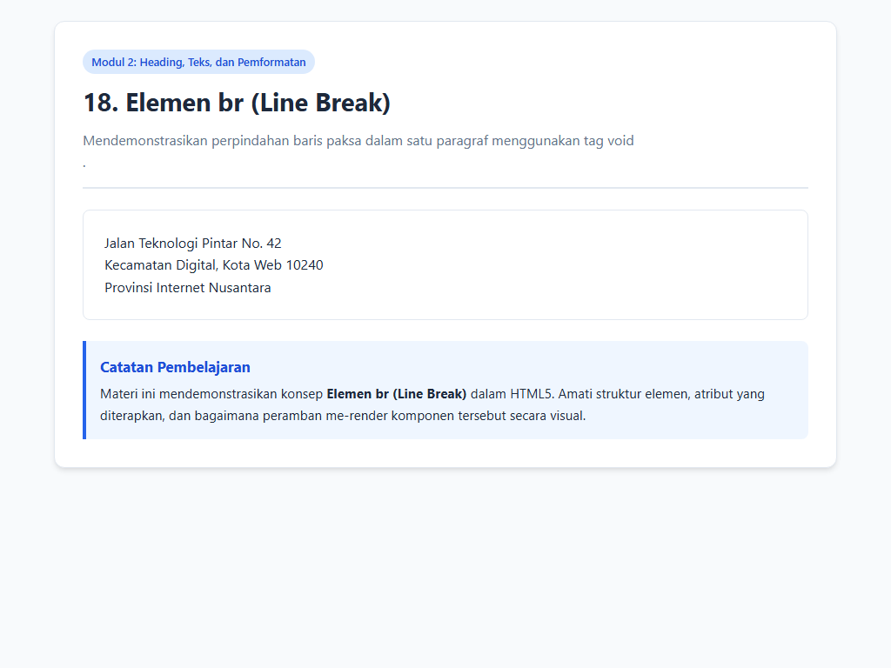

- **Lokasi Source Code:** [18_line_break.html](18_line_break.html)

---

### 4. Elemen hr (Horizontal Rule)

- **Tujuan Pembelajaran:** Mempelajari fungsi semantik elemen 
 dalam memisahkan topik pembahasan.
- **Konsep Utama:** Elemen 
 merepresentasikan jeda tematik (thematic break) tingkat paragraf.
- **Penjelasan Source Code:** Mendemonstrasikan dua bagian konten yang dipisahkan oleh garis horizontal pemisah.
- **Cara Menjalankan:** Buka file `19_horizontal_rule.html` secara langsung di peramban web (Google Chrome, Mozilla Firefox, atau Microsoft Edge), atau jalankan ekstensi Live Server pada VS Code.
- **Hasil yang Diharapkan:** Dua bagian teks yang dipisahkan secara tegas oleh garis horizontal.
- **Screenshot Hasil Eksekusi:**

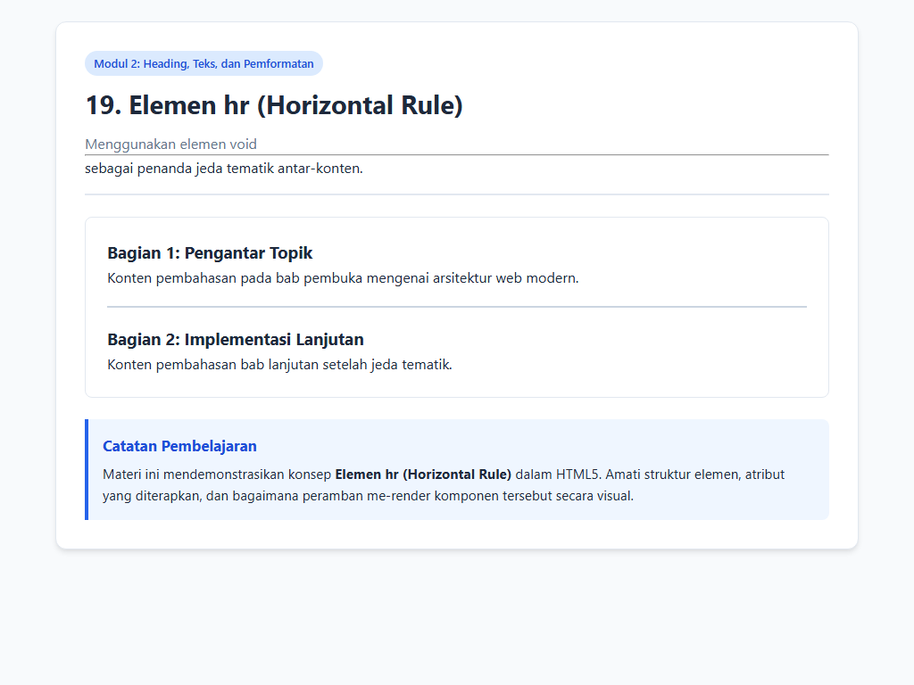

- **Lokasi Source Code:** [19_horizontal_rule.html](19_horizontal_rule.html)

---

### 5. Elemen strong

- **Tujuan Pembelajaran:** Memahami makna semantik penting (strong importance) pada elemen <strong>.
- **Konsep Utama:** Tag <strong> memberikan bobot semantik tinggi yang diterjemahkan sebagai tebal secara visual dan penekanan suara pada screen reader.
- **Penjelasan Source Code:** Menampilkan pesan peringatan keamanan dengan penekanan pada frasa kata sandi.
- **Cara Menjalankan:** Buka file `20_strong_element.html` secara langsung di peramban web (Google Chrome, Mozilla Firefox, atau Microsoft Edge), atau jalankan ekstensi Live Server pada VS Code.
- **Hasil yang Diharapkan:** Teks peringatan di mana frasa kata sandi tampil tebal dan tegas.
- **Screenshot Hasil Eksekusi:**

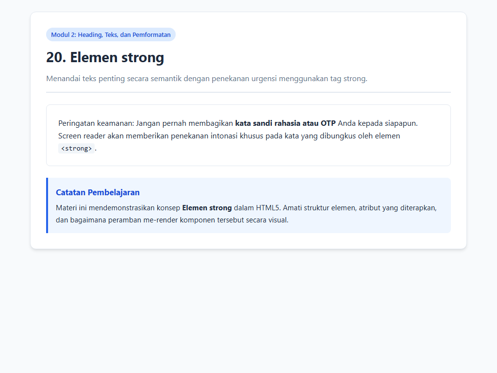

- **Lokasi Source Code:** [20_strong_element.html](20_strong_element.html)

---

### 6. Elemen em (Emphasis)

- **Tujuan Pembelajaran:** Memahami penggunaan tag <em> untuk penekanan intonasi kalimat.
- **Konsep Utama:** Tag <em> mengubah makna tuturan dengan memberi tekanan vokal yang dirender miring secara default.
- **Penjelasan Source Code:** Menampilkan kalimat klarifikasi dengan penekanan miring pada kata 'tidak'.
- **Cara Menjalankan:** Buka file `21_emphasis_element.html` secara langsung di peramban web (Google Chrome, Mozilla Firefox, atau Microsoft Edge), atau jalankan ekstensi Live Server pada VS Code.
- **Hasil yang Diharapkan:** Kalimat dengan kata kunci tercetak miring sebagai penanda penekanan makna.
- **Screenshot Hasil Eksekusi:**

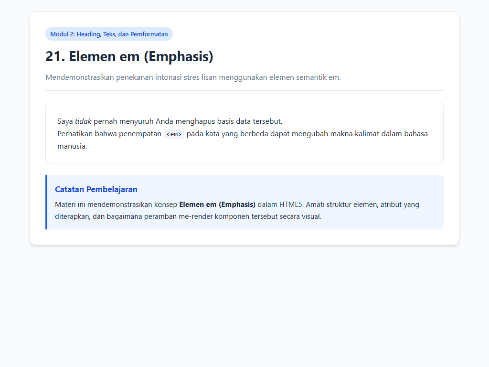

- **Lokasi Source Code:** [21_emphasis_element.html](21_emphasis_element.html)

---

### 7. Elemen b (Bold Text)

- **Tujuan Pembelajaran:** Membedakan penggunaan elemen <b> dengan <strong>.
- **Konsep Utama:** Tag <b> digunakan untuk menarik perhatian tipografis tanpa menyiratkan kepentingan lebih tinggi.
- **Penjelasan Source Code:** Menampilkan kalimat daftar warna produk dengan kata warna yang dicetak tebal murni.
- **Cara Menjalankan:** Buka file `22_bold_text.html` secara langsung di peramban web (Google Chrome, Mozilla Firefox, atau Microsoft Edge), atau jalankan ekstensi Live Server pada VS Code.
- **Hasil yang Diharapkan:** Paragraf teks dengan kata-kata warna tercetak tebal untuk memudahkan pemindaian mata.
- **Screenshot Hasil Eksekusi:**

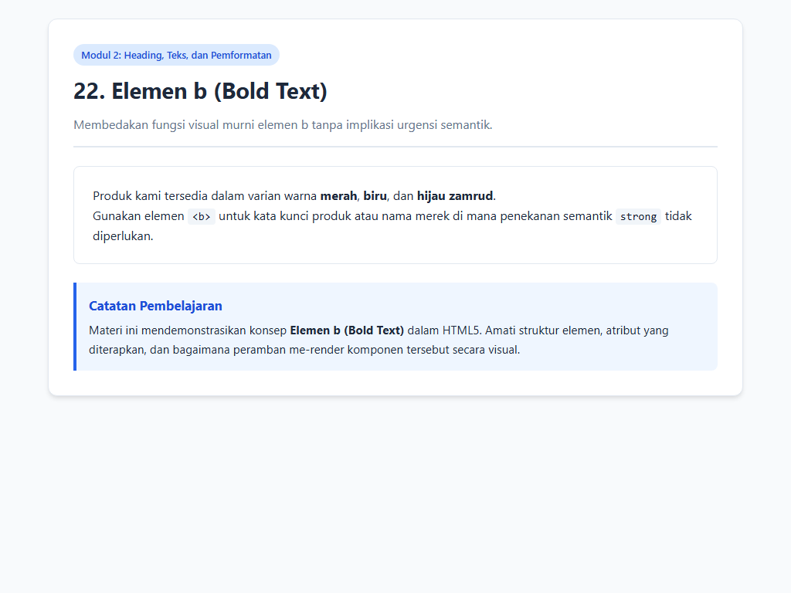

- **Lokasi Source Code:** [22_bold_text.html](22_bold_text.html)

---

### 8. Elemen i (Italic Text)

- **Tujuan Pembelajaran:** Mengetahui peruntukan semantik elemen <i> dibanding <em>.
- **Konsep Utama:** Tag <i> menyajikan teks dalam suara atau suasana berbeda, seperti istilah latin taksonomi.
- **Penjelasan Source Code:** Menampilkan nama latin ilmiah dan kutipan batin dengan format huruf miring.
- **Cara Menjalankan:** Buka file `23_italic_text.html` secara langsung di peramban web (Google Chrome, Mozilla Firefox, atau Microsoft Edge), atau jalankan ekstensi Live Server pada VS Code.
- **Hasil yang Diharapkan:** Paragraf dengan nama latin Felis catus tercetak miring proporsional.
- **Screenshot Hasil Eksekusi:**

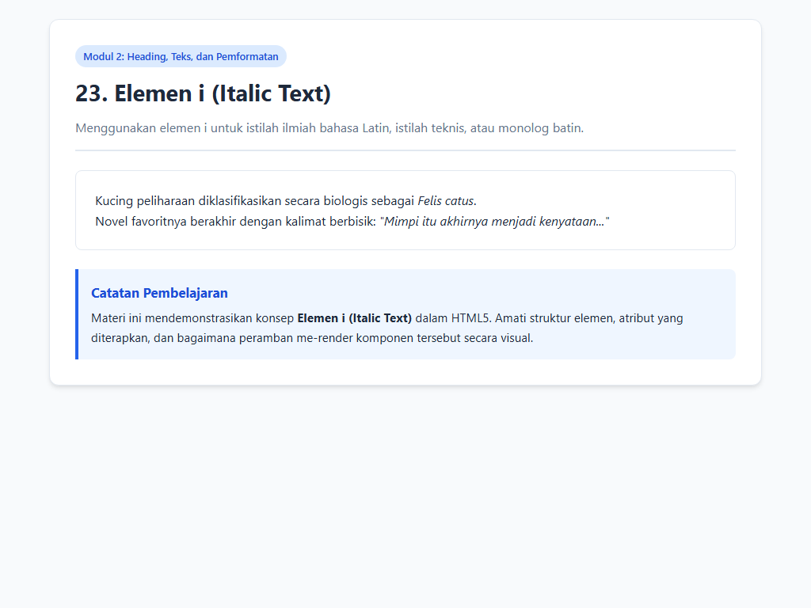

- **Lokasi Source Code:** [23_italic_text.html](23_italic_text.html)

---

### 9. Elemen u (Underline Text)

- **Tujuan Pembelajaran:** Memahami batasan dan etika penggunaan tag <u> agar tidak disangka tautan link.
- **Konsep Utama:** Tag <u> memberi garis bawah untuk anotasi penulisan tanpa makna tautan.
- **Penjelasan Source Code:** Menampilkan contoh penandaan kata typo bergaris bawah bergelombang.
- **Cara Menjalankan:** Buka file `24_underline_text.html` secara langsung di peramban web (Google Chrome, Mozilla Firefox, atau Microsoft Edge), atau jalankan ekstensi Live Server pada VS Code.
- **Hasil yang Diharapkan:** Teks bergaris bawah yang menunjukkan deteksi kesalahan penulisan kata.
- **Screenshot Hasil Eksekusi:**

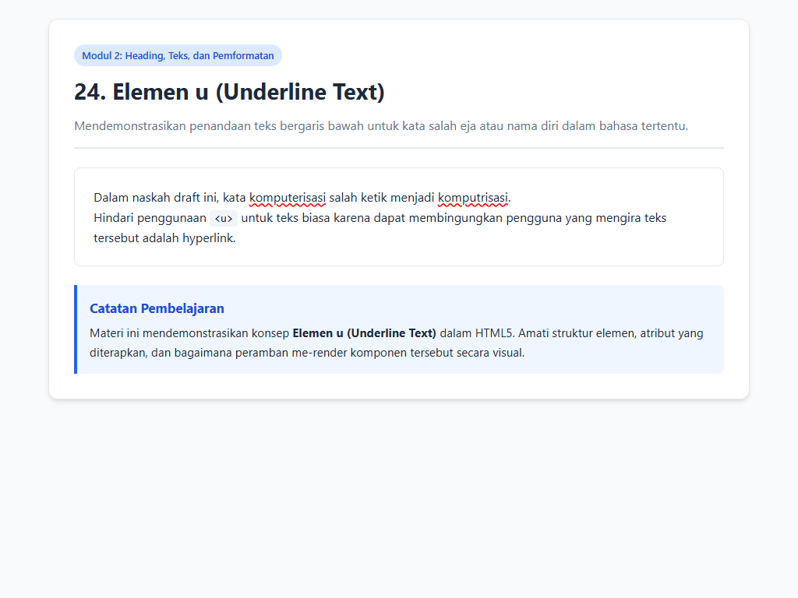

- **Lokasi Source Code:** [24_underline_text.html](24_underline_text.html)

---

### 10. Elemen mark

- **Tujuan Pembelajaran:** Menguasai penyorotan teks hasil pencarian dengan elemen <mark>.
- **Konsep Utama:** Tag <mark> merender latar belakang kuning terang secara bawaan sebagai penanda kata yang relevan.
- **Penjelasan Source Code:** Menampilkan simulasi hasil pencarian dengan kata kunci HTML5 yang tersorot kuning.
- **Cara Menjalankan:** Buka file `25_mark_element.html` secara langsung di peramban web (Google Chrome, Mozilla Firefox, atau Microsoft Edge), atau jalankan ekstensi Live Server pada VS Code.
- **Hasil yang Diharapkan:** Teks dengan kata kunci HTML5 memiliki latar belakang stabilo kuning mencolok.
- **Screenshot Hasil Eksekusi:**

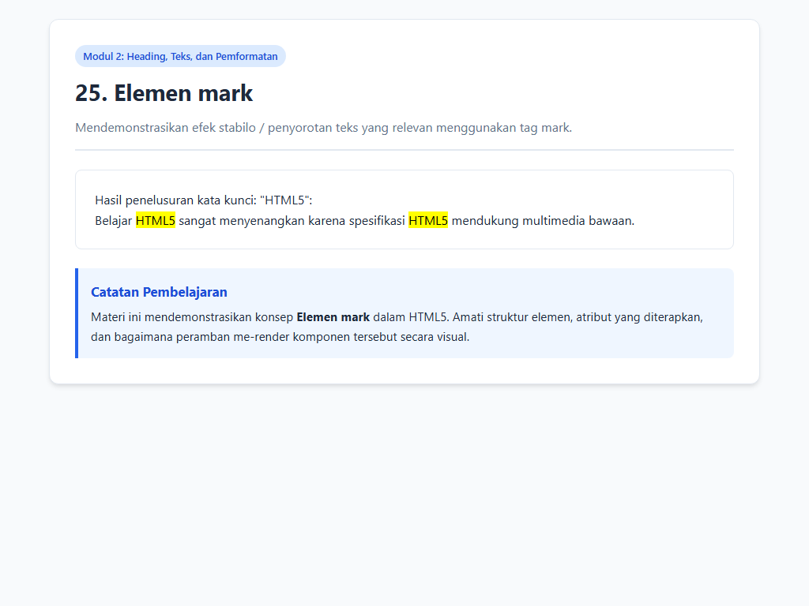

- **Lokasi Source Code:** [25_mark_element.html](25_mark_element.html)

---

### 11. Elemen small

- **Tujuan Pembelajaran:** Mempelajari pemformatan teks legal dan catatan kaki dengan tag <small>.
- **Konsep Utama:** Elemen <small> merepresentasikan komentar sampingan (side comments) dan teks berukuran lebih kecil.
- **Penjelasan Source Code:** Menampilkan harga produk diikuti klausul syarat ketentuan dalam ukuran teks lebih kecil.
- **Cara Menjalankan:** Buka file `26_small_element.html` secara langsung di peramban web (Google Chrome, Mozilla Firefox, atau Microsoft Edge), atau jalankan ekstensi Live Server pada VS Code.
- **Hasil yang Diharapkan:** Teks syarat dan ketentuan tercetak dalam ukuran font yang lebih kecil dan halus.
- **Screenshot Hasil Eksekusi:**

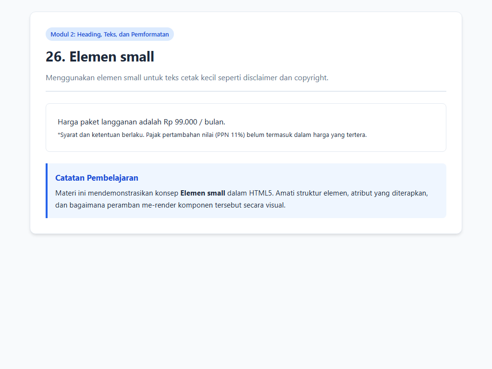

- **Lokasi Source Code:** [26_small_element.html](26_small_element.html)

---

### 12. Elemen del

- **Tujuan Pembelajaran:** Memahami fungsi semantik penghapusan data dengan elemen <del>.
- **Konsep Utama:** Tag <del> menandai rentang teks yang telah dihapus dari dokumen dan dirender dengan garis coret tengah.
- **Penjelasan Source Code:** Menampilkan pencoretan harga lama dalam skenario diskon promosi.
- **Cara Menjalankan:** Buka file `27_deleted_text.html` secara langsung di peramban web (Google Chrome, Mozilla Firefox, atau Microsoft Edge), atau jalankan ekstensi Live Server pada VS Code.
- **Hasil yang Diharapkan:** Teks harga lama tercoret rapi dengan garis strikethrough horizontal.
- **Screenshot Hasil Eksekusi:**

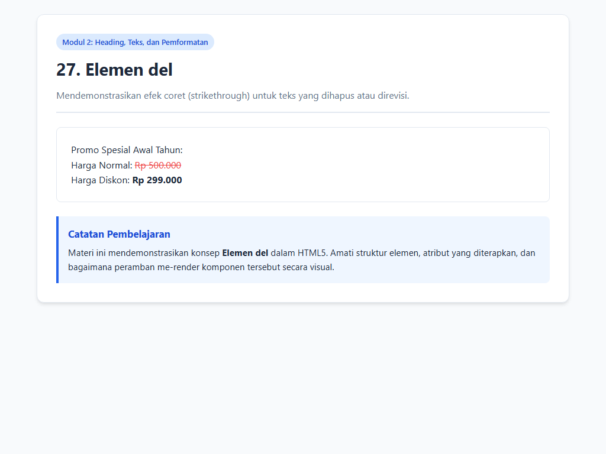

- **Lokasi Source Code:** [27_deleted_text.html](27_deleted_text.html)

---

### 13. Elemen ins

- **Tujuan Pembelajaran:** Mempelajari penandaan teks baru yang disisipkan menggunakan elemen <ins>.
- **Konsep Utama:** Elemen <ins> merepresentasikan penambahan konten dokumen dan dirender bergaris bawah secara default.
- **Penjelasan Source Code:** Menampilkan revisi dokumen di mana kata lama dicoret dan kata pengganti disisipkan.
- **Cara Menjalankan:** Buka file `28_inserted_text.html` secara langsung di peramban web (Google Chrome, Mozilla Firefox, atau Microsoft Edge), atau jalankan ekstensi Live Server pada VS Code.
- **Hasil yang Diharapkan:** Kalimat revisi dengan teks lama dicoret merah dan teks baru tersisip hijau.
- **Screenshot Hasil Eksekusi:**

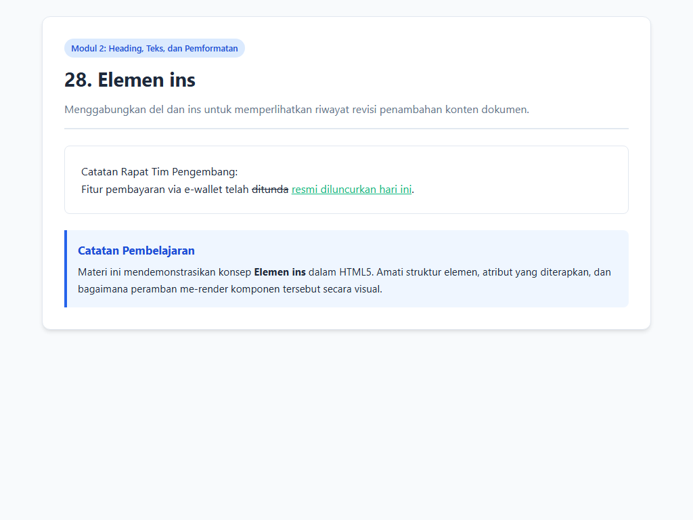

- **Lokasi Source Code:** [28_inserted_text.html](28_inserted_text.html)

---

### 14. Elemen sub (Subscript)

- **Tujuan Pembelajaran:** Menguasai pembuatan teks bersubskrip untuk rumus kimia dan matematika.
- **Konsep Utama:** Tag  merender teks lebih kecil dengan posisi baseline lebih rendah.
- **Penjelasan Source Code:** Mendemonstrasikan penulisan rumus kimia H2O dan CO2 dengan angka indeks turun.
- **Cara Menjalankan:** Buka file `29_subscript_text.html` secara langsung di peramban web (Google Chrome, Mozilla Firefox, atau Microsoft Edge), atau jalankan ekstensi Live Server pada VS Code.
- **Hasil yang Diharapkan:** Teks rumus kimia di mana angka 2 berada di bagian bawah huruf H dan O.
- **Screenshot Hasil Eksekusi:**

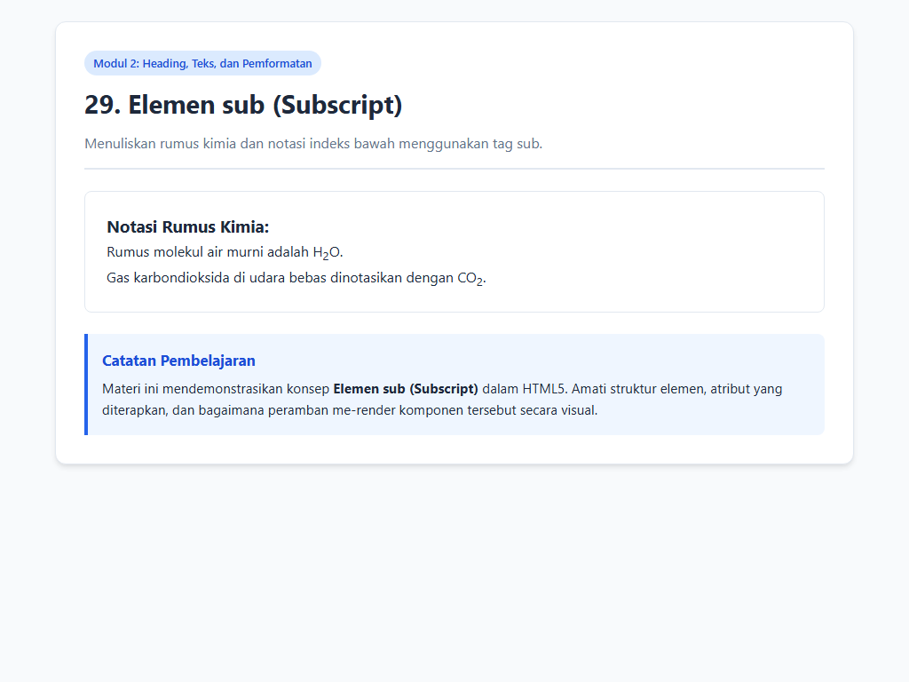

- **Lokasi Source Code:** [29_subscript_text.html](29_subscript_text.html)

---

### 15. Elemen sup (Superscript)

- **Tujuan Pembelajaran:** Memahami penulisan pangkat dan nomor rujukan dengan elemen .
- **Konsep Utama:** Tag  memposisikan teks di atas baseline huruf normal dengan ukuran diperkecil.
- **Penjelasan Source Code:** Menampilkan persamaan kuadrat Pythagoras dan nomor catatan kaki.
- **Cara Menjalankan:** Buka file `30_superscript_text.html` secara langsung di peramban web (Google Chrome, Mozilla Firefox, atau Microsoft Edge), atau jalankan ekstensi Live Server pada VS Code.
- **Hasil yang Diharapkan:** Persamaan matematika a² + b² = c² dengan angka eksponen terangkat rapi.
- **Screenshot Hasil Eksekusi:**

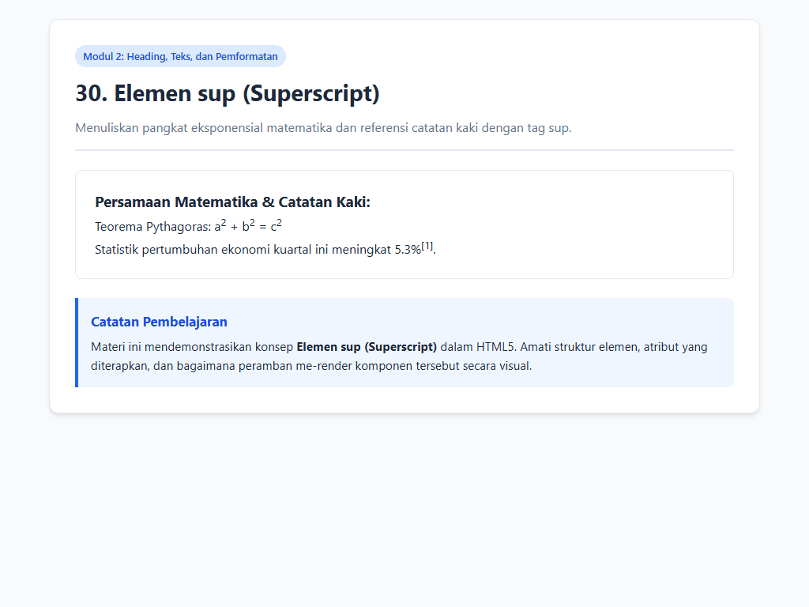

- **Lokasi Source Code:** [30_superscript_text.html](30_superscript_text.html)

---

### 16. Elemen abbr (Abbreviation)

- **Tujuan Pembelajaran:** Menyediakan kepanjangan akronim yang ramah aksesibilitas dengan <abbr>.
- **Konsep Utama:** Tag <abbr> dengan atribut title memberikan penjelasan ekspansi akronim kepada pengguna dan mesin pembaca.
- **Penjelasan Source Code:** Menampilkan singkatan W3C, HTML, dan CSS yang dapat di-hover untuk memunculkan tooltip.
- **Cara Menjalankan:** Buka file `31_abbreviation.html` secara langsung di peramban web (Google Chrome, Mozilla Firefox, atau Microsoft Edge), atau jalankan ekstensi Live Server pada VS Code.
- **Hasil yang Diharapkan:** Teks singkatan dengan garis bawah titik-titik yang memunculkan tooltip kepanjangan saat diarahkan mouse.
- **Screenshot Hasil Eksekusi:**

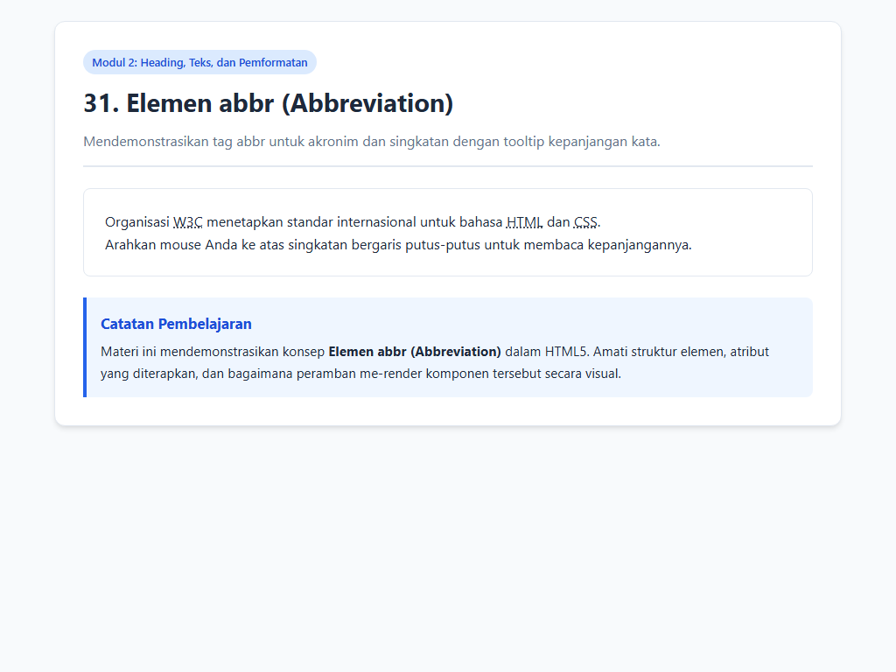

- **Lokasi Source Code:** [31_abbreviation.html](31_abbreviation.html)

---

### 17. Elemen cite

- **Tujuan Pembelajaran:** Memahami peran semantik elemen <cite> untuk judul karya kreatif.
- **Konsep Utama:** Elemen <cite> merujuk pada judul karya seni atau publikasi (bukan nama pengarang) dan dirender miring.
- **Penjelasan Source Code:** Menampilkan referensi judul buku dan judul film dalam kalimat.
- **Cara Menjalankan:** Buka file `32_citation_element.html` secara langsung di peramban web (Google Chrome, Mozilla Firefox, atau Microsoft Edge), atau jalankan ekstensi Live Server pada VS Code.
- **Hasil yang Diharapkan:** Judul karya tercetak miring semantik yang menandakan sitasi karya referensi.
- **Screenshot Hasil Eksekusi:**

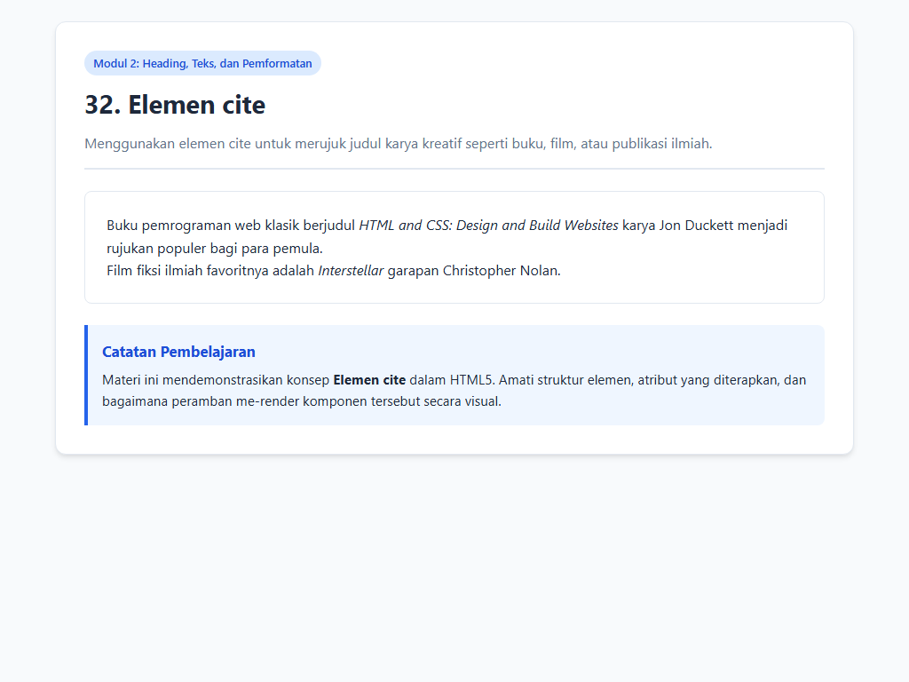

- **Lokasi Source Code:** [32_citation_element.html](32_citation_element.html)

---

### 18. Elemen q (Inline Quote)

- **Tujuan Pembelajaran:** Memahami pembuatan kutipan sebaris (inline) dengan tag <q>.
- **Konsep Utama:** Elemen <q> menyisipkan tanda kutip otomatis di sekitar teks tanpa perlu mengetik simbol petik manual.
- **Penjelasan Source Code:** Menampilkan kalimat kutipan tokoh terkenal di mana tanda petik digenerate otomatis oleh peramban.
- **Cara Menjalankan:** Buka file `33_inline_quote.html` secara langsung di peramban web (Google Chrome, Mozilla Firefox, atau Microsoft Edge), atau jalankan ekstensi Live Server pada VS Code.
- **Hasil yang Diharapkan:** Teks kutipan yang secara otomatis terbungkus tanda petik ganda peramban.
- **Screenshot Hasil Eksekusi:**

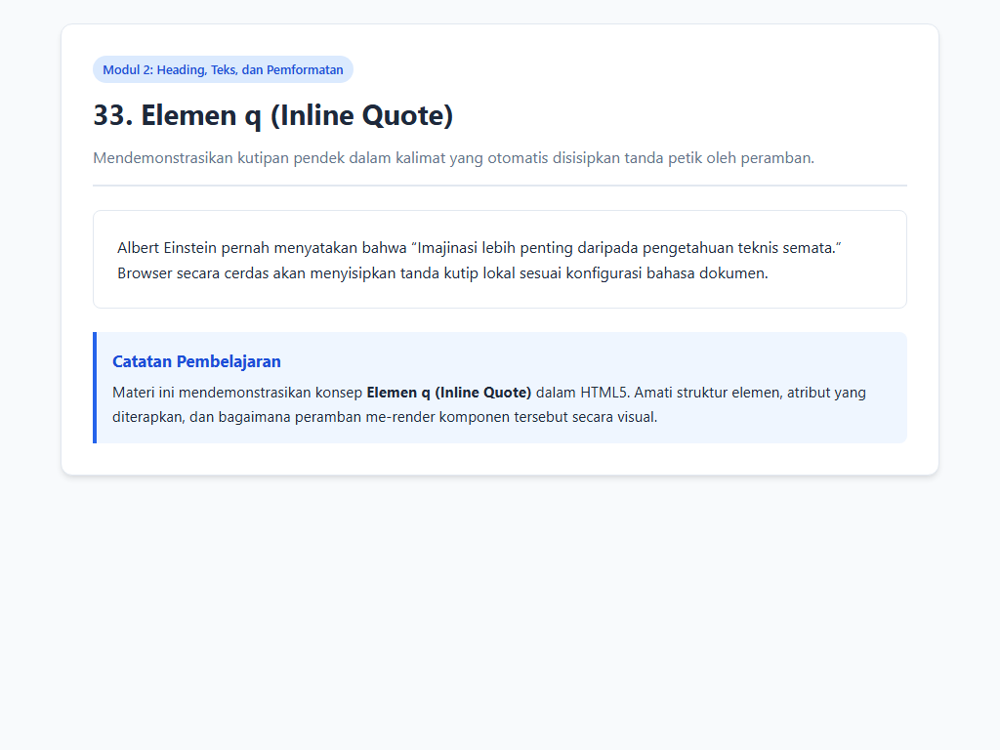

- **Lokasi Source Code:** [33_inline_quote.html](33_inline_quote.html)

---

### 19. Elemen blockquote

- **Tujuan Pembelajaran:** Menguasai pembuatan blok kutipan panjang dengan elemen <blockquote>.
- **Konsep Utama:** Blockquote mengisolasi teks kutipan panjang dengan indentasi dan menyediakan atribut cite untuk URL sumber.
- **Penjelasan Source Code:** Menampilkan kutipan inspiratif Tim Berners-Lee dengan garis batas vertikal kiri dan keterangan sumber.
- **Cara Menjalankan:** Buka file `34_blockquote_element.html` secara langsung di peramban web (Google Chrome, Mozilla Firefox, atau Microsoft Edge), atau jalankan ekstensi Live Server pada VS Code.
- **Hasil yang Diharapkan:** Kotak kutipan berbingkai kiri biru dengan teks miring dan atribusi nama di bawahnya.
- **Screenshot Hasil Eksekusi:**

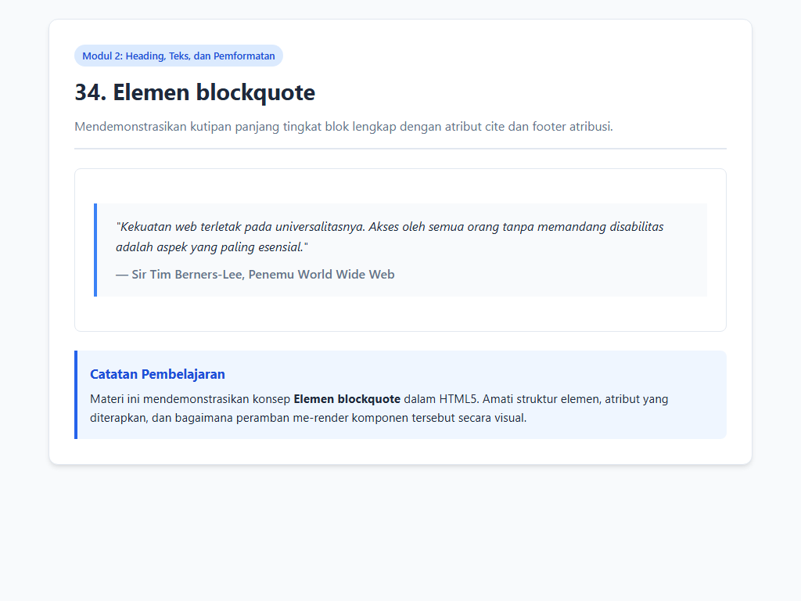

- **Lokasi Source Code:** [34_blockquote_element.html](34_blockquote_element.html)

---

### 20. Elemen pre dan code

- **Tujuan Pembelajaran:** Memahami cara menyajikan kode pemrograman di halaman web menggunakan <pre> dan <code>.
- **Konsep Utama:** Elemen <pre> mempertahankan whitespace dan newline persis seperti aslinya, sementara <code> menandai semantik kode komputer.
- **Penjelasan Source Code:** Menampilkan fungsi JavaScript yang diformat rapi dengan monospace font di dalam kotak gelap.
- **Cara Menjalankan:** Buka file `35_preformatted_text.html` secara langsung di peramban web (Google Chrome, Mozilla Firefox, atau Microsoft Edge), atau jalankan ekstensi Live Server pada VS Code.
- **Hasil yang Diharapkan:** Blok kode berlatar belakang gelap dengan font monospace dan indentasi program yang presisi.
- **Screenshot Hasil Eksekusi:**

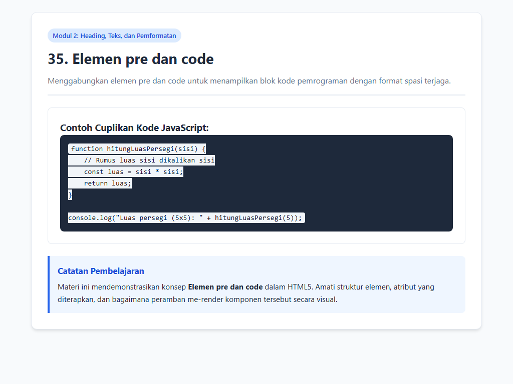

- **Lokasi Source Code:** [35_preformatted_text.html](35_preformatted_text.html)

---

## Ringkasan Modul
Modul 2 menyajikan pondasi penting mengenai Heading, Teks, dan Pemformatan. Pemahaman menyeluruh terhadap submodul di atas menjadi prasyarat penting sebelum melangkah ke modul berikutnya.
