# Modul 3: Hyperlink dan Navigasi

## Ringkasan Ruang Lingkup Materi
Modul ini membahas konsep dasar dan implementasi praktis seputar **Hyperlink dan Navigasi**. Setiap submodul dirancang secara terisolasi agar pembelajar dapat memahami konsep satu per satu secara fokus dan terstruktur.

## Tujuan Pembelajaran Modul
Setelah menyelesaikan modul ini, peserta didik diharapkan mampu memahami, mengimplementasikan, dan menguji komponen-komponen utama dalam lingkup hyperlink dan navigasi sesuai standar modern W3C.

## Daftar Materi atau Submodul

- [36_basic_hyperlink.html](36_basic_hyperlink.html) - Hyperlink Menggunakan a
- [37_absolute_url.html](37_absolute_url.html) - Absolute URL
- [38_relative_url.html](38_relative_url.html) - Relative URL
- [39_internal_link.html](39_internal_link.html) - Internal Page Link
- [40_external_link.html](40_external_link.html) - External Link
- [41_link_target.html](41_link_target.html) - Atribut target
- [42_link_rel.html](42_link_rel.html) - Atribut rel
- [43_email_link.html](43_email_link.html) - Link Menggunakan mailto:
- [44_telephone_link.html](44_telephone_link.html) - Link Menggunakan tel:
- [45_download_link.html](45_download_link.html) - Atribut download
- [46_anchor_navigation.html](46_anchor_navigation.html) - Anchor Navigation
- [47_page_navigation.html](47_page_navigation.html) - Navigasi Antardokumen HTML
- [48_navigation_element.html](48_navigation_element.html) - Elemen nav
- [49_breadcrumb_navigation.html](49_breadcrumb_navigation.html) - Struktur Breadcrumb Navigation
- [50_link_accessibility.html](50_link_accessibility.html) - Aksesibilitas Hyperlink

---

## Pembahasan Setiap Submodul

### 1. Hyperlink Menggunakan a

- **Tujuan Pembelajaran:** Memahami konsep tautan hiperteks yang menghubungkan dokumen web.
- **Konsep Utama:** Elemen <a> dengan atribut href (hypertext reference) mendefinisikan target navigasi saat teks diklik.
- **Penjelasan Source Code:** Menampilkan hyperlink menuju portal dokumentasi MDN dengan styling warna biru khas link.
- **Cara Menjalankan:** Buka file `36_basic_hyperlink.html` secara langsung di peramban web (Google Chrome, Mozilla Firefox, atau Microsoft Edge), atau jalankan ekstensi Live Server pada VS Code.
- **Hasil yang Diharapkan:** Teks hyperlink interaktif berwarna biru bergaris bawah yang dapat diklik.
- **Screenshot Hasil Eksekusi:**

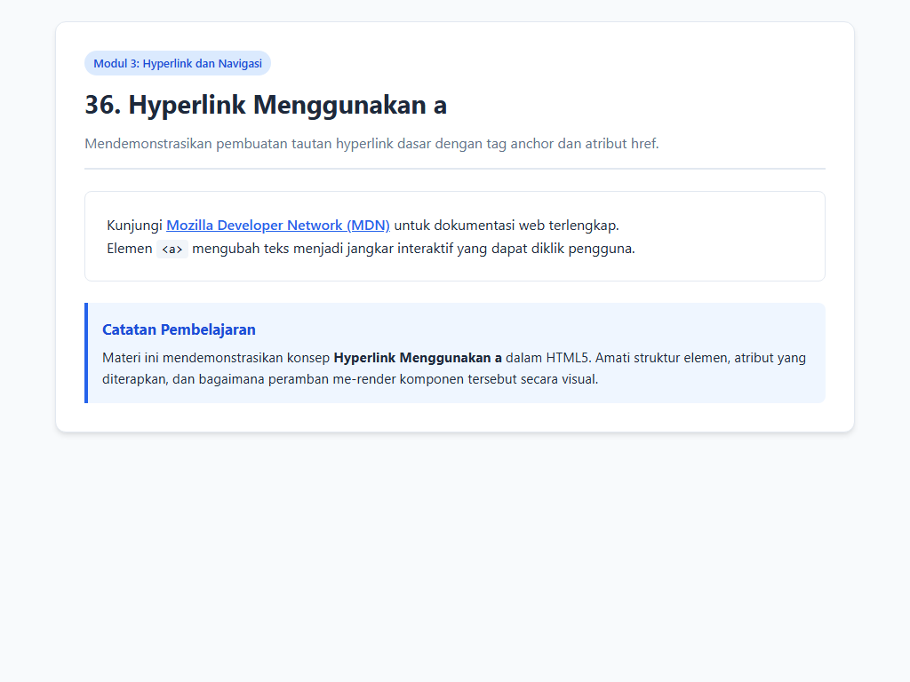

- **Lokasi Source Code:** [36_basic_hyperlink.html](36_basic_hyperlink.html)

---

### 2. Absolute URL

- **Tujuan Pembelajaran:** Mengenali format Absolute URL untuk menautkan halaman di server luar.
- **Konsep Utama:** Absolute URL menyatakan lokasi absolut suatu berkas di seluruh jaringan global World Wide Web.
- **Penjelasan Source Code:** Menampilkan daftar tautan eksternal dengan skema protokol https:// dan nama host domain.
- **Cara Menjalankan:** Buka file `37_absolute_url.html` secara langsung di peramban web (Google Chrome, Mozilla Firefox, atau Microsoft Edge), atau jalankan ekstensi Live Server pada VS Code.
- **Hasil yang Diharapkan:** Daftar tautan internet lengkap menuju situs W3C dan Wikipedia.
- **Screenshot Hasil Eksekusi:**

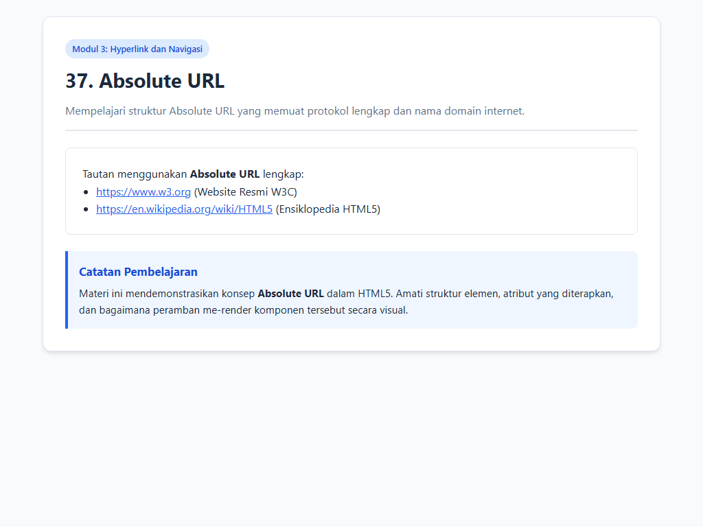

- **Lokasi Source Code:** [37_absolute_url.html](37_absolute_url.html)

---

### 3. Relative URL

- **Tujuan Pembelajaran:** Memahami logika navigasi relative path antar-direktori.
- **Konsep Utama:** Relative URL merujuk lokasi file relatif terhadap lokasi dokumen HTML yang sedang dibuka saat itu.
- **Penjelasan Source Code:** Menjelaskan pola penulisan path selevel, subfolder, dan parent folder (..) beserta tautan uji coba lokal.
- **Cara Menjalankan:** Buka file `38_relative_url.html` secara langsung di peramban web (Google Chrome, Mozilla Firefox, atau Microsoft Edge), atau jalankan ekstensi Live Server pada VS Code.
- **Hasil yang Diharapkan:** Panduan daftar relative path disertai tautan aktif ke file materi sebelumnya.
- **Screenshot Hasil Eksekusi:**

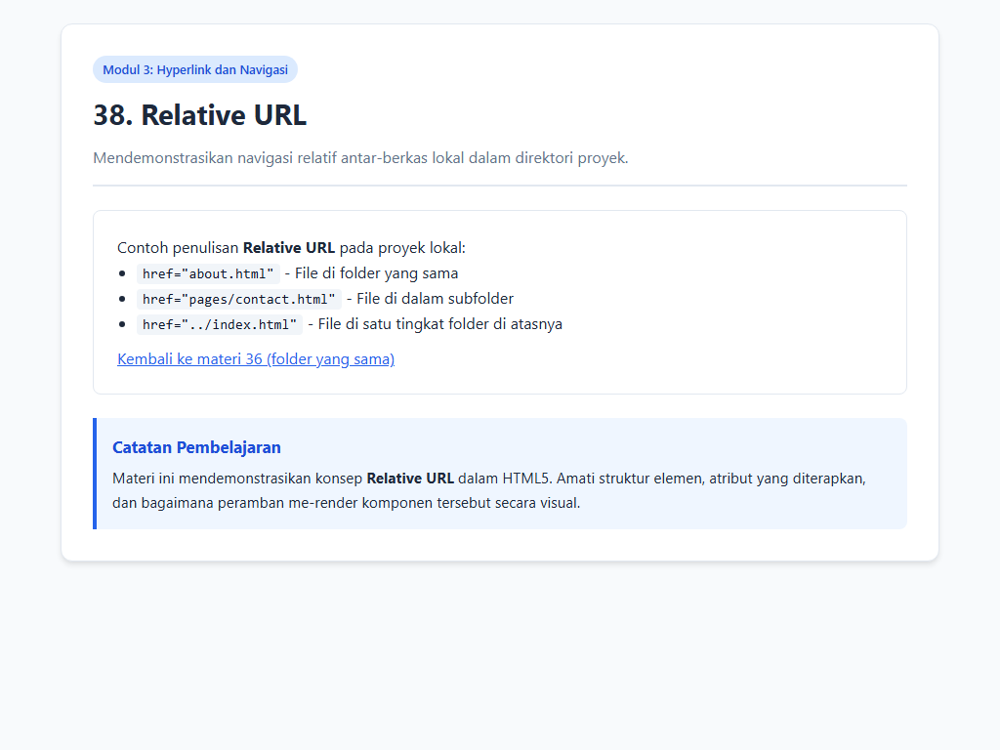

- **Lokasi Source Code:** [38_relative_url.html](38_relative_url.html)

---

### 4. Internal Page Link

- **Tujuan Pembelajaran:** Menyusun skema tautan internal untuk menjelajahi halaman-halaman dalam satu situs.
- **Konsep Utama:** Tautan internal memfasilitasi penjelajahan terpadu antardokumen milik website yang sama.
- **Penjelasan Source Code:** Menampilkan bar navigasi sederhana dengan tautan internal ke modul-modul terkait.
- **Cara Menjalankan:** Buka file `39_internal_link.html` secara langsung di peramban web (Google Chrome, Mozilla Firefox, atau Microsoft Edge), atau jalankan ekstensi Live Server pada VS Code.
- **Hasil yang Diharapkan:** Bilah menu navigasi dengan tiga tautan internal berurutan.
- **Screenshot Hasil Eksekusi:**

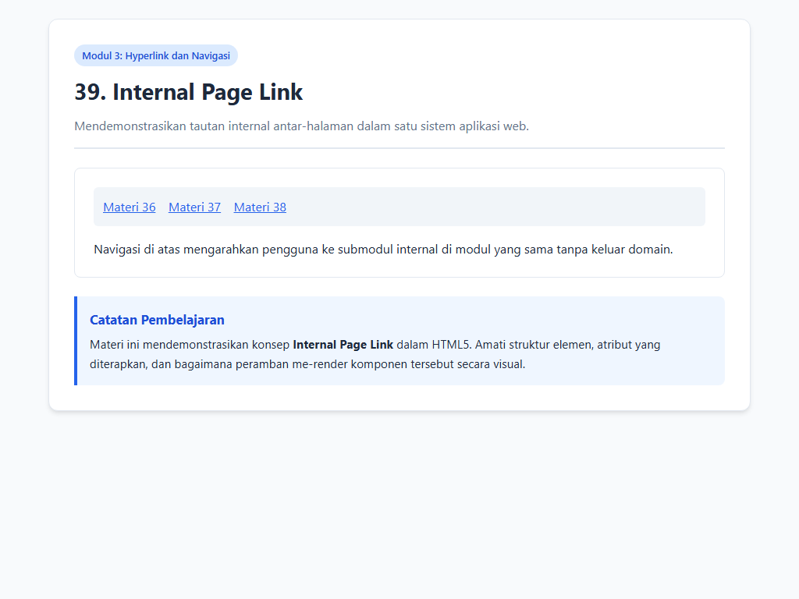

- **Lokasi Source Code:** [39_internal_link.html](39_internal_link.html)

---

### 5. External Link

- **Tujuan Pembelajaran:** Memahami teknik penautan ke sumber daya web di server pihak ketiga.
- **Konsep Utama:** Tautan eksternal mengarahkan peramban keluar dari origin situs saat ini ke origin baru.
- **Penjelasan Source Code:** Menampilkan kartu referensi eksternal menuju standar konsorsium WHATWG.
- **Cara Menjalankan:** Buka file `40_external_link.html` secara langsung di peramban web (Google Chrome, Mozilla Firefox, atau Microsoft Edge), atau jalankan ekstensi Live Server pada VS Code.
- **Hasil yang Diharapkan:** Kotak kartu referensi berisi tombol tautan eksternal menuju domain luar.
- **Screenshot Hasil Eksekusi:**

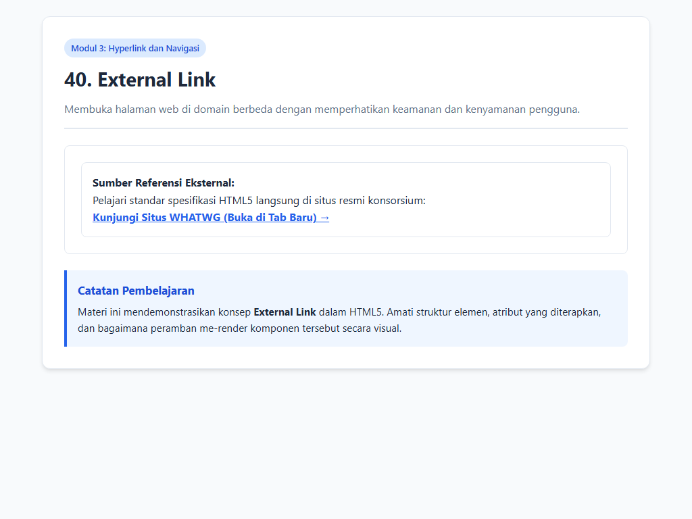

- **Lokasi Source Code:** [40_external_link.html](40_external_link.html)

---

### 6. Atribut target

- **Tujuan Pembelajaran:** Menguasai nilai atribut target (_self, _blank, _parent, _top) pada elemen anchor.
- **Konsep Utama:** Atribut target menentukan browsing context tempat dokumen hasil tautan akan ditampilkan.
- **Penjelasan Source Code:** Menampilkan daftar komprehensif nilai atribut target beserta penjelasan perilaku masing-masing.
- **Cara Menjalankan:** Buka file `41_link_target.html` secara langsung di peramban web (Google Chrome, Mozilla Firefox, atau Microsoft Edge), atau jalankan ekstensi Live Server pada VS Code.
- **Hasil yang Diharapkan:** Daftar penjelasan interaktif 4 macam atribut target peramban.
- **Screenshot Hasil Eksekusi:**

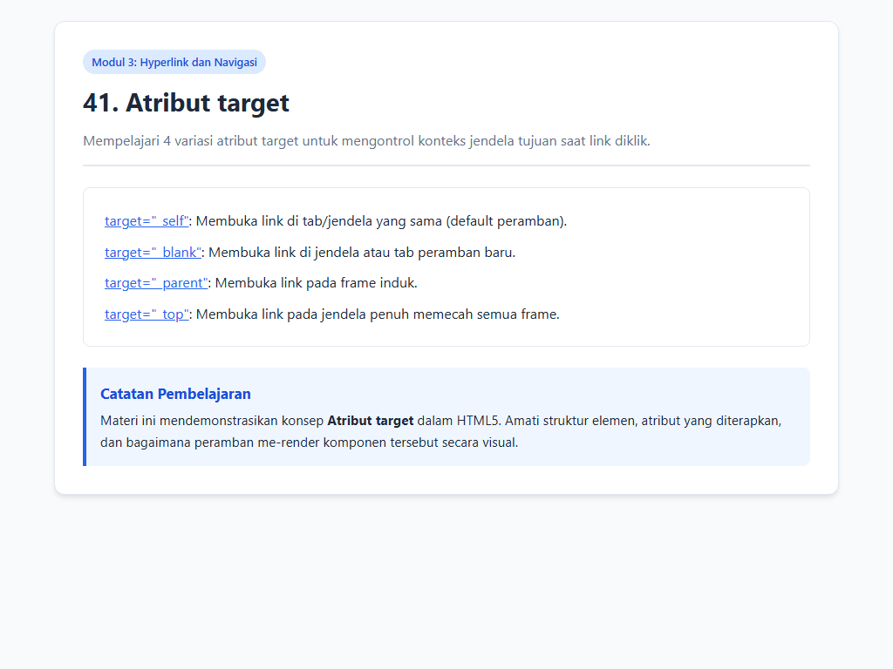

- **Lokasi Source Code:** [41_link_target.html](41_link_target.html)

---

### 7. Atribut rel

- **Tujuan Pembelajaran:** Memahami aspek keamanan hyperlink modern dengan atribut rel.
- **Konsep Utama:** Atribut rel menjamin keamanan dan performa aplikasi saat membuka tautan di tab baru.
- **Penjelasan Source Code:** Menampilkan demonstrasi tautan aman yang dilengkapi atribut rel='noopener noreferrer'.
- **Cara Menjalankan:** Buka file `42_link_rel.html` secara langsung di peramban web (Google Chrome, Mozilla Firefox, atau Microsoft Edge), atau jalankan ekstensi Live Server pada VS Code.
- **Hasil yang Diharapkan:** Informasi keamanan web mengenai pentingnya proteksi tabnabbing pada external link.
- **Screenshot Hasil Eksekusi:**

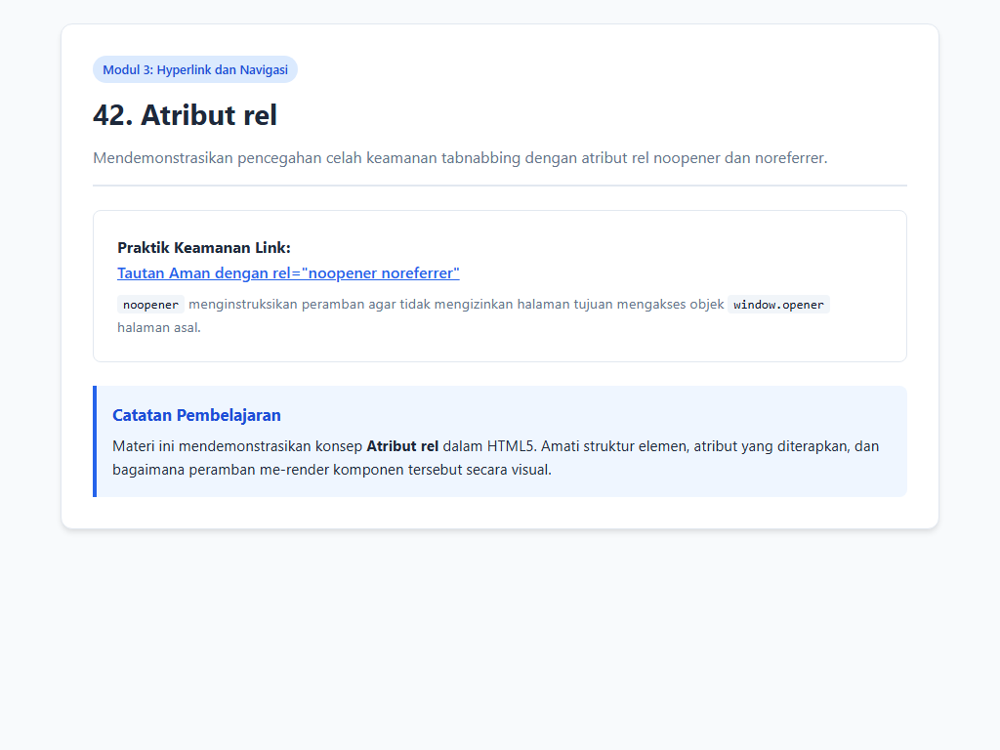

- **Lokasi Source Code:** [42_link_rel.html](42_link_rel.html)

---

### 8. Link Menggunakan mailto:

- **Tujuan Pembelajaran:** Membuat tautan langsung menuju aplikasi email pengguna.
- **Konsep Utama:** Protokol URL mailto: secara otomatis membuka aplikasi email default dengan alamat penerima dan subjek terisi.
- **Penjelasan Source Code:** Menampilkan tombol kontak yang memicu email client dengan parameter subject dan body terenkode.
- **Cara Menjalankan:** Buka file `43_email_link.html` secara langsung di peramban web (Google Chrome, Mozilla Firefox, atau Microsoft Edge), atau jalankan ekstensi Live Server pada VS Code.
- **Hasil yang Diharapkan:** Tombol aksi biru 'Kirim Email via mailto:' yang siap memanggil klien email.
- **Screenshot Hasil Eksekusi:**

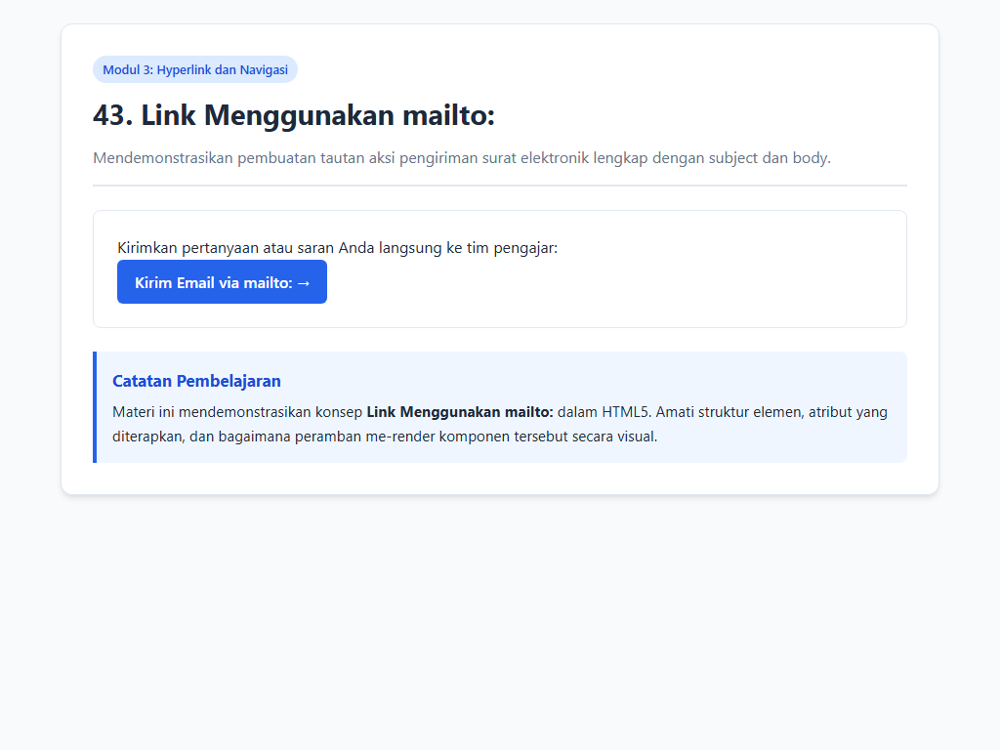

- **Lokasi Source Code:** [43_email_link.html](43_email_link.html)

---

### 9. Link Menggunakan tel:

- **Tujuan Pembelajaran:** Mempelajari integrasi panggilan telepon langsung dari halaman web.
- **Konsep Utama:** Skema URL tel: memungkinkan pengguna smartphone memulai panggilan suara langsung hanya dengan sekali klik.
- **Penjelasan Source Code:** Menampilkan tombol hijau berlabel nomor telepon dengan protokol tel: terstandarisasi internasional.
- **Cara Menjalankan:** Buka file `44_telephone_link.html` secara langsung di peramban web (Google Chrome, Mozilla Firefox, atau Microsoft Edge), atau jalankan ekstensi Live Server pada VS Code.
- **Hasil yang Diharapkan:** Tombol hijau interaktif dengan tautan pemanggil nomor telepon seluler.
- **Screenshot Hasil Eksekusi:**

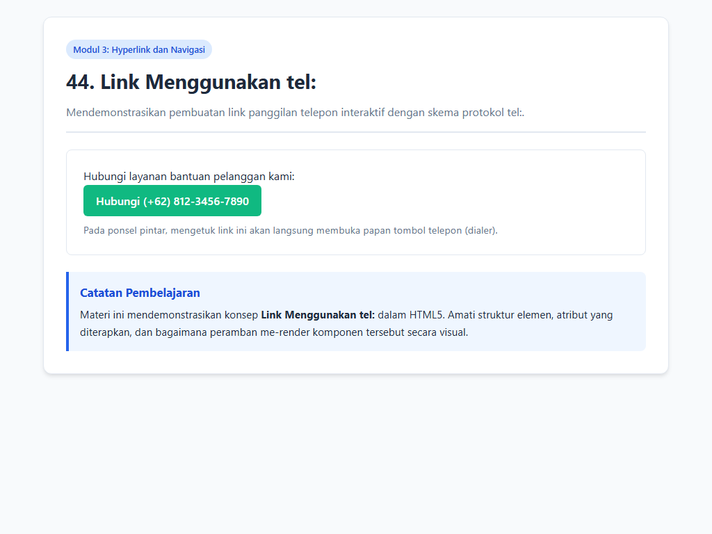

- **Lokasi Source Code:** [44_telephone_link.html](44_telephone_link.html)

---

### 10. Atribut download

- **Tujuan Pembelajaran:** Memahami fungsi pengunduhan file berkas dengan atribut download.
- **Konsep Utama:** Atribut download memerintahkan browser untuk menyimpan sumber daya ke disk lokal.
- **Penjelasan Source Code:** Menampilkan tombol pengunduhan dokumen kurikulum dengan nama berkas hasil unduhan khusus.
- **Cara Menjalankan:** Buka file `45_download_link.html` secara langsung di peramban web (Google Chrome, Mozilla Firefox, atau Microsoft Edge), atau jalankan ekstensi Live Server pada VS Code.
- **Hasil yang Diharapkan:** Tombol download ungu yang memicu penyimpanan berkas markdown ke disk lokal.
- **Screenshot Hasil Eksekusi:**

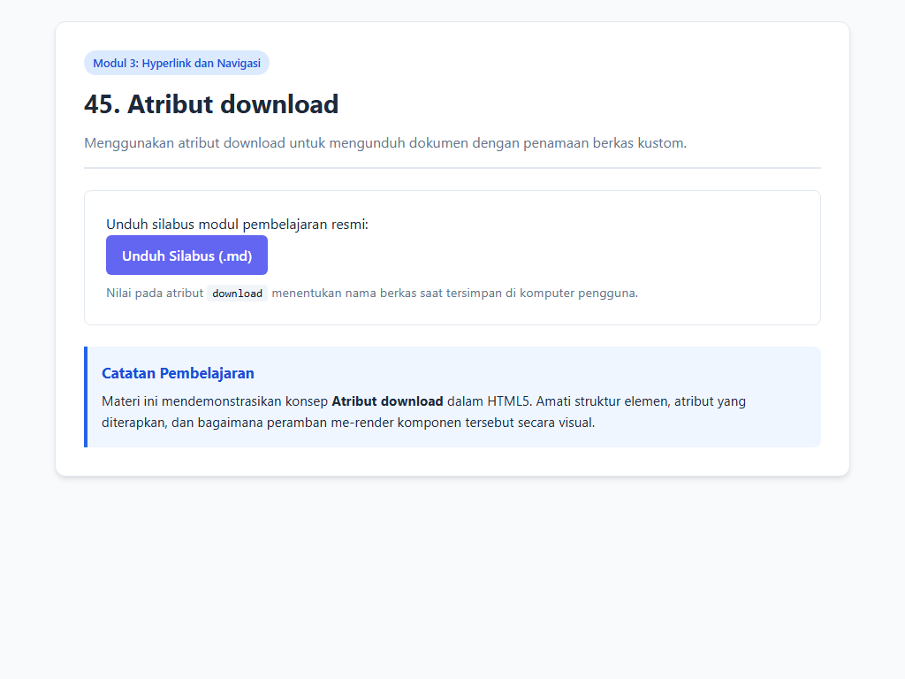

- **Lokasi Source Code:** [45_download_link.html](45_download_link.html)

---

### 11. Anchor Navigation

- **Tujuan Pembelajaran:** Membuat mekanisme navigasi dalam satu halaman (in-page anchor jumping).
- **Konsep Utama:** Tautan href='#id' mencocokkan id elemen tujuan dan menggulir viewport langsung ke elemen tersebut.
- **Penjelasan Source Code:** Menyajikan menu navigasi cepat menuju 3 bab berbeda dalam satu halaman yang sama.
- **Cara Menjalankan:** Buka file `46_anchor_navigation.html` secara langsung di peramban web (Google Chrome, Mozilla Firefox, atau Microsoft Edge), atau jalankan ekstensi Live Server pada VS Code.
- **Hasil yang Diharapkan:** Menu loncat halaman dengan 3 bagian konten bertarget id unik.
- **Screenshot Hasil Eksekusi:**

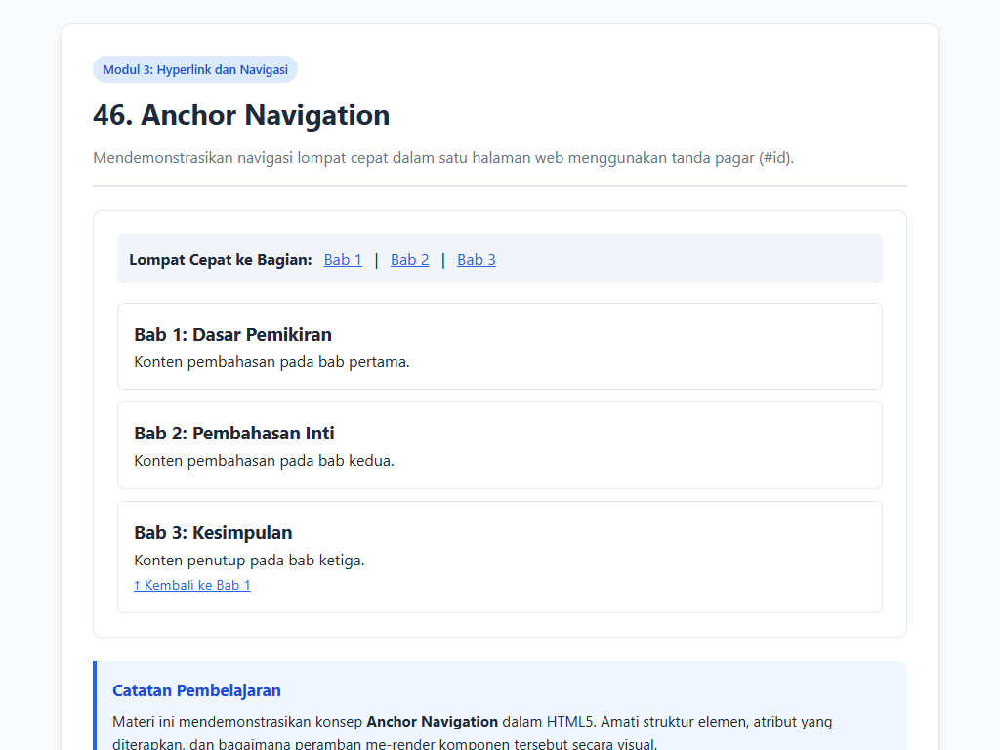

- **Lokasi Source Code:** [46_anchor_navigation.html](46_anchor_navigation.html)

---

### 12. Navigasi Antardokumen HTML

- **Tujuan Pembelajaran:** Merancang struktur menu penjelajahan multi-halaman pada situs web.
- **Konsep Utama:** Kumpulan halaman web individual dipersatukan oleh konsistensi bilah navigasi global.
- **Penjelasan Source Code:** Menampilkan navbar gelap profesional dengan item-item halaman utama situs.
- **Cara Menjalankan:** Buka file `47_page_navigation.html` secara langsung di peramban web (Google Chrome, Mozilla Firefox, atau Microsoft Edge), atau jalankan ekstensi Live Server pada VS Code.
- **Hasil yang Diharapkan:** Bilah navigasi gelap modern dengan link menu: Beranda, Tentang, Layanan, Kontak.
- **Screenshot Hasil Eksekusi:**

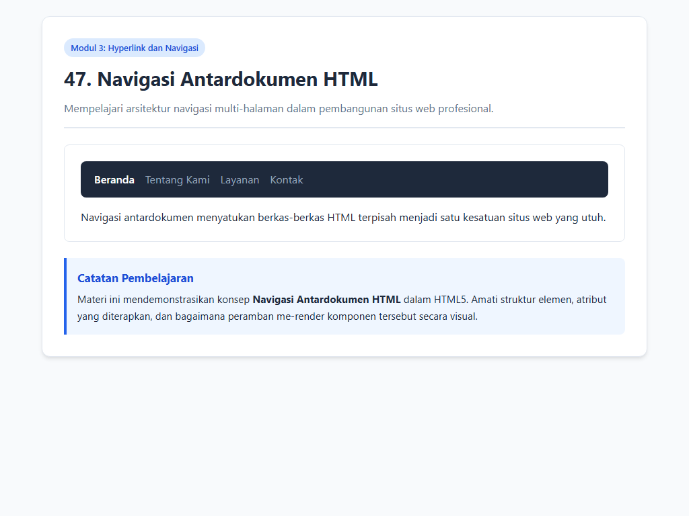

- **Lokasi Source Code:** [47_page_navigation.html](47_page_navigation.html)

---

### 13. Elemen nav

- **Tujuan Pembelajaran:** Memahami keunggulan semantik elemen <nav> dibanding pembungkus 
 generik.
- **Konsep Utama:** Elemen <nav> ditujukan khusus untuk blok berisi kumpulan tautan navigasi utama dokumen.
- **Penjelasan Source Code:** Menampilkan struktur nav semantik yang membungkus list ul/li berisi link penting situs.
- **Cara Menjalankan:** Buka file `48_navigation_element.html` secara langsung di peramban web (Google Chrome, Mozilla Firefox, atau Microsoft Edge), atau jalankan ekstensi Live Server pada VS Code.
- **Hasil yang Diharapkan:** Daftar navigasi terbungkus container nav yang bersih dan aksesibel.
- **Screenshot Hasil Eksekusi:**

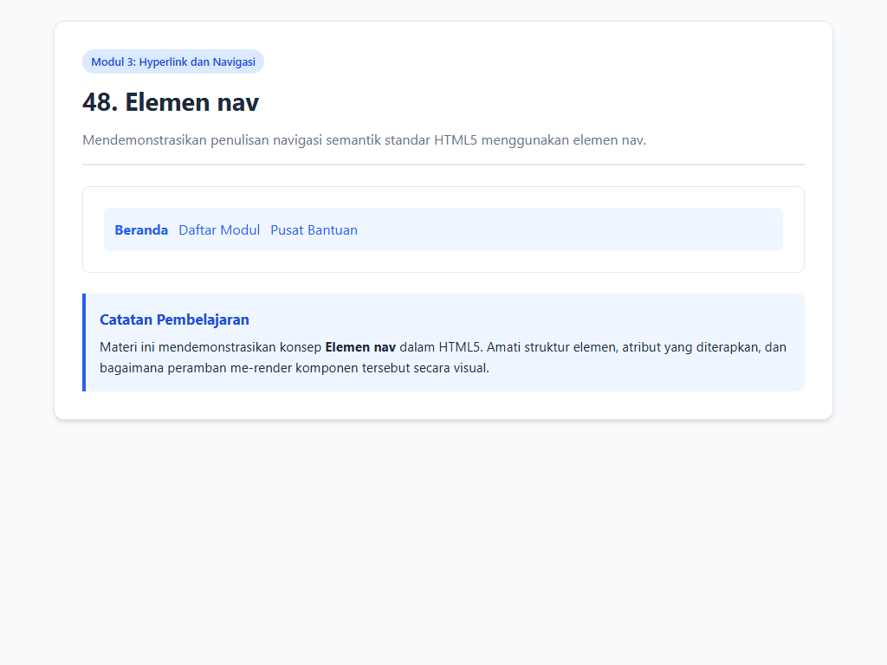

- **Lokasi Source Code:** [48_navigation_element.html](48_navigation_element.html)

---

### 14. Struktur Breadcrumb Navigation

- **Tujuan Pembelajaran:** Merancang struktur breadcrumb menggunakan elemen <ol> dan atribut aria-current='page'.
- **Konsep Utama:** Breadcrumb membantu pengguna memahami posisi kedalaman halaman saat ini dalam struktur situs.
- **Penjelasan Source Code:** Menampilkan remah roti tiga tingkat dari Beranda hingga halaman aktif dengan pemisah garis miring.
- **Cara Menjalankan:** Buka file `49_breadcrumb_navigation.html` secara langsung di peramban web (Google Chrome, Mozilla Firefox, atau Microsoft Edge), atau jalankan ekstensi Live Server pada VS Code.
- **Hasil yang Diharapkan:** Bilah remah roti (breadcrumb) abu-abu terang dengan status aria-current pada item aktif.
- **Screenshot Hasil Eksekusi:**

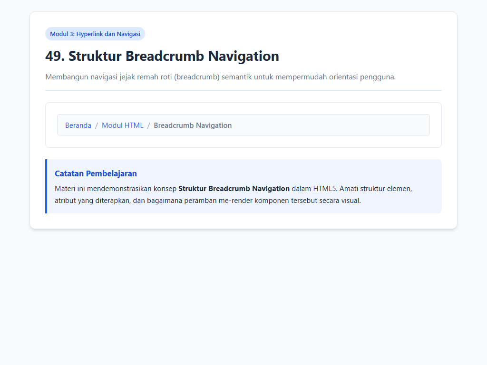

- **Lokasi Source Code:** [49_breadcrumb_navigation.html](49_breadcrumb_navigation.html)

---

### 15. Aksesibilitas Hyperlink

- **Tujuan Pembelajaran:** Memahami kaidah pembuatan hyperlink yang inklusif dan ramah disabilitas.
- **Konsep Utama:** Screen reader membaca link secara terisolasi; teks link harus berdiri sendiri menjelaskan tujuan tanpa frasa 'klik di sini'.
- **Penjelasan Source Code:** Menyajikan perbandingan langsung antara teks tautan ambigu dan teks tautan deskriptif profesional.
- **Cara Menjalankan:** Buka file `50_link_accessibility.html` secara langsung di peramban web (Google Chrome, Mozilla Firefox, atau Microsoft Edge), atau jalankan ekstensi Live Server pada VS Code.
- **Hasil yang Diharapkan:** Dua kotak perbandingan visual (merah untuk buruk dan hijau untuk baik) mengenai penamaan link.
- **Screenshot Hasil Eksekusi:**

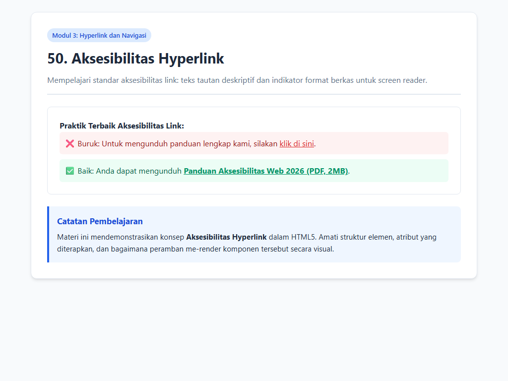

- **Lokasi Source Code:** [50_link_accessibility.html](50_link_accessibility.html)

---

## Ringkasan Modul
Modul 3 menyajikan pondasi penting mengenai Hyperlink dan Navigasi. Pemahaman menyeluruh terhadap submodul di atas menjadi prasyarat penting sebelum melangkah ke modul berikutnya.
