# Modul 5: Gambar dan Visual

## Ringkasan Ruang Lingkup Materi
Modul ini membahas konsep dasar dan implementasi praktis seputar **Gambar dan Visual**. Setiap submodul dirancang secara terisolasi agar pembelajar dapat memahami konsep satu per satu secara fokus dan terstruktur.

## Tujuan Pembelajaran Modul
Setelah menyelesaikan modul ini, peserta didik diharapkan mampu memahami, mengimplementasikan, dan menguji komponen-komponen utama dalam lingkup gambar dan visual sesuai standar modern W3C.

## Daftar Materi atau Submodul

- [63_basic_image.html](63_basic_image.html) - Menampilkan Gambar dengan img
- [64_image_src.html](64_image_src.html) - Atribut src
- [65_image_alt.html](65_image_alt.html) - Atribut alt
- [66_image_dimensions.html](66_image_dimensions.html) - Atribut width dan height
- [67_image_title.html](67_image_title.html) - Atribut title pada Gambar
- [68_image_paths.html](68_image_paths.html) - Path Gambar
- [69_image_formats.html](69_image_formats.html) - Penggunaan Format Gambar
- [70_figure_element.html](70_figure_element.html) - Elemen figure
- [71_figcaption_element.html](71_figcaption_element.html) - Elemen figcaption
- [72_responsive_images.html](72_responsive_images.html) - Responsive Images
- [73_picture_element.html](73_picture_element.html) - Elemen picture
- [74_source_element.html](74_source_element.html) - Elemen source untuk Gambar
- [75_srcset_attribute.html](75_srcset_attribute.html) - Atribut srcset
- [76_sizes_attribute.html](76_sizes_attribute.html) - Atribut sizes
- [77_image_loading.html](77_image_loading.html) - Atribut loading
- [78_image_decoding.html](78_image_decoding.html) - Atribut decoding
- [79_image_maps.html](79_image_maps.html) - Image Maps
- [80_image_map_coordinates.html](80_image_map_coordinates.html) - Area dan Koordinat Image Map

---

## Pembahasan Setiap Submodul

### 1. Menampilkan Gambar dengan img

- **Tujuan Pembelajaran:** Memahami cara menyematkan gambar visual ke dalam dokumen HTML.
- **Konsep Utama:** Elemen  adalah elemen pengganti (replaced element) yang mengunduh dan merender berkas gambar eksternal.
- **Penjelasan Source Code:** Menampilkan berkas gambar vektor lokal dengan atribut src dan alt.
- **Cara Menjalankan:** Buka file `63_basic_image.html` secara langsung di peramban web (Google Chrome, Mozilla Firefox, atau Microsoft Edge), atau jalankan ekstensi Live Server pada VS Code.
- **Hasil yang Diharapkan:** Gambar ilustrasi kartu biru bergradasi yang tampil proporsional.
- **Screenshot Hasil Eksekusi:**

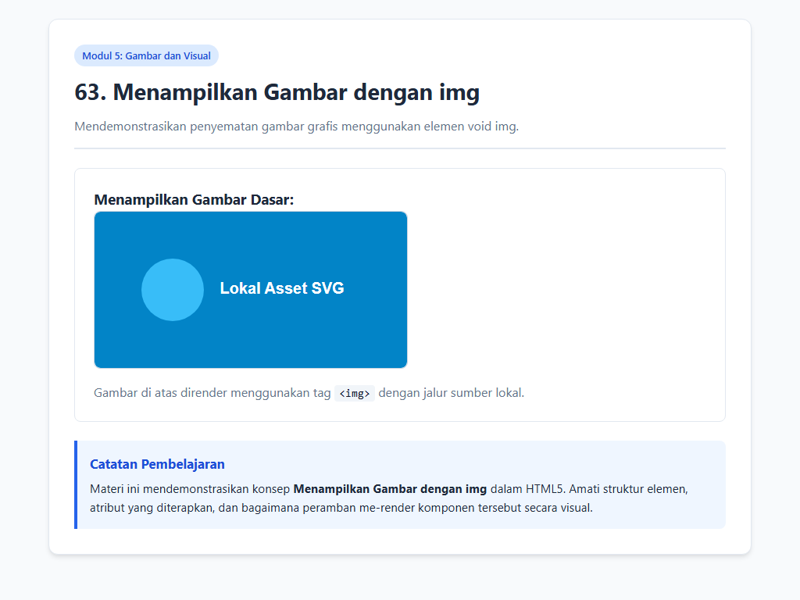

- **Lokasi Source Code:** [63_basic_image.html](63_basic_image.html)

---

### 2. Atribut src

- **Tujuan Pembelajaran:** Menguasai penggunaan atribut src untuk memuat gambar dari berbagai sumber.
- **Konsep Utama:** Atribut src wajib ada pada elemen img untuk memberitahu peramban lokasi berkas gambar.
- **Penjelasan Source Code:** Mendemonstrasikan pemuatan gambar dari path lokal dan data URI langsung.
- **Cara Menjalankan:** Buka file `64_image_src.html` secara langsung di peramban web (Google Chrome, Mozilla Firefox, atau Microsoft Edge), atau jalankan ekstensi Live Server pada VS Code.
- **Hasil yang Diharapkan:** Dua gambar berbeda yang dimuat dari berkas lokal dan data URI hijau.
- **Screenshot Hasil Eksekusi:**

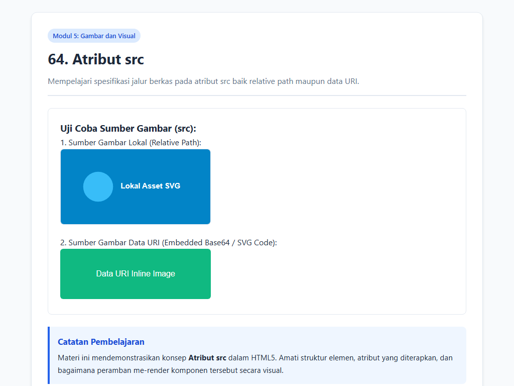

- **Lokasi Source Code:** [64_image_src.html](64_image_src.html)

---

### 3. Atribut alt

- **Tujuan Pembelajaran:** Memahami kewajiban atribut alt untuk aksesibilitas WCAG.
- **Konsep Utama:** Atribut alt menyediakan deskripsi teks bagi pengguna tunanetra dan tampil jika gambar gagal diunduh.
- **Penjelasan Source Code:** Menampilkan perbandingan gambar aktif dan simulasi teks pengganti alt saat gambar rusak.
- **Cara Menjalankan:** Buka file `65_image_alt.html` secara langsung di peramban web (Google Chrome, Mozilla Firefox, atau Microsoft Edge), atau jalankan ekstensi Live Server pada VS Code.
- **Hasil yang Diharapkan:** Gambar normal di bagian atas dan kotak fallback teks merah saat file gambar tidak ditemukan.
- **Screenshot Hasil Eksekusi:**

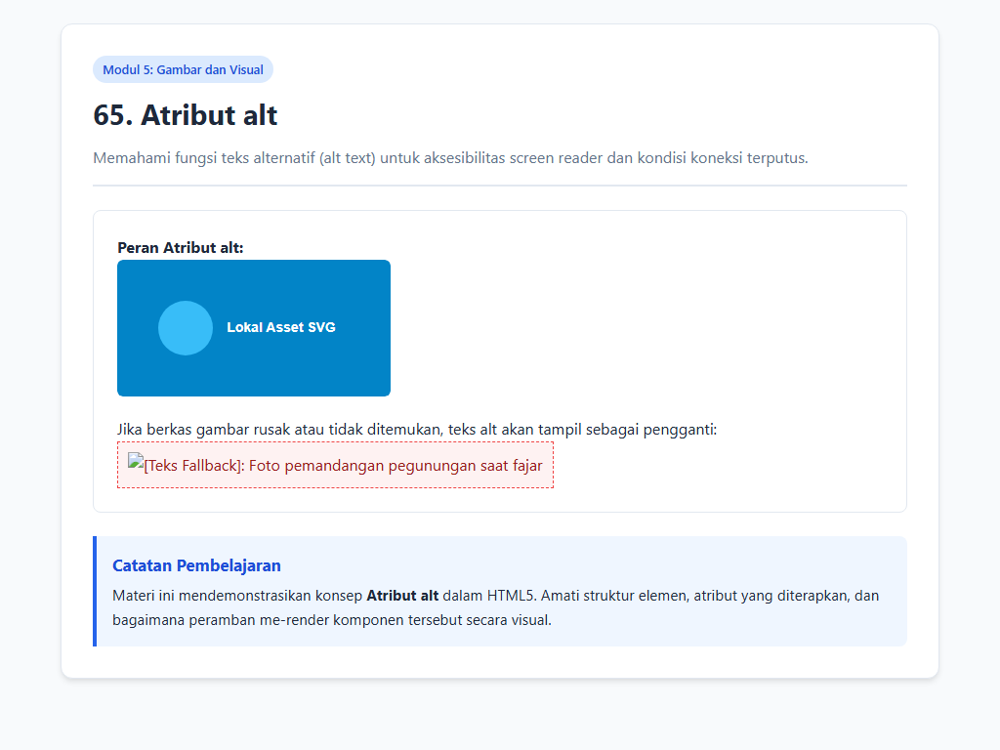

- **Lokasi Source Code:** [65_image_alt.html](65_image_alt.html)

---

### 4. Atribut width dan height

- **Tujuan Pembelajaran:** Memahami pentingnya mencantumkan dimensi width dan height pada tag .
- **Konsep Utama:** Memberikan dimensi intrinsik memungkinkan peramban menghitung rasio aspek sebelum berkas gambar selesai diunduh.
- **Penjelasan Source Code:** Menampilkan gambar dengan spesifikasi dimensi width=360 dan height=180.
- **Cara Menjalankan:** Buka file `66_image_dimensions.html` secara langsung di peramban web (Google Chrome, Mozilla Firefox, atau Microsoft Edge), atau jalankan ekstensi Live Server pada VS Code.
- **Hasil yang Diharapkan:** Gambar berukuran presisi 360x180 dengan rasio aspek terkunci rapi.
- **Screenshot Hasil Eksekusi:**

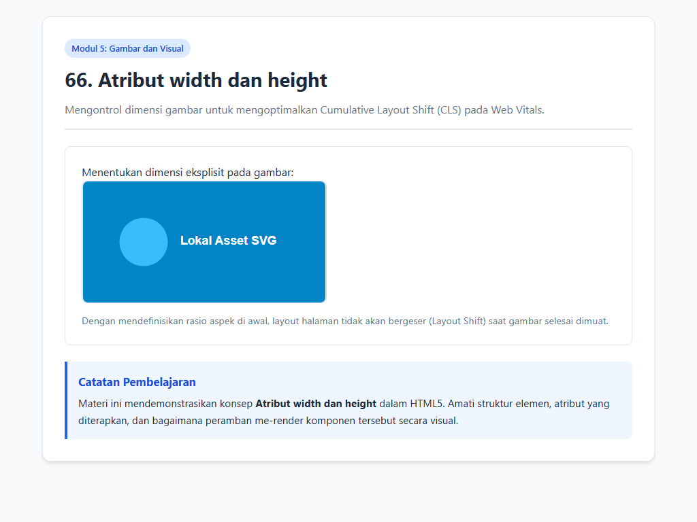

- **Lokasi Source Code:** [66_image_dimensions.html](66_image_dimensions.html)

---

### 5. Atribut title pada Gambar

- **Tujuan Pembelajaran:** Memahami perbedaan fungsional antara atribut alt (aksesibilitas) dan title (tooltip visual).
- **Konsep Utama:** Atribut title memunculkan gelembung tooltip peramban saat kursor diarahkan ke elemen.
- **Penjelasan Source Code:** Menampilkan gambar yang memiliki atribut title interaktif untuk pembaca desktop.
- **Cara Menjalankan:** Buka file `67_image_title.html` secara langsung di peramban web (Google Chrome, Mozilla Firefox, atau Microsoft Edge), atau jalankan ekstensi Live Server pada VS Code.
- **Hasil yang Diharapkan:** Gambar interaktif yang menampilkan tooltip ketika kursor diarahkan ke atasnya.
- **Screenshot Hasil Eksekusi:**

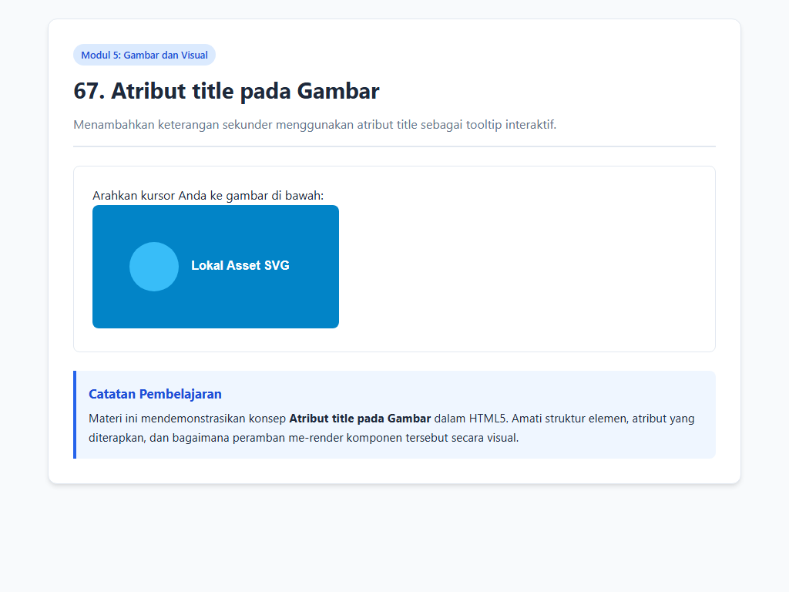

- **Lokasi Source Code:** [67_image_title.html](67_image_title.html)

---

### 6. Path Gambar

- **Tujuan Pembelajaran:** Menguasai navigasi jalur berkas relatif dan absolut dalam struktur proyek web.
- **Konsep Utama:** Pemahaman jalur berkas sangat krusial agar gambar tidak mengalami galat 404 Not Found.
- **Penjelasan Source Code:** Menjelaskan pola penulisan path selevel, subfolder, parent folder, dan absolut URL disertai contoh gambar aktif.
- **Cara Menjalankan:** Buka file `68_image_paths.html` secara langsung di peramban web (Google Chrome, Mozilla Firefox, atau Microsoft Edge), atau jalankan ekstensi Live Server pada VS Code.
- **Hasil yang Diharapkan:** Penjelasan aturan path direktori disertai contoh pemanggilan gambar dari subfolder assets.
- **Screenshot Hasil Eksekusi:**

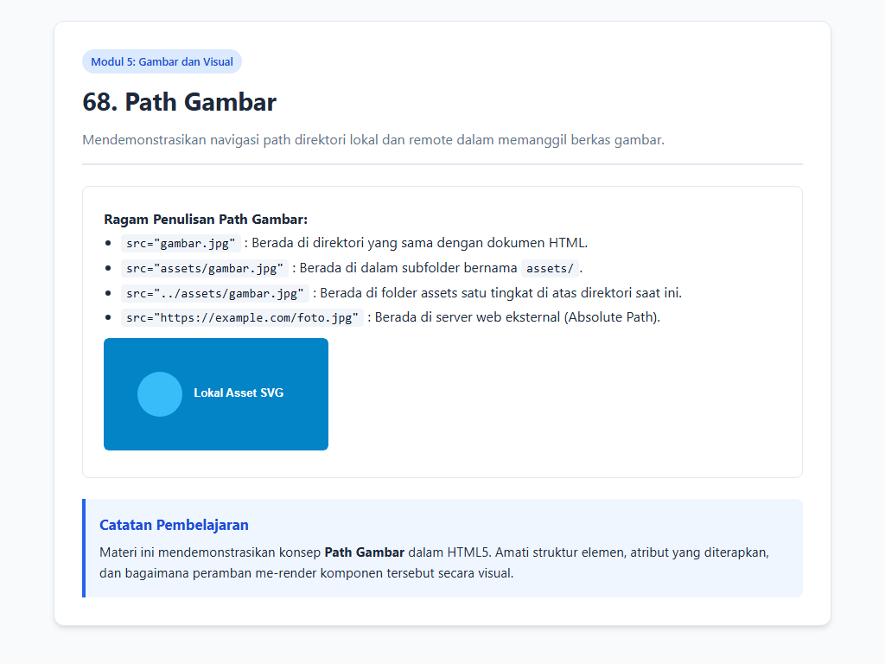

- **Lokasi Source Code:** [68_image_paths.html](68_image_paths.html)

---

### 7. Penggunaan Format Gambar

- **Tujuan Pembelajaran:** Memilih format berkas gambar yang tepat untuk mengoptimalkan performa dan estetika web.
- **Konsep Utama:** Setiap format memiliki kompresi dan algoritma berbeda (raster vs vector, lossy vs lossless).
- **Penjelasan Source Code:** Menyajikan tabel komparasi teknis antar-format gambar web modern.
- **Cara Menjalankan:** Buka file `69_image_formats.html` secara langsung di peramban web (Google Chrome, Mozilla Firefox, atau Microsoft Edge), atau jalankan ekstensi Live Server pada VS Code.
- **Hasil yang Diharapkan:** Tabel perbandingan format gambar (SVG, WebP/AVIF, PNG) yang terstruktur rapi.
- **Screenshot Hasil Eksekusi:**

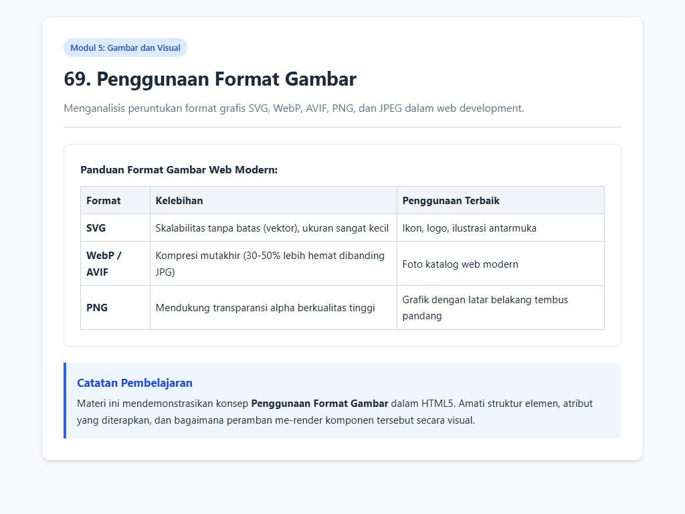

- **Lokasi Source Code:** [69_image_formats.html](69_image_formats.html)

---

### 8. Elemen figure

- **Tujuan Pembelajaran:** Memahami peran semantik tag <figure> untuk visual dan diagram.
- **Konsep Utama:** Elemen <figure> membungkus unit visual yang berdiri sendiri dan biasanya dirujuk dalam teks utama.
- **Penjelasan Source Code:** Menampilkan gambar ilustrasi yang terisolasi rapi di dalam kotak elemen figure.
- **Cara Menjalankan:** Buka file `70_figure_element.html` secara langsung di peramban web (Google Chrome, Mozilla Firefox, atau Microsoft Edge), atau jalankan ekstensi Live Server pada VS Code.
- **Hasil yang Diharapkan:** Kotak figure dengan bingkai pembatas halus yang membungkus gambar.
- **Screenshot Hasil Eksekusi:**

- **Lokasi Source Code:** [70_figure_element.html](70_figure_element.html)

---

### 9. Elemen figcaption

- **Tujuan Pembelajaran:** Menguasai pemberian keterangan resmi gambar dengan <figcaption>.
- **Konsep Utama:** Tag <figcaption> mengaitkan teks takarir dengan konten visualnya untuk teknologi pembaca layar.
- **Penjelasan Source Code:** Menampilkan gambar di dalam figure yang dilengkapi takarir keterangan terpusat di bagian bawah.
- **Cara Menjalankan:** Buka file `71_figcaption_element.html` secara langsung di peramban web (Google Chrome, Mozilla Firefox, atau Microsoft Edge), atau jalankan ekstensi Live Server pada VS Code.
- **Hasil yang Diharapkan:** Gambar dengan takarir miring terpusat bertuliskan 'Gambar 1.1: ...'.
- **Screenshot Hasil Eksekusi:**

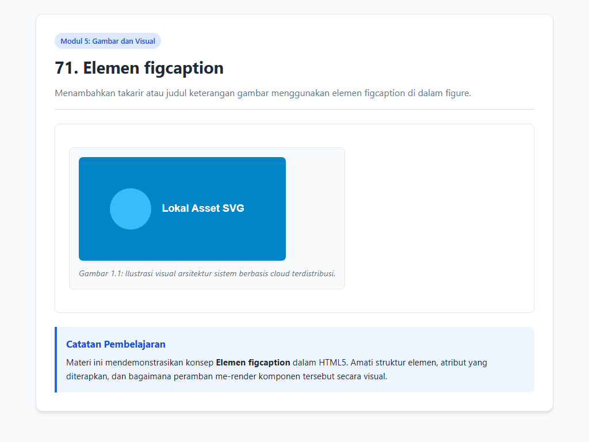

- **Lokasi Source Code:** [71_figcaption_element.html](71_figcaption_element.html)

---

### 10. Responsive Images

- **Tujuan Pembelajaran:** Memahami konsep fluid image dengan teknik CSS modern.
- **Konsep Utama:** Penerapan max-width: 100% dan height: auto mencegah gambar meluap keluar dari batas layar ponsel.
- **Penjelasan Source Code:** Menampilkan gambar di dalam wadah bergaris putus-putus yang menyesuaikan lebar secara otomatis.
- **Cara Menjalankan:** Buka file `72_responsive_images.html` secara langsung di peramban web (Google Chrome, Mozilla Firefox, atau Microsoft Edge), atau jalankan ekstensi Live Server pada VS Code.
- **Hasil yang Diharapkan:** Gambar fluida yang pas sempurna di dalam kotak pembatas responsif.
- **Screenshot Hasil Eksekusi:**

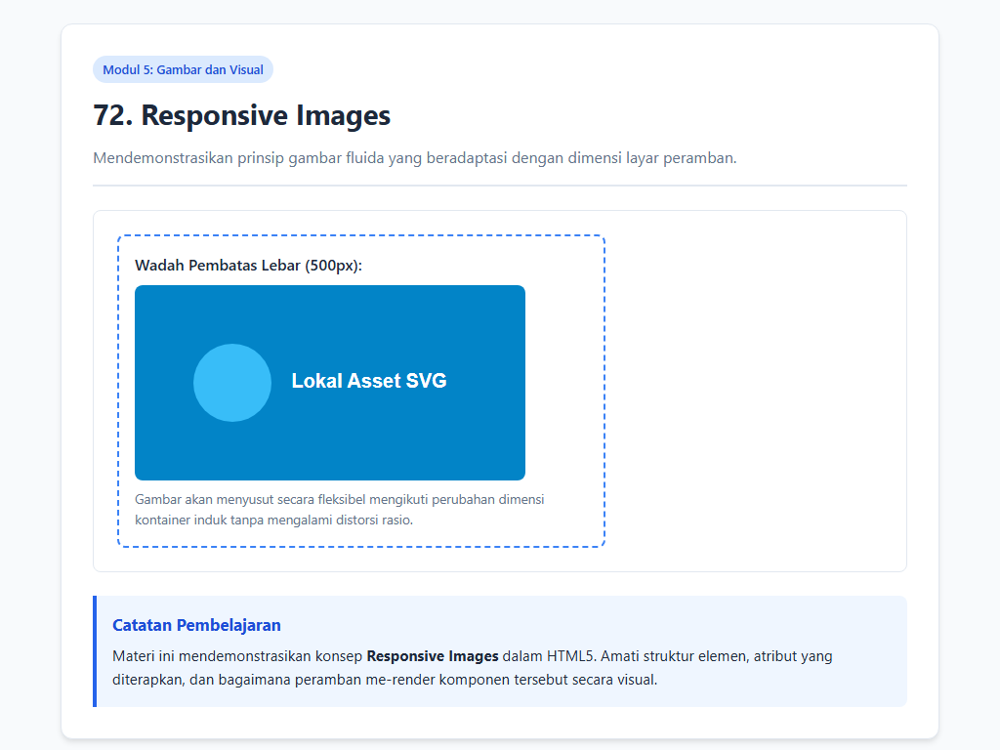

- **Lokasi Source Code:** [72_responsive_images.html](72_responsive_images.html)

---

### 11. Elemen picture

- **Tujuan Pembelajaran:** Menerapkan Art Direction untuk memuat variasi visual yang sesuai dengan perangkat pengguna.
- **Konsep Utama:** Elemen <picture> mengevaluasi media queries pada tag <source> sebelum memutuskan berkas gambar yang diunduh.
- **Penjelasan Source Code:** Mendemonstrasikan tag picture dengan multi-source untuk breakpoint desktop, tablet, dan ponsel.
- **Cara Menjalankan:** Buka file `73_picture_element.html` secara langsung di peramban web (Google Chrome, Mozilla Firefox, atau Microsoft Edge), atau jalankan ekstensi Live Server pada VS Code.
- **Hasil yang Diharapkan:** Banner gambar yang secara dinamis menyajikan variasi aset berdasarkan lebar viewport.
- **Screenshot Hasil Eksekusi:**

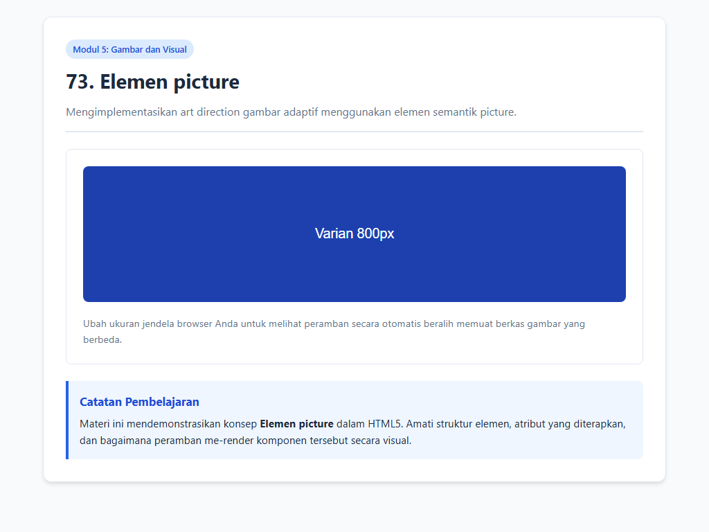

- **Lokasi Source Code:** [73_picture_element.html](73_picture_element.html)

---

### 12. Elemen source untuk Gambar

- **Tujuan Pembelajaran:** Memahami mekanisme pemilihan format berkas dengan atribut type pada <source>.
- **Konsep Utama:** Peramban akan melewati format yang tidak dikenalnya dan memilih format pertama yang didukung.
- **Penjelasan Source Code:** Menampilkan struktur picture dengan beberapa source bertipe MIME berbeda menuju fallback img.
- **Cara Menjalankan:** Buka file `74_source_element.html` secara langsung di peramban web (Google Chrome, Mozilla Firefox, atau Microsoft Edge), atau jalankan ekstensi Live Server pada VS Code.
- **Hasil yang Diharapkan:** Pemuatan gambar cerdas berdasarkan kapabilitas format peramban.
- **Screenshot Hasil Eksekusi:**

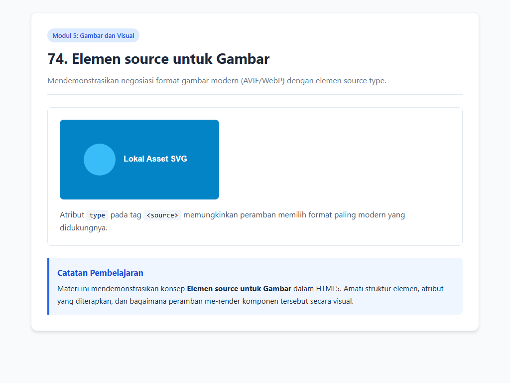

- **Lokasi Source Code:** [74_source_element.html](74_source_element.html)

---

### 13. Atribut srcset

- **Tujuan Pembelajaran:** Mengoptimalkan ketajaman visual gambar pada layar Retina dengan deskriptor 1x dan 2x.
- **Konsep Utama:** Atribut srcset memberitahu peramban pilihan resolusi fisik layar yang tersedia.
- **Penjelasan Source Code:** Menampilkan gambar dengan atribut srcset berdeskriptor kepadatan piksel 1x dan 2x.
- **Cara Menjalankan:** Buka file `75_srcset_attribute.html` secara langsung di peramban web (Google Chrome, Mozilla Firefox, atau Microsoft Edge), atau jalankan ekstensi Live Server pada VS Code.
- **Hasil yang Diharapkan:** Gambar tajam beresolusi optimal sesuai kepadatan layar perangkat pengguna.
- **Screenshot Hasil Eksekusi:**

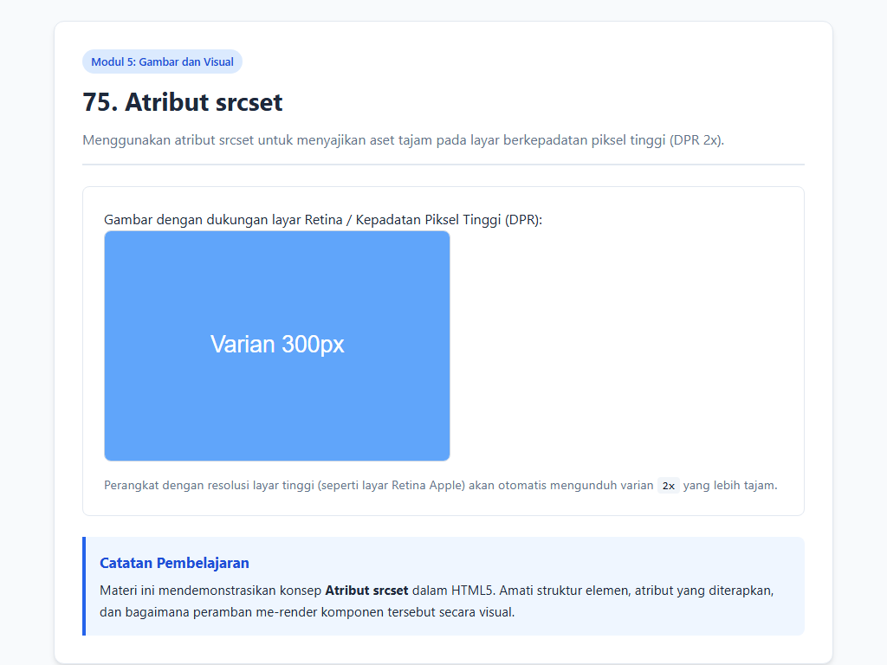

- **Lokasi Source Code:** [75_srcset_attribute.html](75_srcset_attribute.html)

---

### 14. Atribut sizes

- **Tujuan Pembelajaran:** Memahami kalkulasi alokasi lebar gambar menggunakan atribut sizes.
- **Konsep Utama:** Atribut sizes memetakan kondisi viewport terhadap perkiraan persentase lebar slot gambar.
- **Penjelasan Source Code:** Menampilkan gambar responsif dengan konfigurasi deskriptor lebar 300w, 500w, 800w dan sizes 100vw/50vw.
- **Cara Menjalankan:** Buka file `76_sizes_attribute.html` secara langsung di peramban web (Google Chrome, Mozilla Firefox, atau Microsoft Edge), atau jalankan ekstensi Live Server pada VS Code.
- **Hasil yang Diharapkan:** Gambar adaptif yang mengunduh ukuran berkas paling hemat sesuai lebar layar aktual.
- **Screenshot Hasil Eksekusi:**

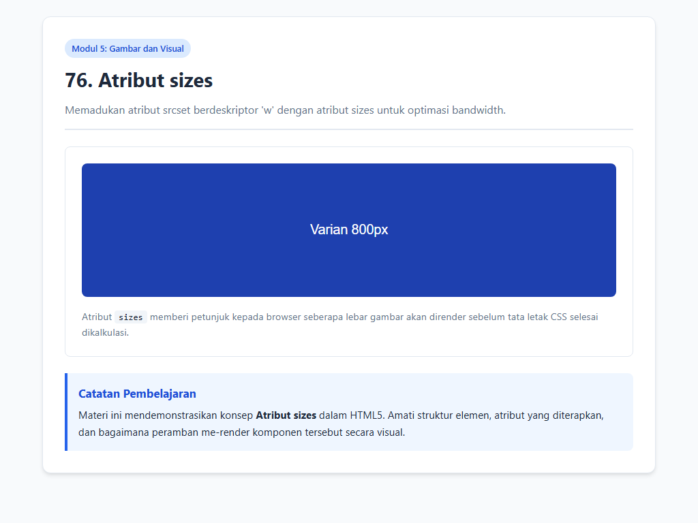

- **Lokasi Source Code:** [76_sizes_attribute.html](76_sizes_attribute.html)

---

### 15. Atribut loading

- **Tujuan Pembelajaran:** Menerapkan lazy loading bawaan browser tanpa library JavaScript eksternal.
- **Konsep Utama:** Nilai loading='lazy' menangguhkan request jaringan untuk gambar yang belum masuk viewport.
- **Penjelasan Source Code:** Menampilkan penerapan atribut loading='lazy' pada elemen img berdimensi lengkap.
- **Cara Menjalankan:** Buka file `77_image_loading.html` secara langsung di peramban web (Google Chrome, Mozilla Firefox, atau Microsoft Edge), atau jalankan ekstensi Live Server pada VS Code.
- **Hasil yang Diharapkan:** Gambar dengan atribut loading cerdas yang mengoptimalkan konsumsi memori dan data.
- **Screenshot Hasil Eksekusi:**

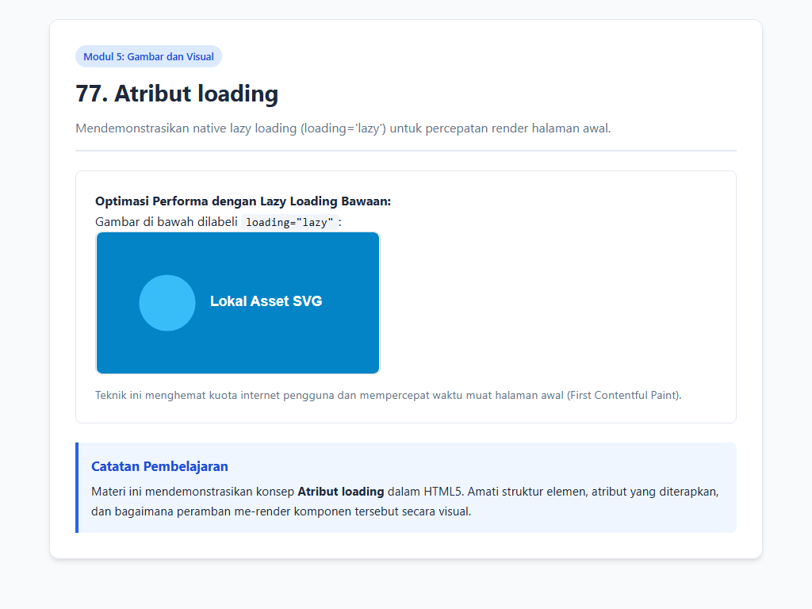

- **Lokasi Source Code:** [77_image_loading.html](77_image_loading.html)

---

### 16. Atribut decoding

- **Tujuan Pembelajaran:** Memahami dampak decoding asinkron terhadap kelancaran respons antarmuka web.
- **Konsep Utama:** Atribut decoding='async' memindahkan proses rasterisasi gambar dari main-thread CPU.
- **Penjelasan Source Code:** Menampilkan gambar dengan konfigurasi decoding asinkron untuk performa frame rate optimal.
- **Cara Menjalankan:** Buka file `78_image_decoding.html` secara langsung di peramban web (Google Chrome, Mozilla Firefox, atau Microsoft Edge), atau jalankan ekstensi Live Server pada VS Code.
- **Hasil yang Diharapkan:** Gambar dengan atribut decoding modern yang menjamin scroll halaman tetap mulus.
- **Screenshot Hasil Eksekusi:**

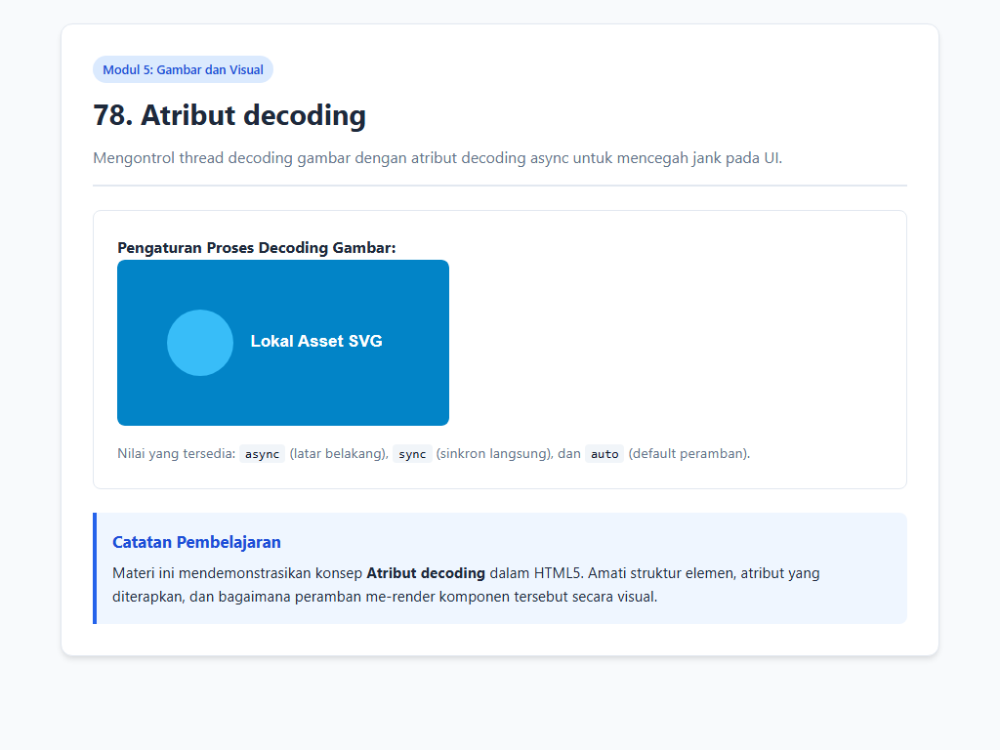

- **Lokasi Source Code:** [78_image_decoding.html](78_image_decoding.html)

---

### 17. Image Maps

- **Tujuan Pembelajaran:** Membuat zona tautan klik terpisah pada satu gambar dengan elemen <map>.
- **Konsep Utama:** Atribut usemap menghubungkan gambar dengan definisi koordinat interaktif pada elemen map.
- **Penjelasan Source Code:** Menampilkan gambar yang memiliki area klik berbentuk kotak dan lingkaran dengan target navigasi terpisah.
- **Cara Menjalankan:** Buka file `79_image_maps.html` secara langsung di peramban web (Google Chrome, Mozilla Firefox, atau Microsoft Edge), atau jalankan ekstensi Live Server pada VS Code.
- **Hasil yang Diharapkan:** Gambar interaktif yang kursornya berubah menjadi pointer saat berada di area koordinat tertentu.
- **Screenshot Hasil Eksekusi:**

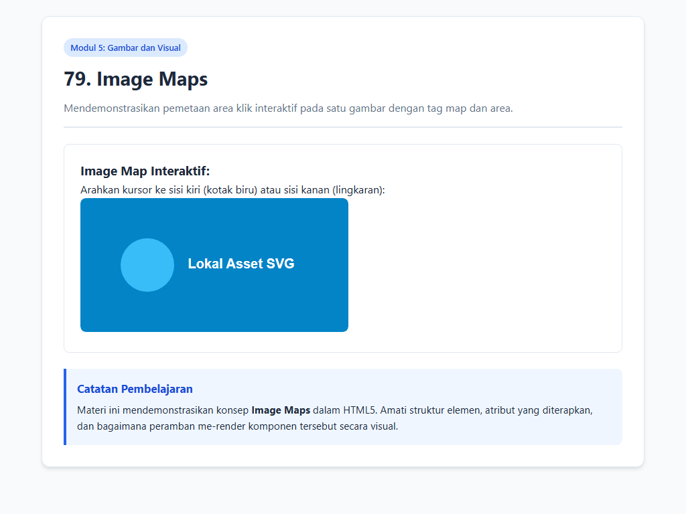

- **Lokasi Source Code:** [79_image_maps.html](79_image_maps.html)

---

### 18. Area dan Koordinat Image Map

- **Tujuan Pembelajaran:** Menguasai penentuan koordinat geometris pada elemen <area>.
- **Konsep Utama:** Sistem koordinat berpangkal dari piksel (0,0) di sudut kiri atas gambar sumber.
- **Penjelasan Source Code:** Menyajikan panduan komprehensif rumus matematika penentuan koordinat rect, circle, dan poly.
- **Cara Menjalankan:** Buka file `80_image_map_coordinates.html` secara langsung di peramban web (Google Chrome, Mozilla Firefox, atau Microsoft Edge), atau jalankan ekstensi Live Server pada VS Code.
- **Hasil yang Diharapkan:** Ringkasan teknis rumus koordinat geometri image map beserta standar aksesibilitasnya.
- **Screenshot Hasil Eksekusi:**

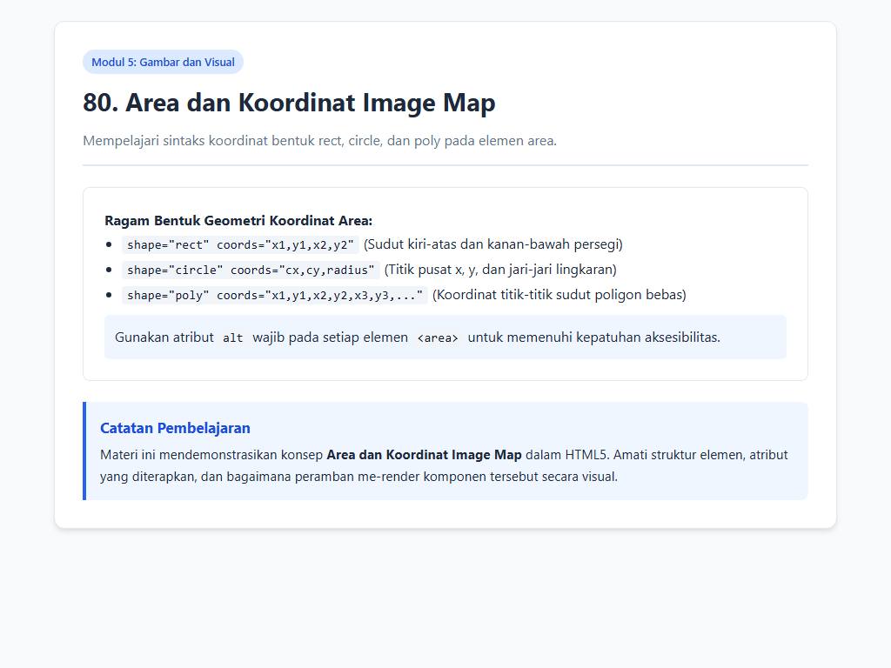

- **Lokasi Source Code:** [80_image_map_coordinates.html](80_image_map_coordinates.html)

---

## Ringkasan Modul
Modul 5 menyajikan pondasi penting mengenai Gambar dan Visual. Pemahaman menyeluruh terhadap submodul di atas menjadi prasyarat penting sebelum melangkah ke modul berikutnya.
