# Modul 6: Tabel HTML

## Ringkasan Ruang Lingkup Materi
Modul ini membahas konsep dasar dan implementasi praktis seputar **Tabel HTML**. Setiap submodul dirancang secara terisolasi agar pembelajar dapat memahami konsep satu per satu secara fokus dan terstruktur.

## Tujuan Pembelajaran Modul
Setelah menyelesaikan modul ini, peserta didik diharapkan mampu memahami, mengimplementasikan, dan menguji komponen-komponen utama dalam lingkup tabel html sesuai standar modern W3C.

## Daftar Materi atau Submodul

- [81_basic_table.html](81_basic_table.html) - Tabel Dasar
- [82_table_row.html](82_table_row.html) - Elemen tr (Table Row)
- [83_table_header.html](83_table_header.html) - Elemen th (Table Header)
- [84_table_data.html](84_table_data.html) - Elemen td (Table Data)
- [85_table_caption.html](85_table_caption.html) - Elemen caption
- [86_table_head.html](86_table_head.html) - Elemen thead
- [87_table_body.html](87_table_body.html) - Elemen tbody
- [88_table_footer.html](88_table_footer.html) - Elemen tfoot
- [89_table_colspan.html](89_table_colspan.html) - Atribut colspan
- [90_table_rowspan.html](90_table_rowspan.html) - Atribut rowspan
- [91_table_colgroup.html](91_table_colgroup.html) - Elemen colgroup
- [92_table_column.html](92_table_column.html) - Elemen col
- [93_table_scope.html](93_table_scope.html) - Atribut scope
- [94_table_headers.html](94_table_headers.html) - Atribut headers
- [95_accessible_data_table.html](95_accessible_data_table.html) - Tabel Data Aksesibel

---

## Pembahasan Setiap Submodul

### 1. Tabel Dasar

- **Tujuan Pembelajaran:** Memahami pembuatan grid tabular data dua dimensi dengan elemen <table>.
- **Konsep Utama:** Tabel HTML disusun secara baris demi baris menggunakan elemen <tr> yang menampung sel <td>.
- **Penjelasan Source Code:** Menampilkan tabel data minimal berukuran 2 baris x 2 kolom dengan border terhubung.
- **Cara Menjalankan:** Buka file `81_basic_table.html` secara langsung di peramban web (Google Chrome, Mozilla Firefox, atau Microsoft Edge), atau jalankan ekstensi Live Server pada VS Code.
- **Hasil yang Diharapkan:** Grid tabel sederhana 4 sel dengan garis tepi abu-abu rapi.
- **Screenshot Hasil Eksekusi:**

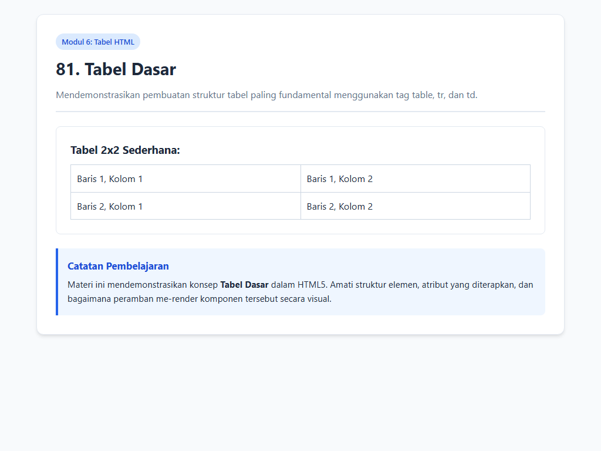

- **Lokasi Source Code:** [81_basic_table.html](81_basic_table.html)

---

### 2. Elemen tr (Table Row)

- **Tujuan Pembelajaran:** Menguasai struktur baris horizontal pada tabel dengan tag <tr>.
- **Konsep Utama:** Setiap baris data tabel wajib dibungkus oleh elemen <tr> sebelum diisi oleh <th> atau <td>.
- **Penjelasan Source Code:** Menampilkan dua baris tr dengan pembedaan warna latar belakang baris pertama.
- **Cara Menjalankan:** Buka file `82_table_row.html` secara langsung di peramban web (Google Chrome, Mozilla Firefox, atau Microsoft Edge), atau jalankan ekstensi Live Server pada VS Code.
- **Hasil yang Diharapkan:** Tabel 2 baris dengan baris pertama memiliki latar belakang abu-abu terang.
- **Screenshot Hasil Eksekusi:**

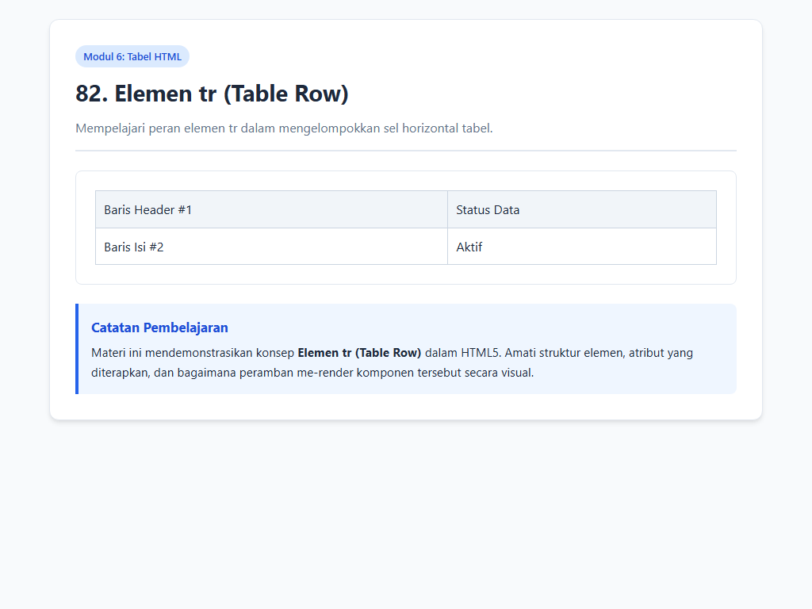

- **Lokasi Source Code:** [82_table_row.html](82_table_row.html)

---

### 3. Elemen th (Table Header)

- **Tujuan Pembelajaran:** Membedakan penggunaan sel judul (th) dengan sel data biasa (td).
- **Konsep Utama:** Elemen <th> menyediakan semantik label yang mengikat kolom atau baris data di bawahnya.
- **Penjelasan Source Code:** Menampilkan tabel anggota tim dengan tiga sel th pada baris teratas.
- **Cara Menjalankan:** Buka file `83_table_header.html` secara langsung di peramban web (Google Chrome, Mozilla Firefox, atau Microsoft Edge), atau jalankan ekstensi Live Server pada VS Code.
- **Hasil yang Diharapkan:** Baris judul tebal berlatar abu-abu diikuti baris data di bawahnya.
- **Screenshot Hasil Eksekusi:**

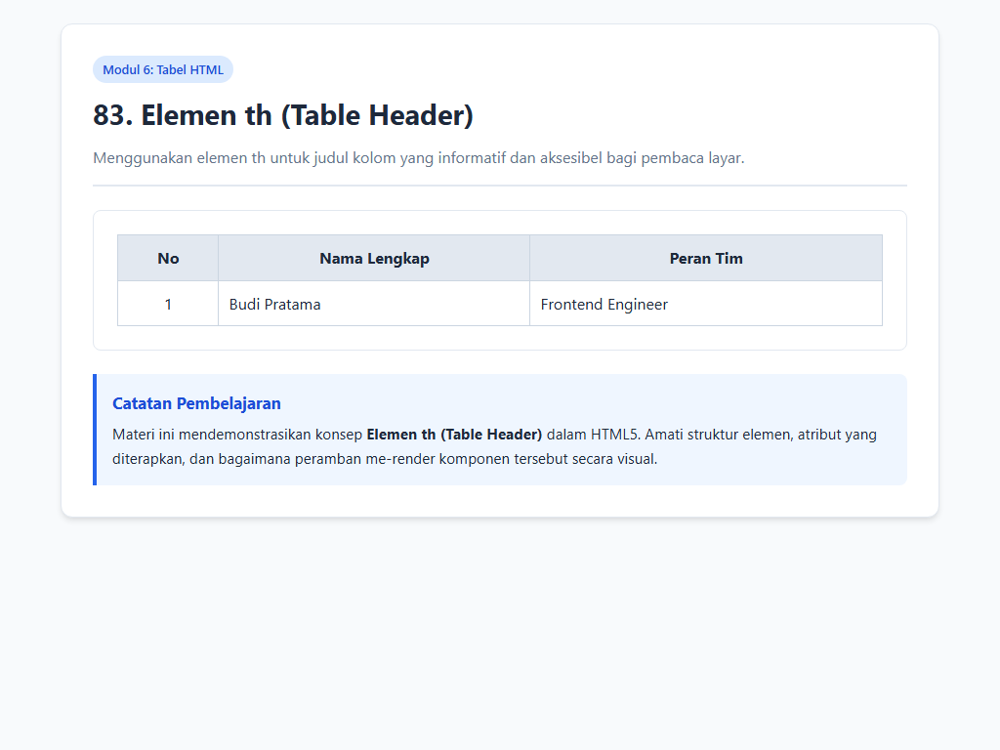

- **Lokasi Source Code:** [83_table_header.html](83_table_header.html)

---

### 4. Elemen td (Table Data)

- **Tujuan Pembelajaran:** Memahami format dan penataan sel data dengan elemen <td>.
- **Konsep Utama:** Elemen <td> menampung data aktual dari record tabel dan dirender rata kiri secara bawaan.
- **Penjelasan Source Code:** Menampilkan baris data produk inventaris toko menggunakan sel td.
- **Cara Menjalankan:** Buka file `84_table_data.html` secara langsung di peramban web (Google Chrome, Mozilla Firefox, atau Microsoft Edge), atau jalankan ekstensi Live Server pada VS Code.
- **Hasil yang Diharapkan:** Tabel inventaris produk dengan data harga dan jumlah stok teratur.
- **Screenshot Hasil Eksekusi:**

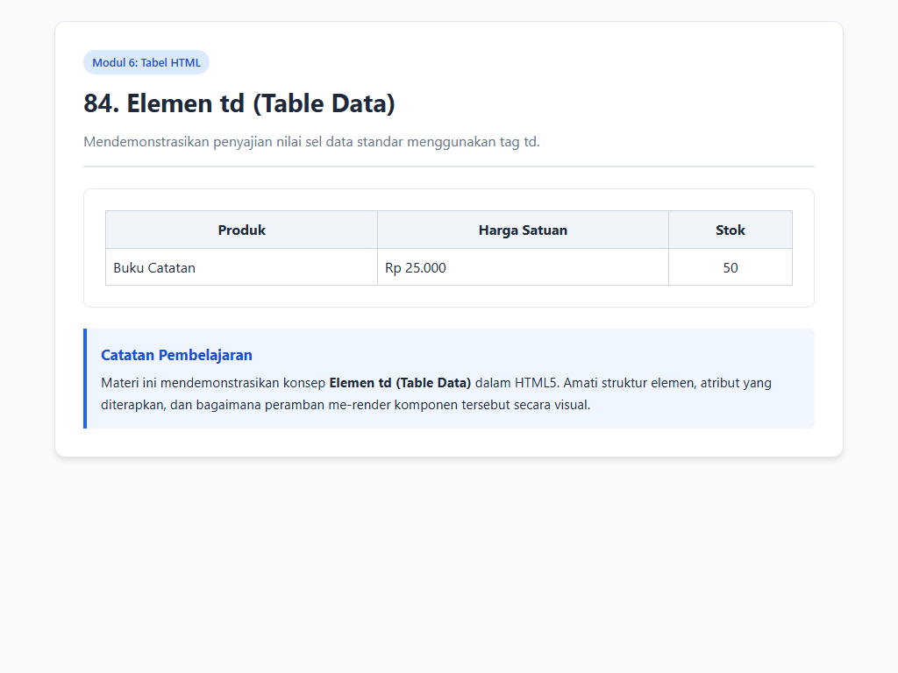

- **Lokasi Source Code:** [84_table_data.html](84_table_data.html)

---

### 5. Elemen caption

- **Tujuan Pembelajaran:** Menguasai pemberian judul resmi tabel dengan elemen <caption>.
- **Konsep Utama:** Tag <caption> diletakkan tepat setelah tag pembuka <table> untuk mengumumkan tujuan tabel kepada pengguna.
- **Penjelasan Source Code:** Menampilkan tabel rekap nilai ujian lengkap dengan teks judul caption di sisi atas.
- **Cara Menjalankan:** Buka file `85_table_caption.html` secara langsung di peramban web (Google Chrome, Mozilla Firefox, atau Microsoft Edge), atau jalankan ekstensi Live Server pada VS Code.
- **Hasil yang Diharapkan:** Teks judul tebal di atas tabel rekap nilai siswa.
- **Screenshot Hasil Eksekusi:**

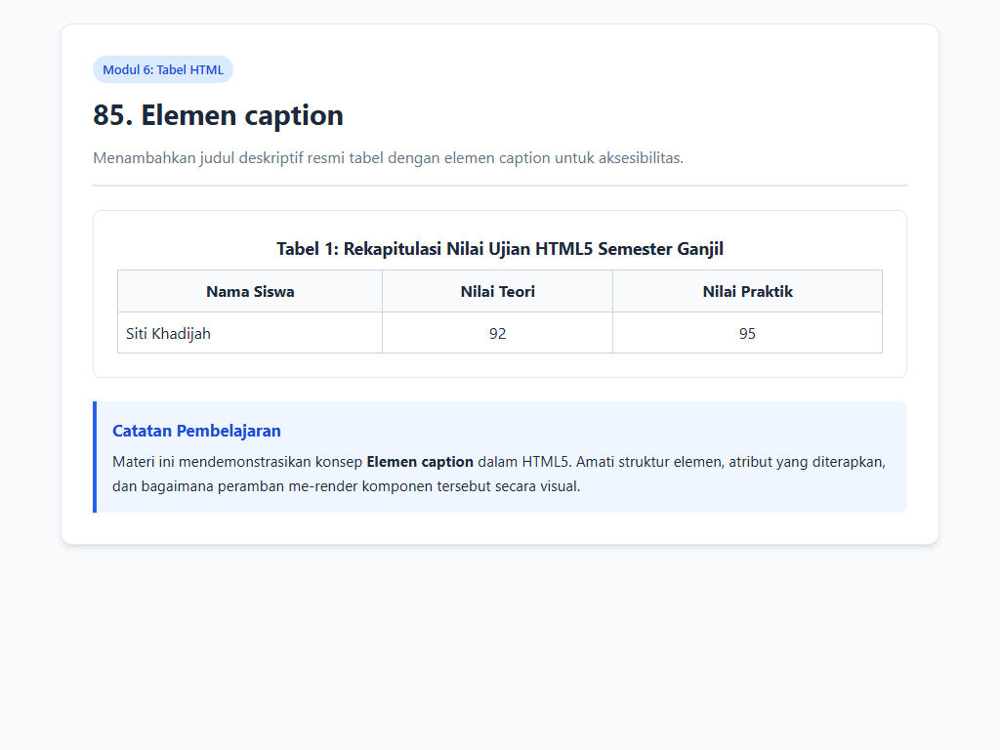

- **Lokasi Source Code:** [85_table_caption.html](85_table_caption.html)

---

### 6. Elemen thead

- **Tujuan Pembelajaran:** Memahami pemisahan semantik bagian kepala tabel dengan <thead>.
- **Konsep Utama:** Elemen <thead> membedakan baris header dari baris data saat dokumen dicetak berulang di halaman terpisah.
- **Penjelasan Source Code:** Menampilkan tabel transaksi dengan blok thead biru yang memikat secara visual.
- **Cara Menjalankan:** Buka file `86_table_head.html` secara langsung di peramban web (Google Chrome, Mozilla Firefox, atau Microsoft Edge), atau jalankan ekstensi Live Server pada VS Code.
- **Hasil yang Diharapkan:** Header tabel berwarna biru solid dengan teks putih yang kontras.
- **Screenshot Hasil Eksekusi:**

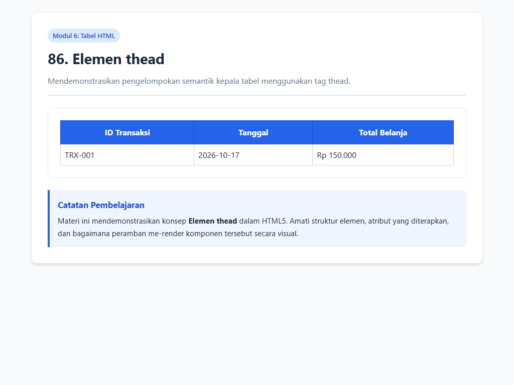

- **Lokasi Source Code:** [86_table_head.html](86_table_head.html)

---

### 7. Elemen tbody

- **Tujuan Pembelajaran:** Memahami peran <tbody> sebagai wadah record data tabel.
- **Konsep Utama:** Peramban secara otomatis menyisipkan <tbody> jika pembuat kode tidak menulisnya secara eksplisit.
- **Penjelasan Source Code:** Menampilkan tabel nama kota dan provinsi yang tersusun rapi di dalam elemen tbody.
- **Cara Menjalankan:** Buka file `87_table_body.html` secara langsung di peramban web (Google Chrome, Mozilla Firefox, atau Microsoft Edge), atau jalankan ekstensi Live Server pada VS Code.
- **Hasil yang Diharapkan:** Tabel dua kolom dengan baris record data tersusun rapi di dalam badan tabel.
- **Screenshot Hasil Eksekusi:**

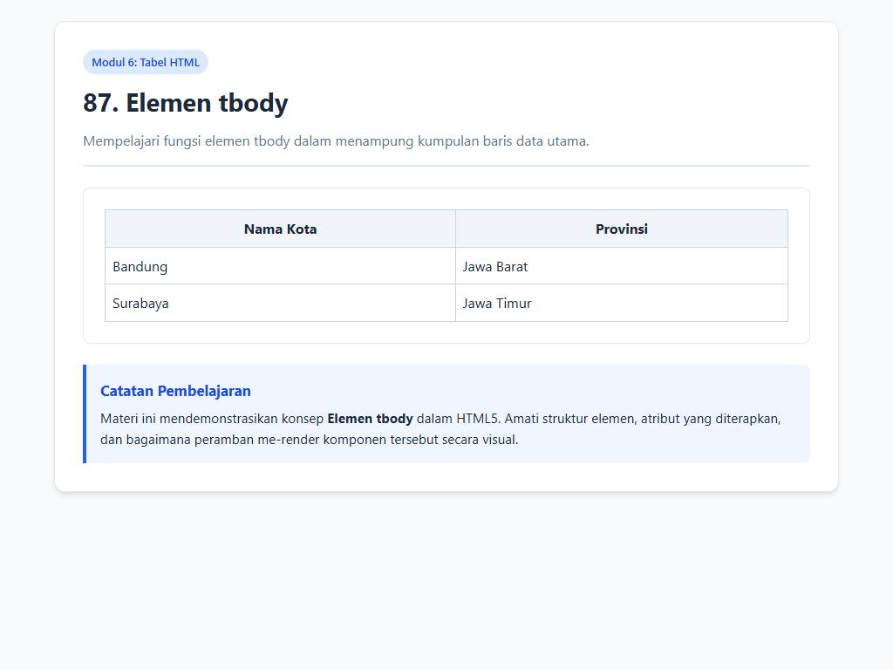

- **Lokasi Source Code:** [87_table_body.html](87_table_body.html)

---

### 8. Elemen tfoot

- **Tujuan Pembelajaran:** Menyajikan baris rekapitulasi data dengan elemen semantik <tfoot>.
- **Konsep Utama:** Elemen <tfoot> merangkum data tabel dan tetap tampil di bagian bawah tabel.
- **Penjelasan Source Code:** Menampilkan rincian pesanan belanja dengan baris ringkasan total di bagian tfoot.
- **Cara Menjalankan:** Buka file `88_table_footer.html` secara langsung di peramban web (Google Chrome, Mozilla Firefox, atau Microsoft Edge), atau jalankan ekstensi Live Server pada VS Code.
- **Hasil yang Diharapkan:** Tabel belanja dengan baris footer tebal yang memuat total pembayaran Rp 1.200.000.
- **Screenshot Hasil Eksekusi:**

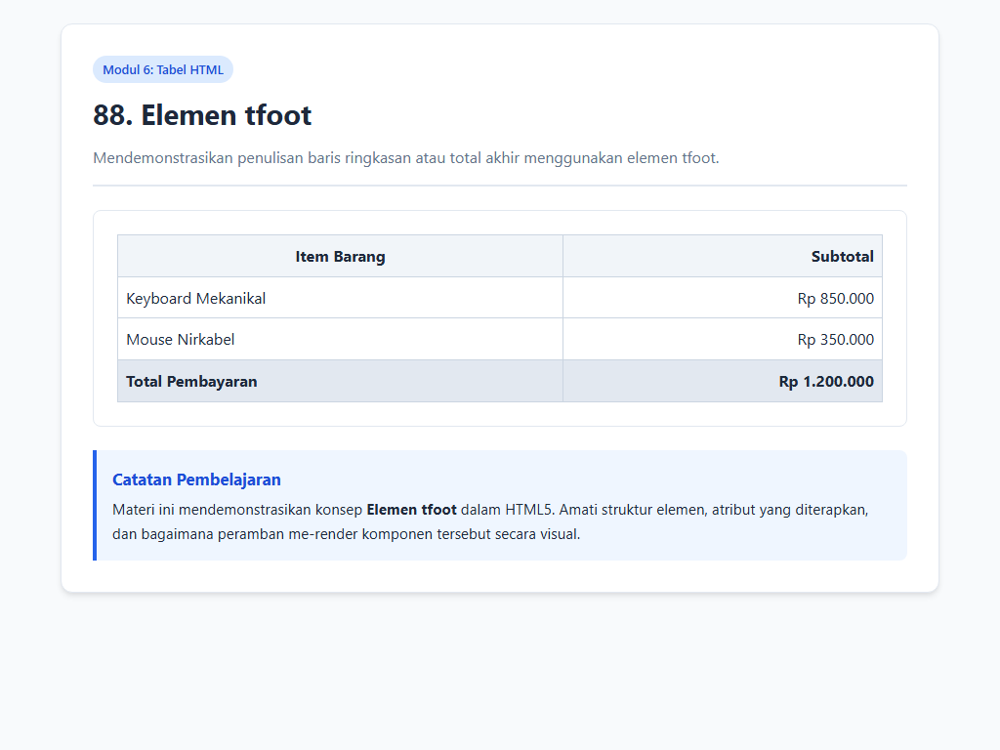

- **Lokasi Source Code:** [88_table_footer.html](88_table_footer.html)

---

### 9. Atribut colspan

- **Tujuan Pembelajaran:** Menguasai penggabungan sel horizontal (merge columns) dengan colspan.
- **Konsep Utama:** Atribut colspan menerima bilangan bulat yang menyatakan berapa lebar kolom yang digabungkan.
- **Penjelasan Source Code:** Menampilkan sel kontak kuning yang membentang melintasi dua kolom secara horizontal.
- **Cara Menjalankan:** Buka file `89_table_colspan.html` secara langsung di peramban web (Google Chrome, Mozilla Firefox, atau Microsoft Edge), atau jalankan ekstensi Live Server pada VS Code.
- **Hasil yang Diharapkan:** Sel kontak berwarna kuning yang menyatu membentang sepanjang dua kolom.
- **Screenshot Hasil Eksekusi:**

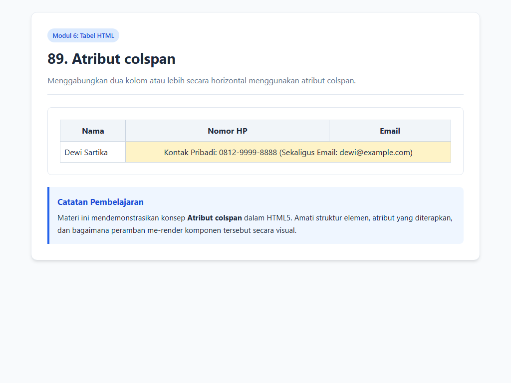

- **Lokasi Source Code:** [89_table_colspan.html](89_table_colspan.html)

---

### 10. Atribut rowspan

- **Tujuan Pembelajaran:** Menguasai penggabungan sel vertikal (merge rows) dengan rowspan.
- **Konsep Utama:** Atribut rowspan membuat sel memanjang ke bawah melintasi sejumlah baris data.
- **Penjelasan Source Code:** Menampilkan sel Departemen IT biru muda yang menggabungkan dua baris anggota tim sekaligus.
- **Cara Menjalankan:** Buka file `90_table_rowspan.html` secara langsung di peramban web (Google Chrome, Mozilla Firefox, atau Microsoft Edge), atau jalankan ekstensi Live Server pada VS Code.
- **Hasil yang Diharapkan:** Sel departemen IT membentang vertikal setinggi dua baris di samping nama staf.
- **Screenshot Hasil Eksekusi:**

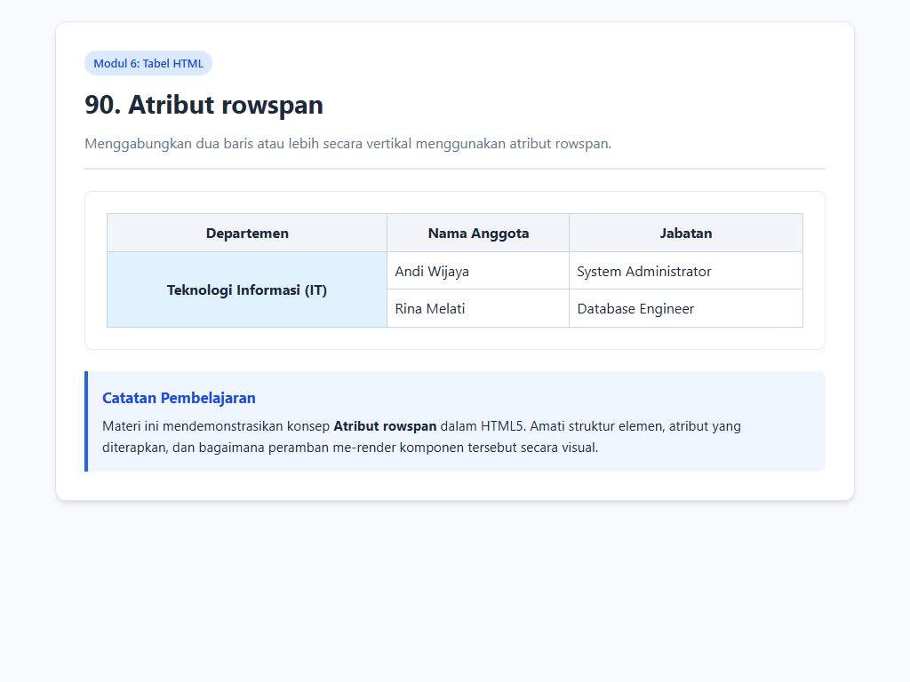

- **Lokasi Source Code:** [90_table_rowspan.html](90_table_rowspan.html)

---

### 11. Elemen colgroup

- **Tujuan Pembelajaran:** Memahami pengelolaan gaya kolom tabel secara terpusat dengan <colgroup>.
- **Konsep Utama:** Elemen <colgroup> mengelompokkan satu atau lebih kolom untuk memudahkan penataan lebar dan styling.
- **Penjelasan Source Code:** Menampilkan tabel yang lebarnya diatur secara proporsional (15%, 50%, 35%) lewat colgroup.
- **Cara Menjalankan:** Buka file `91_table_colgroup.html` secara langsung di peramban web (Google Chrome, Mozilla Firefox, atau Microsoft Edge), atau jalankan ekstensi Live Server pada VS Code.
- **Hasil yang Diharapkan:** Tabel tiga kolom dengan distribusi lebar proporsional dan latar belakang kolom kanan biru muda.
- **Screenshot Hasil Eksekusi:**

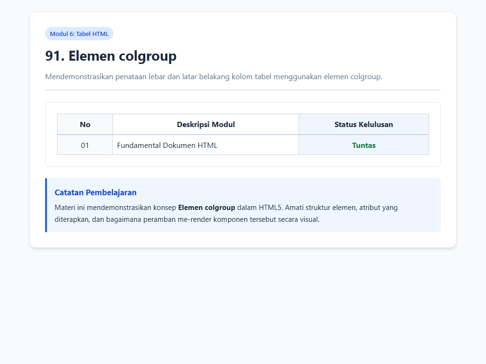

- **Lokasi Source Code:** [91_table_colgroup.html](91_table_colgroup.html)

---

### 12. Elemen col

- **Tujuan Pembelajaran:** Memahami pemanfaatan atribut span pada tag <col>.
- **Konsep Utama:** Tag <col> merepresentasikan satu atau lebih kolom dalam colgroup.
- **Penjelasan Source Code:** Menampilkan tabel dengan kolom pertama abu-abu dan dua kolom berikutnya putih via span='2'.
- **Cara Menjalankan:** Buka file `92_table_column.html` secara langsung di peramban web (Google Chrome, Mozilla Firefox, atau Microsoft Edge), atau jalankan ekstensi Live Server pada VS Code.
- **Hasil yang Diharapkan:** Tabel dengan pembedaan warna kolom pertama secara otomatis.
- **Screenshot Hasil Eksekusi:**

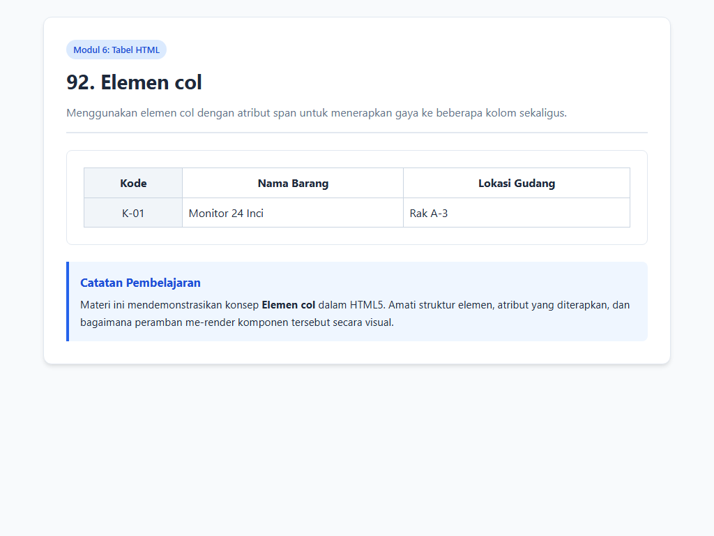

- **Lokasi Source Code:** [92_table_column.html](92_table_column.html)

---

### 13. Atribut scope

- **Tujuan Pembelajaran:** Meningkatkan aksesibilitas tabel bagi penyandang disabilitas dengan atribut scope.
- **Konsep Utama:** Atribut scope mengaitkan sel th dengan sel data secara terarah (kolom vertikal atau baris horizontal).
- **Penjelasan Source Code:** Menampilkan tabel dengan th scope='col' pada header dan th scope='row' pada sel nama staf.
- **Cara Menjalankan:** Buka file `93_table_scope.html` secara langsung di peramban web (Google Chrome, Mozilla Firefox, atau Microsoft Edge), atau jalankan ekstensi Live Server pada VS Code.
- **Hasil yang Diharapkan:** Tabel aksesibel dengan baris tajuk kolom dan sel identitas baris yang tegas.
- **Screenshot Hasil Eksekusi:**

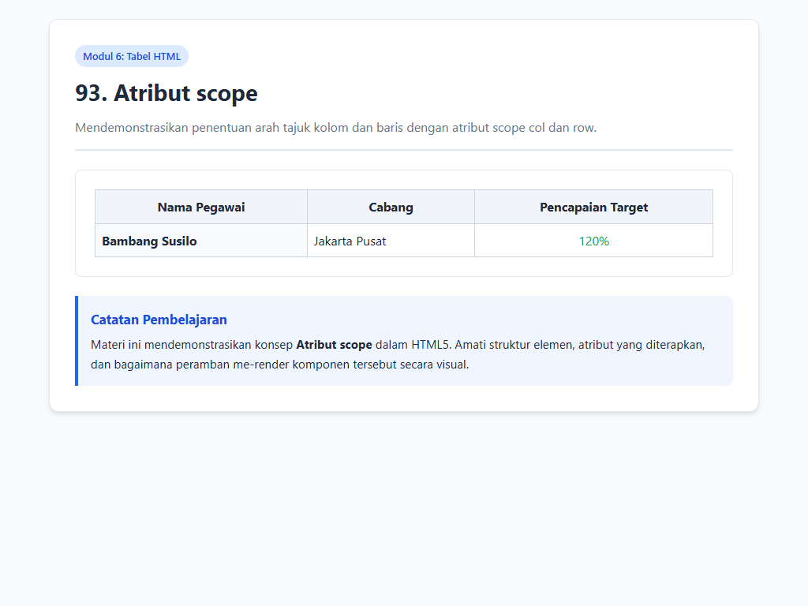

- **Lokasi Source Code:** [93_table_scope.html](93_table_scope.html)

---

### 14. Atribut headers

- **Tujuan Pembelajaran:** Menyelesaikan struktur tabel multi-level dengan relasi eksplisit id dan headers.
- **Konsep Utama:** Ketika tabel memiliki header bertingkat ganda, screen reader menggunakan atribut headers untuk merangkai konteks.
- **Penjelasan Source Code:** Menampilkan tabel laporan keuangan kuartalan bertingkat dengan pemetaan atribut id dan headers.
- **Cara Menjalankan:** Buka file `94_table_headers.html` secara langsung di peramban web (Google Chrome, Mozilla Firefox, atau Microsoft Edge), atau jalankan ekstensi Live Server pada VS Code.
- **Hasil yang Diharapkan:** Tabel keuangan dengan dua tingkatan header: tahun dan kuartal.
- **Screenshot Hasil Eksekusi:**

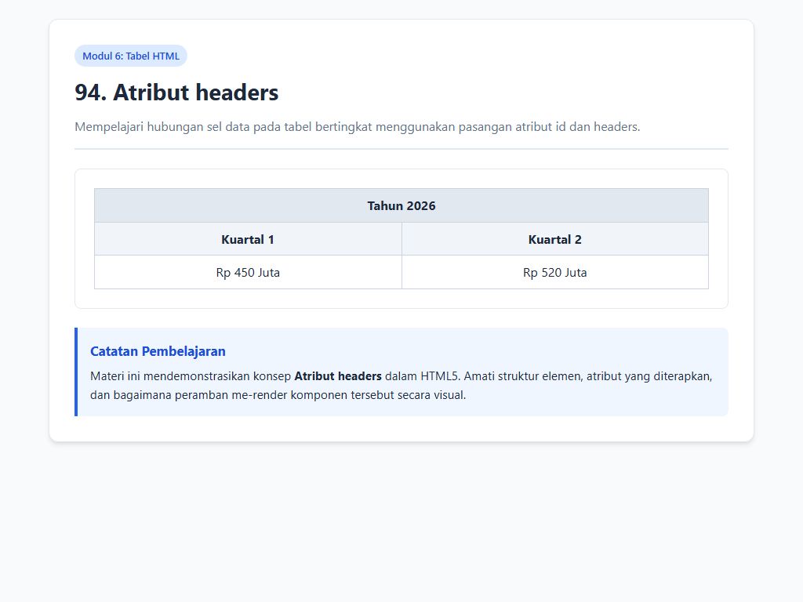

- **Lokasi Source Code:** [94_table_headers.html](94_table_headers.html)

---

### 15. Tabel Data Aksesibel

- **Tujuan Pembelajaran:** Merancang tabel data yang memenuhi standar aksesibilitas WCAG dan responsif pada layar ponsel.
- **Konsep Utama:** Tabel profesional menggabungkan semantik utuh dengan pembungkus overflow-x:auto untuk mencegah layout patah.
- **Penjelasan Source Code:** Menampilkan tabel standar upah dengan desain elegan berlatar header gelap dan status hijau.
- **Cara Menjalankan:** Buka file `95_accessible_data_table.html` secara langsung di peramban web (Google Chrome, Mozilla Firefox, atau Microsoft Edge), atau jalankan ekstensi Live Server pada VS Code.
- **Hasil yang Diharapkan:** Tabel UMR modern dengan tata letak responsif, header gelap elegan, dan sel baris berselang-seling.
- **Screenshot Hasil Eksekusi:**

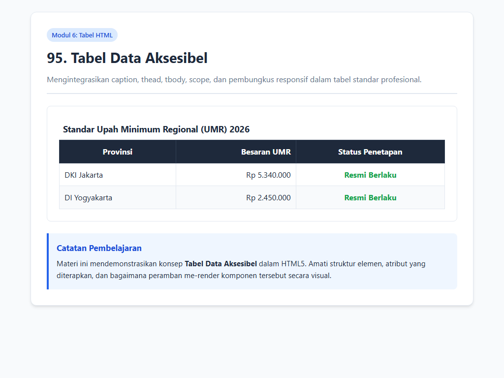

- **Lokasi Source Code:** [95_accessible_data_table.html](95_accessible_data_table.html)

---

## Ringkasan Modul
Modul 6 menyajikan pondasi penting mengenai Tabel HTML. Pemahaman menyeluruh terhadap submodul di atas menjadi prasyarat penting sebelum melangkah ke modul berikutnya.
