# Modul 8: Formulir Lanjutan dan Validasi

## Ringkasan Ruang Lingkup Materi
Modul ini membahas konsep dasar dan implementasi praktis seputar **Formulir Lanjutan dan Validasi**. Setiap submodul dirancang secara terisolasi agar pembelajar dapat memahami konsep satu per satu secara fokus dan terstruktur.

## Tujuan Pembelajaran Modul
Setelah menyelesaikan modul ini, peserta didik diharapkan mampu memahami, mengimplementasikan, dan menguji komponen-komponen utama dalam lingkup formulir lanjutan dan validasi sesuai standar modern W3C.

## Daftar Materi atau Submodul

- [126_label_element.html](126_label_element.html) - Elemen label
- [127_fieldset_element.html](127_fieldset_element.html) - Elemen fieldset
- [128_legend_element.html](128_legend_element.html) - Elemen legend
- [129_datalist_element.html](129_datalist_element.html) - Elemen datalist
- [130_output_element.html](130_output_element.html) - Elemen output
- [131_meter_element.html](131_meter_element.html) - Elemen meter
- [132_progress_element.html](132_progress_element.html) - Elemen progress
- [133_required_attribute.html](133_required_attribute.html) - Atribut required
- [134_placeholder_attribute.html](134_placeholder_attribute.html) - Atribut placeholder
- [135_readonly_attribute.html](135_readonly_attribute.html) - Atribut readonly
- [136_disabled_attribute.html](136_disabled_attribute.html) - Atribut disabled
- [137_min_max_attributes.html](137_min_max_attributes.html) - Atribut min dan max
- [138_minlength_maxlength.html](138_minlength_maxlength.html) - Atribut minlength dan maxlength
- [139_pattern_attribute.html](139_pattern_attribute.html) - Atribut pattern (Regex)
- [140_step_attribute.html](140_step_attribute.html) - Atribut step
- [141_multiple_attribute.html](141_multiple_attribute.html) - Atribut multiple
- [142_accept_attribute.html](142_accept_attribute.html) - Atribut accept
- [143_autocomplete_attribute.html](143_autocomplete_attribute.html) - Atribut autocomplete
- [144_autofocus_attribute.html](144_autofocus_attribute.html) - Atribut autofocus
- [145_form_validation.html](145_form_validation.html) - Validasi Formulir Bawaan Browser

---

## Pembahasan Setiap Submodul

### 1. Elemen label

- **Tujuan Pembelajaran:** Memahami relasi eksplisit atribut for pada <label> dengan id elemen input.
- **Konsep Utama:** Elemen <label> memperluas area sentuh dan sangat vital untuk pengguna screen reader.
- **Penjelasan Source Code:** Menampilkan label interaktif yang saat diklik langsung memfokuskan input teks.
- **Cara Menjalankan:** Buka file `126_label_element.html` secara langsung di peramban web (Google Chrome, Mozilla Firefox, atau Microsoft Edge), atau jalankan ekstensi Live Server pada VS Code.
- **Hasil yang Diharapkan:** Field input yang aktif menyala saat teks label di atasnya diklik.
- **Screenshot Hasil Eksekusi:**

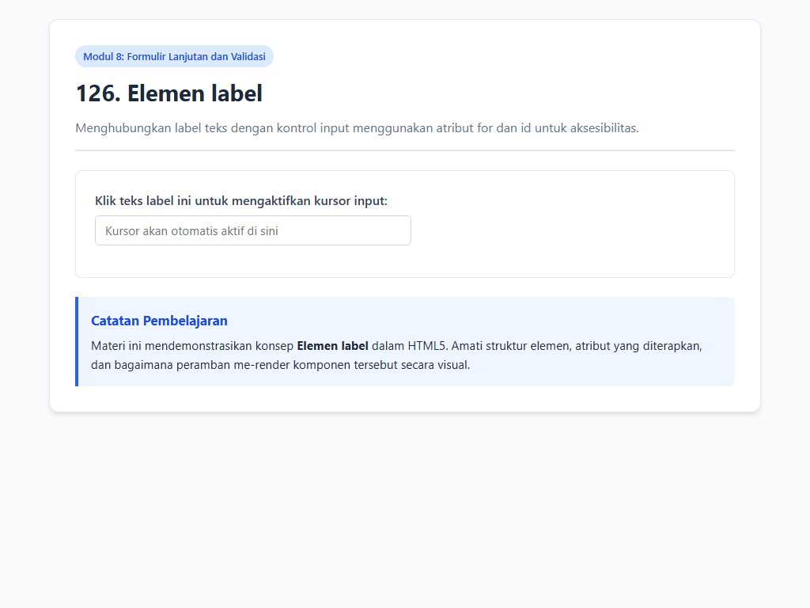

- **Lokasi Source Code:** [126_label_element.html](126_label_element.html)

---

### 2. Elemen fieldset

- **Tujuan Pembelajaran:** Mengelompokkan bagian formulir terpadu menggunakan elemen <fieldset>.
- **Konsep Utama:** Fieldset menggambar bingkai kotak visual di sekitar kumpulan data yang relevan.
- **Penjelasan Source Code:** Menampilkan kotak data alamat pengiriman yang terisolasi rapi.
- **Cara Menjalankan:** Buka file `127_fieldset_element.html` secara langsung di peramban web (Google Chrome, Mozilla Firefox, atau Microsoft Edge), atau jalankan ekstensi Live Server pada VS Code.
- **Hasil yang Diharapkan:** Kotak berbingkai halus yang mengelompokkan input alamat dan kode pos.
- **Screenshot Hasil Eksekusi:**

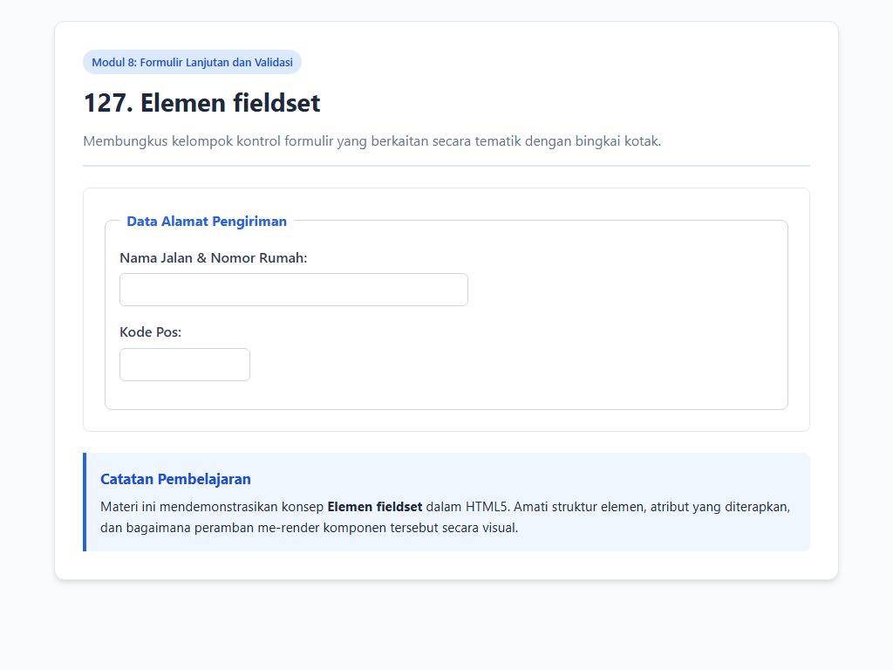

- **Lokasi Source Code:** [127_fieldset_element.html](127_fieldset_element.html)

---

### 3. Elemen legend

- **Tujuan Pembelajaran:** Membuat judul semantik pada bingkai formulir dengan <legend>.
- **Konsep Utama:** Tag <legend> dibaca screen reader saat pengguna berpindah antar-kelompok input.
- **Penjelasan Source Code:** Menampilkan kotak fieldset berbingkai biru dengan judul legend tersemat di garis atas.
- **Cara Menjalankan:** Buka file `128_legend_element.html` secara langsung di peramban web (Google Chrome, Mozilla Firefox, atau Microsoft Edge), atau jalankan ekstensi Live Server pada VS Code.
- **Hasil yang Diharapkan:** Kotak bingkai biru dengan judul 'Informasi Akun Utama' memotong garis atas.
- **Screenshot Hasil Eksekusi:**

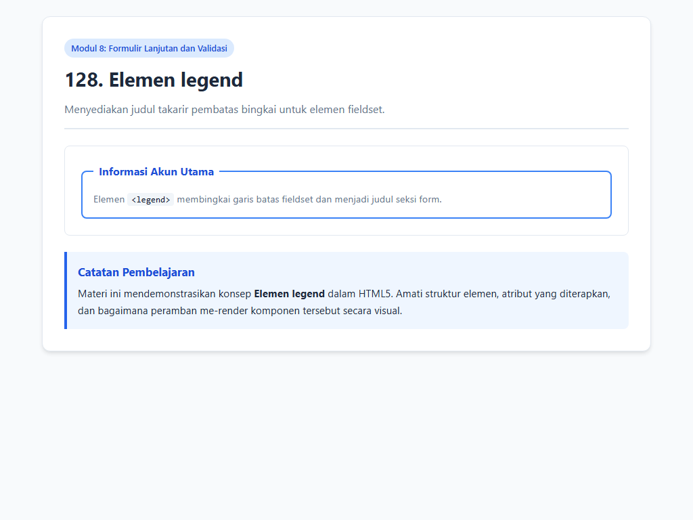

- **Lokasi Source Code:** [128_legend_element.html](128_legend_element.html)

---

### 4. Elemen datalist

- **Tujuan Pembelajaran:** Menerapkan fitur saran autocomplete bawaan HTML5 dengan <datalist>.
- **Konsep Utama:** Datalist memadukan kebebasan input teks biasa dengan kepraktisan dropdown opsi.
- **Penjelasan Source Code:** Menampilkan input yang memunculkan rekomendasi browser saat diketik.
- **Cara Menjalankan:** Buka file `129_datalist_element.html` secara langsung di peramban web (Google Chrome, Mozilla Firefox, atau Microsoft Edge), atau jalankan ekstensi Live Server pada VS Code.
- **Hasil yang Diharapkan:** Kotak input yang menampilkan daftar pilihan cerdas saat pengguna mengetik.
- **Screenshot Hasil Eksekusi:**

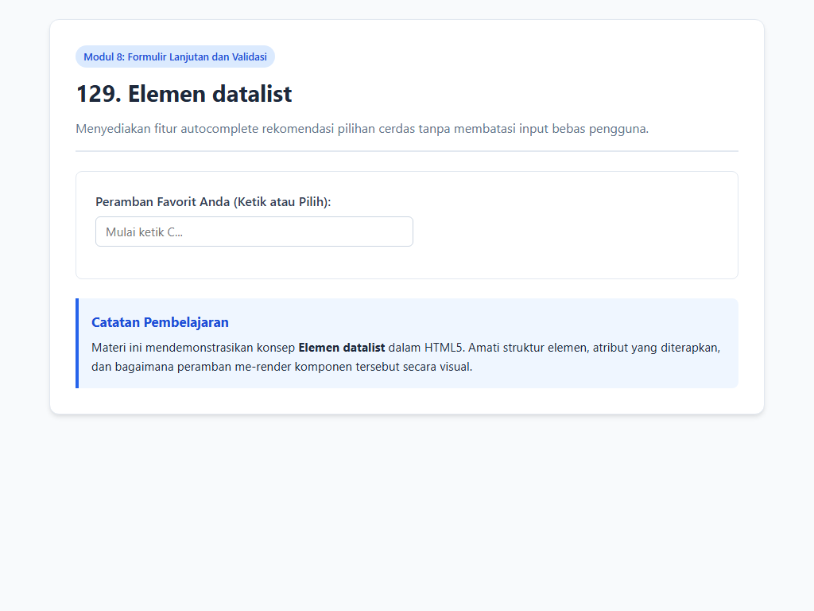

- **Lokasi Source Code:** [129_datalist_element.html](129_datalist_element.html)

---

### 5. Elemen output

- **Tujuan Pembelajaran:** Menyajikan hasil perhitungan dinamis dengan elemen semantik <output>.
- **Konsep Utama:** Elemen <output> mengumumkan perubahan angka hasil kalkulasi kepada teknologi asistif.
- **Penjelasan Source Code:** Menampilkan mini-kalkulator penjumlahan instan 10 + 25 = 35.
- **Cara Menjalankan:** Buka file `130_output_element.html` secara langsung di peramban web (Google Chrome, Mozilla Firefox, atau Microsoft Edge), atau jalankan ekstensi Live Server pada VS Code.
- **Hasil yang Diharapkan:** Operasi hitung dua angka yang hasilnya otomatis tampil di elemen output biru.
- **Screenshot Hasil Eksekusi:**

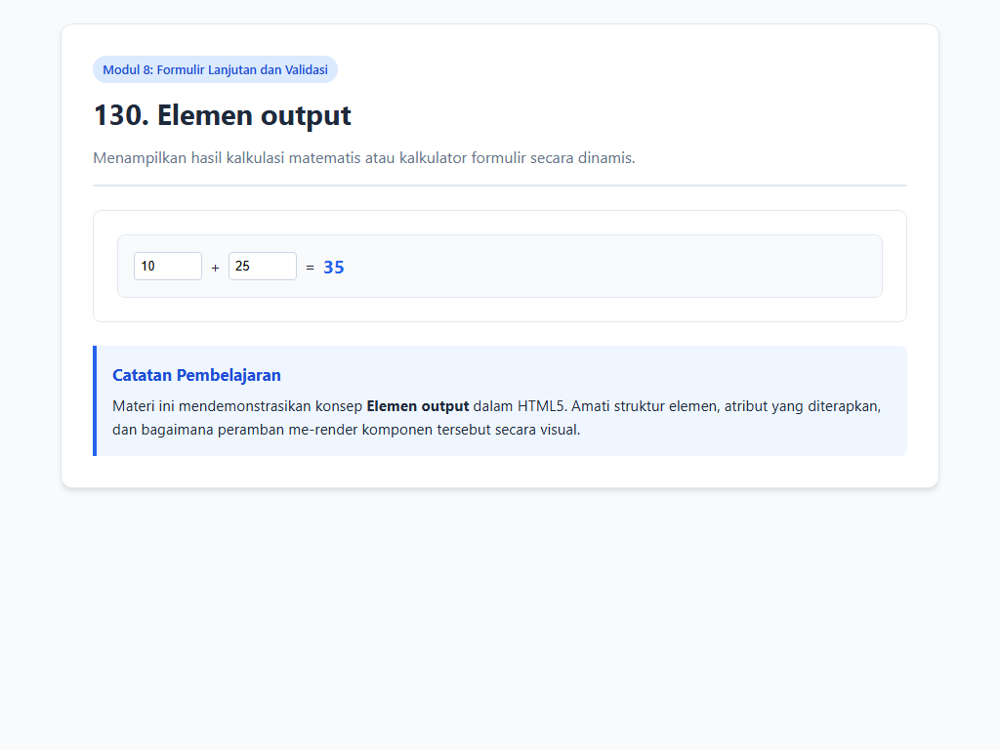

- **Lokasi Source Code:** [130_output_element.html](130_output_element.html)

---

### 6. Elemen meter

- **Tujuan Pembelajaran:** Memahami penggunaan elemen <meter> untuk nilai skalar tertentu.
- **Konsep Utama:** Elemen <meter> berbeda dari progress bar; meter mengukur kapasitas atau fraksi diskon.
- **Penjelasan Source Code:** Menampilkan meteran batang penyimpanan disk yang terisi 75%.
- **Cara Menjalankan:** Buka file `131_meter_element.html` secara langsung di peramban web (Google Chrome, Mozilla Firefox, atau Microsoft Edge), atau jalankan ekstensi Live Server pada VS Code.
- **Hasil yang Diharapkan:** Bilah indikator kapasitas meteran horizontal bergradasi warna peramban.
- **Screenshot Hasil Eksekusi:**

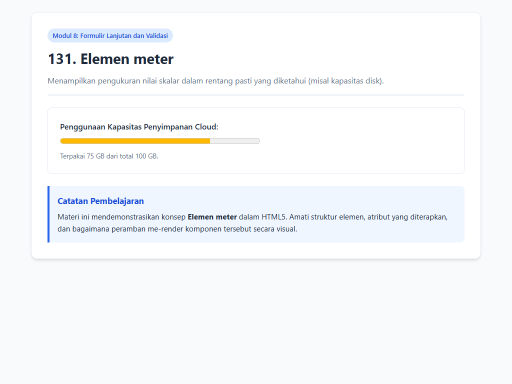

- **Lokasi Source Code:** [131_meter_element.html](131_meter_element.html)

---

### 7. Elemen progress

- **Tujuan Pembelajaran:** Menerapkan progress bar indikator penyelesaian tugas dengan <progress>.
- **Konsep Utama:** Elemen <progress> merepresentasikan status tugas dari awal hingga selesai (0 ke max).
- **Penjelasan Source Code:** Menampilkan bilah progres unduhan yang sedang berada di titik 65%.
- **Cara Menjalankan:** Buka file `132_progress_element.html` secara langsung di peramban web (Google Chrome, Mozilla Firefox, atau Microsoft Edge), atau jalankan ekstensi Live Server pada VS Code.
- **Hasil yang Diharapkan:** Bilah progress bar biru elegan dengan persentase kemajuan unduhan.
- **Screenshot Hasil Eksekusi:**

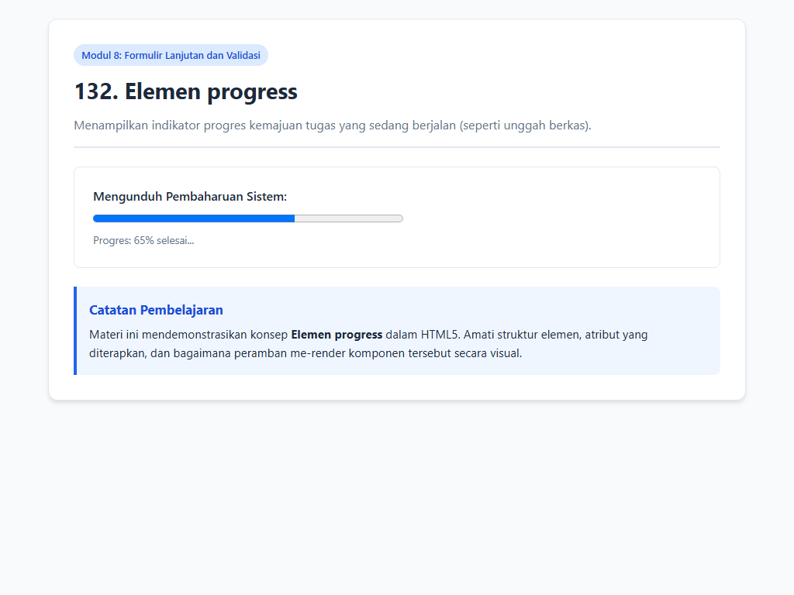

- **Lokasi Source Code:** [132_progress_element.html](132_progress_element.html)

---

### 8. Atribut required

- **Tujuan Pembelajaran:** Mencegah pengiriman formulir kosong dengan atribut boolean required.
- **Konsep Utama:** Peramban akan memunculkan pesan peringatan tooltip jika field required belum diisi.
- **Penjelasan Source Code:** Menampilkan input wajib berlabel tanda bintang merah dengan tombol uji.
- **Cara Menjalankan:** Buka file `133_required_attribute.html` secara langsung di peramban web (Google Chrome, Mozilla Firefox, atau Microsoft Edge), atau jalankan ekstensi Live Server pada VS Code.
- **Hasil yang Diharapkan:** Field input wajib berpenanda bintang merah dan pesan peringatan otomatis.
- **Screenshot Hasil Eksekusi:**

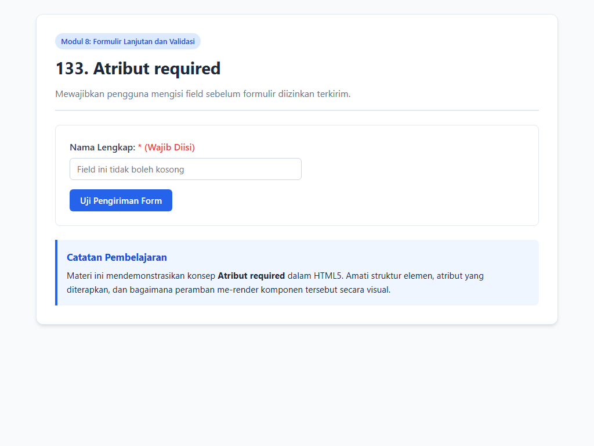

- **Lokasi Source Code:** [133_required_attribute.html](133_required_attribute.html)

---

### 9. Atribut placeholder

- **Tujuan Pembelajaran:** Memberikan contoh petunjuk format isian yang jelas dengan placeholder.
- **Konsep Utama:** Placeholder bukan pengganti label, melainkan petunjuk singkat yang hilang saat diketik.
- **Penjelasan Source Code:** Menampilkan contoh format nomor telepon di dalam kolom isian.
- **Cara Menjalankan:** Buka file `134_placeholder_attribute.html` secara langsung di peramban web (Google Chrome, Mozilla Firefox, atau Microsoft Edge), atau jalankan ekstensi Live Server pada VS Code.
- **Hasil yang Diharapkan:** Field teks dengan teks petunjuk contoh nomor telepon berwarna abu-abu halus.
- **Screenshot Hasil Eksekusi:**

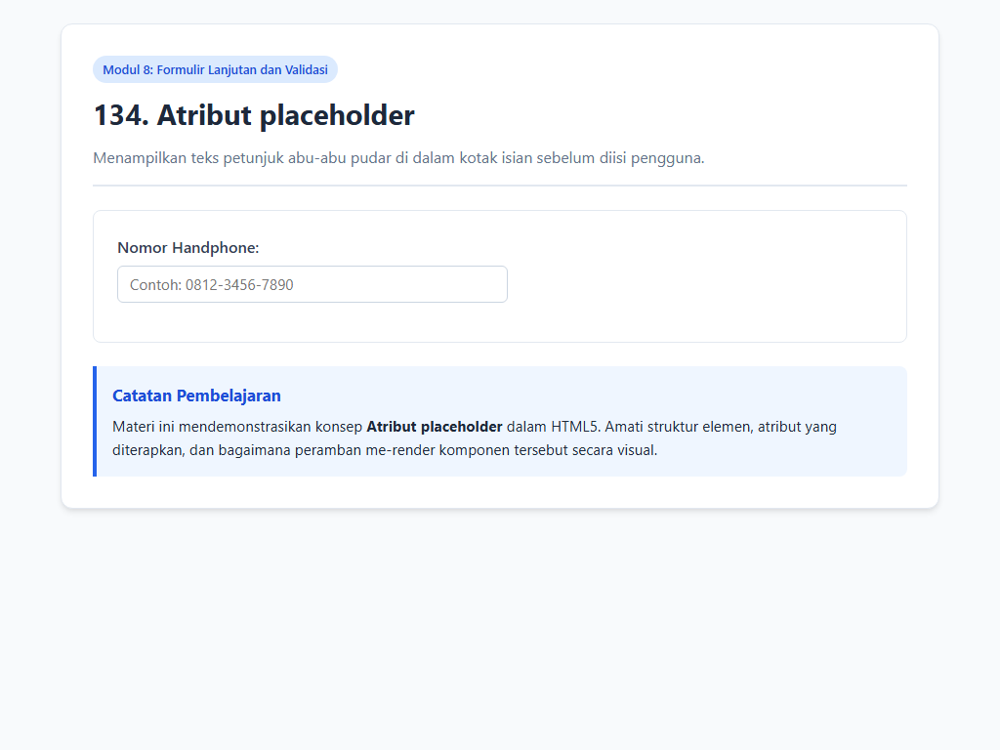

- **Lokasi Source Code:** [134_placeholder_attribute.html](134_placeholder_attribute.html)

---

### 10. Atribut readonly

- **Tujuan Pembelajaran:** Memahami karakteristik proteksi data dengan atribut readonly.
- **Konsep Utama:** Readonly mempertahankan keterkiriman nilai ke backend berbeda dengan disabled.
- **Penjelasan Source Code:** Menampilkan field kode referral dengan latar abu-abu yang terkunci.
- **Cara Menjalankan:** Buka file `135_readonly_attribute.html` secara langsung di peramban web (Google Chrome, Mozilla Firefox, atau Microsoft Edge), atau jalankan ekstensi Live Server pada VS Code.
- **Hasil yang Diharapkan:** Kotak isian kode promo yang terkunci dengan kursor not-allowed.
- **Screenshot Hasil Eksekusi:**

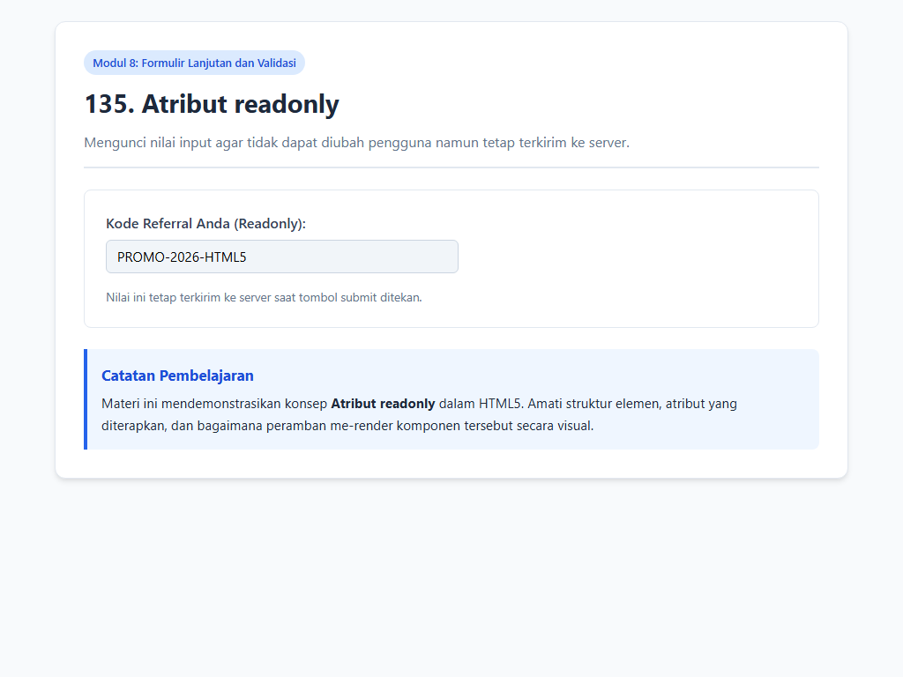

- **Lokasi Source Code:** [135_readonly_attribute.html](135_readonly_attribute.html)

---

### 11. Atribut disabled

- **Tujuan Pembelajaran:** Membedakan atribut disabled dengan readonly pada kontrol formulir.
- **Konsep Utama:** Kontrol disabled pudar secara visual dan dikeluarkan dari siklus payload form submit.
- **Penjelasan Source Code:** Menampilkan input teks dan tombol yang dinonaktifkan secara total.
- **Cara Menjalankan:** Buka file `136_disabled_attribute.html` secara langsung di peramban web (Google Chrome, Mozilla Firefox, atau Microsoft Edge), atau jalankan ekstensi Live Server pada VS Code.
- **Hasil yang Diharapkan:** Input dan tombol berwarna abu-abu redup yang tidak dapat diklik.
- **Screenshot Hasil Eksekusi:**

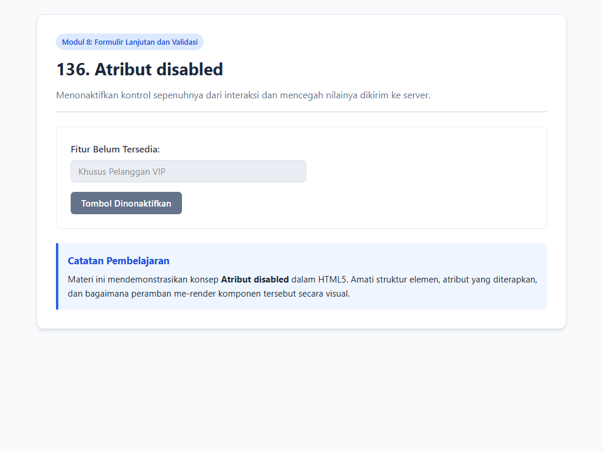

- **Lokasi Source Code:** [136_disabled_attribute.html](136_disabled_attribute.html)

---

### 12. Atribut min dan max

- **Tujuan Pembelajaran:** Membatasi rentang nilai angka yang diizinkan menggunakan min dan max.
- **Konsep Utama:** Peramban akan menolak pengiriman nilai yang berada di luar rentang min dan max.
- **Penjelasan Source Code:** Menampilkan input usia dengan rentang valid 18 hingga 60 tahun.
- **Cara Menjalankan:** Buka file `137_min_max_attributes.html` secara langsung di peramban web (Google Chrome, Mozilla Firefox, atau Microsoft Edge), atau jalankan ekstensi Live Server pada VS Code.
- **Hasil yang Diharapkan:** Field angka dengan batasan rentang nilai minimal 18 dan maksimal 60.
- **Screenshot Hasil Eksekusi:**

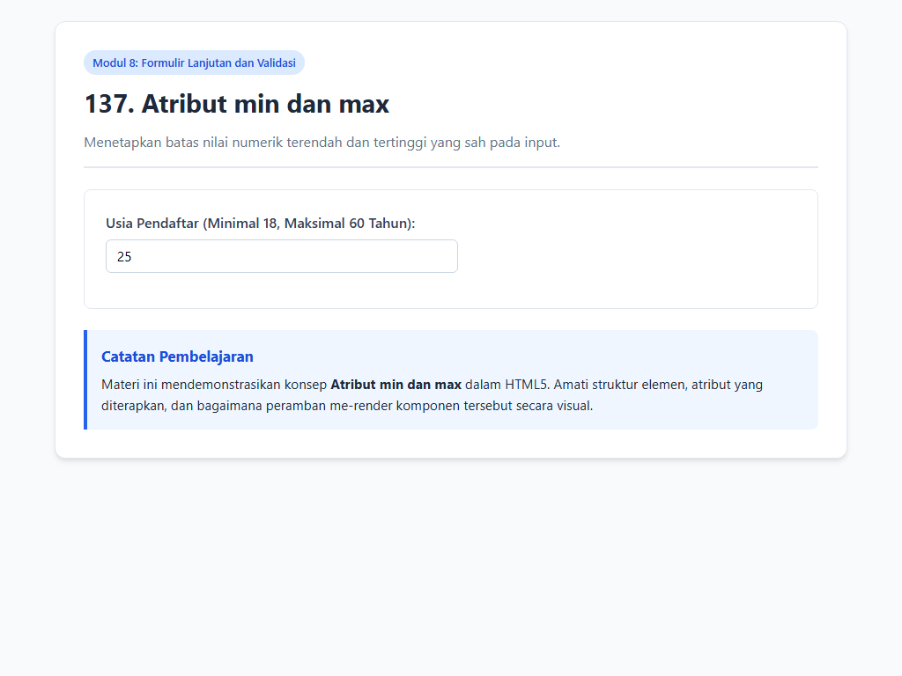

- **Lokasi Source Code:** [137_min_max_attributes.html](137_min_max_attributes.html)

---

### 13. Atribut minlength dan maxlength

- **Tujuan Pembelajaran:** Mengatur panjang karakter teks menggunakan minlength dan maxlength.
- **Konsep Utama:** Atribut maxlength memotong pengetikan berlebih secara otomatis di sisi antarmuka.
- **Penjelasan Source Code:** Menampilkan input nama pengguna dengan batasan panjang karakter 4-12.
- **Cara Menjalankan:** Buka file `138_minlength_maxlength.html` secara langsung di peramban web (Google Chrome, Mozilla Firefox, atau Microsoft Edge), atau jalankan ekstensi Live Server pada VS Code.
- **Hasil yang Diharapkan:** Field teks yang membatasi panjang ketikan karakter.
- **Screenshot Hasil Eksekusi:**

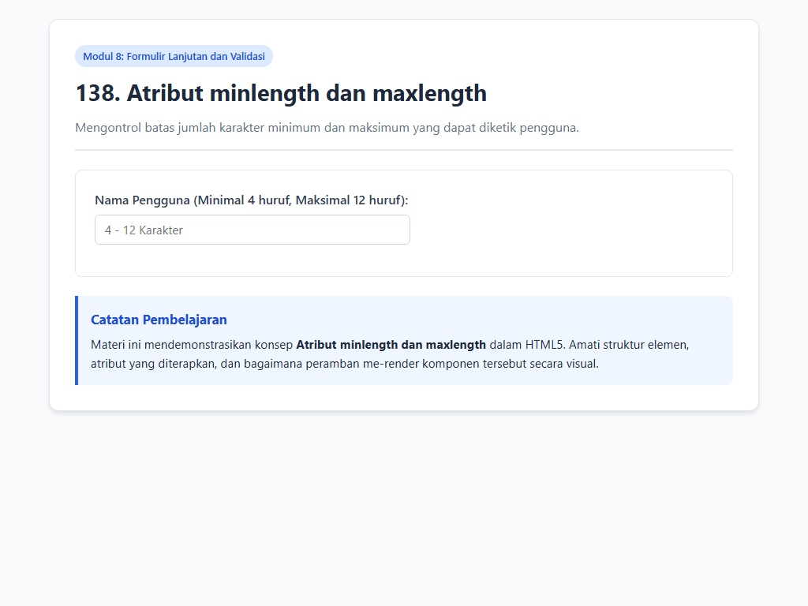

- **Lokasi Source Code:** [138_minlength_maxlength.html](138_minlength_maxlength.html)

---

### 14. Atribut pattern (Regex)

- **Tujuan Pembelajaran:** Menguasai validasi pola teks berbasis Regular Expression (RegEx) dengan pattern.
- **Konsep Utama:** Atribut pattern mencocokkan nilai input dengan regex tanpa perlu menulis script JS.
- **Penjelasan Source Code:** Menampilkan validasi plat nomor kendaraan bermotor Indonesia.
- **Cara Menjalankan:** Buka file `139_pattern_attribute.html` secara langsung di peramban web (Google Chrome, Mozilla Firefox, atau Microsoft Edge), atau jalankan ekstensi Live Server pada VS Code.
- **Hasil yang Diharapkan:** Field teks dengan aturan format plat nomor dan tombol validasi.
- **Screenshot Hasil Eksekusi:**

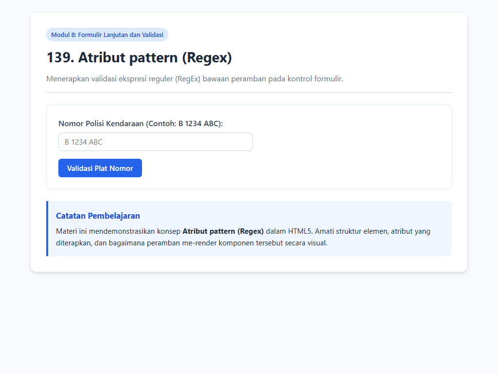

- **Lokasi Source Code:** [139_pattern_attribute.html](139_pattern_attribute.html)

---

### 15. Atribut step

- **Tujuan Pembelajaran:** Mengontrol kelipatan penambahan angka dengan atribut step.
- **Konsep Utama:** Atribut step dapat berupa bilangan bulat (misal 50000) atau desimal pecahan (misal 0.01).
- **Penjelasan Source Code:** Menampilkan input donasi dengan loncatan nilai per 50.000.
- **Cara Menjalankan:** Buka file `140_step_attribute.html` secara langsung di peramban web (Google Chrome, Mozilla Firefox, atau Microsoft Edge), atau jalankan ekstensi Live Server pada VS Code.
- **Hasil yang Diharapkan:** Field angka dengan loncatan nilai kelipatan 50.000.
- **Screenshot Hasil Eksekusi:**

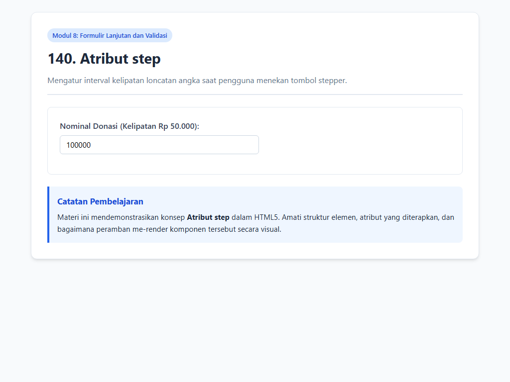

- **Lokasi Source Code:** [140_step_attribute.html](140_step_attribute.html)

---

### 16. Atribut multiple

- **Tujuan Pembelajaran:** Mengaktifkan multi-selection pada input file dan email dengan atribut multiple.
- **Konsep Utama:** Pengguna dapat menahan tombol Ctrl/Shift untuk memilih beberapa berkas sekaligus.
- **Penjelasan Source Code:** Menampilkan input file yang siap menampung lebih dari satu berkas.
- **Cara Menjalankan:** Buka file `141_multiple_attribute.html` secara langsung di peramban web (Google Chrome, Mozilla Firefox, atau Microsoft Edge), atau jalankan ekstensi Live Server pada VS Code.
- **Hasil yang Diharapkan:** Field pemilihan file yang mendukung multi-berkas.
- **Screenshot Hasil Eksekusi:**

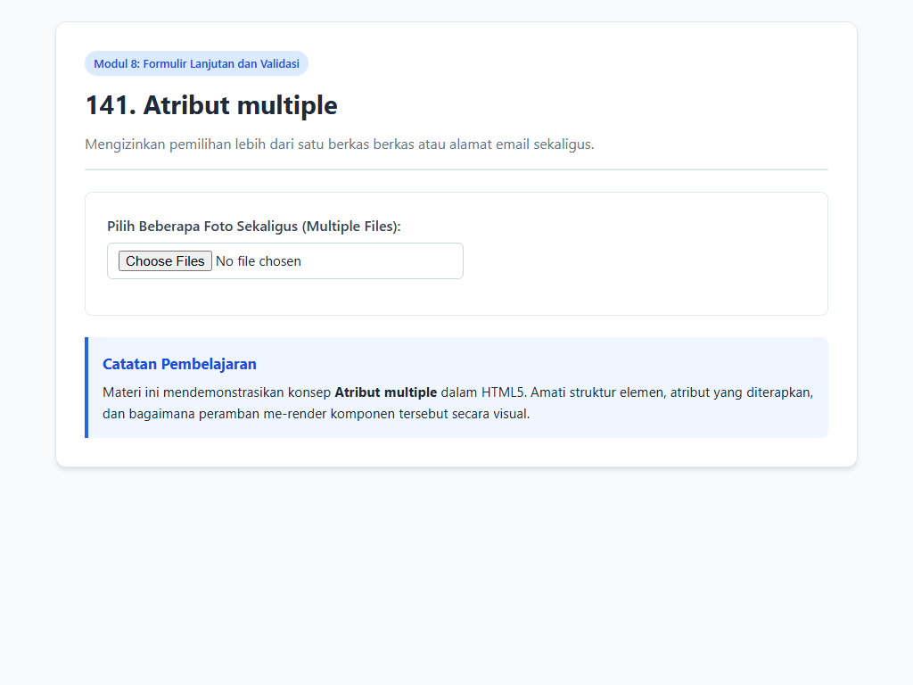

- **Lokasi Source Code:** [141_multiple_attribute.html](141_multiple_attribute.html)

---

### 17. Atribut accept

- **Tujuan Pembelajaran:** Membatasi tipe berkas yang dapat dipilih dengan atribut accept.
- **Konsep Utama:** Atribut accept menerima ekstensi (.pdf) atau MIME type (image/png) untuk menyaring file picker.
- **Penjelasan Source Code:** Menampilkan input berkas khusus dokumen PDF dan gambar PNG.
- **Cara Menjalankan:** Buka file `142_accept_attribute.html` secara langsung di peramban web (Google Chrome, Mozilla Firefox, atau Microsoft Edge), atau jalankan ekstensi Live Server pada VS Code.
- **Hasil yang Diharapkan:** Field unggah berkas yang difilter khusus format PDF dan PNG.
- **Screenshot Hasil Eksekusi:**

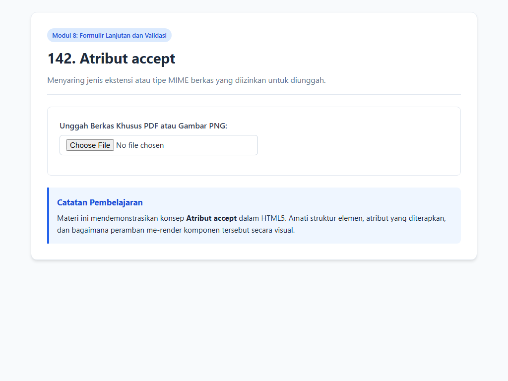

- **Lokasi Source Code:** [142_accept_attribute.html](142_accept_attribute.html)

---

### 18. Atribut autocomplete

- **Tujuan Pembelajaran:** Mengoptimalkan kemudahan pengisian form dengan autocomplete terstandar.
- **Konsep Utama:** Nilai seperti name, email, street-address, dan tel mempercepat konversi form peramban.
- **Penjelasan Source Code:** Menampilkan form alamat dengan panduan autocomplete standar.
- **Cara Menjalankan:** Buka file `143_autocomplete_attribute.html` secara langsung di peramban web (Google Chrome, Mozilla Firefox, atau Microsoft Edge), atau jalankan ekstensi Live Server pada VS Code.
- **Hasil yang Diharapkan:** Dua field formulir dengan metadata autofill peramban terstandar.
- **Screenshot Hasil Eksekusi:**

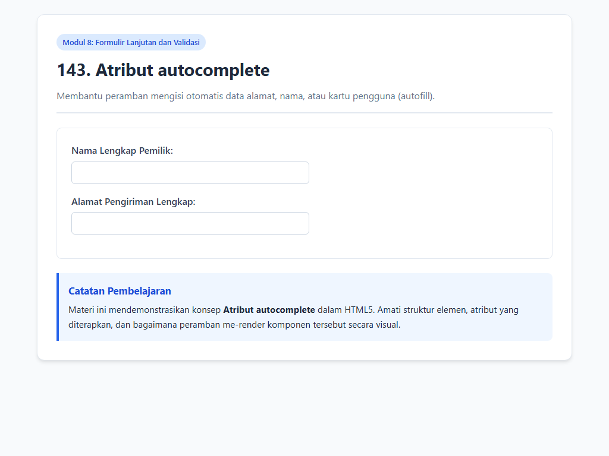

- **Lokasi Source Code:** [143_autocomplete_attribute.html](143_autocomplete_attribute.html)

---

### 19. Atribut autofocus

- **Tujuan Pembelajaran:** Memahami fokus kursor otomatis menggunakan atribut autofocus.
- **Konsep Utama:** Gunakan hanya satu autofocus per halaman agar tidak membingungkan pengguna.
- **Penjelasan Source Code:** Menampilkan field pencarian yang kursornya langsung aktif menyala saat halaman dimuat.
- **Cara Menjalankan:** Buka file `144_autofocus_attribute.html` secara langsung di peramban web (Google Chrome, Mozilla Firefox, atau Microsoft Edge), atau jalankan ekstensi Live Server pada VS Code.
- **Hasil yang Diharapkan:** Field input dengan kursor aktif berbingkai biru menyala secara otomatis.
- **Screenshot Hasil Eksekusi:**

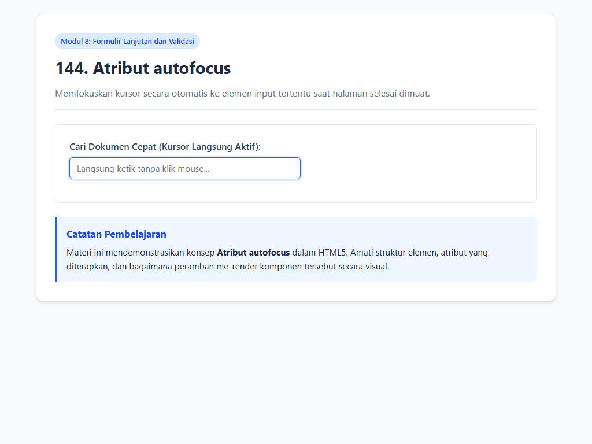

- **Lokasi Source Code:** [144_autofocus_attribute.html](144_autofocus_attribute.html)

---

### 20. Validasi Formulir Bawaan Browser

- **Tujuan Pembelajaran:** Membangun alur validasi formulir lengkap tanpa dependensi JavaScript.
- **Konsep Utama:** Kombinasi required, pattern, type, dan pseudo-class menghasilkan validasi bawaan yang kokoh.
- **Penjelasan Source Code:** Menampilkan formulir pendaftaran akun terverifikasi dengan validasi format email dan PIN 6 angka.
- **Cara Menjalankan:** Buka file `145_form_validation.html` secara langsung di peramban web (Google Chrome, Mozilla Firefox, atau Microsoft Edge), atau jalankan ekstensi Live Server pada VS Code.
- **Hasil yang Diharapkan:** Formulir registrasi lengkap dengan validasi multi-kriteria bawaan peramban.
- **Screenshot Hasil Eksekusi:**

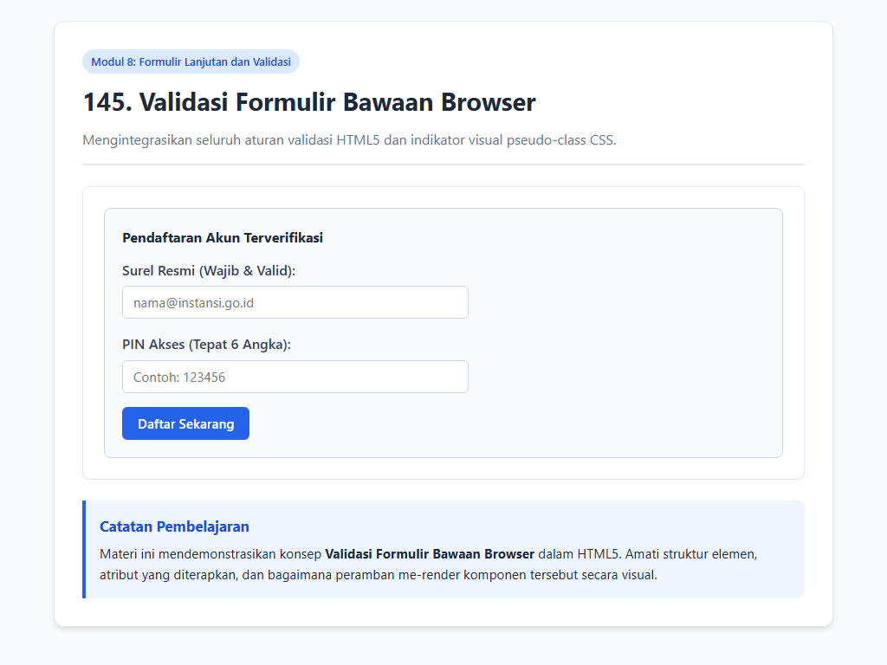

- **Lokasi Source Code:** [145_form_validation.html](145_form_validation.html)

---

## Ringkasan Modul
Modul 8 menyajikan pondasi penting mengenai Formulir Lanjutan dan Validasi. Pemahaman menyeluruh terhadap submodul di atas menjadi prasyarat penting sebelum melangkah ke modul berikutnya.
