# Modul 9: Semantic HTML

## Ringkasan Ruang Lingkup Materi
Modul ini membahas konsep dasar dan implementasi praktis seputar **Semantic HTML**. Setiap submodul dirancang secara terisolasi agar pembelajar dapat memahami konsep satu per satu secara fokus dan terstruktur.

## Tujuan Pembelajaran Modul
Setelah menyelesaikan modul ini, peserta didik diharapkan mampu memahami, mengimplementasikan, dan menguji komponen-komponen utama dalam lingkup semantic html sesuai standar modern W3C.

## Daftar Materi atau Submodul

- [146_header_element.html](146_header_element.html) - Elemen header
- [147_footer_element.html](147_footer_element.html) - Elemen footer
- [148_main_element.html](148_main_element.html) - Elemen main
- [149_section_element.html](149_section_element.html) - Elemen section
- [150_article_element.html](150_article_element.html) - Elemen article
- [151_aside_element.html](151_aside_element.html) - Elemen aside
- [152_nav_semantics.html](152_nav_semantics.html) - Semantik Elemen Navigasi
- [153_address_element.html](153_address_element.html) - Elemen address
- [154_time_element.html](154_time_element.html) - Elemen time
- [155_data_element.html](155_data_element.html) - Elemen data
- [156_details_element.html](156_details_element.html) - Elemen details
- [157_summary_element.html](157_summary_element.html) - Elemen summary
- [158_dialog_element.html](158_dialog_element.html) - Elemen dialog
- [159_search_element.html](159_search_element.html) - Elemen search
- [160_div_element.html](160_div_element.html) - Elemen div
- [161_span_element.html](161_span_element.html) - Elemen span
- [162_semantic_vs_nonsemantic.html](162_semantic_vs_nonsemantic.html) - Perbandingan Elemen Semantik dan Nonsemantik
- [163_blog_semantic_layout.html](163_blog_semantic_layout.html) - Struktur Semantik Blog
- [164_news_semantic_layout.html](164_news_semantic_layout.html) - Struktur Semantik Portal Berita
- [165_landing_page_semantics.html](165_landing_page_semantics.html) - Struktur Semantik Landing Page

---

## Pembahasan Setiap Submodul

### 1. Elemen header

- **Tujuan Pembelajaran:** Memahami fungsi semantik elemen <header>.
- **Konsep Utama:** Header membungkus konten pembuka atau kelompok bantuan navigasi.
- **Penjelasan Source Code:** Menampilkan header bagian dokumen dengan judul dan deskripsi.
- **Cara Menjalankan:** Buka file `146_header_element.html` secara langsung di peramban web (Google Chrome, Mozilla Firefox, atau Microsoft Edge), atau jalankan ekstensi Live Server pada VS Code.
- **Hasil yang Diharapkan:** Kotak kepala halaman berwarna abu-abu terang dengan judul dan subtitle.
- **Screenshot Hasil Eksekusi:**

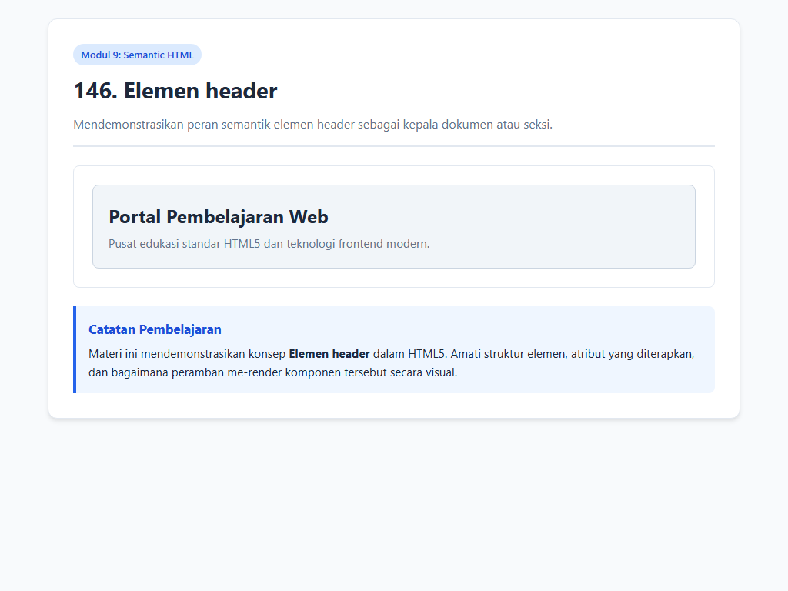

- **Lokasi Source Code:** [146_header_element.html](146_header_element.html)

---

### 2. Elemen footer

- **Tujuan Pembelajaran:** Menguasai penulisan bagian kaki dokumen dengan elemen <footer>.
- **Konsep Utama:** Elemen <footer> memuat informasi kepemilikan, lisensi, dan kontak.
- **Penjelasan Source Code:** Menampilkan footer gelap elegan dengan informasi hak cipta.
- **Cara Menjalankan:** Buka file `147_footer_element.html` secara langsung di peramban web (Google Chrome, Mozilla Firefox, atau Microsoft Edge), atau jalankan ekstensi Live Server pada VS Code.
- **Hasil yang Diharapkan:** Bilah footer gelap dengan teks hak cipta putih terpusat.
- **Screenshot Hasil Eksekusi:**

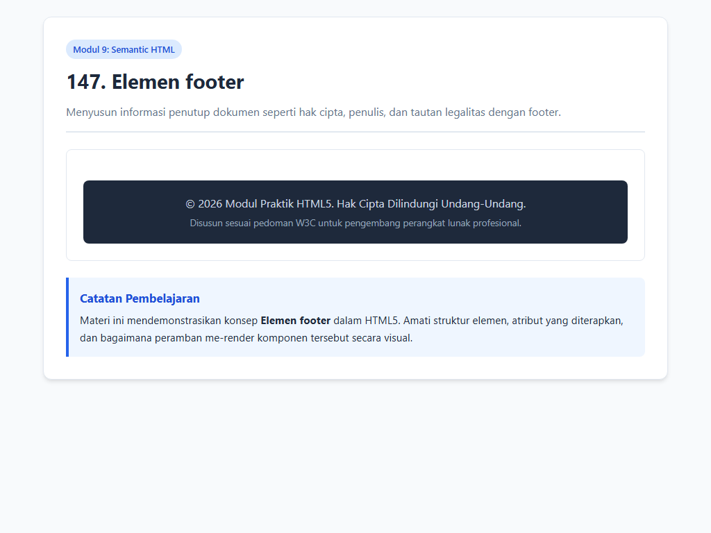

- **Lokasi Source Code:** [147_footer_element.html](147_footer_element.html)

---

### 3. Elemen main

- **Tujuan Pembelajaran:** Menentukan area konten inti dokumen menggunakan elemen <main>.
- **Konsep Utama:** Elemen <main> memberikan landmark utama bagi pembaca layar.
- **Penjelasan Source Code:** Menampilkan kotak konten utama berbingkai biru tegas.
- **Cara Menjalankan:** Buka file `148_main_element.html` secara langsung di peramban web (Google Chrome, Mozilla Firefox, atau Microsoft Edge), atau jalankan ekstensi Live Server pada VS Code.
- **Hasil yang Diharapkan:** Kotak berbingkai biru yang melambangkan wilayah utama konten.
- **Screenshot Hasil Eksekusi:**

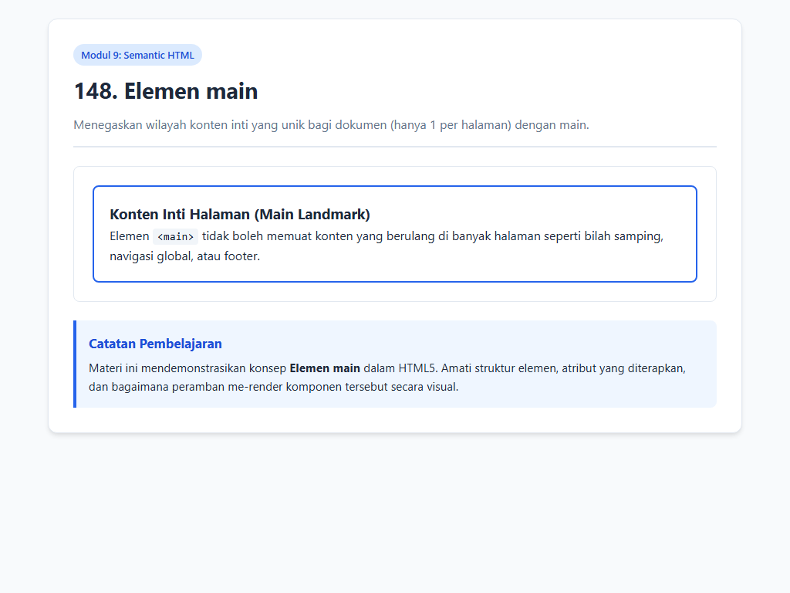

- **Lokasi Source Code:** [148_main_element.html](148_main_element.html)

---

### 4. Elemen section

- **Tujuan Pembelajaran:** Memahami pemisahan tematik dokumen dengan <section>.
- **Konsep Utama:** Elemen <section> harus selalu memiliki heading (h2-h6) sebagai identitas bagian.
- **Penjelasan Source Code:** Menampilkan seksi latar belakang berbingkai rapi.
- **Cara Menjalankan:** Buka file `149_section_element.html` secara langsung di peramban web (Google Chrome, Mozilla Firefox, atau Microsoft Edge), atau jalankan ekstensi Live Server pada VS Code.
- **Hasil yang Diharapkan:** Bagian seksi bertema khusus dengan heading dan paragraf pendukung.
- **Screenshot Hasil Eksekusi:**

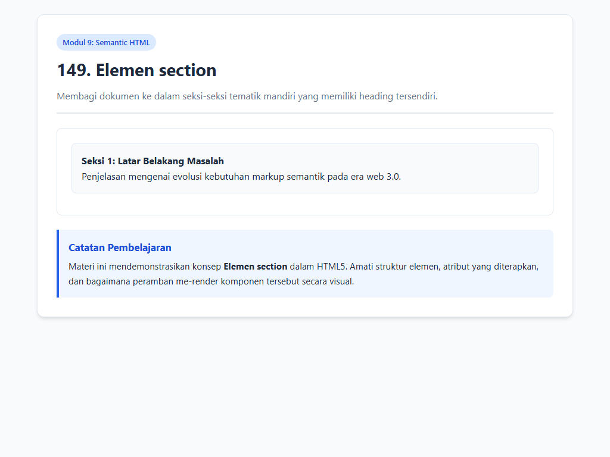

- **Lokasi Source Code:** [149_section_element.html](149_section_element.html)

---

### 5. Elemen article

- **Tujuan Pembelajaran:** Menguasai pembentukan konten mandiri menggunakan elemen <article>.
- **Konsep Utama:** Konten dalam <article> memiliki makna utuh meski dipisahkan dari halaman asalnya.
- **Penjelasan Source Code:** Menampilkan kartu artikel blog lengkap dengan metadata penulis.
- **Cara Menjalankan:** Buka file `150_article_element.html` secara langsung di peramban web (Google Chrome, Mozilla Firefox, atau Microsoft Edge), atau jalankan ekstensi Live Server pada VS Code.
- **Hasil yang Diharapkan:** Kartu artikel modern dengan header tanggal publikasi dan isi naskah.
- **Screenshot Hasil Eksekusi:**

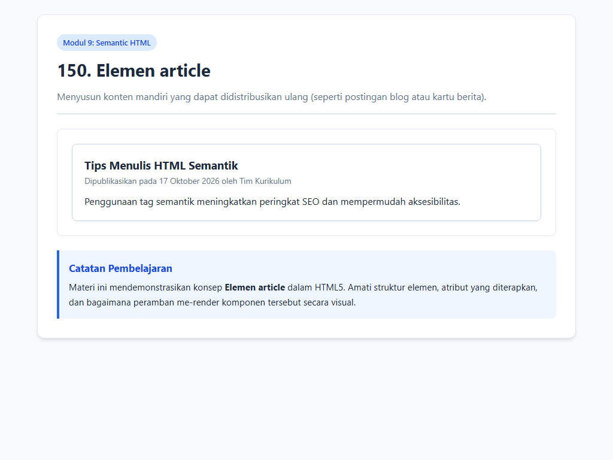

- **Lokasi Source Code:** [150_article_element.html](150_article_element.html)

---

### 6. Elemen aside

- **Tujuan Pembelajaran:** Membangun sidebar dan informasi sampingan dengan elemen <aside>.
- **Konsep Utama:** Elemen <aside> merepresentasikan konten tangensial di luar alur utama.
- **Penjelasan Source Code:** Menampilkan layout dua kolom berisi konten utama dan sidebar aside biru muda.
- **Cara Menjalankan:** Buka file `151_aside_element.html` secara langsung di peramban web (Google Chrome, Mozilla Firefox, atau Microsoft Edge), atau jalankan ekstensi Live Server pada VS Code.
- **Hasil yang Diharapkan:** Dua kolom berdampingan memperlihatkan konten utama dan bilah aside samping.
- **Screenshot Hasil Eksekusi:**

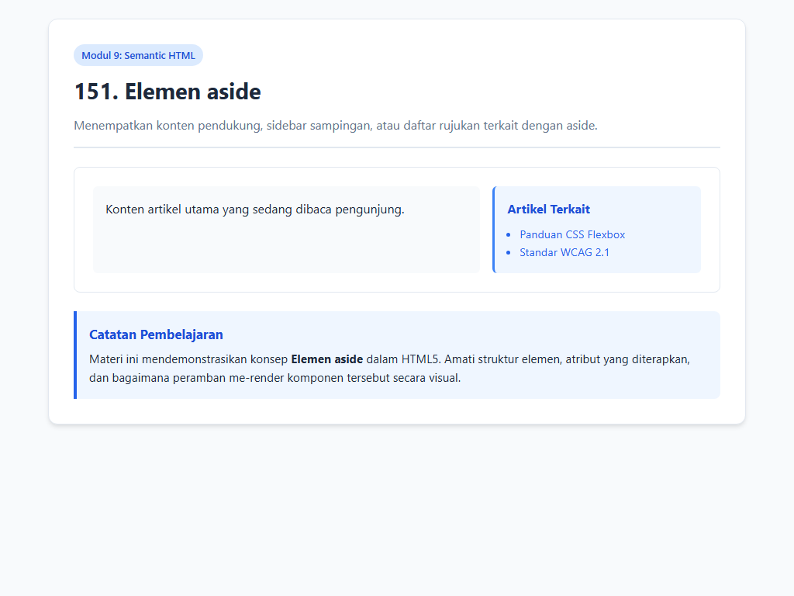

- **Lokasi Source Code:** [151_aside_element.html](151_aside_element.html)

---

### 7. Semantik Elemen Navigasi

- **Tujuan Pembelajaran:** Menerapkan semantik navigasi yang tepat untuk SEO dan aksesibilitas.
- **Konsep Utama:** Tag <nav> hanya untuk kelompok tautan besar utama, bukan untuk setiap link acak di footer.
- **Penjelasan Source Code:** Menampilkan bilah navigasi dokumentasi yang rapi.
- **Cara Menjalankan:** Buka file `152_nav_semantics.html` secara langsung di peramban web (Google Chrome, Mozilla Firefox, atau Microsoft Edge), atau jalankan ekstensi Live Server pada VS Code.
- **Hasil yang Diharapkan:** Menu navigasi horizontal sederhana dengan status aktif.
- **Screenshot Hasil Eksekusi:**

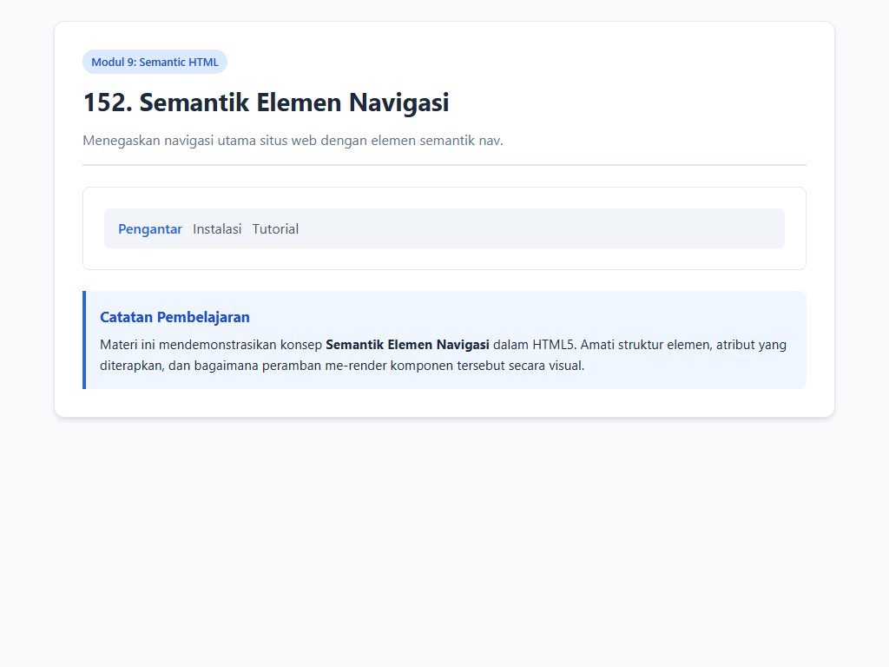

- **Lokasi Source Code:** [152_nav_semantics.html](152_nav_semantics.html)

---

### 8. Elemen address

- **Tujuan Pembelajaran:** Menggunakan tag <address> untuk menyajikan kontak entitas pemilik dokumen.
- **Konsep Utama:** Address menghubungkan identitas penanggung jawab konten dengan format semantik.
- **Penjelasan Source Code:** Menampilkan kartu kontak resmi institusi lengkap dengan tautan email dan telepon.
- **Cara Menjalankan:** Buka file `153_address_element.html` secara langsung di peramban web (Google Chrome, Mozilla Firefox, atau Microsoft Edge), atau jalankan ekstensi Live Server pada VS Code.
- **Hasil yang Diharapkan:** Kotak kartu alamat kontak dengan teks rapi dan tautan interaktif.
- **Screenshot Hasil Eksekusi:**

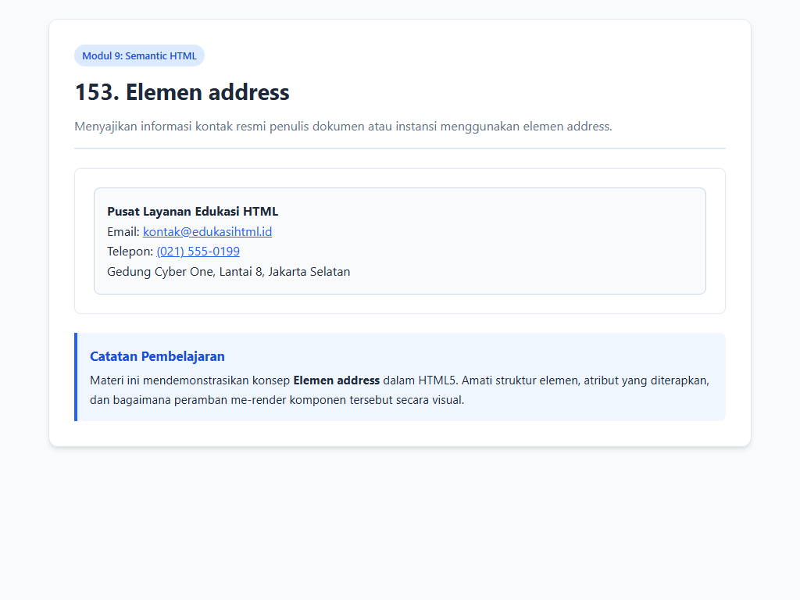

- **Lokasi Source Code:** [153_address_element.html](153_address_element.html)

---

### 9. Elemen time

- **Tujuan Pembelajaran:** Memformat penanggalan semantik yang dapat diurai kalender digital mesin pencari.
- **Konsep Utama:** Atribut datetime memuat string waktu baku standar ISO 8601.
- **Penjelasan Source Code:** Menampilkan teks waktu kegiatan dengan penyorotan warna kuning.
- **Cara Menjalankan:** Buka file `154_time_element.html` secara langsung di peramban web (Google Chrome, Mozilla Firefox, atau Microsoft Edge), atau jalankan ekstensi Live Server pada VS Code.
- **Hasil yang Diharapkan:** Teks tanggal dan jam dengan highlight kuning semantik.
- **Screenshot Hasil Eksekusi:**

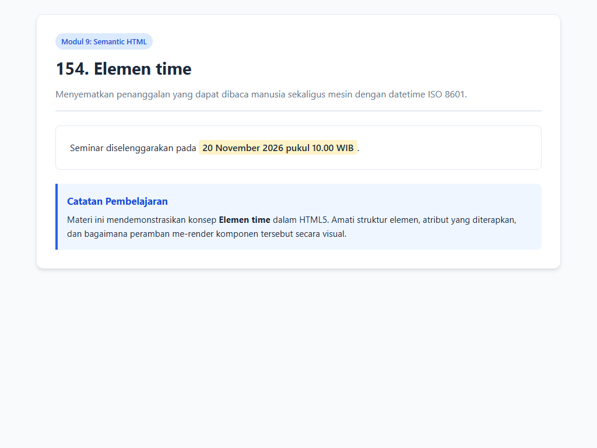

- **Lokasi Source Code:** [154_time_element.html](154_time_element.html)

---

### 10. Elemen data

- **Tujuan Pembelajaran:** Memahami pemetaan nilai mesin dengan elemen <data>.
- **Konsep Utama:** Elemen <data> menghubungkan representasi manusia dengan ID database mesin.
- **Penjelasan Source Code:** Menampilkan nama produk yang mengikat kode SKU internal.
- **Cara Menjalankan:** Buka file `155_data_element.html` secara langsung di peramban web (Google Chrome, Mozilla Firefox, atau Microsoft Edge), atau jalankan ekstensi Live Server pada VS Code.
- **Hasil yang Diharapkan:** Teks produk yang terasosiasi dengan nilai atribut mesin value.
- **Screenshot Hasil Eksekusi:**

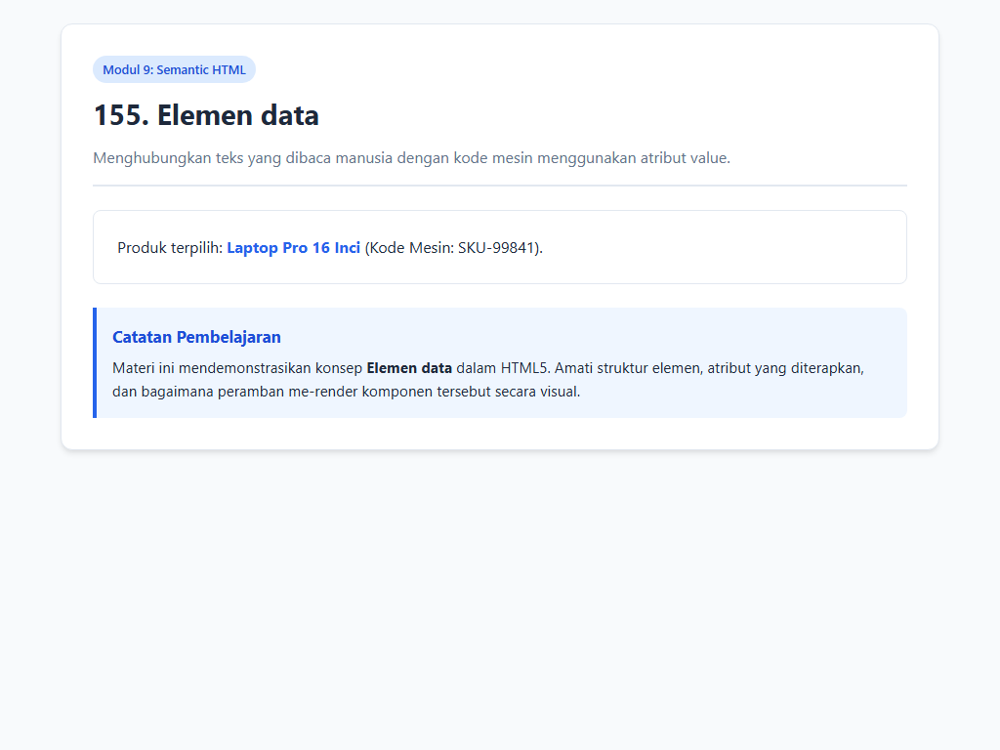

- **Lokasi Source Code:** [155_data_element.html](155_data_element.html)

---

### 11. Elemen details

- **Tujuan Pembelajaran:** Membuat widget akordeon interaktif bawaan dengan tag 
.
- **Konsep Utama:** Details menyembunyikan konten anak sampai pengguna mengklik summary pembukanya.
- **Penjelasan Source Code:** Menampilkan widget akordeon interaktif dengan panah segitiga pembuka.
- **Cara Menjalankan:** Buka file `156_details_element.html` secara langsung di peramban web (Google Chrome, Mozilla Firefox, atau Microsoft Edge), atau jalankan ekstensi Live Server pada VS Code.
- **Hasil yang Diharapkan:** Kotak akordeon interaktif yang dapat diklik buka dan tutup.
- **Screenshot Hasil Eksekusi:**

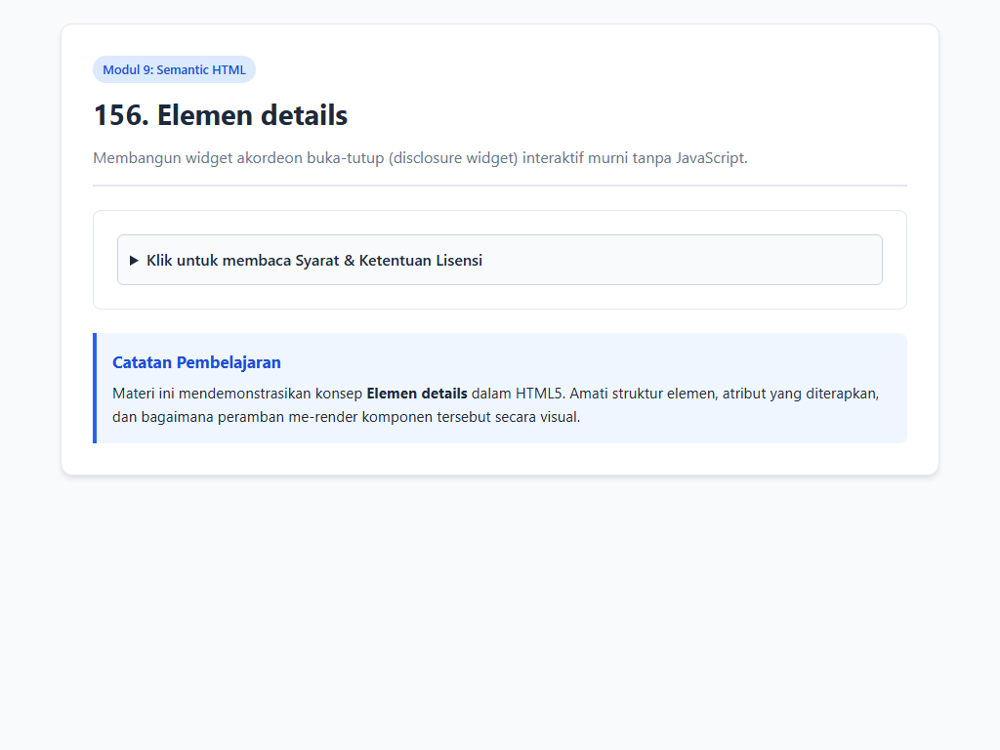

- **Lokasi Source Code:** [156_details_element.html](156_details_element.html)

---

### 12. Elemen summary

- **Tujuan Pembelajaran:** Menguasai kustomisasi judul pemicu akordeon dengan 
.
- **Konsep Utama:** Summary menerima fokus keyboard dan otomatis memicu pembukaan elemen details.
- **Penjelasan Source Code:** Menampilkan FAQ akordeon dalam keadaan terbuka (open).
- **Cara Menjalankan:** Buka file `157_summary_element.html` secara langsung di peramban web (Google Chrome, Mozilla Firefox, atau Microsoft Edge), atau jalankan ekstensi Live Server pada VS Code.
- **Hasil yang Diharapkan:** Kotak FAQ berbingkai biru dengan judul tebal dan jawaban terurai.
- **Screenshot Hasil Eksekusi:**

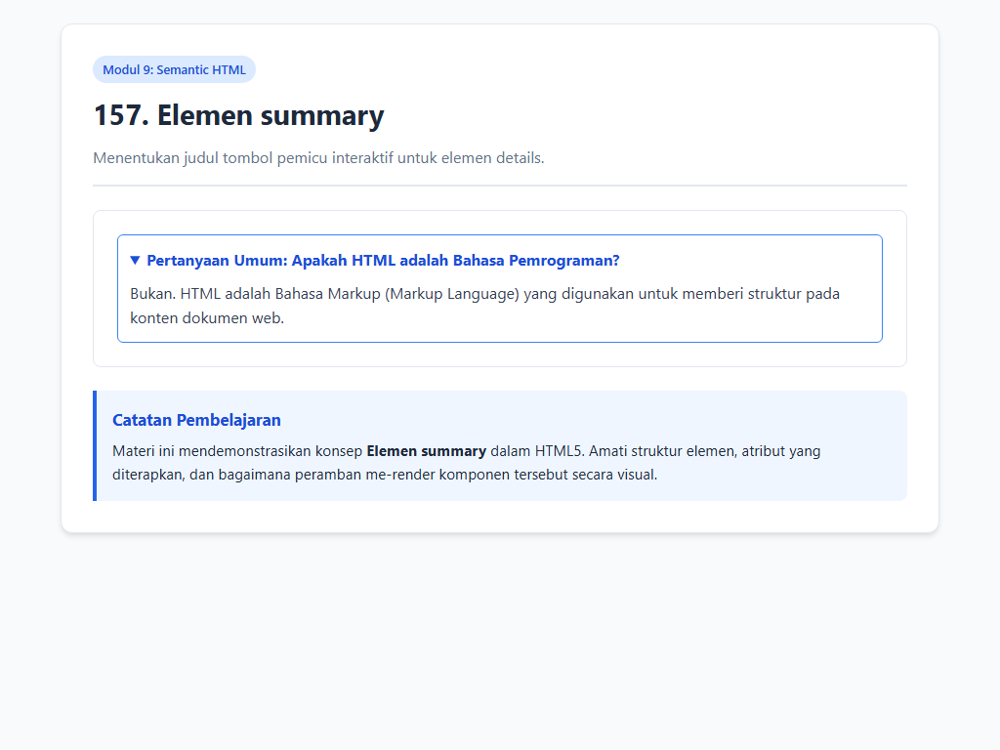

- **Lokasi Source Code:** [157_summary_element.html](157_summary_element.html)

---

### 13. Elemen dialog

- **Tujuan Pembelajaran:** Mengimplementasikan modal dialog standar tanpa library JavaScript eksternal.
- **Konsep Utama:** Elemen <dialog> memiliki dukungan backdrop peramban dan manajemen fokus keyboard bawaan.
- **Penjelasan Source Code:** Menampilkan tombol untuk membuka dialog modal konfirmasi interaktif.
- **Cara Menjalankan:** Buka file `158_dialog_element.html` secara langsung di peramban web (Google Chrome, Mozilla Firefox, atau Microsoft Edge), atau jalankan ekstensi Live Server pada VS Code.
- **Hasil yang Diharapkan:** Tombol biru pemicu dialog modal modern bawaan browser.
- **Screenshot Hasil Eksekusi:**

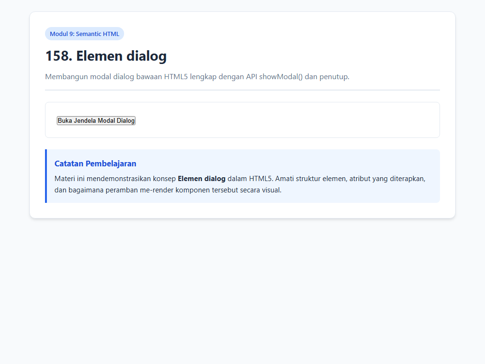

- **Lokasi Source Code:** [158_dialog_element.html](158_dialog_element.html)

---

### 14. Elemen search

- **Tujuan Pembelajaran:** Mengenal elemen semantik <search> yang diperkenalkan pada spesifikasi HTML modern.
- **Konsep Utama:** Elemen <search> secara resmi menggantikan role='search' pada pembungkus form.
- **Penjelasan Source Code:** Menampilkan kotak pencarian terstandarisasi di dalam elemen search.
- **Cara Menjalankan:** Buka file `159_search_element.html` secara langsung di peramban web (Google Chrome, Mozilla Firefox, atau Microsoft Edge), atau jalankan ekstensi Live Server pada VS Code.
- **Hasil yang Diharapkan:** Wadah formulir pencarian modern dengan input teks dan tombol cari.
- **Screenshot Hasil Eksekusi:**

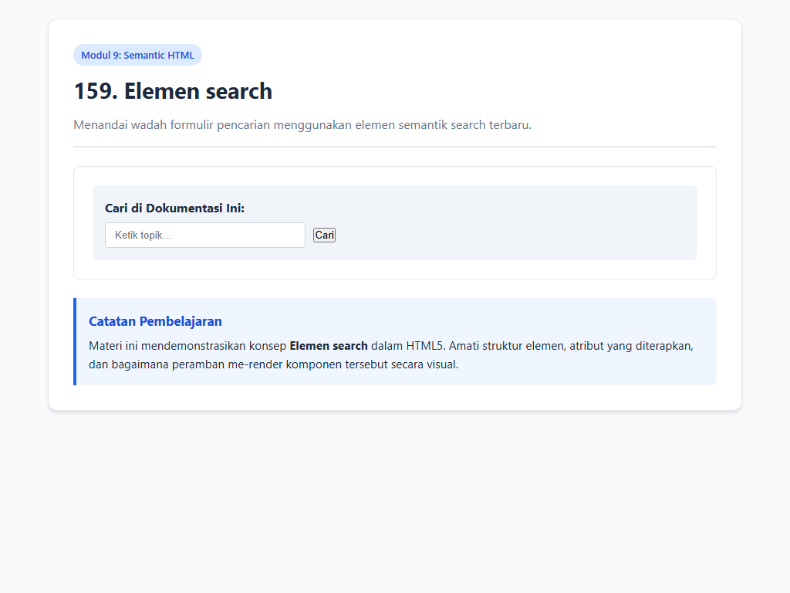

- **Lokasi Source Code:** [159_search_element.html](159_search_element.html)

---

### 15. Elemen div

- **Tujuan Pembelajaran:** Mengetahui kapan harus menggunakan elemen generik non-semantik 
.
- **Konsep Utama:** Elemen 
 adalah kontainer block-level tanpa arti khusus bagi mesin pencari.
- **Penjelasan Source Code:** Menampilkan kotak styling berbingkai garis putus-putus biru.
- **Cara Menjalankan:** Buka file `160_div_element.html` secara langsung di peramban web (Google Chrome, Mozilla Firefox, atau Microsoft Edge), atau jalankan ekstensi Live Server pada VS Code.
- **Hasil yang Diharapkan:** Kotak kontainer pembungkus tata letak bergaris putus-putus.
- **Screenshot Hasil Eksekusi:**

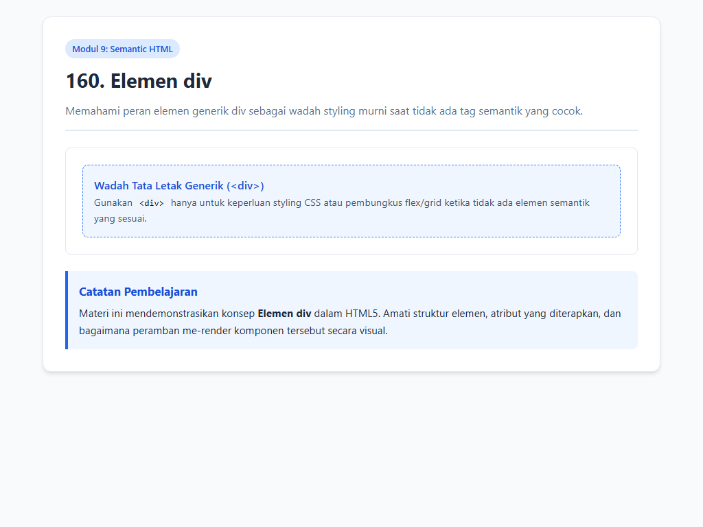

- **Lokasi Source Code:** [160_div_element.html](160_div_element.html)

---

### 16. Elemen span

- **Tujuan Pembelajaran:** Menguasai isolasi teks sebaris menggunakan kontainer .
- **Konsep Utama:** Tag  bertindak sebagai pembungkus inline generik untuk pemformatan lokal.
- **Penjelasan Source Code:** Menampilkan label status server hijau sebaris dalam paragraf.
- **Cara Menjalankan:** Buka file `161_span_element.html` secara langsung di peramban web (Google Chrome, Mozilla Firefox, atau Microsoft Edge), atau jalankan ekstensi Live Server pada VS Code.
- **Hasil yang Diharapkan:** Teks paragraf dengan lencana status hijau 'ONLINE & STABIL'.
- **Screenshot Hasil Eksekusi:**

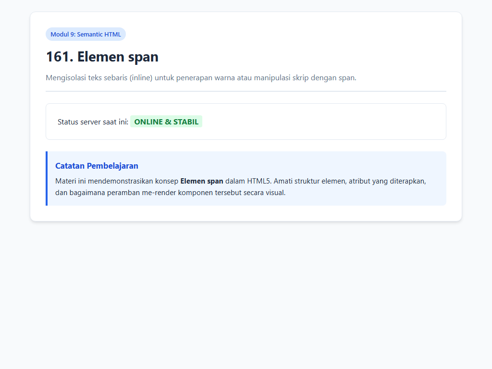

- **Lokasi Source Code:** [161_span_element.html](161_span_element.html)

---

### 17. Perbandingan Elemen Semantik dan Nonsemantik

- **Tujuan Pembelajaran:** Memahami keunggulan mutlak arsitektur semantik atas tumpukan tag div tak bermakna.
- **Konsep Utama:** Kode semantik lebih ringkas, mudah dirawat, ramah SEO, dan memenuhi standar aksesibilitas.
- **Penjelasan Source Code:** Menampilkan dua kotak perbandingan hijau dan merah mengenai struktur kode.
- **Cara Menjalankan:** Buka file `162_semantic_vs_nonsemantic.html` secara langsung di peramban web (Google Chrome, Mozilla Firefox, atau Microsoft Edge), atau jalankan ekstensi Live Server pada VS Code.
- **Hasil yang Diharapkan:** Dua kartu perbandingan pola lama div soup versus struktur semantik modern.
- **Screenshot Hasil Eksekusi:**

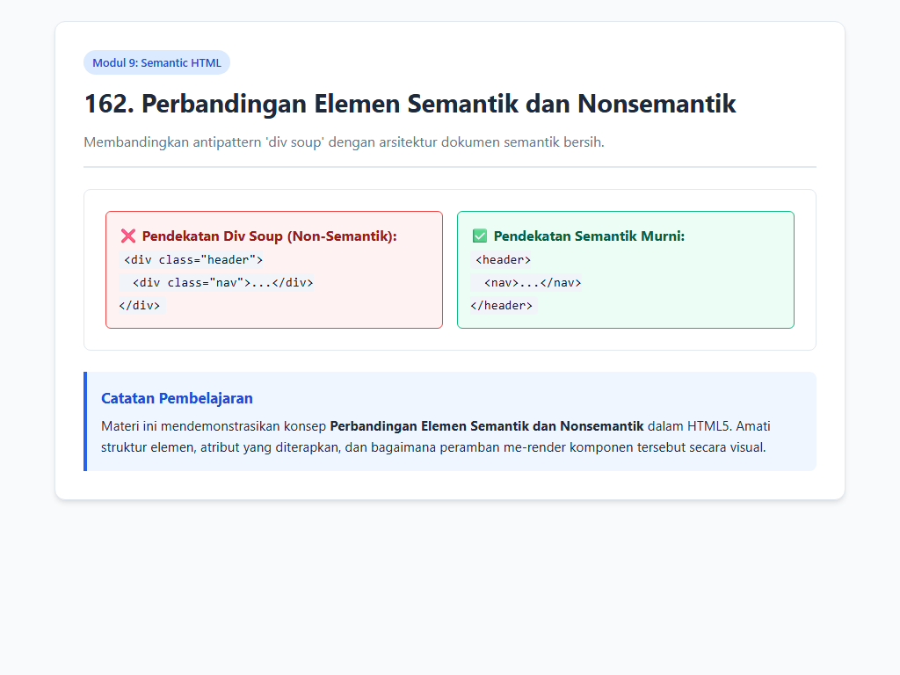

- **Lokasi Source Code:** [162_semantic_vs_nonsemantic.html](162_semantic_vs_nonsemantic.html)

---

### 18. Struktur Semantik Blog

- **Tujuan Pembelajaran:** Merangkai seluruh elemen semantik menjadi arsitektur halaman blog.
- **Konsep Utama:** Menghubungkan header, article, aside, dan footer dalam tata letak kohesif.
- **Penjelasan Source Code:** Menampilkan miniatur halaman blog lengkap dengan sidebar kategori.
- **Cara Menjalankan:** Buka file `163_blog_semantic_layout.html` secara langsung di peramban web (Google Chrome, Mozilla Firefox, atau Microsoft Edge), atau jalankan ekstensi Live Server pada VS Code.
- **Hasil yang Diharapkan:** Mockup halaman blog semantik lengkap dengan sidebar.
- **Screenshot Hasil Eksekusi:**

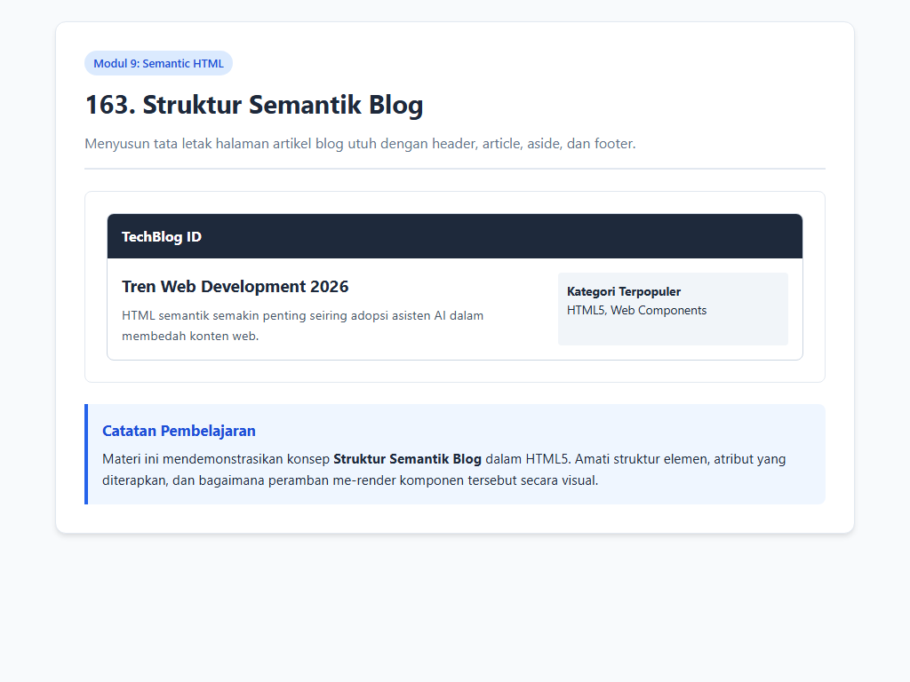

- **Lokasi Source Code:** [163_blog_semantic_layout.html](163_blog_semantic_layout.html)

---

### 19. Struktur Semantik Portal Berita

- **Tujuan Pembelajaran:** Mendesain arsitektur semantik untuk portal berita multi-kategori.
- **Konsep Utama:** Membedakan tajuk breaking news dari feed berita umum menggunakan semantik tepat.
- **Penjelasan Source Code:** Menampilkan cuplikan berita terhangat dengan lencana merah mencolok.
- **Cara Menjalankan:** Buka file `164_news_semantic_layout.html` secara langsung di peramban web (Google Chrome, Mozilla Firefox, atau Microsoft Edge), atau jalankan ekstensi Live Server pada VS Code.
- **Hasil yang Diharapkan:** Tata letak portal berita dengan lencana breaking news merah.
- **Screenshot Hasil Eksekusi:**

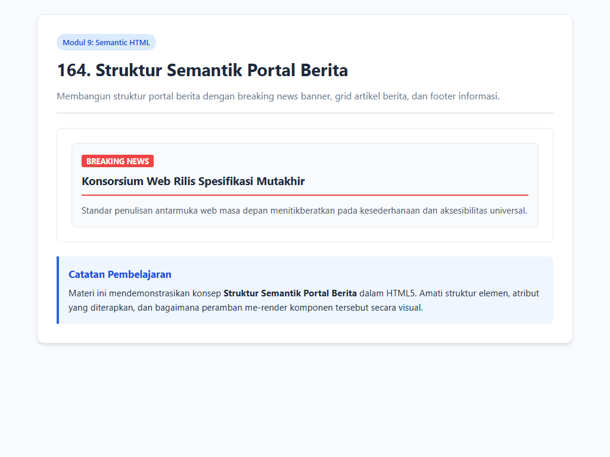

- **Lokasi Source Code:** [164_news_semantic_layout.html](164_news_semantic_layout.html)

---

### 20. Struktur Semantik Landing Page

- **Tujuan Pembelajaran:** Membangun landing page modern yang memenuhi prinsip struktur semantik.
- **Konsep Utama:** Menyatukan hero section, pesan promosi, dan call-to-action ke dalam markup bersih.
- **Penjelasan Source Code:** Menampilkan landing page produk dengan tombol aksi pendaftaran.
- **Cara Menjalankan:** Buka file `165_landing_page_semantics.html` secara langsung di peramban web (Google Chrome, Mozilla Firefox, atau Microsoft Edge), atau jalankan ekstensi Live Server pada VS Code.
- **Hasil yang Diharapkan:** Tampilan hero section landing page berlatar biru muda dengan tombol CTA.
- **Screenshot Hasil Eksekusi:**

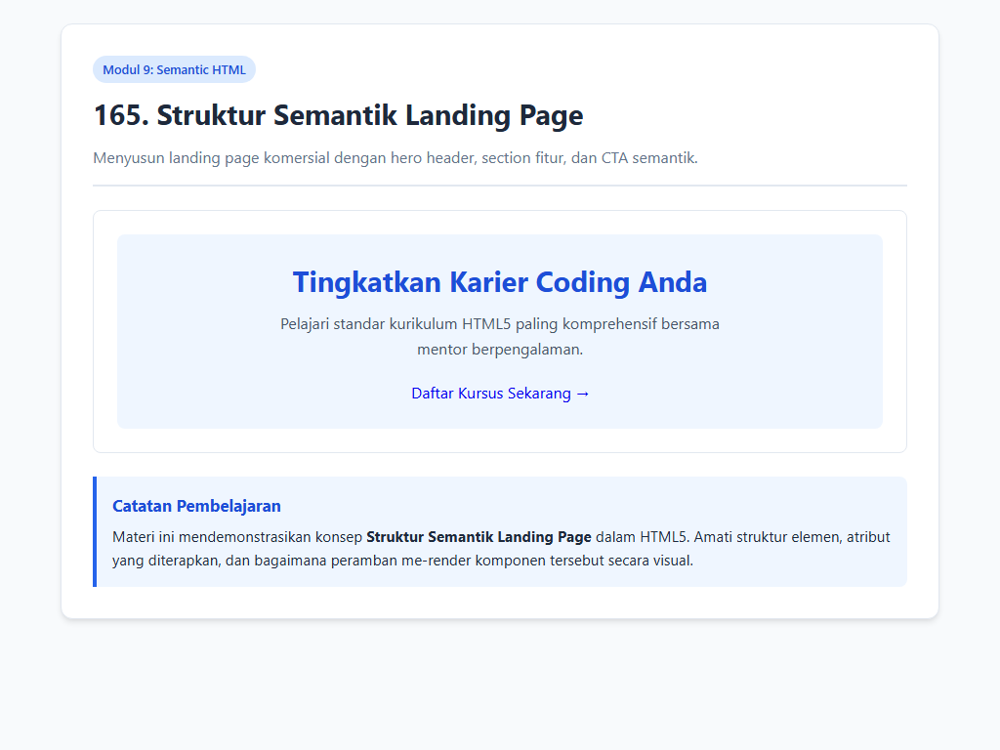

- **Lokasi Source Code:** [165_landing_page_semantics.html](165_landing_page_semantics.html)

---

## Ringkasan Modul
Modul 9 menyajikan pondasi penting mengenai Semantic HTML. Pemahaman menyeluruh terhadap submodul di atas menjadi prasyarat penting sebelum melangkah ke modul berikutnya.
