# Modul 10: Head, Metadata, dan SEO

## Ringkasan Ruang Lingkup Materi
Modul ini membahas konsep dasar dan implementasi praktis seputar **Head, Metadata, dan SEO**. Setiap submodul dirancang secara terisolasi agar pembelajar dapat memahami konsep satu per satu secara fokus dan terstruktur.

## Tujuan Pembelajaran Modul
Setelah menyelesaikan modul ini, peserta didik diharapkan mampu memahami, mengimplementasikan, dan menguji komponen-komponen utama dalam lingkup head, metadata, dan seo sesuai standar modern W3C.

## Daftar Materi atau Submodul

- [166_head_element.html](166_head_element.html) - Elemen head
- [167_title_element.html](167_title_element.html) - Elemen title
- [168_meta_charset.html](168_meta_charset.html) - Metadata charset
- [169_meta_viewport.html](169_meta_viewport.html) - Metadata viewport
- [170_meta_description.html](170_meta_description.html) - Meta description
- [171_meta_robots.html](171_meta_robots.html) - Meta robots
- [172_meta_author.html](172_meta_author.html) - Metadata author
- [173_meta_theme_color.html](173_meta_theme_color.html) - Metadata theme color
- [174_favicon.html](174_favicon.html) - Favicon
- [175_external_css_link.html](175_external_css_link.html) - Menghubungkan Stylesheet
- [176_external_script.html](176_external_script.html) - Menghubungkan JavaScript Eksternal
- [177_defer_attribute.html](177_defer_attribute.html) - Atribut defer
- [178_async_attribute.html](178_async_attribute.html) - Atribut async
- [179_canonical_link.html](179_canonical_link.html) - Canonical link
- [180_social_media_metadata.html](180_social_media_metadata.html) - Metadata Berbagi Media Sosial (Open Graph)

---

## Pembahasan Setiap Submodul

### 1. Elemen head

- **Tujuan Pembelajaran:** Memahami fungsi elemen <head> sebagai penyimpan metadata.
- **Konsep Utama:** Elemen <head> berisi instruksi konfigurasi untuk mesin peramban dan crawler web.
- **Penjelasan Source Code:** Menampilkan kode sumber visual isi elemen head di dalam kotak gelap.
- **Cara Menjalankan:** Buka file `166_head_element.html` secara langsung di peramban web (Google Chrome, Mozilla Firefox, atau Microsoft Edge), atau jalankan ekstensi Live Server pada VS Code.
- **Hasil yang Diharapkan:** Visualisasi kode head yang memuat meta charset, viewport, dan title.
- **Screenshot Hasil Eksekusi:**

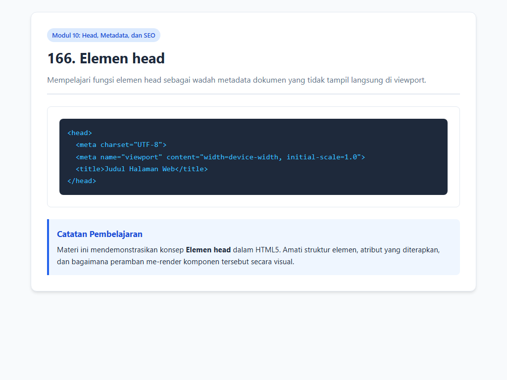

- **Lokasi Source Code:** [166_head_element.html](166_head_element.html)

---

### 2. Elemen title

- **Tujuan Pembelajaran:** Menguasai penulisan elemen <title> yang ramah SEO dan pengguna.
- **Konsep Utama:** Judul <title> adalah faktor on-page SEO paling krusial untuk mesin pencari.
- **Penjelasan Source Code:** Menampilkan simulasi visual tab browser dengan judul aktif.
- **Cara Menjalankan:** Buka file `167_title_element.html` secara langsung di peramban web (Google Chrome, Mozilla Firefox, atau Microsoft Edge), atau jalankan ekstensi Live Server pada VS Code.
- **Hasil yang Diharapkan:** Simulasi tab peramban putih dengan judul halaman.
- **Screenshot Hasil Eksekusi:**

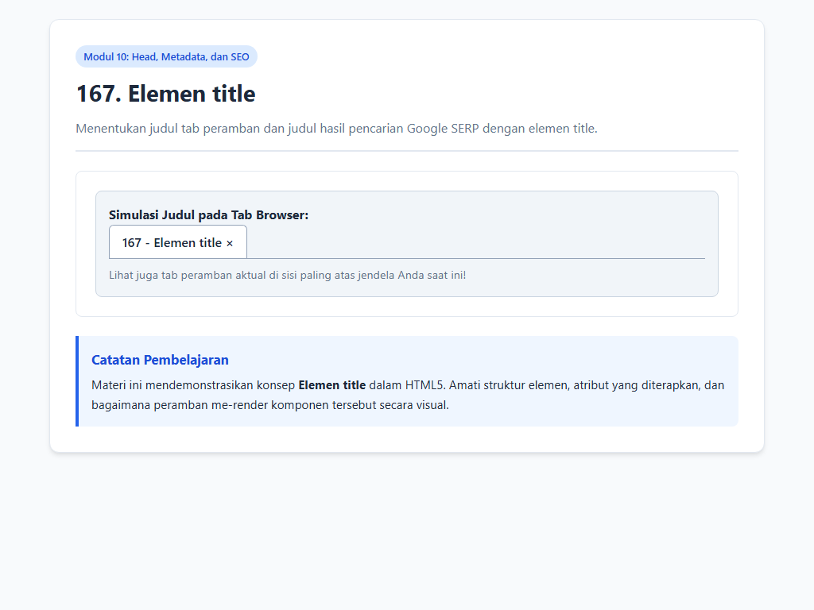

- **Lokasi Source Code:** [167_title_element.html](167_title_element.html)

---

### 3. Metadata charset

- **Tujuan Pembelajaran:** Menjamin integritas rendering karakter multibahasa dengan UTF-8.
- **Konsep Utama:** UTF-8 mampu mengkodekan lebih dari satu juta karakter dari seluruh sistem aksara dunia.
- **Penjelasan Source Code:** Menampilkan aneka aksara asing dan simbol emoji yang dirender sempurna.
- **Cara Menjalankan:** Buka file `168_meta_charset.html` secara langsung di peramban web (Google Chrome, Mozilla Firefox, atau Microsoft Edge), atau jalankan ekstensi Live Server pada VS Code.
- **Hasil yang Diharapkan:** Teks multibahasa Arab, Jepang, simbol matematika, dan emoji yang tampil jernih.
- **Screenshot Hasil Eksekusi:**

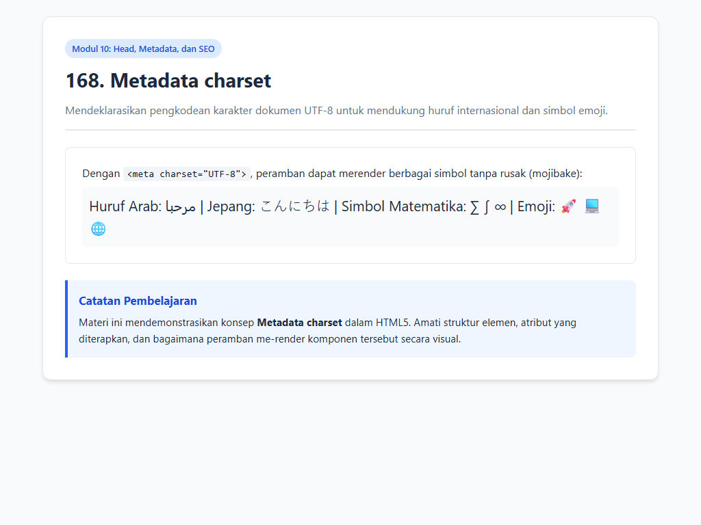

- **Lokasi Source Code:** [168_meta_charset.html](168_meta_charset.html)

---

### 4. Metadata viewport

- **Tujuan Pembelajaran:** Memahami kewajiban meta viewport pada pengembangan web responsif.
- **Konsep Utama:** Width=device-width mencocokkan lebar virtual layar dengan piksel fisik perangkat.
- **Penjelasan Source Code:** Menampilkan penjelasan konfigurasi meta viewport mobile.
- **Cara Menjalankan:** Buka file `169_meta_viewport.html` secara langsung di peramban web (Google Chrome, Mozilla Firefox, atau Microsoft Edge), atau jalankan ekstensi Live Server pada VS Code.
- **Hasil yang Diharapkan:** Kotak penjelasan konfigurasi viewport dengan border kiri biru.
- **Screenshot Hasil Eksekusi:**

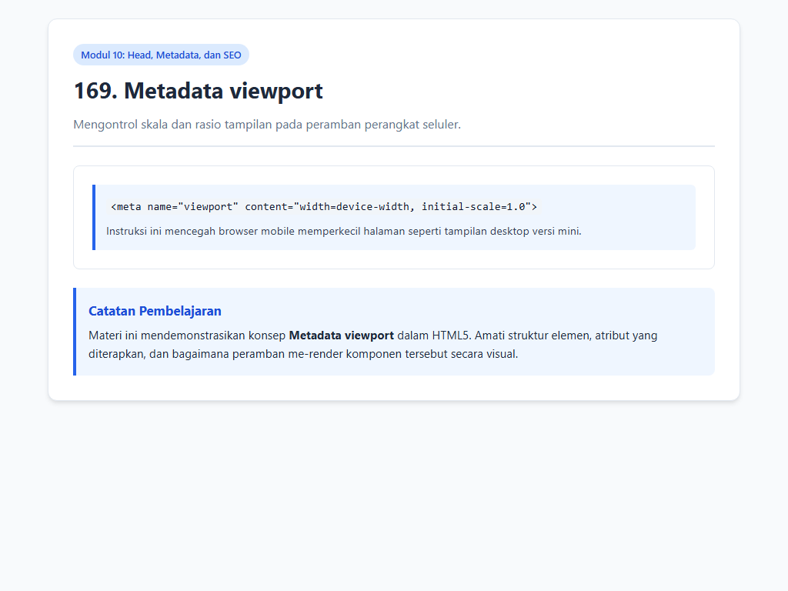

- **Lokasi Source Code:** [169_meta_viewport.html](169_meta_viewport.html)

---

### 5. Meta description

- **Tujuan Pembelajaran:** Menulis meta description yang menarik untuk mendongkrak Click-Through Rate (CTR) SEO.
- **Konsep Utama:** Mesin pencari menampilkan teks deskripsi ini sebagai cuplikan rangkuman di bawah judul pencarian.
- **Penjelasan Source Code:** Menampilkan simulasi hasil pencarian Google Search lengkap dengan link dan snippet teks.
- **Cara Menjalankan:** Buka file `170_meta_description.html` secara langsung di peramban web (Google Chrome, Mozilla Firefox, atau Microsoft Edge), atau jalankan ekstensi Live Server pada VS Code.
- **Hasil yang Diharapkan:** Simulasi cuplikan hasil pencarian Google SERP realistis.
- **Screenshot Hasil Eksekusi:**

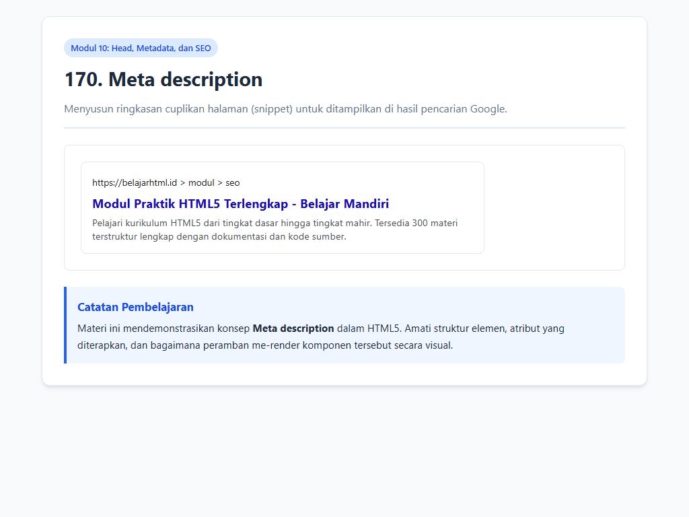

- **Lokasi Source Code:** [170_meta_description.html](170_meta_description.html)

---

### 6. Meta robots

- **Tujuan Pembelajaran:** Mengendalikan privasi halaman di mesin pencari dengan meta robots.
- **Konsep Utama:** Tag meta robots menginstruksikan spider bot seperti Googlebot cara memperlakukan dokumen.
- **Penjelasan Source Code:** Menampilkan daftar opsi direktif robots (index, follow, noindex, nofollow).
- **Cara Menjalankan:** Buka file `171_meta_robots.html` secara langsung di peramban web (Google Chrome, Mozilla Firefox, atau Microsoft Edge), atau jalankan ekstensi Live Server pada VS Code.
- **Hasil yang Diharapkan:** Daftar direktif pengendalian bot pengindeks mesin pencari.
- **Screenshot Hasil Eksekusi:**

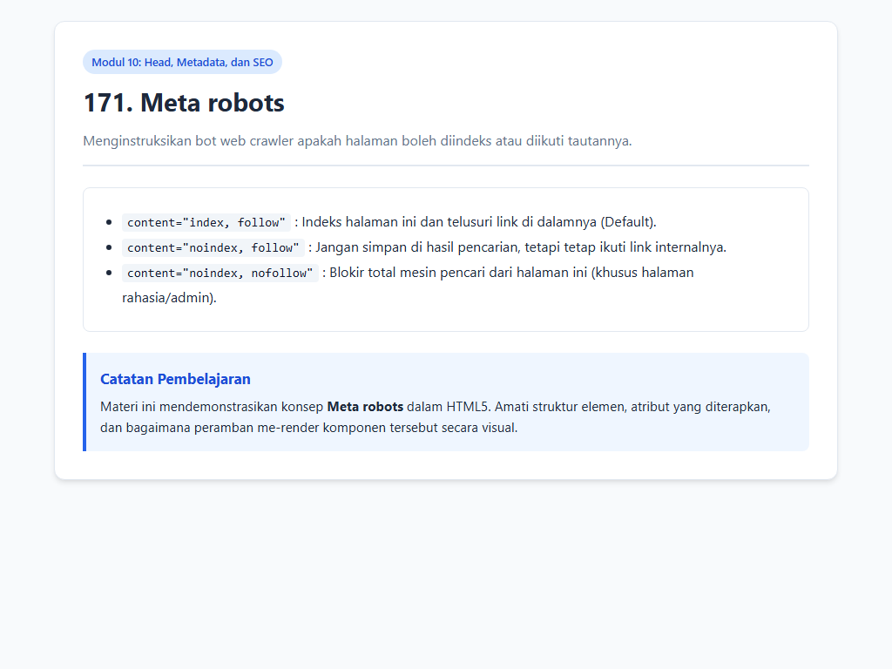

- **Lokasi Source Code:** [171_meta_robots.html](171_meta_robots.html)

---

### 7. Metadata author

- **Tujuan Pembelajaran:** Mencatat hak cipta kepengarangan melalui meta author.
- **Konsep Utama:** Metadata author membantu agregator konten mengenali pembuat karya.
- **Penjelasan Source Code:** Menampilkan contoh penulisan meta tag author dokumen.
- **Cara Menjalankan:** Buka file `172_meta_author.html` secara langsung di peramban web (Google Chrome, Mozilla Firefox, atau Microsoft Edge), atau jalankan ekstensi Live Server pada VS Code.
- **Hasil yang Diharapkan:** Kotak penjelasan penulisan atribusi pembuat dokumen.
- **Screenshot Hasil Eksekusi:**

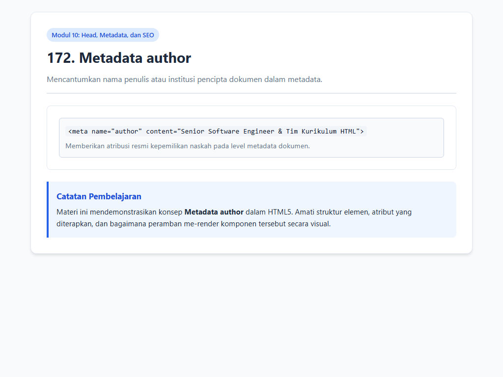

- **Lokasi Source Code:** [172_meta_author.html](172_meta_author.html)

---

### 8. Metadata theme color

- **Tujuan Pembelajaran:** Meningkatkan branding visual pada aplikasi web seluler dengan theme-color.
- **Konsep Utama:** Atribut theme-color menyelaraskan warna UI peramban dengan palet warna website.
- **Penjelasan Source Code:** Menampilkan kartu berwarna biru royal yang merepresentasikan warna tema bilah browser.
- **Cara Menjalankan:** Buka file `173_meta_theme_color.html` secara langsung di peramban web (Google Chrome, Mozilla Firefox, atau Microsoft Edge), atau jalankan ekstensi Live Server pada VS Code.
- **Hasil yang Diharapkan:** Kotak biru royal yang mendemonstrasikan pewarnaan bilah browser.
- **Screenshot Hasil Eksekusi:**

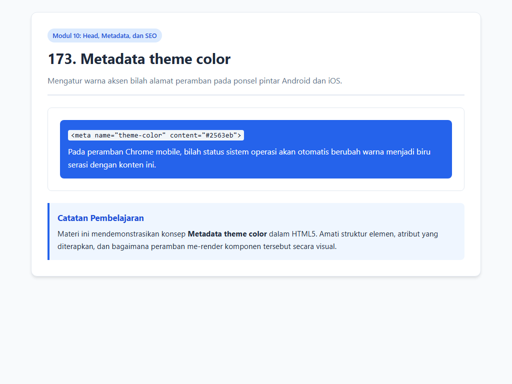

- **Lokasi Source Code:** [173_meta_theme_color.html](173_meta_theme_color.html)

---

### 9. Favicon

- **Tujuan Pembelajaran:** Menerapkan ikon favicon standar pada tab peramban dan bookmark.
- **Konsep Utama:** Favicon mempermudah pengguna mengenali situs di antara puluhan tab yang terbuka.
- **Penjelasan Source Code:** Menampilkan ikon SVG logo kode biru beserta sintaks tag link penghubungnya.
- **Cara Menjalankan:** Buka file `174_favicon.html` secara langsung di peramban web (Google Chrome, Mozilla Firefox, atau Microsoft Edge), atau jalankan ekstensi Live Server pada VS Code.
- **Hasil yang Diharapkan:** Ikon logo favicon biru modern beserta keterangan tag link rel icon.
- **Screenshot Hasil Eksekusi:**

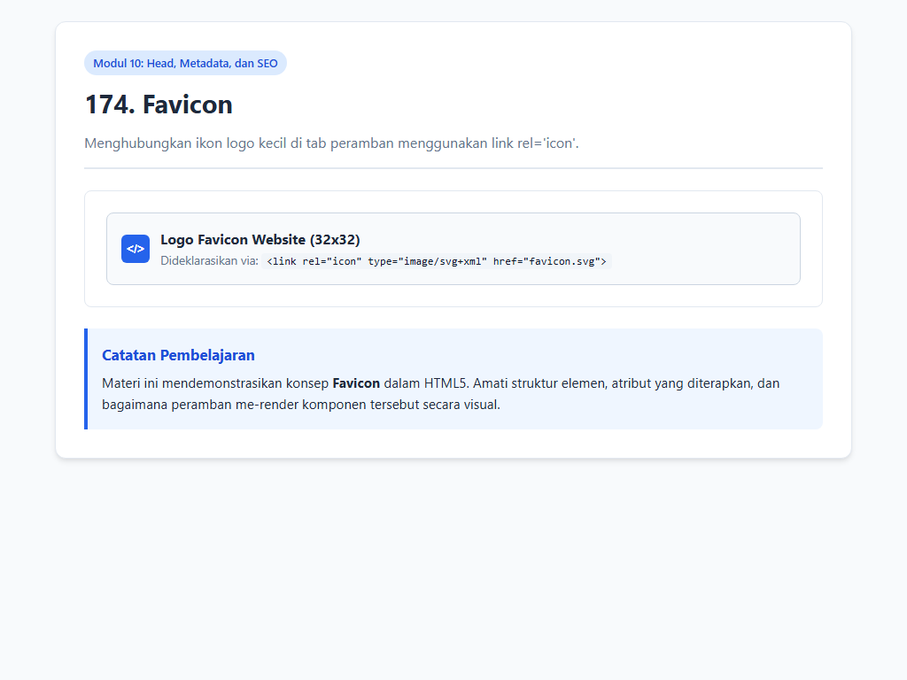

- **Lokasi Source Code:** [174_favicon.html](174_favicon.html)

---

### 10. Menghubungkan Stylesheet

- **Tujuan Pembelajaran:** Memisahkan struktur HTML dengan aturan desain CSS secara modular.
- **Konsep Utama:** Tag <link rel='stylesheet'> mengunduh berkas CSS tanpa memblokir rendering jika diatur efisien.
- **Penjelasan Source Code:** Menampilkan contoh sintaks pemanggilan file CSS eksternal.
- **Cara Menjalankan:** Buka file `175_external_css_link.html` secara langsung di peramban web (Google Chrome, Mozilla Firefox, atau Microsoft Edge), atau jalankan ekstensi Live Server pada VS Code.
- **Hasil yang Diharapkan:** Blok kode pemanggilan berkas CSS eksternal.
- **Screenshot Hasil Eksekusi:**

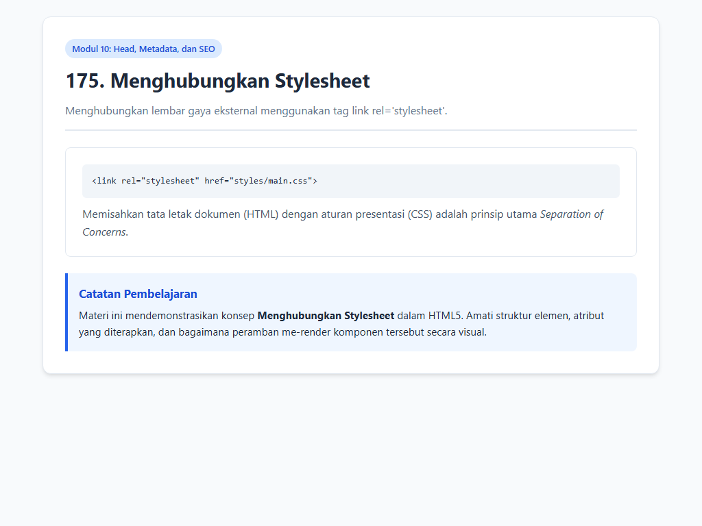

- **Lokasi Source Code:** [175_external_css_link.html](175_external_css_link.html)

---

### 11. Menghubungkan JavaScript Eksternal

- **Tujuan Pembelajaran:** Menghubungkan modul logika JavaScript eksternal ke dalam dokumen HTML.
- **Konsep Utama:** Tag <script> dengan atribut src memisahkan kode interaksi dari kerangka markup.
- **Penjelasan Source Code:** Menampilkan contoh penulisan tag script eksternal.
- **Cara Menjalankan:** Buka file `176_external_script.html` secara langsung di peramban web (Google Chrome, Mozilla Firefox, atau Microsoft Edge), atau jalankan ekstensi Live Server pada VS Code.
- **Hasil yang Diharapkan:** Sintaks tag script pembuka dan penutup untuk memuat file JavaScript.
- **Screenshot Hasil Eksekusi:**

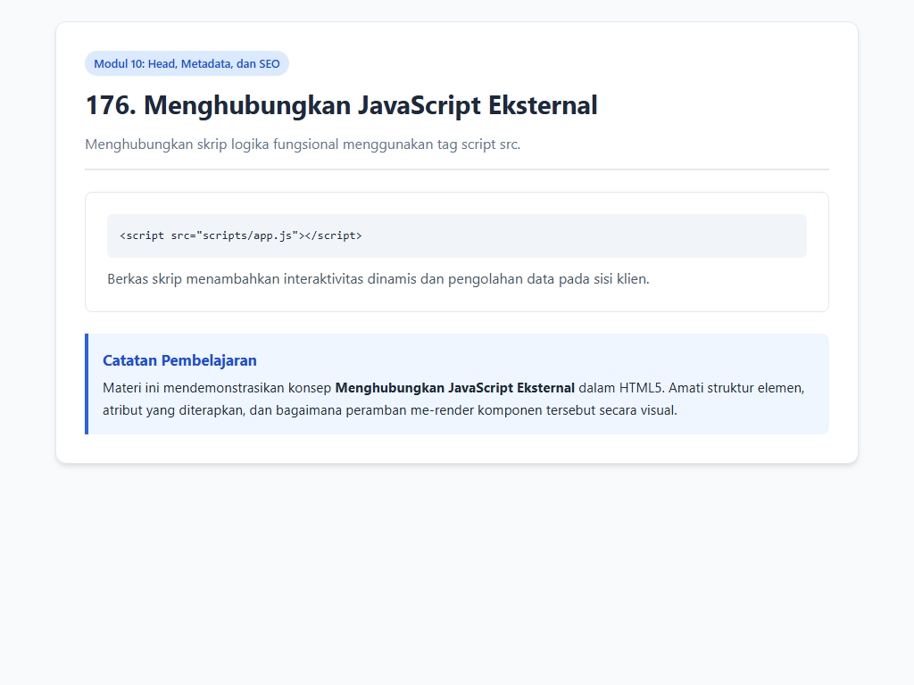

- **Lokasi Source Code:** [176_external_script.html](176_external_script.html)

---

### 12. Atribut defer

- **Tujuan Pembelajaran:** Mengoptimalkan kecepatan pemuatan halaman dengan atribut defer.
- **Konsep Utama:** Atribut defer mencegah fenomena Render-Blocking JavaScript pada peramban.
- **Penjelasan Source Code:** Menampilkan penjelasan cara kerja defer dengan kotak hijau keberhasilan.
- **Cara Menjalankan:** Buka file `177_defer_attribute.html` secara langsung di peramban web (Google Chrome, Mozilla Firefox, atau Microsoft Edge), atau jalankan ekstensi Live Server pada VS Code.
- **Hasil yang Diharapkan:** Kotak penjelasan optimasi defer berlatar hijau muda.
- **Screenshot Hasil Eksekusi:**

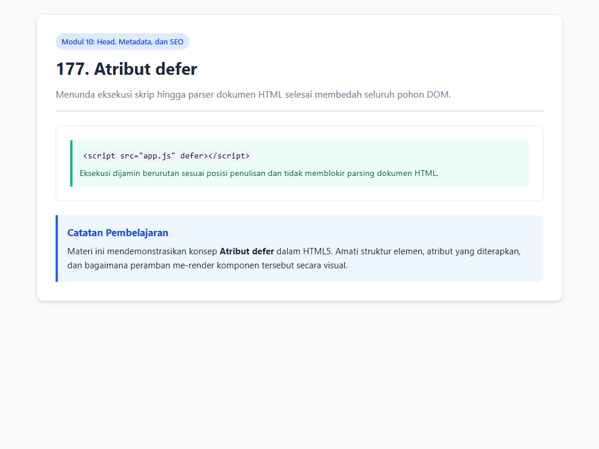

- **Lokasi Source Code:** [177_defer_attribute.html](177_defer_attribute.html)

---

### 13. Atribut async

- **Tujuan Pembelajaran:** Memahami pemuatan skrip asinkron dengan atribut async.
- **Konsep Utama:** Async ideal untuk skrip pelacak analitik yang tidak memanipulasi elemen DOM halaman.
- **Penjelasan Source Code:** Menampilkan penjelasan atribut async untuk pemuatan berkas pelacak pihak ketiga.
- **Cara Menjalankan:** Buka file `178_async_attribute.html` secara langsung di peramban web (Google Chrome, Mozilla Firefox, atau Microsoft Edge), atau jalankan ekstensi Live Server pada VS Code.
- **Hasil yang Diharapkan:** Kotak penjelasan async bergaris pembatas kuning hangat.
- **Screenshot Hasil Eksekusi:**

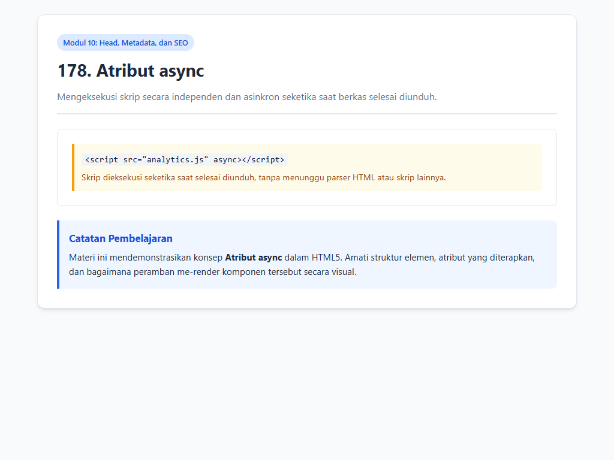

- **Lokasi Source Code:** [178_async_attribute.html](178_async_attribute.html)

---

### 14. Canonical link

- **Tujuan Pembelajaran:** Menghindari isu konten duplikat pada mesin pencari menggunakan rel='canonical'.
- **Konsep Utama:** Mesin pencari menggabungkan sinyal peringkat (ranking signal) ke URL kanonikal.
- **Penjelasan Source Code:** Menampilkan format tag link kanonikal terstandar.
- **Cara Menjalankan:** Buka file `179_canonical_link.html` secara langsung di peramban web (Google Chrome, Mozilla Firefox, atau Microsoft Edge), atau jalankan ekstensi Live Server pada VS Code.
- **Hasil yang Diharapkan:** Kotak penjelasan penulisan canonical link untuk SEO.
- **Screenshot Hasil Eksekusi:**

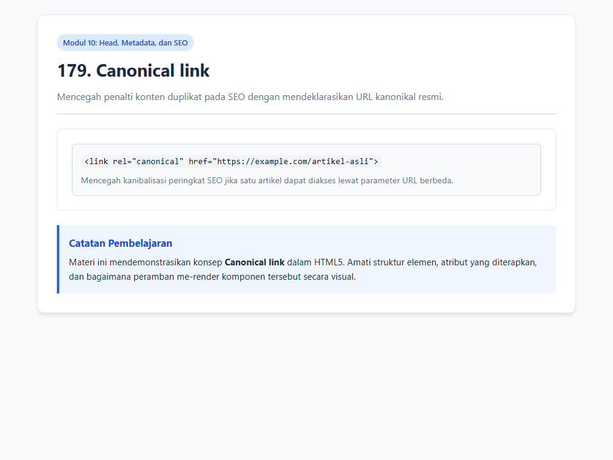

- **Lokasi Source Code:** [179_canonical_link.html](179_canonical_link.html)

---

### 15. Metadata Berbagi Media Sosial (Open Graph)

- **Tujuan Pembelajaran:** Mendesain kartu pratinjau media sosial (rich preview) dengan tag Open Graph.
- **Konsep Utama:** Protokol Open Graph (og:title, og:image, og:description) mengontrol tampilan share tautan di jejaring sosial.
- **Penjelasan Source Code:** Menampilkan simulasi kartu media sosial dengan banner gambar dan deskripsi rapi.
- **Cara Menjalankan:** Buka file `180_social_media_metadata.html` secara langsung di peramban web (Google Chrome, Mozilla Firefox, atau Microsoft Edge), atau jalankan ekstensi Live Server pada VS Code.
- **Hasil yang Diharapkan:** Simulasi kartu pratinjau share media sosial (Open Graph card).
- **Screenshot Hasil Eksekusi:**

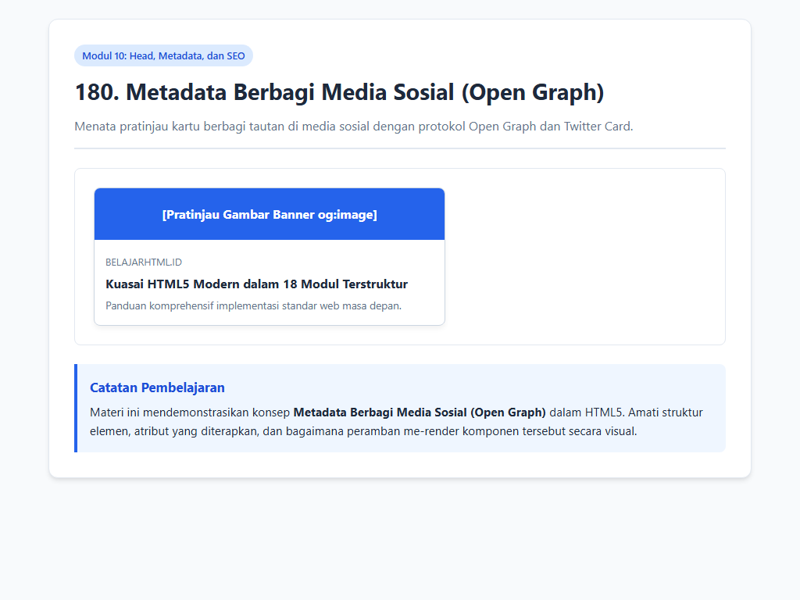

- **Lokasi Source Code:** [180_social_media_metadata.html](180_social_media_metadata.html)

---

## Ringkasan Modul
Modul 10 menyajikan pondasi penting mengenai Head, Metadata, dan SEO. Pemahaman menyeluruh terhadap submodul di atas menjadi prasyarat penting sebelum melangkah ke modul berikutnya.
