# Modul 12: Iframe, Embedded Content, dan Integrasi

## Ringkasan Ruang Lingkup Materi
Modul ini membahas konsep dasar dan implementasi praktis seputar **Iframe, Embedded Content, dan Integrasi**. Setiap submodul dirancang secara terisolasi agar pembelajar dapat memahami konsep satu per satu secara fokus dan terstruktur.

## Tujuan Pembelajaran Modul
Setelah menyelesaikan modul ini, peserta didik diharapkan mampu memahami, mengimplementasikan, dan menguji komponen-komponen utama dalam lingkup iframe, embedded content, dan integrasi sesuai standar modern W3C.

## Daftar Materi atau Submodul

- [196_iframe_basic.html](196_iframe_basic.html) - Elemen iframe
- [197_iframe_dimensions.html](197_iframe_dimensions.html) - Dimensi iframe
- [198_iframe_title.html](198_iframe_title.html) - Atribut title pada iframe
- [199_iframe_sandbox.html](199_iframe_sandbox.html) - Atribut sandbox
- [200_iframe_loading.html](200_iframe_loading.html) - Lazy loading iframe
- [201_iframe_referrerpolicy.html](201_iframe_referrerpolicy.html) - Atribut referrerpolicy
- [202_embed_element.html](202_embed_element.html) - Elemen embed
- [203_object_element.html](203_object_element.html) - Elemen object
- [204_pdf_embed.html](204_pdf_embed.html) - Menampilkan Dokumen PDF
- [205_svg_embed.html](205_svg_embed.html) - Menyematkan SVG
- [206_external_page_embed.html](206_external_page_embed.html) - Menyematkan Halaman Eksternal
- [207_google_maps_embed.html](207_google_maps_embed.html) - Menyematkan Peta (Maps Embed)
- [208_iframe_fallback.html](208_iframe_fallback.html) - Fallback Konten Iframe
- [209_embedded_content_security.html](209_embedded_content_security.html) - Keamanan Embedded Content
- [210_responsive_iframe.html](210_responsive_iframe.html) - Integrasi Iframe Responsif

---

## Pembahasan Setiap Submodul

### 1. Elemen iframe

- **Tujuan Pembelajaran:** Memahami konsep penyematan dokumen independen dengan tag <iframe>.
- **Konsep Utama:** Elemen <iframe> menciptakan browsing context baru yang terisolasi di dalam dokumen induk.
- **Penjelasan Source Code:** Menampilkan bingkai iframe yang memuat halaman sambutan independen.
- **Cara Menjalankan:** Buka file `196_iframe_basic.html` secara langsung di peramban web (Google Chrome, Mozilla Firefox, atau Microsoft Edge), atau jalankan ekstensi Live Server pada VS Code.
- **Hasil yang Diharapkan:** Bingkai iframe berbingkai abu-abu halus yang menampilkan sub-halaman biru.
- **Screenshot Hasil Eksekusi:**

- **Lokasi Source Code:** [196_iframe_basic.html](196_iframe_basic.html)

---

### 2. Dimensi iframe

- **Tujuan Pembelajaran:** Mengontrol dimensi ukuran jendela bingkai tersemat.
- **Konsep Utama:** Pemberian ukuran eksplisit memastikan peramban mereservasi ruang render secara presisi.
- **Penjelasan Source Code:** Menampilkan iframe dengan bingkai biru berukuran 450x150 piksel.
- **Cara Menjalankan:** Buka file `197_iframe_dimensions.html` secara langsung di peramban web (Google Chrome, Mozilla Firefox, atau Microsoft Edge), atau jalankan ekstensi Live Server pada VS Code.
- **Hasil yang Diharapkan:** Kotak bingkai tersemat berbingkai biru cerah.
- **Screenshot Hasil Eksekusi:**

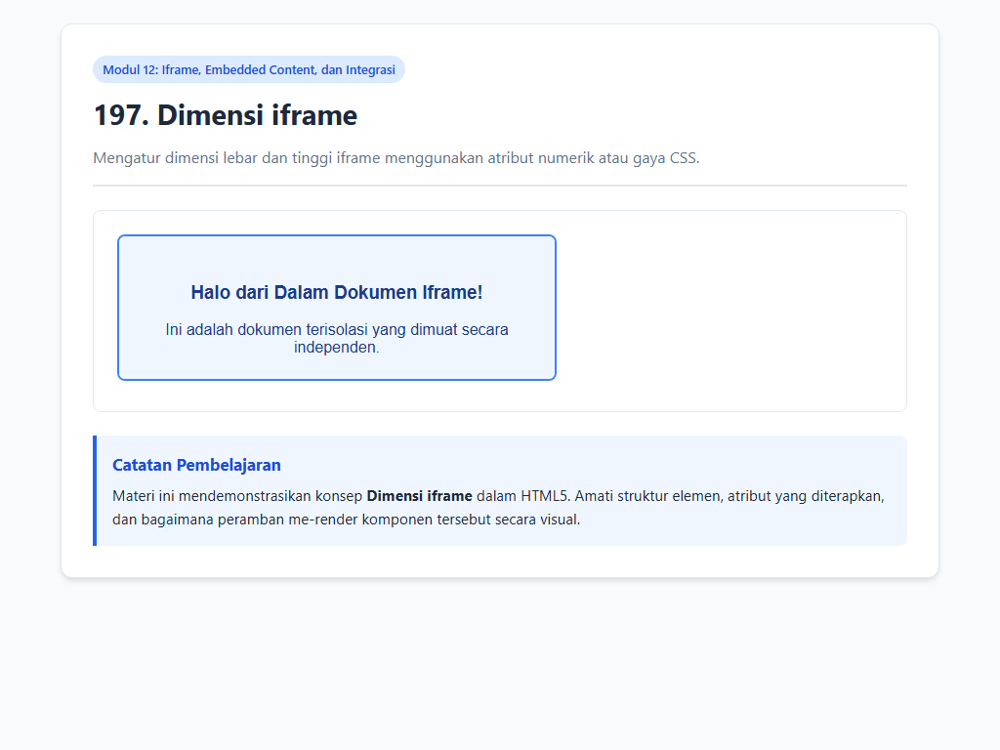

- **Lokasi Source Code:** [197_iframe_dimensions.html](197_iframe_dimensions.html)

---

### 3. Atribut title pada iframe

- **Tujuan Pembelajaran:** Memahami kewajiban atribut title pada setiap elemen <iframe>.
- **Konsep Utama:** Screen reader membacakan atribut title iframe kepada pengguna tunanetra sebelum mereka memutuskan masuk ke dalamnya.
- **Penjelasan Source Code:** Menampilkan iframe berlabel title deskriptif 'Widget Informasi Sambutan Mahasiswa Baru'.
- **Cara Menjalankan:** Buka file `198_iframe_title.html` secara langsung di peramban web (Google Chrome, Mozilla Firefox, atau Microsoft Edge), atau jalankan ekstensi Live Server pada VS Code.
- **Hasil yang Diharapkan:** Bingkai iframe yang memiliki metadata title aksesibel.
- **Screenshot Hasil Eksekusi:**

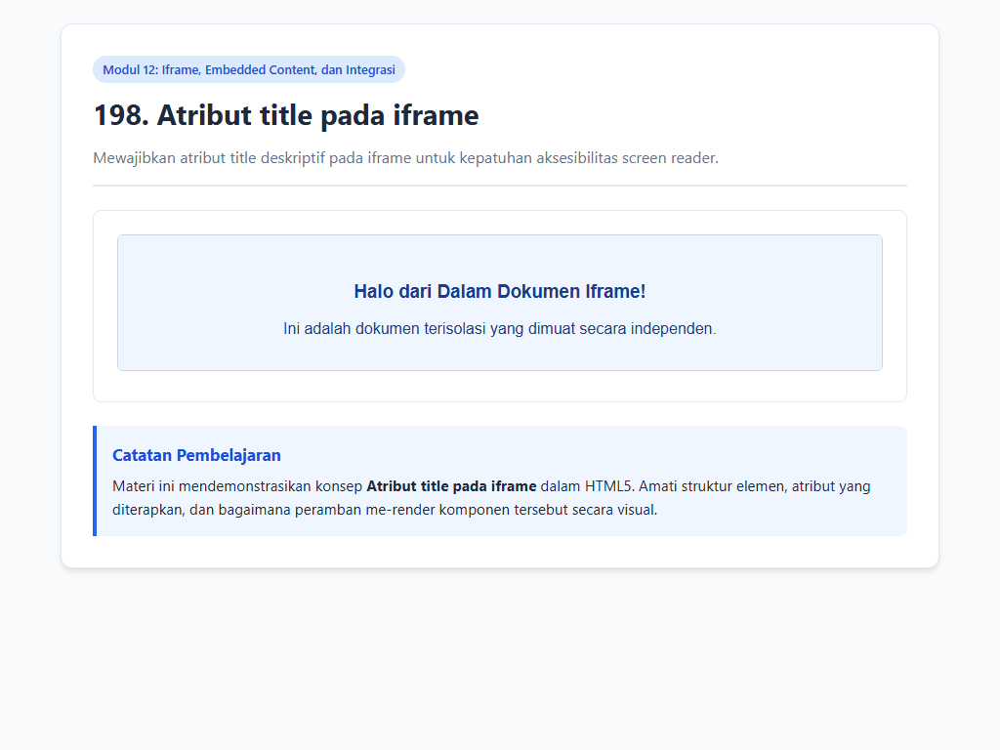

- **Lokasi Source Code:** [198_iframe_title.html](198_iframe_title.html)

---

### 4. Atribut sandbox

- **Tujuan Pembelajaran:** Mengamankan konten tersemat pihak ketiga dengan fitur isolasi sandbox.
- **Konsep Utama:** Atribut sandbox mengaktifkan pembatasan keamanan ketat demi melindungi aplikasi induk dari XSS.
- **Penjelasan Source Code:** Menampilkan iframe terisolasi dengan bingkai garis putus-putus merah tanda isolasi aman.
- **Cara Menjalankan:** Buka file `199_iframe_sandbox.html` secara langsung di peramban web (Google Chrome, Mozilla Firefox, atau Microsoft Edge), atau jalankan ekstensi Live Server pada VS Code.
- **Hasil yang Diharapkan:** Bingkai terisolasi bergaris putus-putus merah tanda proteksi sandbox.
- **Screenshot Hasil Eksekusi:**

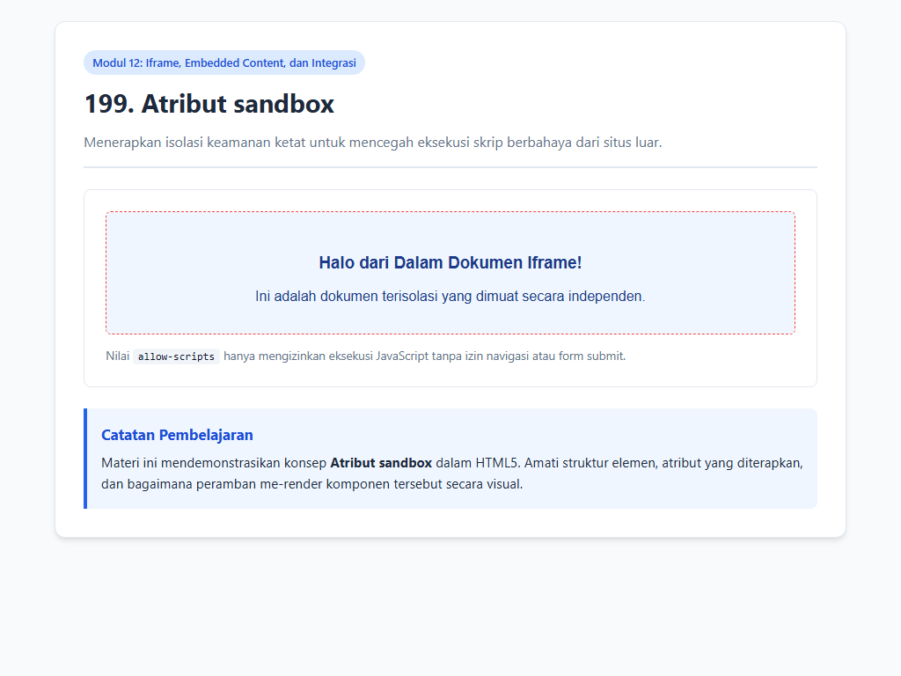

- **Lokasi Source Code:** [199_iframe_sandbox.html](199_iframe_sandbox.html)

---

### 5. Lazy loading iframe

- **Tujuan Pembelajaran:** Meningkatkan skor performa Core Web Vitals dengan lazy loading iframe.
- **Konsep Utama:** Peramban menghemat memori dengan tidak memuat berkas berat iframe yang posisinya di bawah layar.
- **Penjelasan Source Code:** Menampilkan iframe dengan atribut loading='lazy'.
- **Cara Menjalankan:** Buka file `200_iframe_loading.html` secara langsung di peramban web (Google Chrome, Mozilla Firefox, atau Microsoft Edge), atau jalankan ekstensi Live Server pada VS Code.
- **Hasil yang Diharapkan:** Bingkai iframe dengan optimasi pemuatan lazy loading.
- **Screenshot Hasil Eksekusi:**

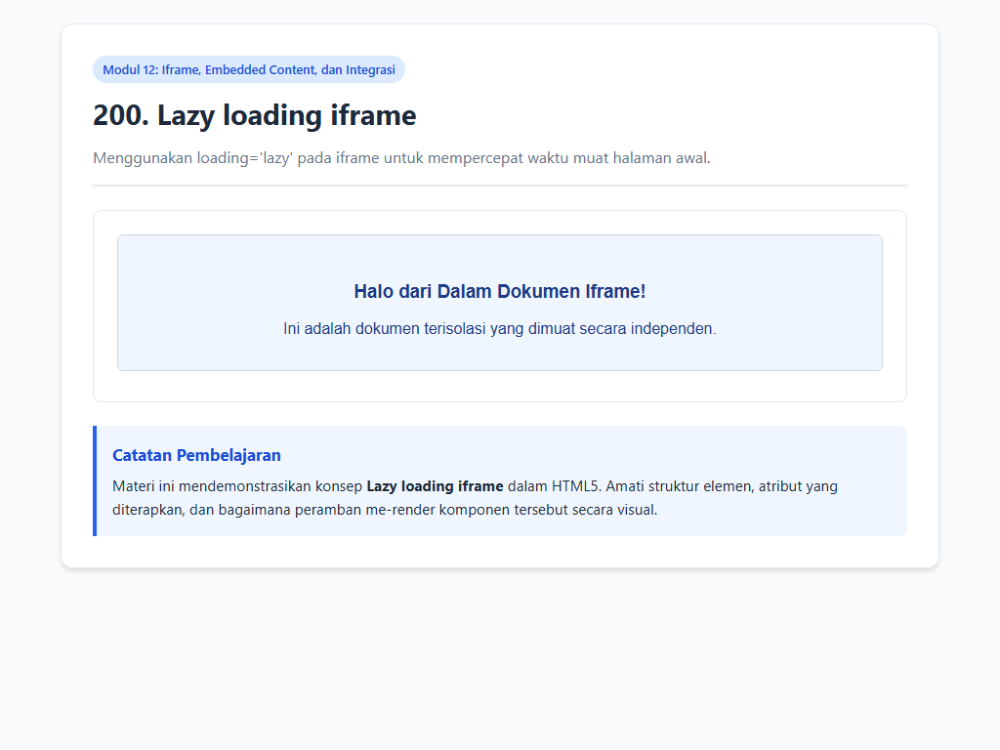

- **Lokasi Source Code:** [200_iframe_loading.html](200_iframe_loading.html)

---

### 6. Atribut referrerpolicy

- **Tujuan Pembelajaran:** Melindungi privasi data navigasi pengguna dengan atribut referrerpolicy.
- **Konsep Utama:** Nilai no-referrer atau strict-origin-when-cross-origin mencegah kebocoran parameter sensitif di URL.
- **Penjelasan Source Code:** Menampilkan iframe dengan kebijakan privasi perujuk terkunci.
- **Cara Menjalankan:** Buka file `201_iframe_referrerpolicy.html` secara langsung di peramban web (Google Chrome, Mozilla Firefox, atau Microsoft Edge), atau jalankan ekstensi Live Server pada VS Code.
- **Hasil yang Diharapkan:** Bingkai iframe yang dilindungi kebijakan perlindungan privasi URL perujuk.
- **Screenshot Hasil Eksekusi:**

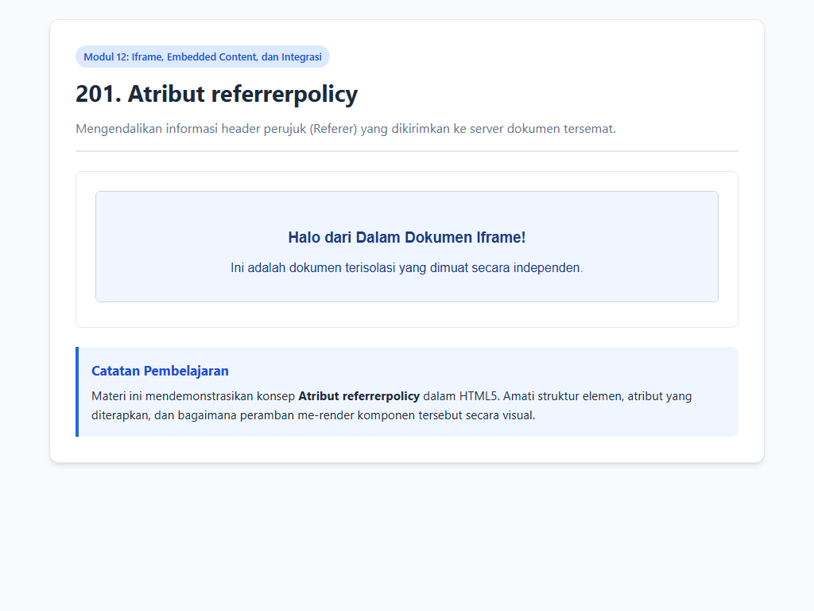

- **Lokasi Source Code:** [201_iframe_referrerpolicy.html](201_iframe_referrerpolicy.html)

---

### 7. Elemen embed

- **Tujuan Pembelajaran:** Mengenal elemen serbaguna <embed> untuk media eksternal.
- **Konsep Utama:** Elemen <embed> adalah tag tunggal (void element) tanpa closing tag untuk integrasi media cepat.
- **Penjelasan Source Code:** Menampilkan komponen embed interaktif.
- **Cara Menjalankan:** Buka file `202_embed_element.html` secara langsung di peramban web (Google Chrome, Mozilla Firefox, atau Microsoft Edge), atau jalankan ekstensi Live Server pada VS Code.
- **Hasil yang Diharapkan:** Kotak tampilan penyematan berkas via tag embed.
- **Screenshot Hasil Eksekusi:**

- **Lokasi Source Code:** [202_embed_element.html](202_embed_element.html)

---

### 8. Elemen object

- **Tujuan Pembelajaran:** Memahami keunggulan elemen <object> yang mendukung fallback konten berlapis.
- **Konsep Utama:** Jika sumber daya data gagal dimuat, peramban otomatis merender konten alternatif di dalam tag object.
- **Penjelasan Source Code:** Menampilkan elemen object berisi konten HTML independen.
- **Cara Menjalankan:** Buka file `203_object_element.html` secara langsung di peramban web (Google Chrome, Mozilla Firefox, atau Microsoft Edge), atau jalankan ekstensi Live Server pada VS Code.
- **Hasil yang Diharapkan:** Wadah dokumen object dengan teks cadangan otomatis.
- **Screenshot Hasil Eksekusi:**

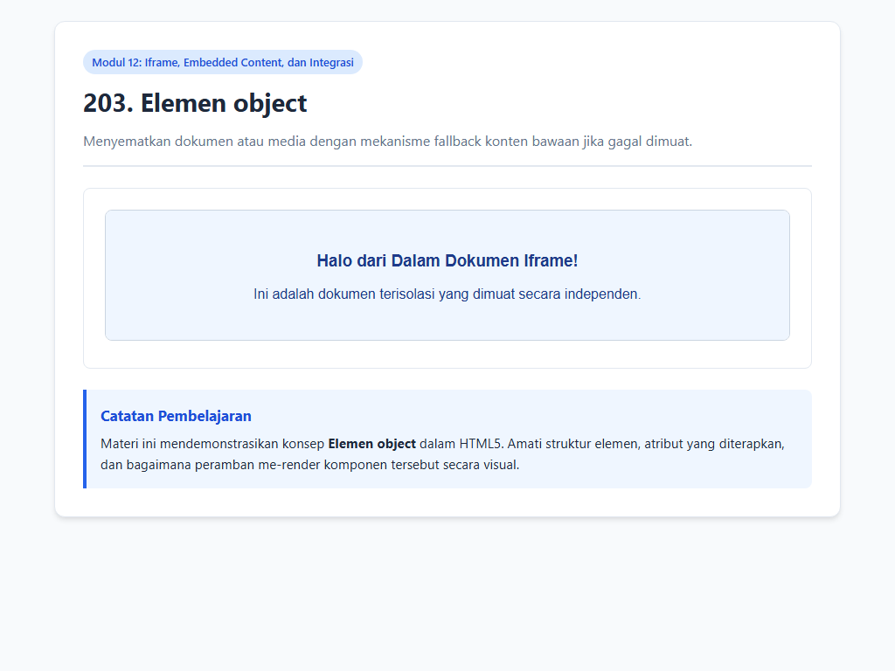

- **Lokasi Source Code:** [203_object_element.html](203_object_element.html)

---

### 9. Menampilkan Dokumen PDF

- **Tujuan Pembelajaran:** Menyajikan dokumen PDF interaktif di antarmuka peramban tanpa software eksternal.
- **Konsep Utama:** Elemen <object> memanggil plugin PDF reader bawaan peramban untuk navigasi halaman berkas.
- **Penjelasan Source Code:** Menampilkan jendela pratinjau dokumen digital lengkap dengan tombol cadangan unduh.
- **Cara Menjalankan:** Buka file `204_pdf_embed.html` secara langsung di peramban web (Google Chrome, Mozilla Firefox, atau Microsoft Edge), atau jalankan ekstensi Live Server pada VS Code.
- **Hasil yang Diharapkan:** Jendela pembaca dokumen dengan bingkai scroll mandiri.
- **Screenshot Hasil Eksekusi:**

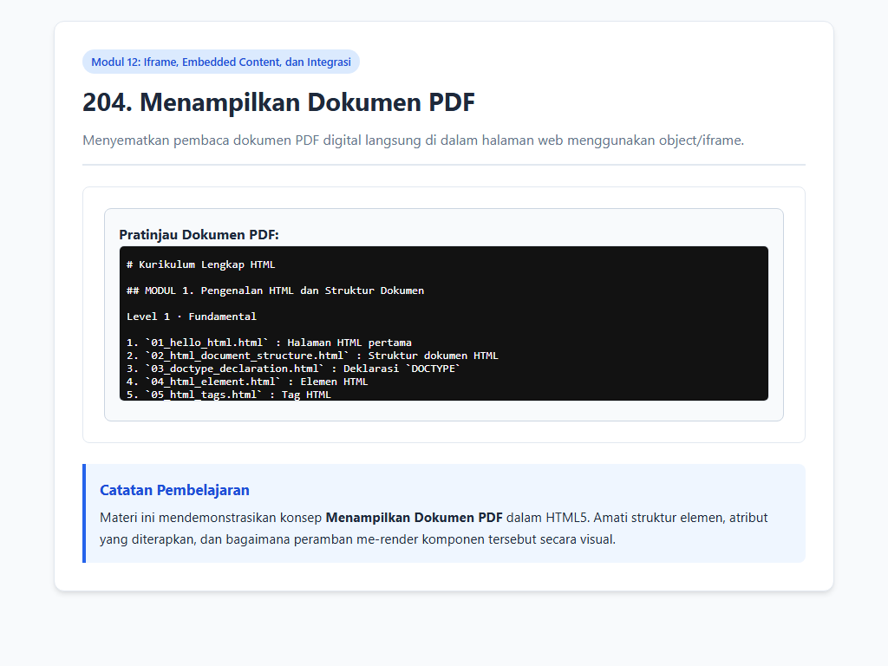

- **Lokasi Source Code:** [204_pdf_embed.html](204_pdf_embed.html)

---

### 10. Menyematkan SVG

- **Tujuan Pembelajaran:** Memilih cara terbaik menyematkan grafik vektor independen.
- **Konsep Utama:** Berbeda dengan tag img, penyematan SVG via <object> mempertahankan interaktivitas DOM di dalam berkas SVG.
- **Penjelasan Source Code:** Menampilkan grafis vektor SVG ungu yang disematkan melalui elemen object.
- **Cara Menjalankan:** Buka file `205_svg_embed.html` secara langsung di peramban web (Google Chrome, Mozilla Firefox, atau Microsoft Edge), atau jalankan ekstensi Live Server pada VS Code.
- **Hasil yang Diharapkan:** Lencana vektor SVG ungu dengan sudut melengkung halus.
- **Screenshot Hasil Eksekusi:**

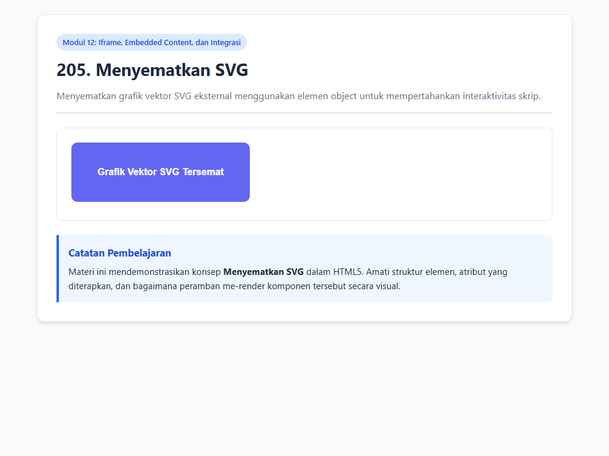

- **Lokasi Source Code:** [205_svg_embed.html](205_svg_embed.html)

---

### 11. Menyematkan Halaman Eksternal

- **Tujuan Pembelajaran:** Memahami mengapa beberapa domain luar menolak ditampilkan di dalam iframe.
- **Konsep Utama:** Kebijakan Same-Origin dan header keamanan HTTP membatasi izin penyematan antar-situs.
- **Penjelasan Source Code:** Menampilkan kartu edukasi mengenai proteksi clickjacking dan header X-Frame-Options.
- **Cara Menjalankan:** Buka file `206_external_page_embed.html` secara langsung di peramban web (Google Chrome, Mozilla Firefox, atau Microsoft Edge), atau jalankan ekstensi Live Server pada VS Code.
- **Hasil yang Diharapkan:** Kotak peringatan kuning hangat yang menjelaskan batasan keamanan iframe.
- **Screenshot Hasil Eksekusi:**

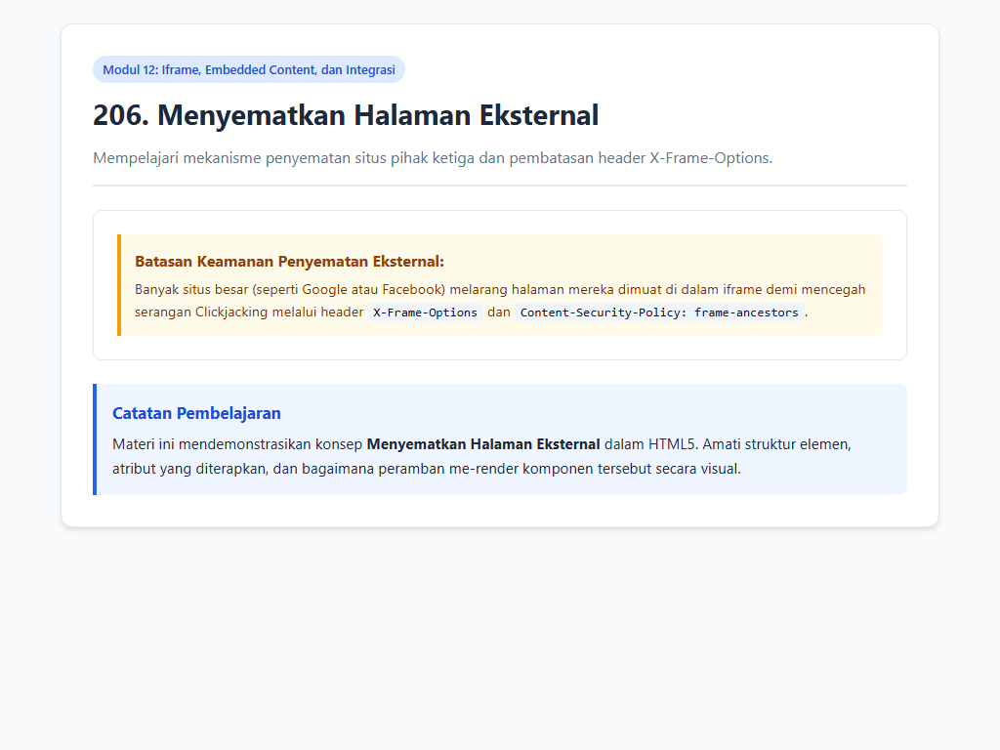

- **Lokasi Source Code:** [206_external_page_embed.html](206_external_page_embed.html)

---

### 12. Menyematkan Peta (Maps Embed)

- **Tujuan Pembelajaran:** Menerapkan penyematan peta digital interaktif pada halaman kontak atau profil perusahaan.
- **Konsep Utama:** Iframe peta menyediakan fitur zoom, drag, dan rute navigasi tanpa biaya komputasi backend.
- **Penjelasan Source Code:** Menampilkan komponen kartu peta dengan tajuk hitam dan bingkai peta terintegrasi.
- **Cara Menjalankan:** Buka file `207_google_maps_embed.html` secara langsung di peramban web (Google Chrome, Mozilla Firefox, atau Microsoft Edge), atau jalankan ekstensi Live Server pada VS Code.
- **Hasil yang Diharapkan:** Kartu penyematan peta berlatar header hitam dengan jendela peta interaktif.
- **Screenshot Hasil Eksekusi:**

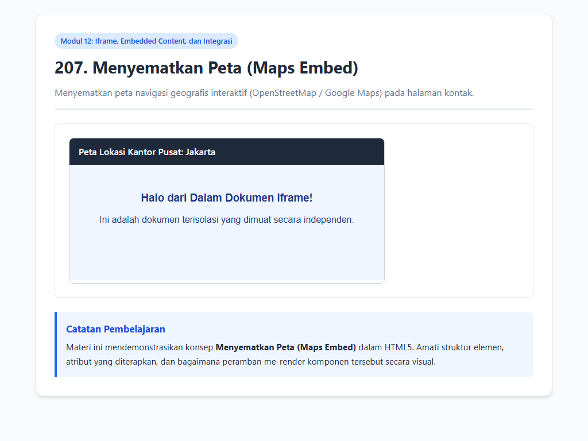

- **Lokasi Source Code:** [207_google_maps_embed.html](207_google_maps_embed.html)

---

### 13. Fallback Konten Iframe

- **Tujuan Pembelajaran:** Menyiapkan pesan cadangan yang elegan saat terjadi hambatan teknis render.
- **Konsep Utama:** Fallback teks di dalam tag <iframe> memastikan informasi tetap tersampaikan.
- **Penjelasan Source Code:** Menampilkan contoh penulisan fallback di dalam elemen iframe.
- **Cara Menjalankan:** Buka file `208_iframe_fallback.html` secara langsung di peramban web (Google Chrome, Mozilla Firefox, atau Microsoft Edge), atau jalankan ekstensi Live Server pada VS Code.
- **Hasil yang Diharapkan:** Bingkai iframe yang memiliki fallback teks alternatif di dalam tag.
- **Screenshot Hasil Eksekusi:**

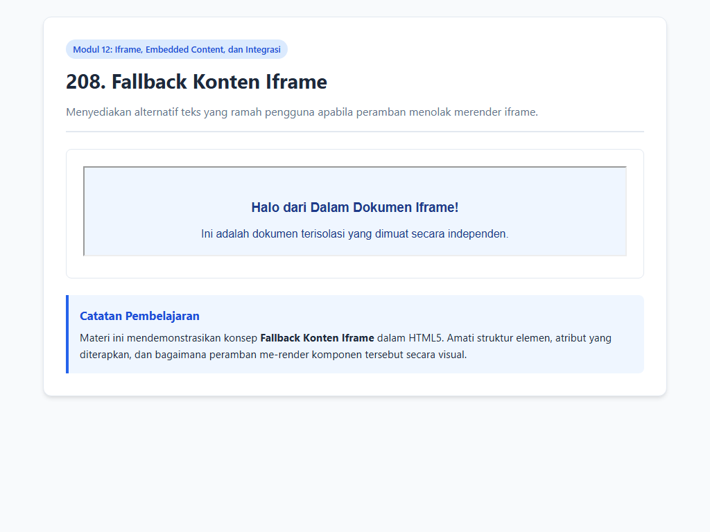

- **Lokasi Source Code:** [208_iframe_fallback.html](208_iframe_fallback.html)

---

### 14. Keamanan Embedded Content

- **Tujuan Pembelajaran:** Menguasai prinsip pertahanan berlapis pada penyematan konten pihak ketiga.
- **Konsep Utama:** Keamanan iframe mencegah penyerang memanfaatkan situs kita sebagai perantara kejahatan siber.
- **Penjelasan Source Code:** Menampilkan daftar checklist langkah pencegahan celah keamanan iframe.
- **Cara Menjalankan:** Buka file `209_embedded_content_security.html` secara langsung di peramban web (Google Chrome, Mozilla Firefox, atau Microsoft Edge), atau jalankan ekstensi Live Server pada VS Code.
- **Hasil yang Diharapkan:** Daftar panduan praktis keamanan embedded content.
- **Screenshot Hasil Eksekusi:**

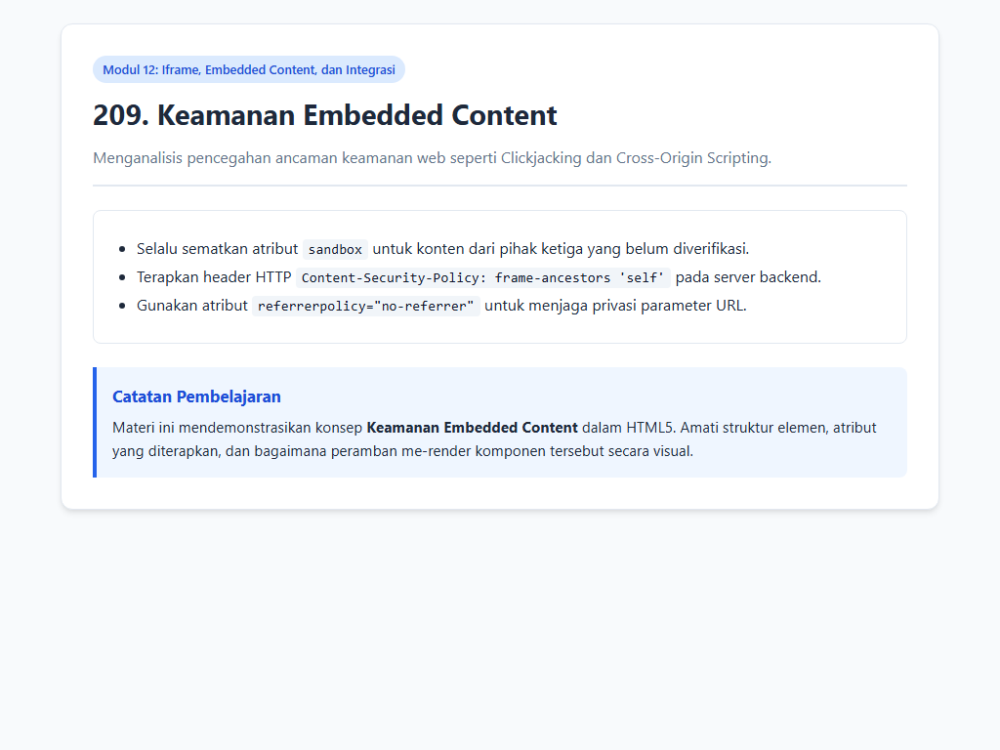

- **Lokasi Source Code:** [209_embedded_content_security.html](209_embedded_content_security.html)

---

### 15. Integrasi Iframe Responsif

- **Tujuan Pembelajaran:** Membuat kontainer iframe yang fleksibel mengikuti lebar layar tanpa distorsi rasio.
- **Konsep Utama:** Properti CSS aspect-ratio: 16/9 menyederhanakan teknik lama padding-bottom hack.
- **Penjelasan Source Code:** Menampilkan iframe berbingkai biru yang mempertahankan rasio 16:9 secara dinamis.
- **Cara Menjalankan:** Buka file `210_responsive_iframe.html` secara langsung di peramban web (Google Chrome, Mozilla Firefox, atau Microsoft Edge), atau jalankan ekstensi Live Server pada VS Code.
- **Hasil yang Diharapkan:** Bingkai iframe responsif berbingkai biru dengan rasio aspek 16:9 terkunci sempurna.
- **Screenshot Hasil Eksekusi:**

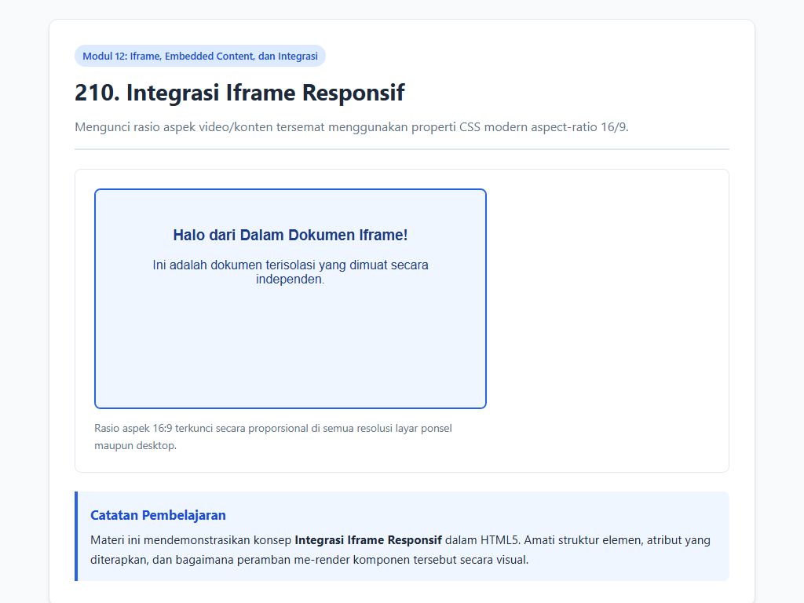

- **Lokasi Source Code:** [210_responsive_iframe.html](210_responsive_iframe.html)

---

## Ringkasan Modul
Modul 12 menyajikan pondasi penting mengenai Iframe, Embedded Content, dan Integrasi. Pemahaman menyeluruh terhadap submodul di atas menjadi prasyarat penting sebelum melangkah ke modul berikutnya.
