# Modul 17: Validasi, Performa, dan Kualitas HTML

## Ringkasan Ruang Lingkup Materi
Modul ini membahas konsep dasar dan implementasi praktis seputar **Validasi, Performa, dan Kualitas HTML**. Setiap submodul dirancang secara terisolasi agar pembelajar dapat memahami konsep satu per satu secara fokus dan terstruktur.

## Tujuan Pembelajaran Modul
Setelah menyelesaikan modul ini, peserta didik diharapkan mampu memahami, mengimplementasikan, dan menguji komponen-komponen utama dalam lingkup validasi, performa, dan kualitas html sesuai standar modern W3C.

## Daftar Materi atau Submodul

- [276_html_validation.html](276_html_validation.html) - Validasi Dokumen HTML
- [277_html_nesting_validation.html](277_html_nesting_validation.html) - Pemeriksaan Nested Elements
- [278_duplicate_id_validation.html](278_duplicate_id_validation.html) - Pemeriksaan ID Duplikat
- [279_required_attributes.html](279_required_attributes.html) - Pemeriksaan Atribut Wajib
- [280_semantic_validation.html](280_semantic_validation.html) - Pemeriksaan Semantik
- [281_html_document_language.html](281_html_document_language.html) - Pemeriksaan Bahasa Dokumen
- [282_html_metadata_validation.html](282_html_metadata_validation.html) - Pemeriksaan Metadata
- [283_html_link_validation.html](283_html_link_validation.html) - Pemeriksaan Hyperlink
- [284_html_image_validation.html](284_html_image_validation.html) - Pemeriksaan Gambar
- [285_html_form_validation.html](285_html_form_validation.html) - Pemeriksaan Struktur Formulir
- [286_html_accessibility_audit.html](286_html_accessibility_audit.html) - Audit Aksesibilitas
- [287_html_performance_basics.html](287_html_performance_basics.html) - Optimasi Performa HTML
- [288_html_resource_loading.html](288_html_resource_loading.html) - Pengelolaan Pemuatan Sumber Daya
- [289_html_security_attributes.html](289_html_security_attributes.html) - Atribut Keamanan HTML
- [290_html_best_practices.html](290_html_best_practices.html) - Praktik Terbaik Penulisan HTML

---

## Pembahasan Setiap Submodul

### 1. Validasi Dokumen HTML

- **Tujuan Pembelajaran:** Memahami kriteria validitas standar W3C pada dokumen web modern.
- **Konsep Utama:** Dokumen valid menjamin konsistensi tampilan di berbagai perangkat dan engine browser.
- **Penjelasan Source Code:** Menampilkan kartu panduan kepatuhan validasi dokumen bergaris tepi hijau.
- **Cara Menjalankan:** Buka file `276_html_validation.html` secara langsung di peramban web (Google Chrome, Mozilla Firefox, atau Microsoft Edge), atau jalankan ekstensi Live Server pada VS Code.
- **Hasil yang Diharapkan:** Kotak panduan kepatuhan standar W3C bernuansa hijau.
- **Screenshot Hasil Eksekusi:**

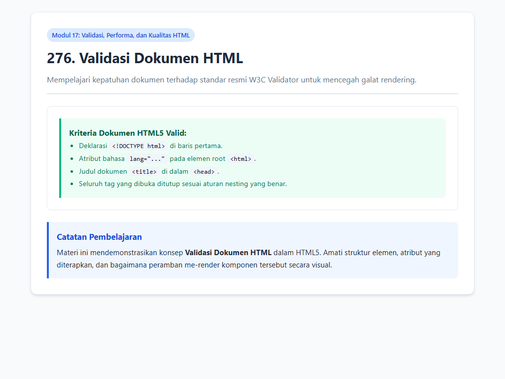

- **Lokasi Source Code:** [276_html_validation.html](276_html_validation.html)

---

### 2. Pemeriksaan Nested Elements

- **Tujuan Pembelajaran:** Mencegah kesalahan nesting elemen inline dan block-level.
- **Konsep Utama:** Penyarangan yang salah merusak struktur pohon DOM dan menyebabkan bug CSS yang sulit dilacak.
- **Penjelasan Source Code:** Menampilkan dua kotak perbandingan aturan penyarangan elemen.
- **Cara Menjalankan:** Buka file `277_html_nesting_validation.html` secara langsung di peramban web (Google Chrome, Mozilla Firefox, atau Microsoft Edge), atau jalankan ekstensi Live Server pada VS Code.
- **Hasil yang Diharapkan:** Dua kartu perbandingan pola nesting yang valid dan tidak valid.
- **Screenshot Hasil Eksekusi:**

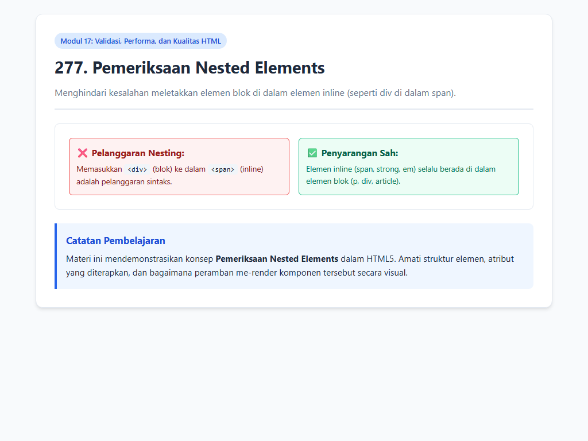

- **Lokasi Source Code:** [277_html_nesting_validation.html](277_html_nesting_validation.html)

---

### 3. Pemeriksaan ID Duplikat

- **Tujuan Pembelajaran:** Memahami mengapa nilai atribut ID harus unik mutlak di satu halaman.
- **Konsep Utama:** ID duplikat memicu kegagalan selektor JavaScript dan membatalkan aksesibilitas aria-labelledby.
- **Penjelasan Source Code:** Menampilkan penjelasan konsekuensi ID duplikat beserta solusinya.
- **Cara Menjalankan:** Buka file `278_duplicate_id_validation.html` secara langsung di peramban web (Google Chrome, Mozilla Firefox, atau Microsoft Edge), atau jalankan ekstensi Live Server pada VS Code.
- **Hasil yang Diharapkan:** Kotak penjelasan keunikan ID dan alternatif atribut class.
- **Screenshot Hasil Eksekusi:**

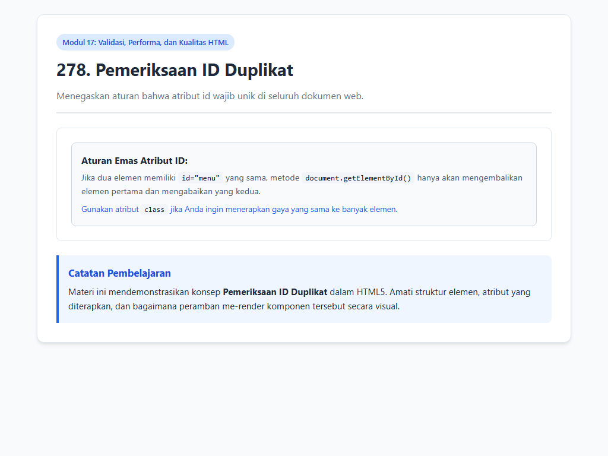

- **Lokasi Source Code:** [278_duplicate_id_validation.html](278_duplicate_id_validation.html)

---

### 4. Pemeriksaan Atribut Wajib

- **Tujuan Pembelajaran:** Mengingat daftar atribut esensial yang tidak boleh dilewatkan.
- **Konsep Utama:** Ketiadaan atribut wajib dapat membatalkan validitas W3C dan merusak aksesibilitas.
- **Penjelasan Source Code:** Menampilkan daftar elemen penting beserta atribut wajibnya.
- **Cara Menjalankan:** Buka file `279_required_attributes.html` secara langsung di peramban web (Google Chrome, Mozilla Firefox, atau Microsoft Edge), atau jalankan ekstensi Live Server pada VS Code.
- **Hasil yang Diharapkan:** Daftar checklist atribut wajib elemen HTML.
- **Screenshot Hasil Eksekusi:**

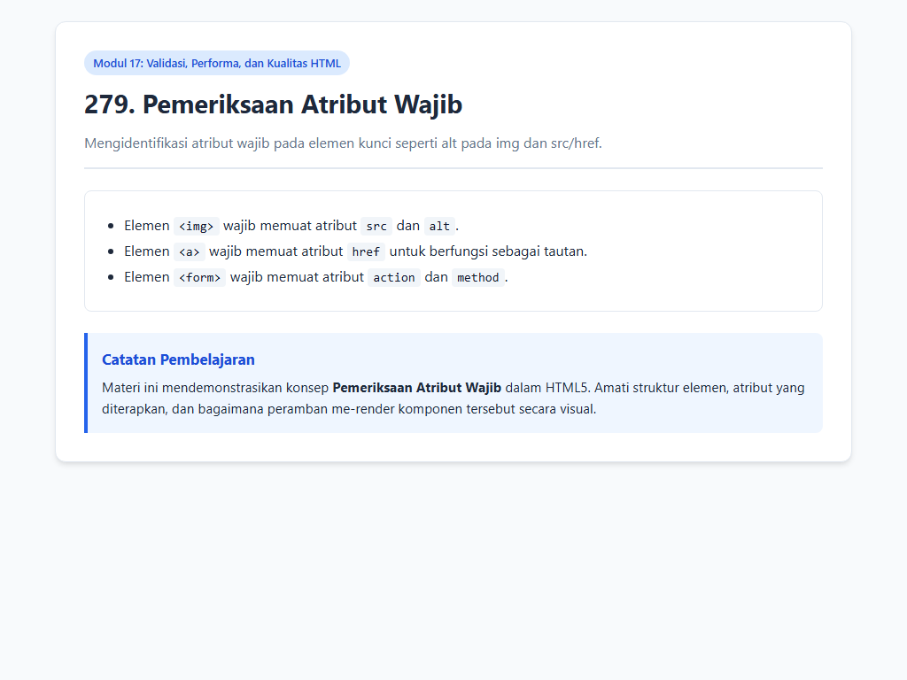

- **Lokasi Source Code:** [279_required_attributes.html](279_required_attributes.html)

---

### 5. Pemeriksaan Semantik

- **Tujuan Pembelajaran:** Menerapkan pemilihan elemen semantik secara presisi.
- **Konsep Utama:** Semantik yang tepat meningkatkan kecerdasan dokumen di mata peramban dan asisten virtual.
- **Penjelasan Source Code:** Menampilkan panduan praktis pemilihan tag semantik yang ideal.
- **Cara Menjalankan:** Buka file `280_semantic_validation.html` secara langsung di peramban web (Google Chrome, Mozilla Firefox, atau Microsoft Edge), atau jalankan ekstensi Live Server pada VS Code.
- **Hasil yang Diharapkan:** Tiga baris panduan praktis pemilihan tag semantik tepat.
- **Screenshot Hasil Eksekusi:**

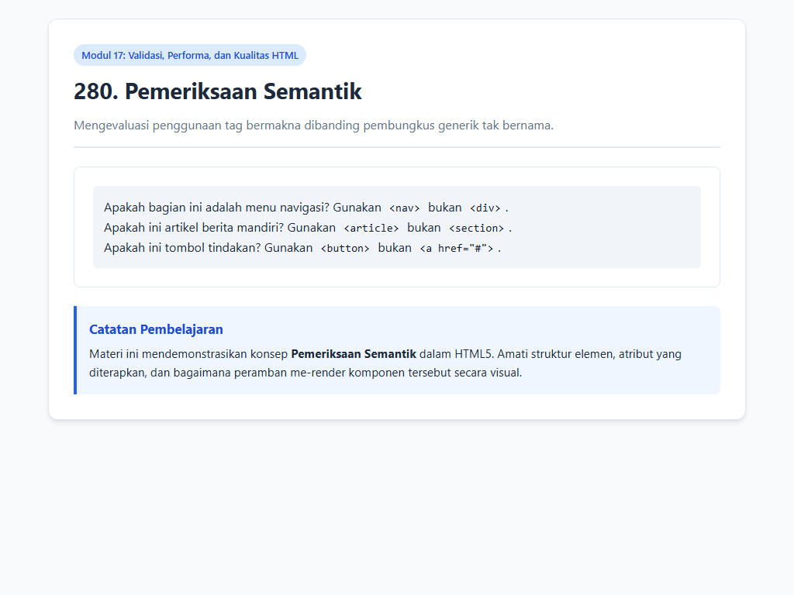

- **Lokasi Source Code:** [280_semantic_validation.html](280_semantic_validation.html)

---

### 6. Pemeriksaan Bahasa Dokumen

- **Tujuan Pembelajaran:** Memahami peran deklarasi bahasa dokumen pada level akar.
- **Konsep Utama:** Atribut lang memicu sintesis suara pembaca layar yang tepat serta penyesuaian tanda baca.
- **Penjelasan Source Code:** Menampilkan contoh penulisan deklarasi bahasa Indonesia pada tag html.
- **Cara Menjalankan:** Buka file `281_html_document_language.html` secara langsung di peramban web (Google Chrome, Mozilla Firefox, atau Microsoft Edge), atau jalankan ekstensi Live Server pada VS Code.
- **Hasil yang Diharapkan:** Kotak penjelasan penulisan atribut lang='id' pada elemen root.
- **Screenshot Hasil Eksekusi:**

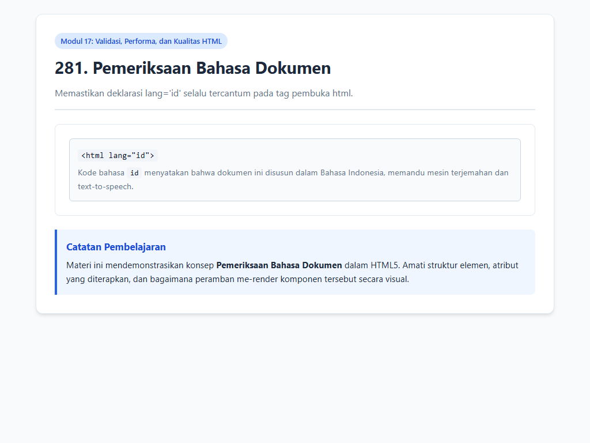

- **Lokasi Source Code:** [281_html_document_language.html](281_html_document_language.html)

---

### 7. Pemeriksaan Metadata

- **Tujuan Pembelajaran:** Memastikan kelengkapan metadata esensial pada setiap dokumen HTML.
- **Konsep Utama:** Metadata yang lengkap menjamin performa SEO maksimal dan rendering responsif bebas cacat.
- **Penjelasan Source Code:** Menampilkan daftar centang 4 meta tag pokok dalam head.
- **Cara Menjalankan:** Buka file `282_html_metadata_validation.html` secara langsung di peramban web (Google Chrome, Mozilla Firefox, atau Microsoft Edge), atau jalankan ekstensi Live Server pada VS Code.
- **Hasil yang Diharapkan:** Checklist metadata head dengan tanda centang rapi.
- **Screenshot Hasil Eksekusi:**

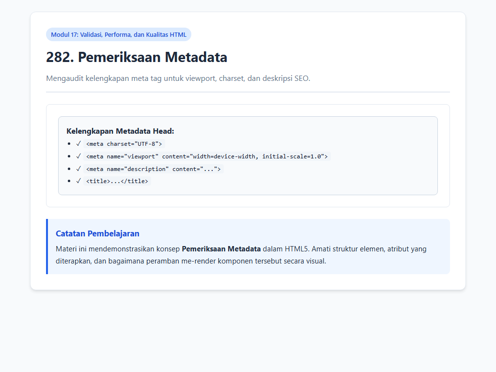

- **Lokasi Source Code:** [282_html_metadata_validation.html](282_html_metadata_validation.html)

---

### 8. Pemeriksaan Hyperlink

- **Tujuan Pembelajaran:** Mencegah tautan putus (broken link) dan celah keamanan tabnabbing.
- **Konsep Utama:** Pemeriksaan link secara berkala menjaga reputasi domain dan kepuasan pengunjung.
- **Penjelasan Source Code:** Menampilkan tautan aman dengan rel='noopener noreferrer'.
- **Cara Menjalankan:** Buka file `283_html_link_validation.html` secara langsung di peramban web (Google Chrome, Mozilla Firefox, atau Microsoft Edge), atau jalankan ekstensi Live Server pada VS Code.
- **Hasil yang Diharapkan:** Tautan biru terproteksi dengan keterangan pencegahan link putus.
- **Screenshot Hasil Eksekusi:**

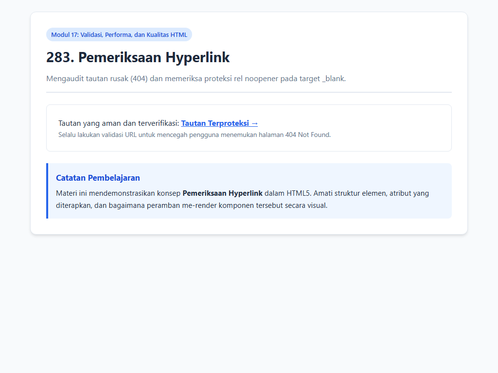

- **Lokasi Source Code:** [283_html_link_validation.html](283_html_link_validation.html)

---

### 9. Pemeriksaan Gambar

- **Tujuan Pembelajaran:** Melakukan audit kualitas dan performa aset grafis di halaman web.
- **Konsep Utama:** Optimasi gambar menyumbang peningkatan performa paling signifikan pada halaman web.
- **Penjelasan Source Code:** Menampilkan 4 pedoman penting audit gambar web.
- **Cara Menjalankan:** Buka file `284_html_image_validation.html` secara langsung di peramban web (Google Chrome, Mozilla Firefox, atau Microsoft Edge), atau jalankan ekstensi Live Server pada VS Code.
- **Hasil yang Diharapkan:** Daftar checklist audit mutu dan performa gambar.
- **Screenshot Hasil Eksekusi:**

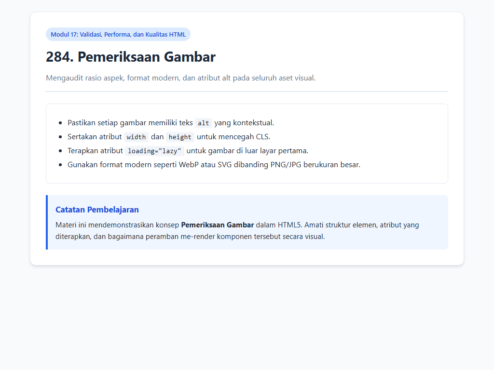

- **Lokasi Source Code:** [284_html_image_validation.html](284_html_image_validation.html)

---

### 10. Pemeriksaan Struktur Formulir

- **Tujuan Pembelajaran:** Memastikan seluruh formulir memenuhi standar semantik dan kemudahan isi.
- **Konsep Utama:** Formulir yang terstruktur dengan baik meningkatkan tingkat konversi dan meminimalkan kesalahan input.
- **Penjelasan Source Code:** Menampilkan formulir yang lolos audit struktur dan aksesibilitas.
- **Cara Menjalankan:** Buka file `285_html_form_validation.html` secara langsung di peramban web (Google Chrome, Mozilla Firefox, atau Microsoft Edge), atau jalankan ekstensi Live Server pada VS Code.
- **Hasil yang Diharapkan:** Formulir rapi berlabel lengkap dan tombol kirim biru.
- **Screenshot Hasil Eksekusi:**

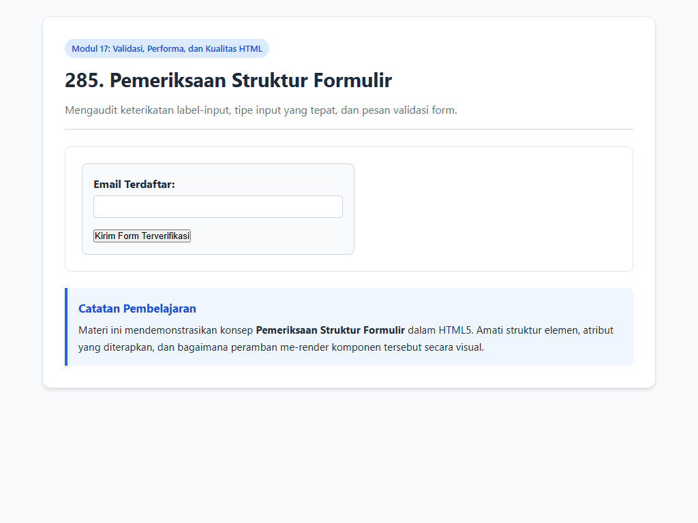

- **Lokasi Source Code:** [285_html_form_validation.html](285_html_form_validation.html)

---

### 11. Audit Aksesibilitas

- **Tujuan Pembelajaran:** Memahami proses audit aksesibilitas menggunakan automated tools dan pengujian manual.
- **Konsep Utama:** Situs dengan aksesibilitas tinggi terbukti lebih mudah dinavigasi oleh seluruh lapisan masyarakat.
- **Penjelasan Source Code:** Menampilkan kartu panduan audit skor aksesibilitas sempurna.
- **Cara Menjalankan:** Buka file `286_html_accessibility_audit.html` secara langsung di peramban web (Google Chrome, Mozilla Firefox, atau Microsoft Edge), atau jalankan ekstensi Live Server pada VS Code.
- **Hasil yang Diharapkan:** Kotak informasi evaluasi skor aksesibilitas web.
- **Screenshot Hasil Eksekusi:**

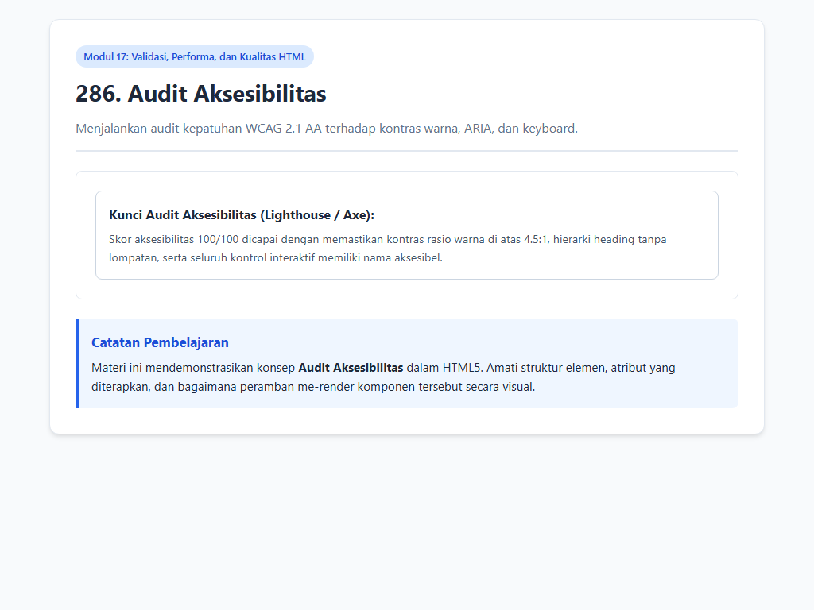

- **Lokasi Source Code:** [286_html_accessibility_audit.html](286_html_accessibility_audit.html)

---

### 12. Optimasi Performa HTML

- **Tujuan Pembelajaran:** Menyusun urutan tag dokumen untuk meminimalkan waktu rendering halaman.
- **Konsep Utama:** Urutan pemuatan yang benar menurunkan metrik FCP (First Contentful Paint) dan LCP.
- **Penjelasan Source Code:** Menampilkan panduan 3 langkah urutan pemuatan berkas tercepat.
- **Cara Menjalankan:** Buka file `287_html_performance_basics.html` secara langsung di peramban web (Google Chrome, Mozilla Firefox, atau Microsoft Edge), atau jalankan ekstensi Live Server pada VS Code.
- **Hasil yang Diharapkan:** Panduan langkah urutan pemuatan aset performa tinggi.
- **Screenshot Hasil Eksekusi:**

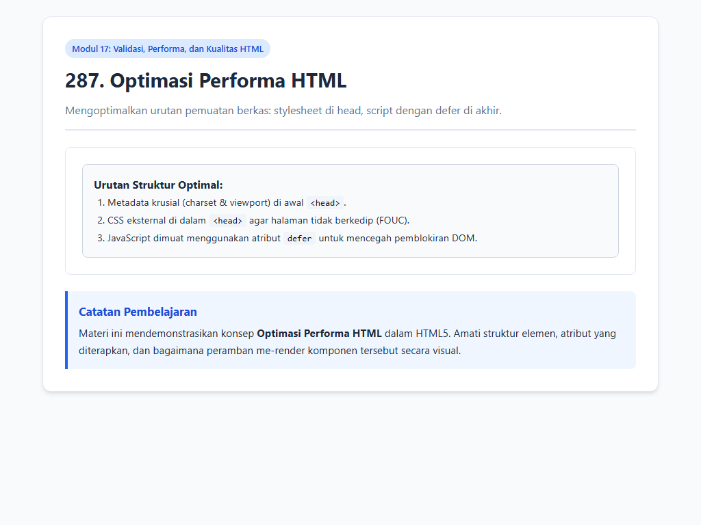

- **Lokasi Source Code:** [287_html_performance_basics.html](287_html_performance_basics.html)

---

### 13. Pengelolaan Pemuatan Sumber Daya

- **Tujuan Pembelajaran:** Menguasai teknik Resource Hints untuk mengoptimalkan koneksi jaringan peramban.
- **Konsep Utama:** Preconnect menyiapkan koneksi TCP/TLS lebih awal, preload memprioritaskan font krusial.
- **Penjelasan Source Code:** Menampilkan blok kode konfigurasi rel preconnect, preload, dan prefetch.
- **Cara Menjalankan:** Buka file `288_html_resource_loading.html` secara langsung di peramban web (Google Chrome, Mozilla Firefox, atau Microsoft Edge), atau jalankan ekstensi Live Server pada VS Code.
- **Hasil yang Diharapkan:** Blok kode sintaks resource hints performa jaringan.
- **Screenshot Hasil Eksekusi:**

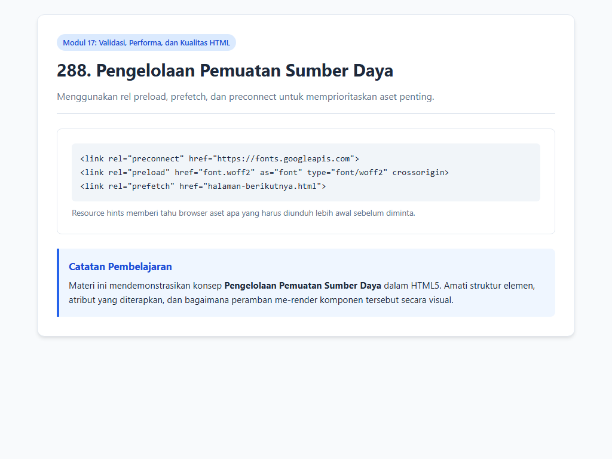

- **Lokasi Source Code:** [288_html_resource_loading.html](288_html_resource_loading.html)

---

### 14. Atribut Keamanan HTML

- **Tujuan Pembelajaran:** Menerapkan pertahanan keamanan siber pada level penulisan markup HTML.
- **Konsep Utama:** Atribut keamanan menangkal serangan reverse tabnabbing, clickjacking, dan script injection.
- **Penjelasan Source Code:** Menampilkan kartu peringatan merah berisi tiga langkah proteksi keamanan markup.
- **Cara Menjalankan:** Buka file `289_html_security_attributes.html` secara langsung di peramban web (Google Chrome, Mozilla Firefox, atau Microsoft Edge), atau jalankan ekstensi Live Server pada VS Code.
- **Hasil yang Diharapkan:** Kotak trio keamanan HTML bergaris batas merah tegas.
- **Screenshot Hasil Eksekusi:**

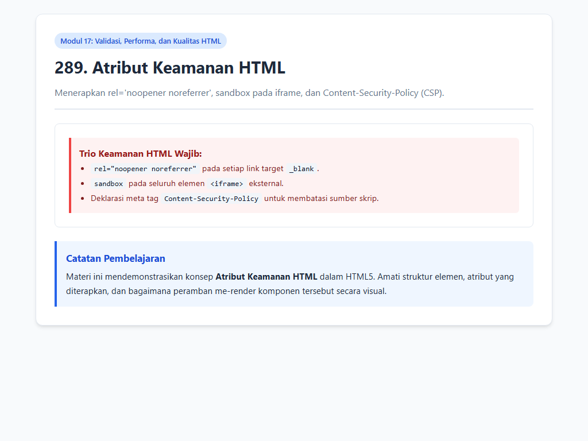

- **Lokasi Source Code:** [289_html_security_attributes.html](289_html_security_attributes.html)

---

### 15. Praktik Terbaik Penulisan HTML

- **Tujuan Pembelajaran:** Mengadopsi standar clean code dan etika rekayasa web profesional.
- **Konsep Utama:** Menulis markup yang bersih mempermudah kolaborasi tim dan menjamin umur panjang kode.
- **Penjelasan Source Code:** Menampilkan 5 pedoman clean code HTML standar software engineering.
- **Cara Menjalankan:** Buka file `290_html_best_practices.html` secara langsung di peramban web (Google Chrome, Mozilla Firefox, atau Microsoft Edge), atau jalankan ekstensi Live Server pada VS Code.
- **Hasil yang Diharapkan:** Kartu rangkuman pedoman clean code HTML bernuansa hijau cerah.
- **Screenshot Hasil Eksekusi:**

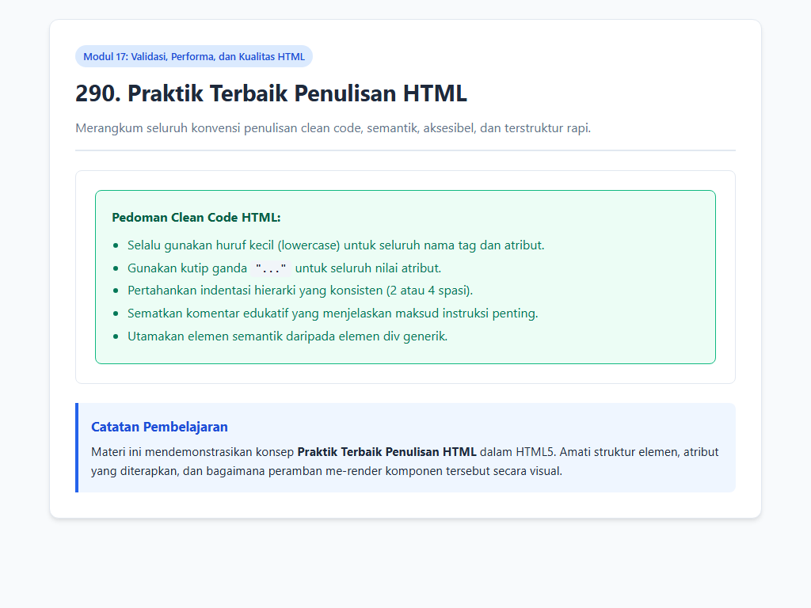

- **Lokasi Source Code:** [290_html_best_practices.html](290_html_best_practices.html)

---

## Ringkasan Modul
Modul 17 menyajikan pondasi penting mengenai Validasi, Performa, dan Kualitas HTML. Pemahaman menyeluruh terhadap submodul di atas menjadi prasyarat penting sebelum melangkah ke modul berikutnya.
